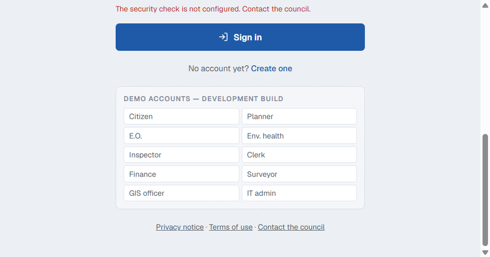
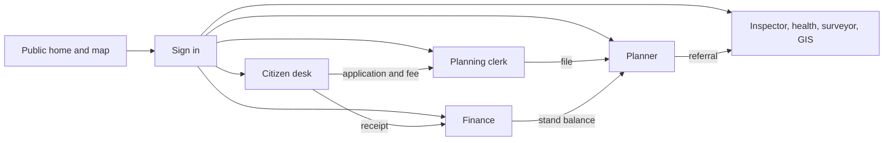
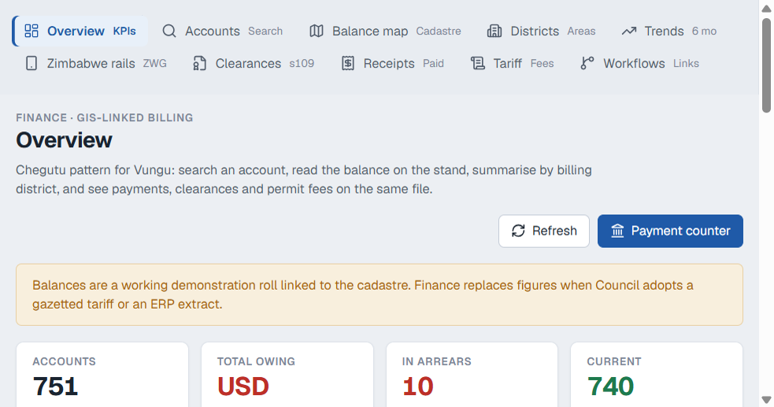
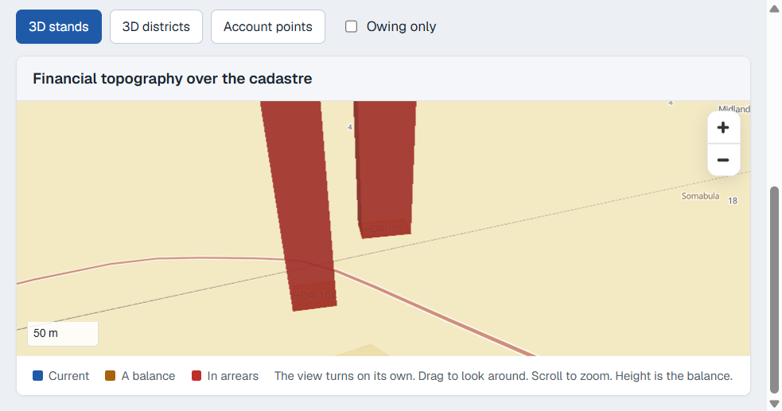

# LAMIS

Land administration for Vungu Rural District Council. One register holds the planning file, the rates account, the inspection, and the map, and each officer sees only their own desk.

The public demo is [spartialiq.onrender.com](https://spartialiq.onrender.com). The free host sleeps after a quiet period, so the first open can take up to a minute.

## What is in this repository

```
backend/      Fastify API, PostGIS migrations, finance and statutory registers
frontend/     Vue portal used by residents and council staff
mobile/       Field app
pos/          Point of sale
docs/         Manuals, reports, and the pictures in this readme
scripts/      Document and maintenance scripts
installers/   Desktop setup and Android package
data/spatial  Council master-plan package
```

`Dockerfile` builds the portal and the API as one web service.

## What has been done

- Residents can lodge a development application and see only their own files. Staff see the shared queue.
- The planning counter, the planner, the executive officer, environmental health, the building inspector, the surveyor, and the GIS officer each have a desk.
- Finance is linked to the cadastre: 751 demonstration accounts, balances drawn as 3D columns on the stand, section 109 clearances, numbered receipts, and a working fee schedule.
- Zimbabwe payment rails are on the finance desk. Cash at the council office issues a receipt. EcoCash, OneMoney, InnBucks, Zimswitch, ZIPIT, RTGS, and Paynow are shown and waiting for merchant keys.
- Statutory registers cover by-laws, the annual district plan, compulsory acquisition, rates clearance, and expense recovery.
- The map is PostGIS. Wards, parcels, buildings, roads, and land use are layers, not a pasted picture.

The rates and the USD/ZWG figure on screen are a working demonstration. Finance replaces them with the gazetted tariff and the day's rate before a bill is quoted.

## Sign in

On the hosted demo the password for every chip is `demo1234`.

| Chip | Account | Lands on |
|---|---|---|
| Citizen | demo.viewer@vungu.test | Citizen services |
| Planner | demo.planner@vungu.test | Town planning |
| E.O. | demo.eo@vungu.test | Executive officer |
| Env. health | demo.envoffice@vungu.test | Environmental health |
| Inspector | demo.inspector@vungu.test | Building inspector |
| Clerk | demo.clerk@vungu.test | Planning counter |
| Finance | demo.finance@vungu.test | Finance |
| Surveyor | demo.surveyor@vungu.test | Survey |
| GIS officer | demo.gis@vungu.test | GIS |
| IT admin | demo.admin@vungu.test | Users |



## How you move through it



A resident lodges the file. The clerk finds it by stand number. The planner reviews it. Finance reads the balance on that same stand and will not clear it while money is owing.

## Public site

No account is required.

- Home, with live district figures from the database
- Apply for a permit, a stand, or building-plan approval
- Pay council fees
- Map explorer: wards, roads, buildings, land use
- Council department pages and contact

## Citizen desk

Home, reception, new application, my applications, map, documents, public notices, payments, inspections, certificates, rates clearance, appeals, report a building, service requests, profile, and reference.

The demonstration file is **Citizen Smoke**, stand **CIT-SMK-1**, a new building.

## Finance

Open **Finance** after signing in. The rail runs left to right:

| Screen | What it shows |
|---|---|
| Overview | 751 accounts, amount owing, arrears, valuation roll, district bars |
| Accounts | Search by account, stand, or holder. Open **HDR-105** |
| Balance map | 3D stands, 3D districts, or account points. Height is the balance |
| Districts | 29 billing districts. Layout high-density is the largest |
| Trends | Six months, billed against collected |
| Zimbabwe rails | Working rate, ZWG book, EcoCash `*151#`, OneMoney `*111#`, and the cash office |
| Clearances | Section 109. Do not issue a certificate while the stand still owes |
| Receipts | VRDC receipt numbers, including application fees and property searches |
| Tariff | Working schedule: clearance, search, shop licence, market stall |
| Workflows | Every account linked to a parcel, and the planning fee on the same file |



Stand **HDR-105**, account **VRDC-LAYOUT-HDR-105**, parcel **P-0000746**, is the tall column. The demonstration balance is **USD 487.28**. The holder on the file is Hdr Holder HDR-105.



## Other desks

- **Clerk.** Dashboard, find a file, take an application, development matrix, statutory clocks, document check, public inspection, acknowledgements, notices, refusals, the development register, correspondence, the cashbook, file movement, permit dispatch, enforcement, and appeals.
- **Planner.** The staff case list. **PLN-SMK-1** is a new building under review. **SRV-SMK-1** in Ward 4, Lalapanzi, is a subdivision.
- **Executive officer.** The same cases, for what is late and what is ready for committee.
- **Environmental health.** Premises inspections, notices, and surveillance. A planning file can be referred here.
- **Building inspector.** Stages, bookings, enforcement, and complaints after a plan is approved.
- **Surveyor.** Diagrams and the subdivision file.
- **GIS officer.** The layers everyone else is reading.
- **IT admin.** Issues the accounts. Does not decide an application or edit a rates balance.

## Run it locally

PostgreSQL with PostGIS, then the API and the portal:

```
cd backend && npm install && node server.js
cd frontend && npm install && npm run dev
```

The API listens on port 3000. The portal listens on port 5174 and proxies `/api`.
