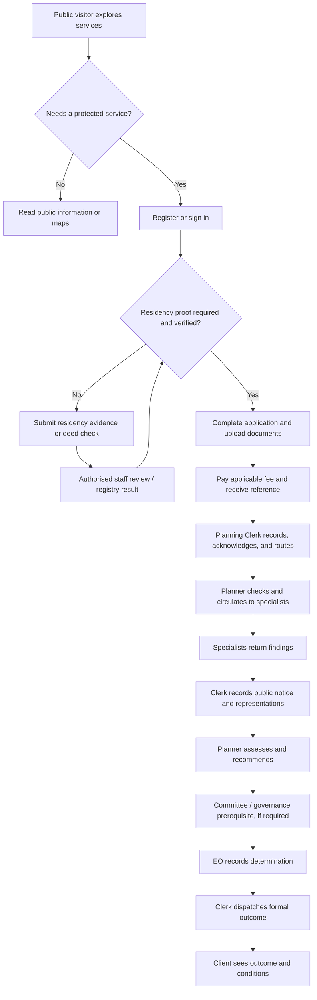
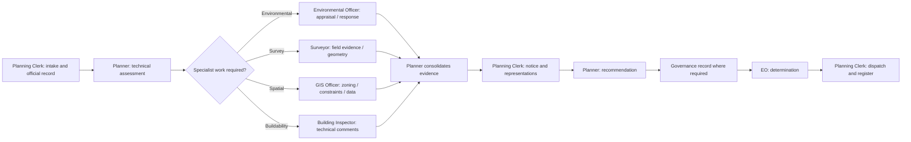
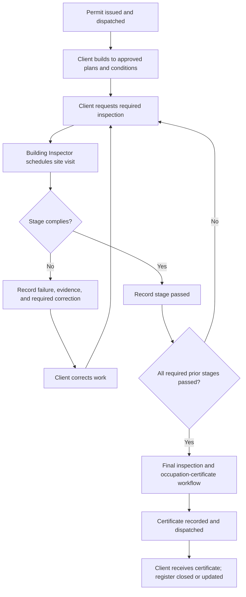
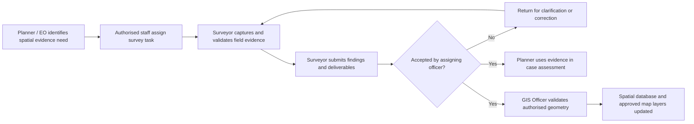
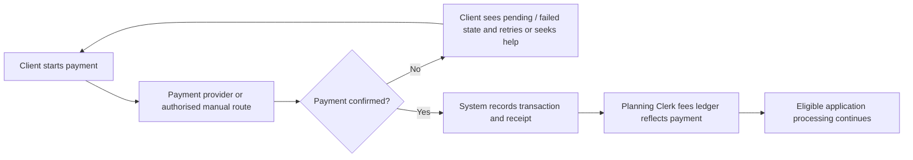

# Vungu RDC System Use Cases by Actor

## Purpose and scope

This document explains how each person or user category works with the Vungu Rural District Council information system. It separates **internal council operations**, where council staff process records and make or support decisions, from **external operations**, where residents, landowners, businesses, applicants, and other clients use public services. The system connects the two through controlled records, assigned work, decisions, notices, payments, and status updates.

The descriptions below are written from the roles and workflows present in the project. A role is a system account category; it does not mean that the software replaces the authority, legal responsibility, or professional judgment of the person holding that role. Some governance participants, such as committee members and a Director of Planning, appear in statutory workflow concepts but are not currently issuable application roles. They are described as process participants where relevant, not as active portal actors. The code taxonomy identifies `admin`, `planner`, `eo`, `env_officer`, `building_inspector`, `planning_clerk`, `surveyor`, `gis_officer`, `viewer`, `registered`, and `public` as active account roles.

## Actor map

| Operating boundary | Actor / account role | Main system responsibility |
|---|---|---|
| External | Public visitor (`public`) | Browse public information and services; create or begin an account/application where enabled |
| External | Registered applicant (`registered`) | Maintain an account and submit or follow their council service requests |
| External | Viewer (`viewer`) | Read permitted public or shared information without the full registered-applicant workflow |
| External | Citizen / client (person using a citizen-tier account) | Prove residency when required, apply, upload, pay, communicate, and track outcomes |
| Internal | Planning Clerk (`planning_clerk`) | Intake, records, fees, notices, registers, document handling, and dispatch |
| Internal | Planner (`planner`) | Development assessment, due diligence, technical circulation, land-use planning, and recommendations |
| Internal | Environmental Officer (`env_officer`) | Environmental appraisal, inspections, surveillance, and specialist responses |
| Internal | Surveyor (`surveyor`) | Assigned field survey, spatial measurements, beacons, survey findings, and plans |
| Internal | GIS Officer (`gis_officer`) | Authoritative spatial data, zoning and constraints, map publication, and GIS coordination |
| Internal | Executive Officer (`eo`) | Statutory review and determination within the configured decision controls |
| Internal | Building Inspector (`building_inspector`) | Construction-stage inspections, compliance records, and occupation-certificate workflow |
| Internal | System Administrator (`admin`) | User access, configuration, support, and system governance; operational access is bounded by specific controls |

## External operations: clients and the public

### Public visitor (`public`)

A public visitor is a person who has not yet completed the account or residency steps needed for a full client workflow. The public-facing system gives this person a starting point for understanding council services, finding public information, registering or logging in, and beginning a service request where the relevant route is available. Public information includes service descriptions and permitted map or layer information; it does not expose private application records, internal comments, personal details, or staff work queues. If the person proceeds to a service that requires an identity or district-residency check, the system directs them into the appropriate account and evidence process. Their use case is therefore discovery and entry: understand what the council offers, provide the minimum information needed to establish an account, and move into a protected client space before submitting sensitive material. The public visitor does not make council decisions, verify another person's evidence, or alter official land or permit records. Once authenticated, their practical actor category becomes registered applicant or citizen/client, depending on the account status and service.

### Registered applicant (`registered`)

A registered applicant is an external user with an account who can carry out the client-side steps made available by the portal. They use their account to maintain contact and identity information, start and submit applications, upload plans and supporting documents, arrange payment, review receipts, respond to requests for more information, and follow the progress of their own cases. Where residency verification applies, an unverified account must provide acceptable proof or complete the available deed-check process before relying on services restricted to verified residents. After submission, the application becomes an official work item for council staff; the applicant can see the permitted status and next-step information, while internal recommendations and restricted staff notes remain internal. A registered applicant is responsible for the accuracy and completeness of submitted information and for responding to notices or document requests. The system provides a traceable communication and status channel, but the applicant does not route cases between council departments or grant themselves a permit. Their interaction ends with a recorded council outcome, delivery of the permitted documents or service, and any follow-up obligations such as construction inspections.

### Viewer (`viewer`)

The viewer role supports read-only access to information that the system permits the account to see. The use case is to inspect public-facing information, maps, service guidance, or shared records without the authority to submit or manage the full client application workflow. A viewer can use the information to understand the district, locate relevant public data, or review a service before deciding whether to register. The role is deliberately different from an internal staff role: it does not confer permission to edit authoritative GIS layers, update a permit, access another applicant's private file, record an inspection, or issue a decision. If a viewer needs to transact with council, they must use the registration and application path and satisfy any identity or residency requirements for that service. This separation lets the council provide useful information while keeping personal and operational records within authenticated, role-appropriate workspaces.

### Citizen / client (resident, landowner, business, or representative)

The citizen/client is the main external service user, whether the underlying account is public or registered. Depending on the service, a client may act as an owner, occupier, business, applicant, or authorised representative. The client begins by selecting the service, completing the requested application fields, identifying the relevant property or stand, attaching plans and evidence, and submitting the request. For residency-controlled services, the client supplies a deed reference for a logged registry check or uploads acceptable proof such as an occupation certificate, lodger's permit, settlement or offer letter, rates or utility statement, or confirmation letter. The client pays applicable fees through an available payment route and keeps the receipt and reference. During processing, the client uses the application timeline to see the current stage and may answer a request for more information, review a notice, or lodge a permitted objection or appeal. If a development permit is approved, the client follows its conditions, requests inspections at the required stages, and receives the occupation certificate only after the applicable inspection process is complete. The portal gives the client a clear view of their own case, but statutory assessment, internal circulation, and decision authority remain with council officers and configured governance steps.

## Internal operations: council staff

### Planning Clerk (`planning_clerk`)

The Planning Clerk is the administrative custodian of the development-management record from intake through outward correspondence and register maintenance. When a client submits a request, the clerk checks that the submission has arrived, records and acknowledges receipt, assigns or confirms the official reference, and identifies missing administrative items for follow-up. The clerk maintains the fee and payment record, reconciles receipts, keeps the statutory and development registers current, and ensures that notices and case documents are filed against the correct application. At the public-notice stage, the clerk prepares or records the notice, observes the objection period, attaches received representations to the case, and routes those records to the responsible planner. Once a decision is ready, the clerk supports preparation and dispatch of the permit, refusal, request, or other formal correspondence and records when it was sent. The clerk may handle residency-document queues and administrative checks where the configured access allows it, but this does not turn the clerk into the statutory decision-maker or technical assessor. Their central use case is continuity and auditability: every incoming item is receipted, every outgoing item is traceable, and the official file shows what is awaiting action and which office owns the next step.

### Planner (`planner`)

The Planner owns the technical planning assessment of development and land-use cases. They review the submitted proposal against applicable plans, zoning, site context, policy and statutory requirements; identify deficiencies; and record the case analysis and recommendation. Where more expertise is needed, the planner creates and coordinates technical circulation to the Environmental Officer, Surveyor, GIS Officer, Building Inspector, and other relevant bodies. The planner reads the responses together, resolves questions with the applicant through formal requests where needed, evaluates representations received during public notice, and develops the recommendation for the configured committee and Executive Officer process. For subdivision, consolidation, and stand-layout work, the planner uses Planning Studio or a supported GIS/CAD exchange, validates the resulting lots and roads, and coordinates survey pegging and GIS updates. The planner can return work for correction, track dependencies, and keep the application status aligned with the actual case stage. The planner's records provide the reasoned technical basis for the next authority; the planner's recommendation is not itself the final statutory determination where the workflow reserves that determination to the EO or other governance step.

### Environmental Officer (`env_officer`)

The Environmental Officer contributes specialist environmental judgment to applications and council operations. On receiving a circulated case, the officer reviews the proposal, site context, supporting material, and relevant environmental constraints, then records an appraisal, requested mitigation, conditions, or a reasoned response for the planner and decision file. The officer may conduct environmental inspections or surveillance connected to a site, record observations and evidence, identify non-compliance, and recommend follow-up action. The case record should connect each response to the application or property so it can be considered alongside planning, survey, GIS, and building comments. The officer's use case is to ensure that environmental effects and obligations are not lost inside the general planning review: advice is recorded, conditions can be considered before a decision, and later monitoring can refer back to the approved proposal. The officer does not issue the development permit solely by virtue of this role; the environmental response informs the authorised decision-maker and becomes part of the auditable case history.

### Surveyor (`surveyor`)

The Surveyor performs assigned ground-truth and cadastral or engineering survey work needed to establish reliable site and boundary information. A planner, EO, clerk, or other permitted assigner creates a survey task with a case, property, purpose, and requested deliverable. The Surveyor reviews the task, plans field work, captures relevant beacons, control points, traverses, measurements, and site observations, and checks geometry and area calculations. They prepare the appropriate survey findings and outputs, such as a Report on Survey, diagram, GeoPDF or DXF, or supporting certificate where applicable. Findings are submitted to the assigning officer, who can accept them, ask for clarification or correction, or cancel the task with a recorded reason. Accepted geometry and documents inform the planning case and, where approved, the spatial record; the surveyor does not independently make the planning decision or assign official stand numbers outside the controlled allocation process. Their main contribution is defensible spatial evidence that allows staff and clients to act on the same measured understanding of the property.

### GIS Officer (`gis_officer`)

The GIS Officer maintains and publishes the council's authoritative spatial information used by planning staff, service users, and connected GIS tools. Their work includes validating parcel and stand geometry, managing zoning and environmental-constraint layers, supporting abutting-owner or location analysis, maintaining spatial database quality, and coordinating the connection between the web map, QGIS Server, and desktop GIS. When a planning or survey change is authorised, the GIS Officer checks that the submitted geometry is valid, correctly attributed, and consistent with authoritative identifiers before updating or publishing it. They also govern map symbology through the versioned style workflow so that published web and GIS views use consistent visual meanings. The officer may provide a spatial due-diligence response to a particular case, but map data is not a substitute for a statutory planning determination or a field survey where one is required. Their use case is to give council operations a reliable, shared spatial reference and to make approved public-facing geographic information understandable without exposing restricted owner or applicant information.

### Executive Officer (`eo`)

The Executive Officer (EO) is the senior statutory decision actor represented in the development-permit workflow. The EO reviews the complete case file, including the planner's assessment, technical responses, public representations, committee or agenda record where required, payment and process prerequisites, and any conditions proposed. The configured decision action records an outcome such as approval, approval with conditions, refusal, deferral, or a return for further work, with reasons and conditions attached to the official case. Decision controls are intended to prevent an outcome from being recorded when required governance evidence, such as a committee resolution, is absent. The EO may also oversee technical circulation, due diligence, committee reporting, and enforcement decisions according to the permissions and modules available. Once the determination is recorded, the clerk handles formal dispatch and the client is informed through the external case view. The EO's use case is accountable determination: review the record as a whole, exercise the designated authority, document the reasons, and ensure that resulting conditions or follow-up actions can be traced.

### Building Inspector (`building_inspector`)

The Building Inspector protects public safety and verifies construction compliance after the relevant permit has been issued. The client or authorised workflow requests an inspection at the appropriate stage; the inspector reviews the permitted plans and conditions, schedules or reschedules the visit, attends the site, records observations, captures supporting photographs or evidence, and marks checklist items as passed, failed, or requiring correction. The system maintains stage history and prevents later certification from bypassing required earlier stages. The inspector communicates deficiencies and the next action to the client through the permitted case channel, then re-inspects when corrections are reported. Once all required inspection stages pass, the occupation-certificate process can proceed and the final certificate is recorded and dispatched. The inspector may also identify unauthorised work or enforcement concerns and route them into the appropriate enforcement record. The inspector's findings relate to observed work and approved requirements; changes to the planning permission itself remain with the authorised planning decision process.

### System Administrator (`admin`)

The System Administrator keeps the application available, secure, and correctly configured for council operations. Their principal use cases include managing user accounts and invitations, assigning approved access roles, supporting account recovery, maintaining system content and configuration, monitoring operational health, and administering technical integration or map-style settings where permitted. Because this role has broad technical access, changes should be attributable and limited to the administrative purpose; the role is not a substitute for a Planner, EO, Surveyor, or Inspector and does not itself create technical or statutory authority. The current project explicitly treats `admin` as an IT role and route-level controls block administrative accounts from certain planning actions, although some individual staff views allow admin oversight or support. The administrator therefore enables authorised people to do their jobs, protects the integrity and availability of the service, and escalates case decisions to the responsible professional role. Any exceptional support action affecting a live case should retain a clear audit trail and respect the applicable business approval.

### Committee and governance participants (workflow participants, not active account roles)

Committee members, a committee chair, and a Director of Planning may be involved in statutory review, quorum, resolution, or recommendation steps represented by the application workflow. They are not part of the current active role taxonomy, so this document does not imply that each has a separate login or portal. Where a committee resolution is required, authorised staff record or verify the governance evidence through the configured process, and the system uses that evidence as a prerequisite to the EO decision. The use case for these participants is collective consideration and accountable resolution: review the material placed before the committee, record the result through the council's authorised procedure, and ensure the case file contains enough evidence for the decision stage. Future implementation of individual accounts for these participants would require matching backend role issuance, route permissions, and audit controls.

## Cross-system flowcharts

### External client to council determination

### Internal council application processing

### Permit, construction inspections, and close-out

### Survey and spatial-data handoff

### Payments and receipts

## Main use-case catalogue

| Use case | Primary actors | Result |
|---|---|---|
| Discover council services and public maps | Public visitor, viewer | Client understands available information and services |
| Create account and verify residency | Citizen/client; authorised reviewing staff; registry interface | Account/residency state supports eligible service access |
| Submit development application | Citizen/client, Planning Clerk | Referenced and receipted case enters the council workflow |
| Assess development proposal | Planner, specialist officers, EO | Reasoned recommendation and recorded statutory outcome |
| Publish notice and process representations | Planning Clerk, Planner, public/client | Notice period and received representations become part of the file |
| Pay application fees | Citizen/client, payment service, Planning Clerk | Transaction and receipt are recorded and reconciled |
| Subdivide or consolidate land | Planner, GIS Officer, Surveyor | Validated proposed spatial arrangement and related records |
| Complete survey task | Surveyor, assigning officer, Planner/GIS Officer | Accepted measurements, findings, and spatial deliverables |
| Inspect construction and issue occupation certificate | Client, Building Inspector, Planning Clerk | Passed inspection history and final certificate where eligible |
| Record environmental appraisal or surveillance | Environmental Officer, Planner, EO | Environmental findings and follow-up are attached to the case/site |
| Maintain GIS data and published styles | GIS Officer, Planner, Administrator (technical support) | Consistent authoritative spatial records and map presentation |
| Maintain users and system configuration | System Administrator | Correctly provisioned access and reliable system operation |
| Record governance prerequisite and determination | Governance participants through configured process; EO | Auditable resolution evidence and authorised case outcome |

## Important interpretation notes

1. Internal means the council's protected operational workflow; it does not mean that every record is visible to every staff member. Access remains role- and route-controlled.
2. External operations include clients and other public users. The client sees their own permitted case status, receipts, notices, and outcomes; internal technical notes and restricted personal records are not general public information.
3. A system role describes available application permissions. It does not, by itself, create legal authority beyond the user's actual appointment and applicable council procedures.
4. Governance roles shown as workflow participants are not currently active user roles according to the frontend role taxonomy. Treat their portal capabilities as future or separately configured until backend role issuance and access controls exist.
5. The application lifecycle and the construction-inspection lifecycle are connected in the user journey but have separate records and status transitions. A permit decision is not the same event as passing an inspection or issuing an occupation certificate.

## Project references

- `docs/USE_CASES.md` — existing use-case and document-routing notes.
- `docs/COUNCIL_OPERATIONS_FLOW.md` — detailed operational flow and role capability matrix.
- `frontend/src/services/types.ts` — active frontend role taxonomy and role notes.
- `frontend/src/router/index.ts` — route access declarations for role workspaces.
