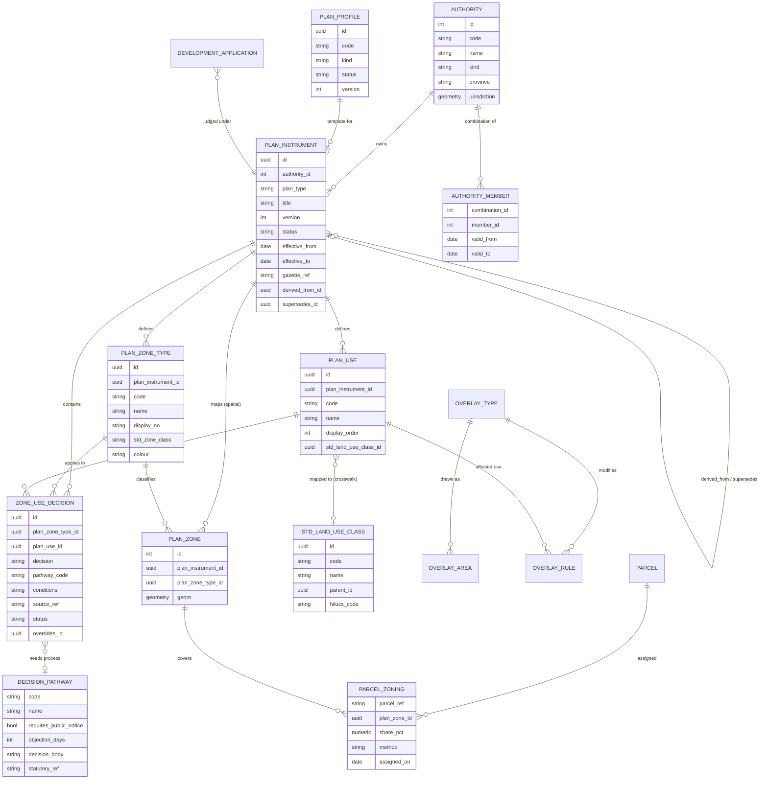

# Data model proposal: zoning and plans for 92 authorities

**Status:** draft v0.3 · **Phase 1 delivered** (migration 139, see Appendix D) · **Date:** 2026-10-07
**Builds on:** [`01-standards-review.md`](01-standards-review.md)

## 0. Answers received and what they change

| # | Question | Answer | Effect on the design |
|---|---|---|---|
| 1 | Is there a national zoning standard with codes? | Being checked by the project lead. | None yet. The link to a shared dictionary stays optional, so nothing is blocked. |
| 2 | Which authority does each sample belong to? | One is **Vungu RDC**, the other **Chipinge RDC**. **Which is which is immaterial:** the goal is generic models, not per-authority data. | Samples are kept as *source documents*. The matrix seeds the rural profile template; Vungu's zones become Vungu's plan. |
| 3 | Urban samples? | Not yet available. | The urban side of the model stays provisional (see §10). |
| 4 | What does P mean? | **Permitted**, as the matrix's own legend says: P = Permitted, X = Prohibited, SC = Special Consent. | Closed. No `permit_required` flag. See §5. |
| 5 | What happens where two authorities overlap? | **A combination authority is created** for the overlap. | New: authority kind `combination`, with members, its own plans, and precedence in the overlap. See §3.2 and §3.5. |
| 6 | Three generic models: rural, urban, combination? | Yes, as the goal. Proposed and agreed: **one common structure with profiles**, not three separate schemas. | A *profile* (rural, urban) is a reusable template attached to a **plan instrument**, not to an authority. A combination authority is an authority *kind* with composition rules. See §3.2. |

## 1. The problem, with evidence from the current system

The portal was built around one council. The matrix work this month exposed how far that
goes. Facts below were read from the live dev database and the code on 2026-10-07.

| Finding | Evidence |
|---|---|
| No row of data belongs to an authority | 0 of 96 tables has an authority or tenant column. `local_authorities` holds one row (Vungu). |
| A multi-tenant design for 92 authorities was started and never carried through | `migrations/000_multi_tenant_schema.sql` declares "Supports 92 local planning authorities"; its `organizations` table does not exist in the live database. |
| Vungu is hard-coded | Council letterhead in `src/config/council.js`; the name "Vungu" appears in 52 source and migration files (excluding tests), and `'Vungu RDC'` is used as a literal default in code (for example `zones.js`, `tiles.js`, `jwtAuth.js`). |
| Matrix rows know no owner, version or date | `zone_land_use_controls` has an `authority` text column and nothing else. |
| Vocabulary is global, not per authority | `land_use_groups` has unique codes across the whole database. The two samples use different codes. |
| Layers mix national, Vungu and duplicate data | See Appendix A: 45 spatial relations, several of them duplicates. |

**What we need to support:** 62 rural and 32 urban authorities, each with its own plans,
zones, land uses and decisions; rules that change over time; and onboarding that a small
team can repeat 92 times.

## 2. Design principles

These come straight from the lessons in the standards review.

1. **Authorities own their decisions; the system owns the structure.** No authority's
   matrix is "the" matrix.
2. **A plan is a dated, versioned legal document.** Rules belong to a plan version, not to
   the system. Applications record which version they were judged under.
3. **Zone, land use and process are separate.** A decision names the *process* when it
   isn't a plain yes or no (special consent has public notice, objections, a decision body).
4. **A shared dictionary, never forced codes.** Authorities keep their own use codes; a
   crosswalk maps them to a standard class so authorities can be compared.
5. **Overlays are their own layer.** Constraints modify a zone's outcome.
6. **Blank means "not decided".** Never guess, never default to permitted.
7. **Provenance on everything.** Where did this cell come from (document, page, who
   checked it, when)?
8. **Adopt, then override.** An authority may build its matrix on a shared template and
   change only some cells.
9. **Additive migration.** Vungu keeps working at every step. Old table names remain as
   compatibility views until nothing reads them.

## 3. The proposed model

### 3.1 Overview

### 3.2 Layer by layer

**Authority.** Evolve the existing `local_authorities` table (don't replace it): add a
`code`, a `kind` (rural / urban / town / city / municipality / **combination**), a
`province`, and a `jurisdiction` polygon. Staff users get an authority membership.
National layers (provinces, districts, wards, roads, buildings) stay shared and are *not*
authority-scoped.

**Combination authority.** When the areas of two local authorities overlap, a **combination
authority** is created for the overlap (project lead, 2026-10-07). It is an authority in its
own right: its own code, jurisdiction polygon (the overlap) and plan instruments. An
`authority_member` row links it to each member authority, with dates, because
combinations can be created and dissolved. Members keep their own plans for the rest of
their areas. How combinations are constituted legally (who creates one, by what
instrument, whether the Act calls it something else) is not yet confirmed; see §8.

**Land category.** Under the Rural District Councils Act every parcel in a rural authority belongs to one of five land categories (s2). It is held on the parcel, never defaulted, with its basis and the instrument it rests on (migration 179). It is a legal fact, separate from the zone a plan assigns and from the `tenure_class` an import carried. It belongs to the rural profile: an urban authority's parcels fall under a different Act. See [03-rural-district-councils-act.md](03-rural-district-councils-act.md).

**Profiles.** A `plan_profile` (**rural**, **urban**) is a reusable template for a kind of
plan: its zone types, land uses and default decisions, held as a *template plan instrument*
that belongs to no authority. A profile attaches to a **plan instrument**, not to an
authority, because one authority can hold both kinds of plan: Vungu RDC is rural but its
peri-urban plan has urban-style zones (High Density Residential, Light Industry, Economic
Corridor). The rural profile is **draft v0**, seeded from one sample matrix and to be tested
against further rural samples. The urban profile is a **skeleton**, awaiting urban samples
(density, floor-area ratio, coverage, height, setbacks, parking, precincts). Zone
*standards* (the "how big or high" that sits beside the matrix's "what is allowed") are
reserved for Phase 2.

**Plan instrument.** One row per plan document version:

- `plan_type`: district master plan, local plan, layout plan, land use scheme.
- `status`: draft → public notice → approved → gazetted → superseded.
- `effective_from` / `effective_to`, `gazette_ref`, a link to the source document.
- `supersedes_id` links to the previous version. `derived_from_id` links to a *template*
  instrument (see 3.4).

**Zone types and zones.** A zone *type* belongs to a plan instrument, with the authority's
own code, name and display number, plus an optional link to a standard zone class. A zone
*polygon* belongs to a plan instrument and a zone type. Today's `ref_zone_types` and
`proposed_peri_urban_zones` map straight onto these.

**Land uses and the dictionary.** A `plan_use` belongs to a plan instrument, so each
authority keeps its own letters and wording. An optional `std_land_use_class_id` maps it to
a shared, hierarchical dictionary (aligned with HILUCS at the top level) for comparison
and reporting. The dictionary is reference data, not authority data.

**Decisions.** A `zone_use_decision` is one (plan, zone type, use) cell:
`decision` is *permitted*, *special consent* or *prohibited*, with conditions, notes, a
source reference and an optional `pathway_code`. **No row means "not decided"**, as in the
council's printed matrix. This is today's `zone_land_use_controls`, given an owner, a
plan version and provenance.

**Decision pathways.** A small reference table of processes, for example *Section 26(3)
special consent*: public notice at the applicant's expense, adjacent landowners notified,
objection period, decision body, statutory reference. Authorities use the ones that exist
and may add their own. This keeps the three-value decision while recording what each
"SC" actually triggers.

**Overlays.** An overlay *type* (wetland, floodplain, heritage, protected area, airport,
and so on) has areas (polygons) and rules: overlay type × land use → *prohibits*,
*requires special consent*, or *adds a condition*. Overlays are authority-owned where
local, shared where national. This is deferred (Phase 4) but the model reserves room.

**Parcel zoning.** A parcel is assigned to a zone *at a point in time*, by spatial
intersection, recording the method (majority area, centroid, manual) and the share where
a parcel straddles zones. Stands, farms and surveyed parcels are different tables today;
a `parcel_ref` of (layer, id) avoids merging them yet.

**Applications.** Each development application stores the plan instrument it was judged
under and a snapshot of the decisions it was checked against. Later changes to the plan
never rewrite what applied to that application.

### 3.3 Tenancy

- Every authority-owned table carries an `authority_id`, directly or through its plan
  instrument.
- PostgreSQL **row-level security** keyed on a per-request setting enforces it, so a bug in
  a route cannot leak another authority's rows.
- National reference layers stay shared. An authority sees them filtered by jurisdiction.
- A combination authority's rows are visible to the staff of **each member authority**
  (through `authority_member`), and editable only by those given that right. Members never
  see each other's own rows.
- One central multi-tenant database is preferred over one database per authority at 92
  authorities (backups, migrations and support scale far better), unless data-sovereignty
  rules say otherwise. See open question 6.

### 3.4 Templates: adopt by copy (changed in Phase 2)

Many rural authorities may adopt the same district matrix. v0.3 proposed a template plus
overrides resolved at read time. **Phase 2 replaced that with adopt-by-copy:** adopting a
template (`adopt_plan_template()`) copies its zone types, land uses and decisions into a
new plan, recording `derived_from_id` on every copied row. A plan is a dated legal document
and must be complete in itself: it cannot change meaning because a template was edited
later, and a reader never needs to merge two sources. Drift is made visible instead:
`plan_diff(plan)` and `GET /api/plans/:id/diff` list changed, added and removed cells.
Land-use codes are now unique per plan, not globally.

### 3.5 How a decision is resolved

For a parcel and a proposed use on a date:

1. Find the plan instruments in force on that date whose area covers the parcel.
   - Where two authorities overlap, the **combination authority's** plan governs the
     overlap, because the combination exists to resolve exactly that. (From the project
     lead's answer; confirm against the Act.)
   - Within one authority, when a local plan and a district plan both apply, the local plan
     is assumed to take precedence. **Still unconfirmed** (§8, question 5).
2. Find the parcel's zone (stored assignment, or intersection if none).
3. Take the effective decision for (zone type, use): the instrument's own row, else the
   template's, else *unknown*.
4. Apply overlay rules that cover the parcel.
5. Return the decision, the pathway, the conditions and **the provenance** (instrument,
   version, source cell).

## 4. How the two samples fit

| Sample | Becomes |
|---|---|
| District matrix (11 zones × 32 uses, supplied as a PDF) | The **rural profile v0 template**: a template plan instrument (no authority) with 11 zone types, 32 uses and 337 decisions. The 15 blank cells stay blank. The PDF is recorded as its source document. |
| Vungu peri-urban zones (36 polygons) | **Vungu RDC's local plan** (provisional urban profile): 11 zone types and 36 polygons. Status, gazette reference and effective date are not yet confirmed. It has no decision table yet. |

Neither sample needs its codes changed. Each plan keeps its own letters; the crosswalk to
the shared dictionary is added at onboarding. Which authority supplied the matrix is
deliberately not recorded: it is a template, not an authority's adopted plan.

## 5. Decision vocabulary

The three values stay, with the meanings in the matrix legend (**P** Permitted, **X** Prohibited,
**SC** Special Consent). Comparison with other systems shows they are not exact equivalents:

| Ours | Closest equivalents | Open point |
|---|---|---|
| `permitted` (P) | NSW "permitted with consent"; Queensland "accepted" or "code assessable" | **Decided: P means permitted**, as the matrix legend states. The model does not add a permit-required flag. Whether the permit process (s26(1)) still runs for a permitted use is a property of the application process, not of the matrix. If planners say otherwise, a flag can be added later. |
| `special_consent` (SC) | Queensland "impact assessable"; Zimbabwe s26(3) | Public notice and objections apply. Model via `decision_pathway`. |
| `prohibited` (X) | NSW "prohibited"; Queensland "prohibited" | Is "not listed" the same as prohibited? In NSW yes. Our blanks deliberately do not mean that. |

## 6. Migration from today, step by step

Each step is small, reversible and keeps the current app working. **Status after Phase 1:** steps 1 and 2 are done; step 3 was done differently (see below); steps 4 to 6 are Phase 2 onward.

| Step | Change | Risk |
|---|---|---|
| 0 | Resolve the open questions in §8 | none |
| 1 | Extend `local_authorities` (code, kind, province, jurisdiction); add `authority_id` to the tables that clearly belong to an authority, back-filled to Vungu | low |
| 2 | Create `plan_instrument`; insert Vungu local plan and the district matrix; add `plan_instrument_id` to zones, uses and decisions | low |
| 3 | ~~Rename today's tables and add compatibility views~~ **Changed:** no table is renamed. The new tables sit beside the old ones, the old tables gain plan references, and triggers keep those references filled for writers that have not moved. Renaming bought nothing and risked every reader. | done differently |
| 4 | Move readers to the new views one at a time; add the pathway table; add application snapshots | medium |
| 5 | Turn on row-level security per authority; test with two authorities | medium |
| 6 | Replace hard-coded Vungu identity (letterhead, defaults) with per-authority settings | low |

Table mapping (conceptual; the physical tables keep their names for now): `local_authorities` is
the authority; `plan_zone_type` is new (seeded from `ref_zone_types` for the template and from
polygon names for Vungu); `proposed_peri_urban_zones` holds the zone polygons;
`land_use_groups` holds the uses; `zone_land_use_controls` holds the decisions.

## 7. Onboarding workflow (the real bottleneck)

At 92 authorities, getting tables in matters more than the schema. A repeatable path,
built from pieces we already have:

1. **Intake:** PDF, image or spreadsheet, stored with the plan instrument as provenance.
2. **Transcribe:** assisted extraction of the grid, never trusted as final.
3. **Verify:** side-by-side view of the original and the extracted grid, cell by cell. The
   throwaway page used for the sample matrix proved this catches errors.
4. **Validate:** the existing import checks (unknown zone or use, duplicates, bad values).
5. **Map:** crosswalk uses to the shared dictionary; choose or build a template.
6. **Review:** the authority's planner signs off.
7. **Publish a version:** with gazette reference and effective date; show a diff against the
   previous version.

## 8. Open questions

**Resolved** (§0): P means permitted; sample ownership is immaterial; overlapping authorities
are handled by a combination authority; one structure with rural and urban profiles.

**Still open**

1. **National zoning standard.** Being checked: a national model zoning scheme or standard use
   classes, with codes. Is "Zones 1A to 11" in our symbology file part of it?
2. **Vungu's plan details.** Its official name, status and gazette date, so the plan's
   status can move from `unknown`. (Which authority supplied the matrix no longer matters.)
3. **Urban samples.** Outstanding. Without them the urban side is a guess (density,
   floor-area ratio, parking, precincts).
4. **Combination authorities.** Who constitutes one, and by what instrument? Does the Act
   use this term? Do members keep any rights in the overlap? Is a combination's plan
   always a *local* plan, or can it be a district plan? Are there existing examples in
   Zimbabwe we can model from?
5. **Plan levels inside one authority.** When a local plan and a district plan both cover
   land, which governs?
6. **Hosting.** May authorities' data live in one central database, or must some stay
   separate?
7. **Dictionary ownership.** Who owns the shared land-use dictionary and approves changes?
8. **Pilots.** Which three authorities would pilot onboarding (suggest two rural, one urban)?
9. **Where the planning templates came from.** See Appendix C.

## 9. Phasing (rough; one developer)

| Phase | What | Rough size |
|---|---|---|
| 0 | Answers to §8; review this document | 1 to 2 weeks elapsed |
| 1 | **Delivered.** Authority extension, combination authorities, profiles, plan instruments, existing data attached (Appendix D) | done |
| 2 | Move readers and the loader to a plan context; per-plan land-use codes; template inheritance (`derived_from`); zone standards; decision pathways; application snapshots; parcel zoning | 2 to 3 weeks |
| 3 | Onboarding workbench MVP; pilot with three authorities. **Backend and screens delivered (Appendix L); the pilot remains** | 3 to 4 weeks |
| 4 | Tenancy via row-level security (step 5), overlays, dictionary governance, standards-based export | 3 to 4 weeks |

Estimates are rough and assume the open questions are answered promptly.

Phase 1 did not depend on questions 1 or 3: the link to a shared dictionary is optional and
urban needs affect later phases.

## 10. Not decided here

- Adopting LADM or INSPIRE formally. We borrow the structure and keep the door open.
- The layer-by-layer review of the whole GIS (Appendix A is only the starting inventory).
- Form-based or density-based controls for urban areas, pending samples.

---

## Appendix A: Current state of the spatial layers (read 2026-10-07)

**45 spatial relations** in the dev database. Grouped by what they are:

| Group | Relations (rows) | Notes |
|---|---|---|
| National / shared basemap | country (1), provinces (10), districts (91), wards (1,961), roads (2,876), railways (225), buildings (139,619), landuse (121), admin_areas (11), water_areas (66), waterways (80), protected_areas (2), natural_*, places_*, pois_*, traffic_*, transport_*, worship_* | Imported national data. Should stay shared, not authority-scoped. |
| Vungu plan zones | proposed_peri_urban_zones (36), gweru_peri_urban_zone (43), zones_master (view), gweru_beyond_periurban_zones (16), vungu_beyond_peri_urban_zones (16) | **Duplicates**: the two beyond-peri-urban tables hold the same 16 rows. |
| Vungu land and parcels | gweru_rural_farms (672), vungu_farm_cadastre (687), vungu_parcels (733), stands (20), v_stands and stands_tile_view (views) | Three overlapping parcel-like layers with different counts. |
| Vungu facilities and other | gweru_business_centres (67), gweru_health_centres (0), gweru_chiefdoms (5), gweru_rivers (260), vungu_cemeteries (1), vungu_waste_management (2), gweru_rural_planning_boundary (1), vungu_clip_boundary (1) | `gweru_health_centres` is empty. |
| Empty or unused | layer_data (0), natural_areas (0), places (0), places_areas (0) | Candidates to retire. |

**Application and workflow tables exist but hold no data:** `development_applications`,
`application_*`, `inspection_*`, `plan_reviews`, `stand_allocation`, all at 0 rows. The
model changes in §3 can therefore reshape them without migrating real history.

## Appendix B: What to preserve

- The import validator and CSV format (`scripts/load-zoning-matrix.js`,
  `src/utils/zoningMatrixImport.js`): becomes step 4 of onboarding.
- The grid API (`/matrix/grid`) and the side-by-side verification page: become the
  workbench's verify step.
- The `zone_effective_controls` idea (own rule wins over the inherited one): becomes the
  template-and-override resolution in §3.4.

## Appendix C: A data-quality finding to resolve

`planning_assistant_templates` (8 rows: typical plot sizes, coverage and setbacks per zone
type) cites its sources as "Manual 2021, Table 4.A, Communal Lands", "Table 4.B, Commercial
Farming Zone", "Table 4.C, Estates", "section 5.4, Irrigation schemes", "section 3.2.2,
Peri-urban residential" and "section 3.4, Growth point retail".

Those citations do not match the *Development Management (Control) Handbook 2021* in the
repository. Its tables are lintel specifications and the by-laws index (Tables 1 to 3);
section 5.4 is "Model Building By-Laws (1977)"; section 3.4 is "Prohibition Order"; and the
words "communal", "estates", "irrigation" and "peri-urban" do not appear in it at all.

So the origin of those numbers is unknown. They may come from another edition, another
document or someone's judgement. Under the principle that every rule carries provenance,
they should be marked **unverified** until the source is found. Nothing has been changed.
Who wrote them?

## Appendix D: What Phase 1 delivered (migration 139)

**New structure**
- `local_authorities` gains `code`, `kind` (rural / urban / combination), `authority_type`,
  `province`, `jurisdiction`, `application_fee`, `is_active`, and `authority_id` (an alias of
  `id`). Vungu RDC is set to rural, province Midlands.
- `authority_member`: a combination authority's members, with dates. A trigger refuses members
  on a non-combination authority and a combination as a member of another. (A combination
  needing at least two members is left to the application.)
- `plan_profile`: **rural** (draft v0) and **urban** (skeleton).
- `plan_instrument`: a plan owned by an authority, or a profile template (no authority).
  Fields for status, effective dates, gazette reference, source document, `derived_from_id`
  and `supersedes_id`.
- `plan_zone_type`: zone types per plan instrument.
- Views `plan_instrument_summary` and an updated `zone_effective_controls`.

**Existing data attached**
- The rural template plan: 11 zone types, 32 land uses, 337 decisions.
- Vungu's local plan (urban profile, status unknown): 11 zone types, 36 zone polygons.
- `development_applications` gains `authority_id`.
- Ten retired legacy land-use groups stay unattached.

**API (read-only):** `GET /api/authorities`, `/api/plan-profiles`, `/api/plans`
(filters `authority`, `profile`, `template`).

**A repair on the way:** three routes selected `authority_id`, `authority_type`,
`application_fee` and `is_active` from `local_authorities`, columns migration 110 never
created. `GET /api/development-control/local-authorities` returned 500 and now returns 200.

**Transitional, to remove in Phase 2 to 4**
| Shortcut | Why | Removed when |
|---|---|---|
| A trigger files a zone-type decision written the old way under the **rural template** | The matrix loader and routes still write `zone_type` text | Writers pass a plan instrument |
| A trigger files a new zone polygon under **Vungu's plan** and creates its zone type | QGIS zone edits write this table | QGIS zone authoring is plan-aware |
| `development_applications.authority_id` defaults to **1** (Vungu) | Every application so far is Vungu's | Row-level security, Phase 4 |
| Land-use codes are **unique across the whole table** | Only one plan has uses so far | Phase 2 (unique per plan) |

**Verification:** `node scripts/verify-plan-model.js` checks the structure and migrated data,
then exercises the constraints and triggers in a transaction that is always rolled back.

## Appendix E: What Phase 2 slice 1 delivered (migration 140)

Per-plan land-use codes; `adopt_plan_template()` and `plan_diff()`; plan-aware loader
(`--plan`, `--list`) and readers (`?plan=`); `scripts/add-authority.js`,
`scripts/adopt-plan-template.js`; `scripts/verify-fresh-database.js` (end to end on a
scratch database). Still to come in slice 2: decision pathways (only the confirmed s26(3)
facts), zone standards (empty; the unverified template numbers are not migrated),
application snapshots and parcel zoning.

## Appendix F: Reference classification and the urban starter palette (migration 141)

- `reference_classification`: INSPIRE HILUCS levels 1-2 (29 classes). Retrieved 2026-10-07
  through a summarising fetch; to be checked against the register.
- `plan_zone_type_class` and `land_use_group_class`: the crosswalk from each plan's local
  codes to a reference class, with relation (exact / within / overlaps) and status
  (proposed / confirmed). All shipped rows are proposed. `adopt_plan_template()` copies them.
- The urban profile (now draft v0) has a template plan with 14 zone types and 30 land uses
  from general best-practice categories, **and no decisions**. Both templates' land uses are
  fully mapped; one urban zone type (Special / Comprehensive Development) is deliberately
  unmapped because it has no natural class.
- Replace the starter palette if Zimbabwe has a national zoning standard (open question 1).
- `GET /api/plans/:id/crosswalk` exposes it.

## Appendix G: Several templates per profile (migration 142)

- `plan_instrument.is_default_template`: at most one default template per profile (unique
  index); the loader, readers and adopt script use it when no plan is named.
- The rural profile now has two templates: the **sample** (real decisions) and a **starter
  palette** (17 zone types, 32 land uses, crosswalked, no decisions).
- **How palettes are integrated.** They are never merged automatically. `plan_compare(a, b)`
  shows overlap and gaps by reference class; `import_plan_items()` copies chosen zone types
  and land uses into a plan, with provenance and crosswalk but never decisions. When a
  populated second source exists, a revised profile template is published as a new version
  (`supersedes_id`) after a person has reconciled the two.

## Appendix H: Phase 2 slice 2 (migrations 143 to 145)

- **`decision_pathway`**, with `zone_land_use_controls.pathway_code`. Seeded with s26(3) only,
  recording the two confirmed facts. Objection period, decision body: null. Evidence status
  `secondary_source`. A decision with no pathway uses the default for its decision value.
- **`standard_kind`** (vocabulary) and **`plan_zone_standard`** (per plan, zone type, optional
  land use). Empty. Adopting a template copies standards and pathways.
- **`parcel_zoning`**, `compute_parcel_zoning()`, `parcel_zoning_for()`: a parcel is
  named by (layer, id); shares by area on the spheroid; largest share governs within a
  plan; manual assignments win. Cross-plan precedence is **not** decided (every plan is
  returned). Plans' effective dates are not applied yet.
- **`rule_snapshot(layer, id, use)`** and `development_applications.plan_instrument_id /
  rules_snapshot / snapshot_at`. Computed on the server; a trigger refuses to rewrite a stored
  snapshot. `GET /api/parcel-zoning/:layer/:id[?use=]` exposes it.
- **Open:** which plan governs where authorities overlap; the objection period and decision
  body for s26(3); whether a permit pathway exists for permitted uses; the portal form must
  send the parcel and land-use code; removal of the transitional triggers.

## Appendix I: Snapshots belong on the permit (migration 146)

Slice 2 first put snapshots on `development_applications`. That table has no rows and no
caller; the real intake is `POST /permit-applications` into
`spatial_planning.permit_application`. Migration 146 moves the work there and removes the
columns it had added to the retired table.

- `permit_application` gains `authority_id` (defaults to Vungu, transitional), `parcel_layer`,
  `parcel_id`, `parcel_match` (matched, by_location, ambiguous, unmatched, manual) and
  `plan_instrument_id` (set only when exactly one plan governs).
- `permit_rule_snapshot` is an append-only history with kinds `lodgement`,
  `parcel_corrected` and `assessment`.
- `lodge_permit_zoning()` runs at lodgement and never fails it. `resolve_stand_parcel()`
  never guesses: several candidates is ambiguous, none is unmatched.
- `take_permit_assessment_snapshot()` judges under the plan recorded for the permit, not
  whichever plan also covers the parcel. Where two plans cover it, none is recorded and both
  appear in the snapshot.
- Staff endpoints: `PUT /permit-applications/:id/parcel`, `POST .../rule-snapshot`;
  `GET .../rule-snapshots` for the owner or staff.
- The planner's Zoning assessment card records an assessment snapshot when a use is applied.
- **Open:** the card's verdict and the snapshot can disagree for Vungu until its plan has
  its own land uses and decisions; plan effective dates; authority from the request; the
  permit smoke-test rows on dev (the tests' cleanup call hits a DELETE route that does not
  exist).

## Appendix J: Vungu's plan gets a vocabulary, not decisions (migration 147)

- Vungu's local plan had zone types but no land uses, so nothing could be recorded against it.
  Migration 147 copies the sample template's 32 coded uses into it (the only Zimbabwean council
  use-class list available), with provenance, and proposes HILUCS mappings for its 11 zone types.
- **No decisions are added.** The sample matrix is for district zones, not Vungu's peri-urban
  zones, so there is nothing to derive them from. The blank 11 x 32 sheet to fill in is
  `docs/vungu-local-plan-matrix-template.csv`.
- Correction to Appendix I: Vungu's polygons already point at Vungu's own zone types, so nothing
  needs re-pointing, and the card's verdict and the snapshot do not disagree: both are empty.
- Data note: one zone was spelled "Cemetry" in the map data; it was corrected on the map and
  migration 148 brought the plan in step (Appendix K).

## Appendix K: Renaming a zone on the map (migration 148)

A zone polygon is edited in QGIS and its name changes. Before 148 the polygon changed but its
zone type in the plan kept the old name, so the plan, the blank sheet and recorded snapshots
disagreed with the map. Now, when a polygon's name changes: it moves to an existing zone type
of the new name; else, if its zone type was named for the old name, no other polygon uses it
and it has no decisions or standards, the zone type is renamed (a typo fix); else a new zone
type is created and the old one is left, with its rules, for a person to resolve. Rules are
never carried across a rename automatically when anything else depends on the old type.
The same migration repaired Vungu's "Cemetry" type. A separate legacy table,
`gweru_peri_urban_zone`, still has "Cemetry"; nothing in the portal reads it.

## Appendix L: Phase 3, the workbench's backbone (migrations 149 and 150)

- 149 drops the unused legacy table `gweru_peri_urban_zone` (dumped first, outside version control).
- 150 adds, in the database so no client can bypass them: `plan_event` (append-only history),
  `plan_signoff` (with a content hash, so any later edit makes it stale), `plan_status_transition`
  (the allowed steps, as data), `set_plan_status()` (approval needs a current sign-off, gazetting
  a reference and an effective date), a freeze on the rules of approved, gazetted or superseded
  plans, `new_plan_version()` and `plan_decision_diff()`. Gazetting a new version supersedes the
  old and moves its zone polygons to the same-named zone types.
- `/api/workbench` (admin, planner) wraps these; the matrix import is one service shared with
  the command-line loader.
- **Assumptions to confirm:** the status chain (public notice before approval); that a version's
  polygons should follow it when it is gazetted.
- **Screens:** `/admin/plan-workbench` (admin, planner): the plan list, step strip, sign-off, next steps,
  a checked-then-applied sheet import, history, adopting a template, and (admin) adding an authority.
  A combination authority is still added by the command line.
- **Not done:** row-level separation between authorities (Phase 4); the pilot with three
  authorities, which needs real data from them; intake of a source document (the plan's source is
  still a text reference); screens for the side-by-side compare and the reference crosswalk.
