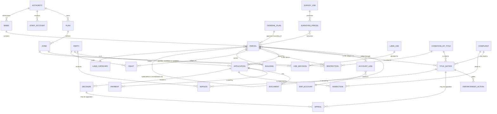

# Conceptual model

**Status:** 13 October 2026. This is the model of what the council cares about, independent of tables. It is the first of three levels: conceptual (this file), logical ([LOGICAL-PARCEL.md](LOGICAL-PARCEL.md), for the parcel family) and physical ([`physical/`](physical), generated from the database). The plan-and-zone part is specified in detail in [../architecture/02-data-model-proposal.md](../architecture/02-data-model-proposal.md); this file adds the rest and joins them.

It follows ISO 19152 (LADM), the land administration standard, which sees land as **parties** holding **rights, restrictions and responsibilities** over **basic administrative units** that are located by **spatial units**. The council's own terms are used here; the LADM class is given in the table below.

## 1. The model

The diagram shows entities and how they relate. Attributes belong to the logical level.

## 2. Entities, in the council's words

| Entity | What it is | LADM class | Custodian (who owns the truth) |
|---|---|---|---|
| **Authority** | The council as a body corporate (Rural District Councils Act s12); also urban and town authorities | Party (organisation) | Established under the RDC Act (s8) |
| **Ward**, village | A division of the council area | Administrative source | Divided under the RDC Act (s8) |
| **Parcel** | A piece of land with one boundary: a stand, a farm, a plot. Never reused, never deleted, retired when superseded | Basic administrative unit and spatial unit | **Boundary: the Surveyor-General.** The council keeps its own survey until approved |
| **General plan** | The Surveyor-General's approved plan or diagram | Source (spatial) | The Surveyor-General |
| **Land category** | Communal, large-scale commercial, small-scale commercial, resettlement or urban (RDC Act s2, s3) | Administrative classification | Defined by statute; declared by the Minister |
| **Party** | A person or organisation: owner, occupier, applicant, appellant, allottee | Party | The Deeds Registry for owners; the council for applicants |
| **Right** | Ownership, allocation, lease, occupation permit | Right | **Title: the Deeds Registry.** Allocation and lease: the council |
| **Restriction** | A limit on use or building: a zone's rule, a condition of title, a heritage listing, an overlay | Restriction | The plan, the title deed, or the heritage authority |
| **Condition of title** | A condition in a township's establishment or a title deed | Restriction | The Deeds Registry / township conditions |
| **Plan, zone, land use, use decision** | The council's plan, the zones in it, the uses, and what each zone decides for each use (permitted, special consent, prohibited) | Restriction (planning) | The council, under the RTCP Act |
| **Building** | A structure on a parcel | Spatial unit (volume/footprint) | The council |
| **Application** | A request to develop, subdivide or change use | (outside LADM) | The council |
| **Decision, appeal** | The outcome of an application, and its review | | The council; the Administrative Court on appeal |
| **Inspection, complaint** | A site visit; a report of unauthorised or dangerous work | | The council |
| **Title notice, service, enforcement action** | Notice before action on a breach of a condition of title; each service on an owner or occupier; what the council then does (RDC Act s73) | Responsibility | The council |
| **Survey job, surveyed parcel** | A surveyor's work and its output, before the council accepts it | Source | The surveyor, then the council |
| **Payment, document** | Money received; files and certificates | | The council; the payment gateway |
| **Account link, ERP account** | The tie from a parcel to the finance system's account | | The finance system owns the account; VunGIS holds only the link and a status band |
| **Staff account, citizen account, role** | Who signs in, and what they may do | | The council |

## 3. Three rules that run through the model

1. **Each custodian owns its truth.** The council holds a reference to a record it does not own (a boundary, a title, an ERP account) and a record of what the council itself did. It never keeps an editable copy.
2. **A parcel is identified by one key, and everything that concerns land points at it.** A stand number is a *label* a person uses; it is unique only inside a township. The key is the parcel identifier. (See the findings in the logical model: this rule is not yet followed everywhere.)
3. **Derived facts are derived.** A parcel's area, its ward, the zone it lies in and the answer to "what may I build here" follow from its boundary and the plan. They can be stored as a performance cache, but the boundary is the master and the cache must be checkable against it.

## 4. Where the model is only partly in the database

| Entity | State in the database |
|---|---|
| **Party** | There is no single party table. Owners appear in `parcel_owner` (empty), in `gweru_rural_farms.owner_id`, and in the simulated deeds registry; applicants are users |
| **Right** | No table. Allocation is `stand_allocation`; ownership and title exist only as text in a farm table and in the simulated registry |
| **Restriction** | Zones and use decisions are modelled well (the plan tables). Conditions of title, heritage and overlays are not generalised: heritage is three flags on `property` (empty); constraints are named concepts with no data |
| **Condition of title** | Held as free text in a section 73 notice. There is no register of the conditions themselves |
| **Parcel** | Five tables side by side; see [LOGICAL-PARCEL.md](LOGICAL-PARCEL.md) |

These are the modelling gaps. The use-case gaps (charges ledger, by-law register, Minister's approvals) are in [../USE-CASES.md](../USE-CASES.md).
