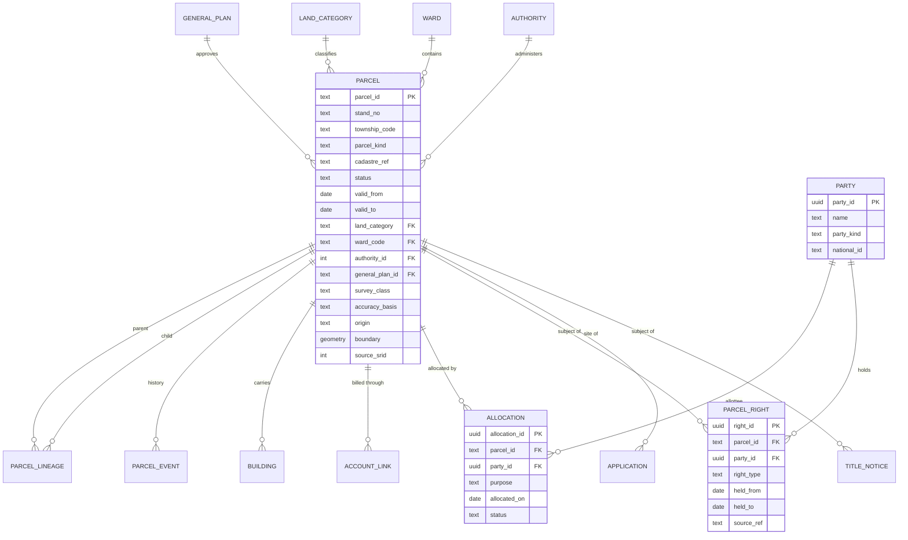

# Logical model: the parcel family

**Status:** 13 October 2026. The logical level says what entities, attributes and keys the system needs, in third normal form, whatever the tables are called. It then maps today's tables onto them and lists where they depart. It covers the parcel family because that is where the departures are largest and the most other tables depend on it. Conceptual model: [CONCEPTUAL.md](CONCEPTUAL.md). Physical model: [`physical/`](physical).

Nothing here changes the database. The consolidation path at the end is a proposal.

## 1. The logical model

**Keys.** `parcel_id` is the one key. `(township_code, stand_no)` is unique among current parcels and is a *label*, never a key. A parcel is never deleted and its identifier is never reused.

**Normal form.** Each attribute depends on the parcel key and on nothing else:
- `ward_code` is held with the parcel, but a ward is derivable from the boundary. It is a cached fact with a master (the ward polygons). **Enforced (migration 183):** a blank ward is filled from the boundary, and a ward the parcel does not meet is refused.
- `area_m2` is derived from the boundary. Storing it is a deliberate cache. **Enforced (migration 183):** a CHECK refuses an area more than 0.5 per cent from the area of the boundary (the survey projection and the ellipsoid differ by about 0.01 per cent). All 751 parcels pass; the widest difference is 0.0024 per cent.
- The zone a parcel lies in is **not** an attribute. It is resolved by overlay with the plan at the date of the question, and recorded only as a snapshot on an application (`parcel_zoning`, `application_rule_snapshots`).
- Ownership is **not** an attribute. It is a `PARCEL_RIGHT` held by a `PARTY`, so one parcel may have several holders over time and one party several parcels.
- An allocation is a relationship between a council, a party and a parcel, with its own dates and state.

## 2. Mapping: which table holds what today

| Logical entity | Intended table | What else holds the same facts |
|---|---|---|
| **PARCEL** (farms) | `land.parcel` (731 current rows, `parcel_kind = farm`, from `vungu_parcels`) | `vungu_parcels` (733), `vungu_farm_cadastre` (687, a near-duplicate from the same extract), `gweru_rural_farms` (672, legacy) |
| **PARCEL** (stands) | `land.parcel`: the 20 council layout stands are there as `plot`; `public.stands` is a view over the register and writes through to it (migration 186) | `public.stands` (20 rows), `spatial_planning.available_stand` (2), `spatial_planning.property` (0), `survey.land_parcels` (0, and one per surveyor) |
| **GENERAL_PLAN** | `land.general_plan` | `survey` has its own plan and import tables |
| **LAND_CATEGORY** | `land.land_category`, `land.parcel.land_category` (migration 179) | `tenure_class`, `vungu_parcels.status` (an import's word for the same thing) |
| **PARCEL_LINEAGE** | `land.parcel_lineage` | `spatial_planning.parcel_lineage` (separate, keyed to `property`) |
| **PARCEL_EVENT** | `land.parcel_event` | none |
| **BUILDING** | `land.building` (0 rows) | `public.buildings` (139,619 footprints, no parcel link) |
| **ACCOUNT_LINK** | `revenue_link.account_link` (keyed to `land.parcel`) | none |
| **ALLOCATION** | `public.stand_allocation` (`stand_id` to `public.stands`, and `parcel_id` to `land.parcel`, filled by trigger, migration 182) | `stands.allocated_to`, `reserved_by` and the related timestamps |
| **PARTY** | none | `spatial_planning.parcel_owner` (0), `gweru_rural_farms.owner_id`, `lands_registry_deeds.holder_name` (simulated), `stands.allocated_to` |
| **PARCEL_RIGHT** | none | `gweru_rural_farms.title_deed_*`, `lands_registry_deeds`, `stand_allocation` |
| **TITLE_NOTICE** | `spatial_planning.title_notice` (`parcel_id`, optional) | |

## 3. Where the physical model departs from the logical one

Each finding is checked against the live database (13 October 2026) or the audit of 9 October.

| # | Finding | Why it matters | Normal form |
|---|---|---|---|
| 1 | **Thirteen tables identify land by a free-text `stand_number`.** Ten had nothing else; migration 181 (13 October 2026) gave them a nullable `parcel_id` key. `title_notice` had a real key from the start. `permit_application` has a `parcel_id` that is **not** a foreign key: it is a polymorphic id paired with `parcel_layer` (`stands`, `vungu_parcels` or `land.parcel`), which has to change when the parcel tables are consolidated. They are `building_complaint`, `enforcement_order`, `prohibition_order`, `health_abatement_notice`, `health_licence_clearance`, `health_nuisance_complaint`, `health_premises`, `survey_task`, `property`, `available_stand`, `stands`, `permit_application` and `title_notice`. `stands` is itself a parcel table. | A stand number is unique only inside a township and is retyped by hand, so the same stand can be spelled two ways and two townships can share a number. A complaint, a notice and a permit about one stand cannot be joined reliably. | Violates the single-key rule; a "foreign key" in free text |
| 2 | **Five parcel tables, one concept.** Stands in `stands`, farms in `land.parcel` and three flat copies, with no table linking them. | Every query and every rule must choose a table. The zoning engine accepts only three, by hard-coded name. | Redundancy across relations |
| 3 | **Derived values stored as text and wrong.** `vungu_parcels` keeps area four times (`area_km2`, `area_ha`, `area_acre`, `area_km`) as text, plus `shape_leng` and `shape_area`. | Against the geometry they disagree: one parcel stores 179 ha and measures 305 ha. | Derived attribute stored without a master; wrong type |
| 4 | **One word, several meanings.** `vungu_parcels.status` holds a tenure or land class (Commercial 535, City 95, Purchase 59, State Land 29, Resettlement 6), not a status. | Mixes an owner (State Land, City), a legal category (Purchase, Resettlement) and a use (Commercial). Migration 179 gives the legal category its own column. | One column, several domains |
| 5 | **Transitive dependencies in `stands`.** `id → zone_id → zone_type`, with `zone_type`, `zone_type_cache`, `zone_id` (uuid), `zone_id_int` and `statutory_plan_id` all describing the zone. `status`/`status_code`, `use_scale`/`use_scale_code`, `ward`/`ward_fid` are pairs. | A zone change must update five columns, and they can disagree. Migration 078 began the fix and kept the old columns for compatibility. | Violates 3NF (transitive); half-finished migration |
| 6 | **A drawing table doing a record's job.** `gweru_rural_farms` mixes the shape, the cadastral attributes, the owner (`owner_id`), the title deed (`title_deed_info` JSON), compliance status and `zone_id` (pointing at a retired table). | An owner, a right, a compliance state and a shape change for different reasons and at different times. | Several entities in one relation |
| 7 | **Ownership has no home.** `parcel_owner` is empty; the farm register holds an owner id and a deed as JSON; the deeds registry simulation holds a holder name against a stand number as text. | The council cannot ask "who holds this parcel" across the system, and the rule that the Deeds Registry owns title has nowhere to attach a reference. | Missing entity (PARTY, PARCEL_RIGHT) |
| 8 | **Allocation points at the wrong table.** `stand_allocation.stand_id` references `public.stands`, not `land.parcel`; the allocation columns also appear on `stands` itself (`allocated_to`, `reserved_by`, and their times). | A stand moved into the parcel register would orphan its allocations. The same fact is stored twice. | Redundancy; wrong referent |
| 9 | **Two lineage tables.** `land.parcel_lineage` and `spatial_planning.parcel_lineage` (keyed to `property`). | Subdivision history exists in two places and neither knows the other. | Duplicate relation |
| 10 | **`public.buildings` has no parcel.** 139,619 footprints from the basemap are not tied to any parcel; `land.building` is designed to be and is empty. | "How many buildings on this parcel" is a spatial query every time, not a join. | Missing relationship (derivable by overlay) |
| 11 | **Per-surveyor schemas** (`surveyor_*`, three tables each). | A copy of the same three tables per user; superseded by shared tables with row-level security in SurveyPro. | Replicated structure |

The good news is that the designed parcel model is sound. `land.parcel` has a single key, validity dates, a source coordinate system, accuracy and approval fields, a lineage, an append-only history, a land category with its basis, a guard that refuses boundary edits except by an approved import, and row-level tenancy. The departures are mostly the older tables around it.

## 4. A consolidation path (proposed, in order)

Each step is a migration of its own, reversible, with the old table left readable until its readers have moved.

1. **Done.** Farm parcels are in `land.parcel` (731 rows, `source_relation = public.vungu_parcels`). The land category is a column with a basis and an audit trail.
2. **Give every table that names a stand a parcel key. Structure done (migration 181); data waits on step 3.** Add `parcel_id` (nullable, foreign key to `land.parcel`) to the ten tables that have only `stand_number`; backfill by `(township, stand number)` where it matches exactly and report the rest; make the application write the key. **This is the highest-value step**: it makes a complaint, a notice, a permit and an inspection about one stand joinable.

   *What was done:* the ten tables have a nullable `parcel_id` referencing `land.parcel`. `land.resolve_parcel(stand, township)` returns a key only when exactly one current stand or plot matches, never a farm and never a guess between several. `land.v_stand_reference_audit` lists every row that names land by number and whether it is linked, resolvable, ambiguous or unmatched. Complaint intake and triage, and notice drafting, now write the key and report `parcel_link`. *What is not done:* the other eight tables' routes (enforcement and prohibition orders, the four health registers, survey tasks, available stands) do not yet write the key; no existing row could be linked, because the only stand numbers in them are test data and the 20 stands are not in the register; and the column is still nullable, because making it required before step 3 would refuse every record about a stand.
3. **Done (migration 182), with the readers still to move. Move the 20 stands into `land.parcel`** as `parcel_kind = stand`, preserving geometry and allocation facts, then point `stand_allocation.stand_id` at the parcel. Retire `stands` columns that duplicate the zone and the ward; keep `v_stands` as a view for the tile server.

   *What was done:* each stand has a parcel (`parcel_kind = plot`, because the register requires a township for a stand and a council layout has none until it is surveyed and approved; `origin = authority`; the ward found by spatial join, not by the text in `stands.ward`). The area is **measured** from the geometry. A trigger keeps the parcel in step with the stand, and retires it, never deletes it, when the stand is deleted or withdrawn. `stand_allocation.parcel_id` is filled by trigger. Every stand number in the other tables now resolves through the register. *What is not done:* the seven code paths that read `stands` have not moved; the duplicated zone and ward columns on `stands` are still there; the stands have no township, so none is a `stand` yet. *What it found:* all 20 stored `area_sqm` values disagree with the measured area by 35 to 59 per cent (`land.v_stand_area_disagreement`), and the text ward on the stands (Wards 3, 5, 7, 9) disagrees with the ward the geometry falls in (Ward 18, for 19 of the 20), so the demo layouts' attributes cannot be trusted.
   **Step 3b, moving `stands` onto the register (13 October 2026): done in migrations 185, 186 and 187. `public.stands` is now a view; the register is the only place a stand lives.**

   *Tenancy first (migration 185).* `public.stands` is tenant data (an authority sees its own; a signed-in person sees stands they hold; anyone sees an `available` stand), and `land.parcel` had no row-level security, so a reader moved onto it would have shown one authority's council layouts to every other. Now: `land.parcel` has row-level security. Custodian parcels (farms, the Surveyor-General's) stay visible to all; an authority-origin parcel is visible to its authority (and a combination it belongs to), to a platform operator, and wherever its stand layout is visible. `land.stand_layout` (keyed by parcel, carrying the legacy stand id) holds what describes a layout *offer*: price, frontage, depth, reservation, allocation, use scale, zone, the stated area, the status. It has the same policy `stands` has and leaves out the three duplicate columns (`status_code`, `use_scale_code`, `zone_type_cache`). `land.v_stand` gives it back under `stands`' column names. The system plane (importers, the mirror) bypasses row-level security as before, so the public parcel lookup, which runs there, applies the same rule by hand. Isolation is proved with two authorities, a stand holder, the public and a platform operator (`parcel-isolation.test.js`).

   *Parity.* `land.v_stand` equals `public.stands` on all 22 columns, the boundary and the centroid, row for row, for every stand. The one difference is that the centroid is now computed rather than stored; it is snapped to a nanodegree so that `29.7296` does not become `29.729600000000005` in citizen-facing JSON.

   *Readers moved:* the citizen portal's available stands, plan lookup (search and lookup), the map's search suggestions and its natural-language query, the planning assistant, the ward profile and the inspector's site resolution (in `tiles.js`, `planLookup.js`, `citizen-portal.js`, `inspectorSpatial.js`, `planningAssistant.js`, `wardProfilePdf.js`; `map-search.js` is never registered and was changed for consistency). `stand-readers.test.js` compares each live route's answer with what the old query gives, and `test/stand-readers-moved.test.js` fails if one goes back to the old table.

   *The writer moved too (migration 186).* `public.stands` is a view with the old table's column names, running with the caller's rights, and INSTEAD OF triggers that write through into `land.parcel` (boundary, number, ward, authority, the area measured from the boundary) and `land.stand_layout` (the offer). So `routes/stands.js`, the seed scripts, the tests, `parcel_geometry`, `resolve_stand_parcel`, the tile view and every stored stand id keep working without a change of meaning. The parcel is written only when a parcel fact changed, so a citizen reserving a stand writes the layout alone. The rules the old table enforced moved with it: a stand number unique per ward (now per authority, as a trigger, since an index cannot span two tables), no overlap between active stands (a shared edge is allowed), the reservation policy, and the map-change notification (now from the layout table). An authority may write only its own council layouts, enforced by new write policies on `land.parcel`. The old table is kept as `public.stands_pre_register`, read-only, with its triggers dropped, as a rollback copy; the migration refuses to commit unless the view shows exactly the stands it held.

   *Behaviour that changed, on purpose:* a DELETE on `stands` withdraws the stand and retires its parcel (a parcel is never deleted), where it used to remove the row; the stand-number rule is per authority, not global; and a withdrawn stand is no longer a candidate when a permit is matched to its parcel (migration 187; after a split, a point inside a child used to match the withdrawn parent as well and come back unmatched).

   *Two defects found and fixed on the way, both older than this work.* (1) The old `citizen_reserve` policy let any signed-in person UPDATE any column of an available stand, so a planner of one authority could change or withdraw another authority's available stands; the only guard was the route's role check. `stands-writer.test.js` showed it as soon as it ran as two authorities. A non-owner may now only reserve a stand or release their own reservation (refused in the write-through function, so the route answers 404, and by a trigger on the layout, for a direct write). (2) Merge and split inserted the new stands before withdrawing the parents, and the no-overlap rule added in migration 107 refuses a new active stand on top of active ones, so both operations had been failing since. They now withdraw the parents first, inside the same transaction.

   *Test coverage this gave the writer:* `stand-allocation` and `geometry-validation` had been failing since the tenancy work (they built the app with no tenant context); they now run as a real tenant. `stands-writer.test.js` (17 tests) covers create, update, withdraw, overlap, the other authority, citizen reserve and release, merge, split, and that a stand's id still means the same stand to the SQL permits use.

   *Left for later:* the duplicate columns `ward`, `zone_type` and `area_sqm` now live in `stand_layout` under their stated meaning (the layout's own ward text, zone text and stated area) and are exposed under their old names; `status_code`, `use_scale_code`, `zone_type_cache` and `ward_fid` are served as copies and can be dropped when nothing reads them. `routes/stands.js` can be rewritten to write the register directly and the view and its triggers can then go; nothing now requires it.

   *Found on the way:* the planning assistant's stand path **already failed** before this work (`integer = uuid`): `stands.zone_id` is a uuid that points at nothing, and the working `zone_id_int` is empty on all 20 stands. It was moved with its behaviour unchanged. The zone of a stand should be derived from the plan by overlay, not stored.

   *Open for the council:* the stated area against the measured area (the view carries both: `area_sqm` and `area_measured_m2`), the layout's ward text against the ward the boundary falls in, and the typed zone against the plan's zone. For the 20 stands: no typed ward lies inside its own ward polygon, no stated area agrees with the measured one (they are 25 to 62 per cent smaller), the typed zone agrees with the plan on 15, contradicts it on 3 (EC-301 to 303) and has no zone polygon on 2 (HDR-104, 105). [stand-attribute-review.xlsx](stand-attribute-review.xlsx) lines the values up for a planner, with a dropdown for each decision and a Read me sheet that explains the options; the same facts as a plain CSV are in [stand-attribute-review.csv](stand-attribute-review.csv), and `app-backend/scripts/stand-attribute-review.js` regenerates both inputs from the live register. Nothing changes until the sheet is returned.

4. **Retire the duplicate flat copies.** `vungu_farm_cadastre` is a near-duplicate; note that `vungu_parcels` has 733 rows and `land.parcel` 731: the two left out (`Shangani Farm North`, `Netherburn Extention`) have empty geometry, which the register refuses, so they need their boundaries from the Survey Section. Then archive the duplicate `vungu_farm_cadastre`. Retire `gweru_rural_farms` after its farm-zone remap (a defect already known to the audit).
5. **Create the missing entities.** `party` and `parcel_right`, populated first from `lands_registry_deeds` (still a simulation) and the allocation table. Replace `gweru_rural_farms.owner_id` and the `title_deed_*` columns with rights. This is the step where the Deeds Registry boundary is drawn in the schema: a right carries a `source_ref` to the registry's record and a date, never a copy of the registry's data.
6. **Merge the two lineage tables** into `land.parcel_lineage`, and retire `spatial_planning.property` or turn it into a thin view over parcel plus party plus right.
7. **Retire the `surveyor_*` schemas** once SurveyPro's shared tables are confirmed to hold everything.
8. **Check the caches. Done for the register (migration 183, `scripts/check-derived-columns.js`).** The register now enforces its own area and ward. The script also reports the older tables, which are not enforced: all 20 stands' `area_sqm` and ward text disagree with their geometry; 52 of 733 `vungu_parcels` and 85 of 672 `gweru_rural_farms` have an `area_ha` more than 5 per cent off. Those are fixed by retiring the columns (steps 3 and 4), not by constraints on tables that are being retired.

   *A regression this work caused and then fixed:* step 3 put each stand in two parcel tables, and `resolve_stand_parcel` counted a stand twice, so lodging a permit against any of the 20 stands came back "ambiguous" (found by `scripts/verify-plan-model.js`, not by the unit tests). Migration 184 counts a mirrored stand once. It also showed that two tests and three scripts inserted parcels with a fixed area (900, 1000) whatever the geometry, the pattern the constraint now refuses; they compute the area now.

## 5. What I have not done

- I have not changed any table. The mapping and the findings come from reading the live catalogue and the code.
- The logical model covers the parcel family. Applications, plans and zones, and the survey workspace each deserve the same treatment; the plan and zone part already has its design in [../architecture/02-data-model-proposal.md](../architecture/02-data-model-proposal.md).
- Step 2 changes how the routes behind ten tables identify land, so it needs the council's agreement on how to resolve a stand number that matches no parcel or more than one.
