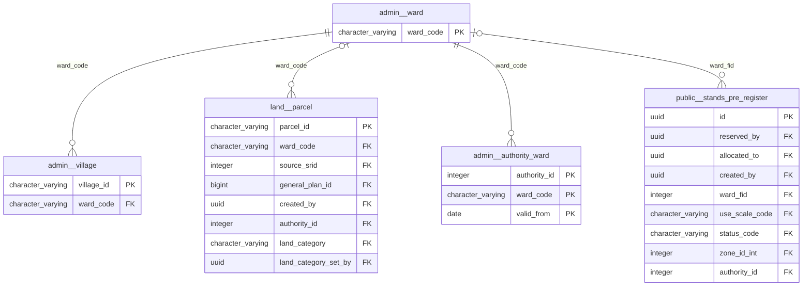

# Physical model: schema `admin`

Generated by `app-backend/scripts/generate-data-model.js` from the live database. Do not edit by hand: regenerate.

3 tables, 1 views. Diagrams show keys only (primary key, foreign keys); the data dictionary below lists every column. References to the hub tables `public.users`, `spatial_planning.permit_application`, `land.parcel`, `public.local_authorities` (created_by, authority_id and the like) are left out of the diagrams so the groups stay readable; they are in the dictionary. A relationship leaving this schema shows the other schema's table by its `schema__table` name.

## Relationships, group 1

Tables: `village`, `ward`, `authority_ward`.

## Data dictionary

### View `authority_area`

view · tenancy: national · concept: authority_area (canonical)

| Column | Type | Null | Default | Key | Comment |
|---|---|:-:|---|---|---|
| `authority_id` | integer | yes |  |  |  |
| `authority_code` | text | yes |  |  |  |
| `wards` | integer | yes |  |  |  |
| `basis` | text | yes |  |  |  |
| `provisional` | boolean | yes |  |  |  |
| `geom` | geometry(MultiPolygon,4326) | yes |  |  |  |

### `authority_ward`

19 rows · tenancy: reference

| Column | Type | Null | Default | Key | Comment |
|---|---|:-:|---|---|---|
| `authority_id` | integer | no |  | PK FK → public.local_authorities.id |  |
| `ward_code` | character varying(24) | no |  | PK FK → admin.ward.ward_code |  |
| `valid_from` | date | no |  | PK |  |
| `valid_to` | date | yes |  |  |  |
| `basis` | text | no |  |  |  |
| `instrument_ref` | text | yes |  |  |  |
| `note` | text | yes |  |  |  |
| `created_at` | timestamp with time zone | no | now() |  |  |

### `village`

0 rows · tenancy: national · concept: admin_village (target)

| Column | Type | Null | Default | Key | Comment |
|---|---|:-:|---|---|---|
| `village_id` | character varying(24) | no |  | PK |  |
| `name` | text | no |  |  |  |
| `headman` | text | yes |  |  |  |
| `ward_code` | character varying(24) | no |  | FK → admin.ward.ward_code |  |
| `geom` | geometry(Point,4326) | yes |  |  |  |

### `ward`

1961 rows · tenancy: national · concept: admin_ward (canonical)

| Column | Type | Null | Default | Key | Comment |
|---|---|:-:|---|---|---|
| `ward_code` | character varying(24) | no |  | PK |  |
| `name` | text | no |  |  |  |
| `source` | text | no |  |  |  |
| `geom` | geometry(MultiPolygon,4326) | yes |  |  |  |
| `parent_pcode` | text | yes |  |  |  |
| `delimitation` | text | no | 'COD-AB'::text |  |  |
| `valid_from` | date | yes |  |  |  |
| `valid_to` | date | yes |  |  |  |
| `legacy_fid` | integer | yes | nextval('admin.ward_legacy_fid_seq'::regclass) |  |  |
