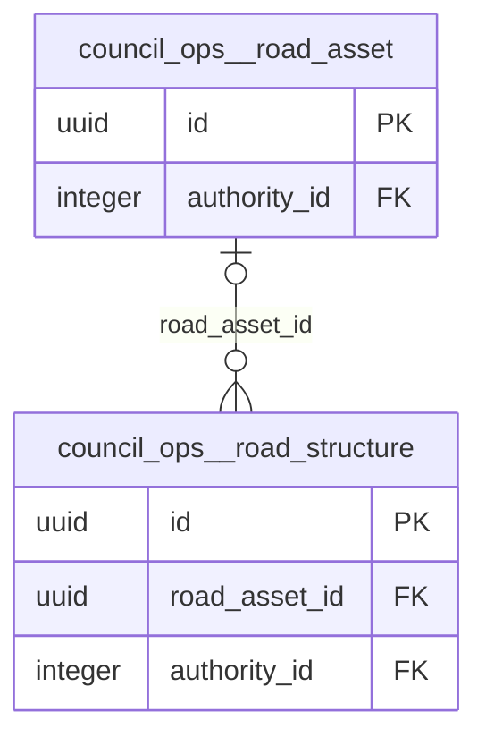

# Physical model: schema `council_ops`

Generated by `app-backend/scripts/generate-data-model.js` from the live database. Do not edit by hand: regenerate.

6 tables, 0 views. Diagrams show keys only (primary key, foreign keys); the data dictionary below lists every column. References to the hub tables `public.users`, `spatial_planning.permit_application`, `land.parcel`, `public.local_authorities` (created_by, authority_id and the like) are left out of the diagrams so the groups stay readable; they are in the dictionary. A relationship leaving this schema shows the other schema's table by its `schema__table` name.

## Relationships, group 1

Tables: `road_structure`, `road_asset`.

## Tables related only to a hub table

These reference only `public.users`, `spatial_planning.permit_application`, `land.parcel`, `public.local_authorities` (or are referenced by nothing drawn): `council_asset`, `livestock_facility`, `service_desk_ticket`, `wash_asset`.

## Data dictionary

### `council_asset`

0 rows · tenancy: tenant · concept: council_asset (canonical)

| Column | Type | Null | Default | Key | Comment |
|---|---|:-:|---|---|---|
| `id` | uuid | no | gen_random_uuid() | PK |  |
| `asset_code` | character varying(64) | yes |  |  |  |
| `name` | text | no |  |  |  |
| `asset_class` | character varying(40) | no |  |  |  |
| `department` | character varying(120) | yes |  |  |  |
| `condition` | character varying(40) | yes |  |  |  |
| `ward` | character varying(120) | yes |  |  |  |
| `data_quality` | character varying(24) | no | 'unverified'::character varying |  |  |
| `source` | text | yes |  |  |  |
| `geom` | geometry(Geometry,4326) | yes |  |  |  |
| `created_at` | timestamp with time zone | no | now() |  |  |
| `updated_at` | timestamp with time zone | no | now() |  |  |
| `authority_id` | integer | no | app.authority_id() | FK → public.local_authorities.id |  |

### `livestock_facility`

0 rows · tenancy: tenant · concept: council_asset (source)

| Column | Type | Null | Default | Key | Comment |
|---|---|:-:|---|---|---|
| `id` | uuid | no | gen_random_uuid() | PK |  |
| `facility_type` | character varying(40) | no |  |  |  |
| `name` | text | yes |  |  |  |
| `ward` | character varying(120) | yes |  |  |  |
| `data_quality` | character varying(24) | no | 'unverified'::character varying |  |  |
| `source` | text | yes |  |  |  |
| `geom` | geometry(Point,4326) | yes |  |  |  |
| `created_at` | timestamp with time zone | no | now() |  |  |
| `updated_at` | timestamp with time zone | no | now() |  |  |
| `authority_id` | integer | no | app.authority_id() | FK → public.local_authorities.id |  |

### `road_asset`

0 rows · tenancy: tenant · concept: council_road_asset (canonical)

| Column | Type | Null | Default | Key | Comment |
|---|---|:-:|---|---|---|
| `id` | uuid | no | gen_random_uuid() | PK |  |
| `asset_code` | character varying(64) | yes |  |  |  |
| `name` | text | yes |  |  |  |
| `hierarchy` | character varying(40) | yes |  |  |  |
| `authority` | character varying(120) | yes |  |  |  |
| `surface` | character varying(40) | yes |  |  |  |
| `condition` | character varying(40) | yes |  |  |  |
| `length_m` | numeric(12,2) | yes |  |  |  |
| `ward` | character varying(120) | yes |  |  |  |
| `status` | character varying(24) | no | 'active'::character varying |  |  |
| `data_quality` | character varying(24) | no | 'unverified'::character varying |  |  |
| `source` | text | yes |  |  |  |
| `responsible_dept` | text | yes | 'Roads & Works'::text |  |  |
| `geom` | geometry(MultiLineString,4326) | yes |  |  |  |
| `created_at` | timestamp with time zone | no | now() |  |  |
| `updated_at` | timestamp with time zone | no | now() |  |  |
| `authority_id` | integer | no | app.authority_id() | FK → public.local_authorities.id |  |

### `road_structure`

0 rows · tenancy: tenant · concept: council_asset (source)

| Column | Type | Null | Default | Key | Comment |
|---|---|:-:|---|---|---|
| `id` | uuid | no | gen_random_uuid() | PK |  |
| `structure_type` | character varying(40) | no |  |  |  |
| `name` | text | yes |  |  |  |
| `road_asset_id` | uuid | yes |  | FK → council_ops.road_asset.id |  |
| `condition` | character varying(40) | yes |  |  |  |
| `ward` | character varying(120) | yes |  |  |  |
| `data_quality` | character varying(24) | no | 'unverified'::character varying |  |  |
| `source` | text | yes |  |  |  |
| `geom` | geometry(Point,4326) | yes |  |  |  |
| `created_at` | timestamp with time zone | no | now() |  |  |
| `updated_at` | timestamp with time zone | no | now() |  |  |
| `authority_id` | integer | no | app.authority_id() | FK → public.local_authorities.id |  |

### `service_desk_ticket`

1 rows · tenancy: tenant

| Column | Type | Null | Default | Key | Comment |
|---|---|:-:|---|---|---|
| `id` | uuid | no | gen_random_uuid() | PK |  |
| `service_id` | text | no |  |  |  |
| `department` | text | no |  |  |  |
| `title` | text | no |  |  |  |
| `requester_user_id` | uuid | yes |  | FK → public.users.id |  |
| `requester_name` | text | yes |  |  |  |
| `contact_phone` | text | yes |  |  |  |
| `contact_email` | text | yes |  |  |  |
| `location_text` | text | yes |  |  |  |
| `details` | text | yes |  |  |  |
| `status` | text | no | 'open'::text |  |  |
| `created_at` | timestamp with time zone | no | now() |  |  |
| `updated_at` | timestamp with time zone | no | now() |  |  |
| `authority_id` | integer | no | app.authority_id() | FK → public.local_authorities.id |  |

### `wash_asset`

6 rows · tenancy: tenant · concept: council_asset (source)

| Column | Type | Null | Default | Key | Comment |
|---|---|:-:|---|---|---|
| `id` | uuid | no | gen_random_uuid() | PK |  |
| `asset_code` | character varying(64) | yes |  |  |  |
| `asset_type` | character varying(40) | no |  |  |  |
| `name` | text | yes |  |  |  |
| `ward` | character varying(120) | yes |  |  |  |
| `capacity` | text | yes |  |  |  |
| `operational` | character varying(24) | yes | 'unknown'::character varying |  |  |
| `responsible_party` | text | yes |  |  |  |
| `data_quality` | character varying(24) | no | 'unverified'::character varying |  |  |
| `source` | text | yes |  |  |  |
| `responsible_dept` | text | yes | 'DSSWC'::text |  |  |
| `geom` | geometry(Point,4326) | yes |  |  |  |
| `created_at` | timestamp with time zone | no | now() |  |  |
| `updated_at` | timestamp with time zone | no | now() |  |  |
| `authority_id` | integer | no | app.authority_id() | FK → public.local_authorities.id |  |
