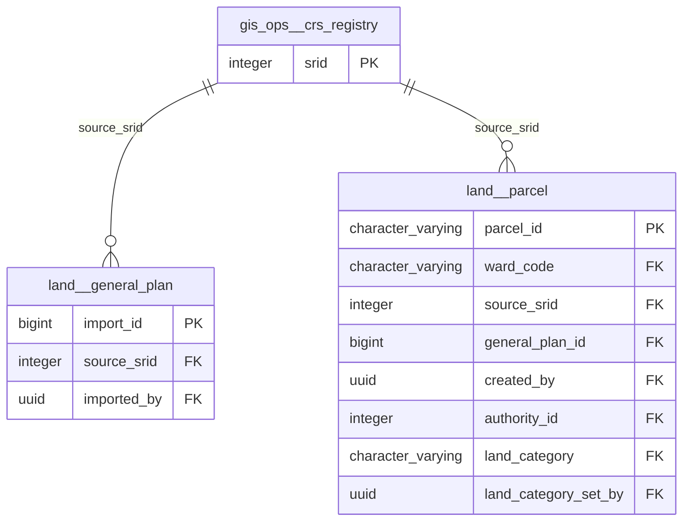

# Physical model: schema `gis_ops`

Generated by `app-backend/scripts/generate-data-model.js` from the live database. Do not edit by hand: regenerate.

2 tables, 0 views. Diagrams show keys only (primary key, foreign keys); the data dictionary below lists every column. References to the hub tables `public.users`, `spatial_planning.permit_application`, `land.parcel`, `public.local_authorities` (created_by, authority_id and the like) are left out of the diagrams so the groups stay readable; they are in the dictionary. A relationship leaving this schema shows the other schema's table by its `schema__table` name.

## Relationships, group 1

Tables: `crs_registry`.

## Tables with no foreign key to or from anything

Imports, registries and reference lists are often right to stand alone. Each is listed so someone can say so on purpose.

| Table | Rows | Kind | Concept |
|---|---:|---|---|
| `datum_transformation` | 4 | reference |  |

## Data dictionary

### `crs_registry`

7 rows · tenancy: reference

| Column | Type | Null | Default | Key | Comment |
|---|---|:-:|---|---|---|
| `srid` | integer | no |  | PK |  |
| `code` | character varying(24) | no |  |  |  |
| `name` | text | no |  |  |  |
| `datum` | text | no |  |  |  |
| `proj4text` | text | no |  |  |  |
| `is_survey` | boolean | no | false |  |  |
| `transform_method` | text | yes |  |  |  |
| `accuracy_m` | numeric | yes |  |  | Uncertainty of the datum shift alone, not the positional accuracy of any feature. Merry & Rens state +/-17.5/18.4/21.2 m on the translations; 20 is used as a ro |
| `updated_at` | timestamp with time zone | no | now() |  |  |

### `datum_transformation`

4 rows · tenancy: reference

Candidate Cape/Arc 1950 to WGS 84 transformations. Active one: cape-7p-merry-rens-1990. Unconfirmed with the Department of the Surveyor General. See docs/dsg-crs-technical-report.md. Open questions: (1) confirm the SG control list is Cape, not Arc 1950; (2) confirm whether Merry & Rens apply to the Zimbabwe SG network, or whether a CORS re-adjustment supersedes them; (3) if a CORS re-adjustment exists, supply its parameters and residuals; (4) confirm the rotation convention of the published set.

| Column | Type | Null | Default | Key | Comment |
|---|---|:-:|---|---|---|
| `code` | character varying(40) | no |  | PK |  |
| `name` | text | no |  |  |  |
| `source_crs` | text | no |  |  |  |
| `target_crs` | text | no |  |  |  |
| `method` | text | no |  |  |  |
| `convention` | text | no |  |  |  |
| `dx` | numeric | no |  |  |  |
| `dy` | numeric | no |  |  |  |
| `dz` | numeric | no |  |  |  |
| `rx_arcsec` | numeric | no | 0 |  |  |
| `ry_arcsec` | numeric | no | 0 |  |  |
| `rz_arcsec` | numeric | no | 0 |  |  |
| `scale_ppm` | numeric | no | 0 |  |  |
| `towgs84_clause` | text | no |  |  |  |
| `accuracy_m` | numeric | yes |  |  |  |
| `citation` | text | yes |  |  |  |
| `note` | text | yes |  |  |  |
