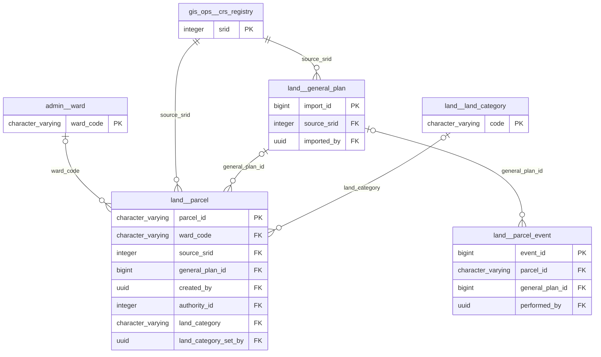
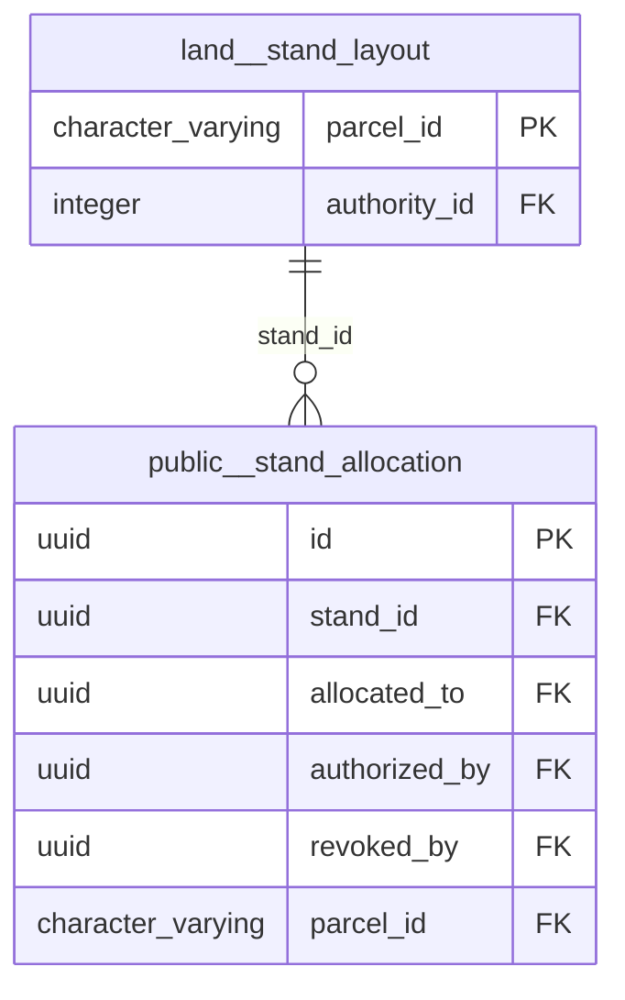

# Physical model: schema `land`

Generated by `app-backend/scripts/generate-data-model.js` from the live database. Do not edit by hand: regenerate.

7 tables, 3 views. Diagrams show keys only (primary key, foreign keys); the data dictionary below lists every column. References to the hub tables `public.users`, `spatial_planning.permit_application`, `land.parcel`, `public.local_authorities` (created_by, authority_id and the like) are left out of the diagrams so the groups stay readable; they are in the dictionary. A relationship leaving this schema shows the other schema's table by its `schema__table` name.

## Relationships, group 1

Tables: `general_plan`, `parcel`, `parcel_event`, `land_category`.

## Relationships, group 2

Tables: `stand_layout`.

## Tables related only to a hub table

These reference only `public.users`, `spatial_planning.permit_application`, `land.parcel`, `public.local_authorities` (or are referenced by nothing drawn): `building`, `parcel_lineage`.

## Data dictionary

### `building`

0 rows · tenancy: national · concept: building (target)

| Column | Type | Null | Default | Key | Comment |
|---|---|:-:|---|---|---|
| `building_id` | character varying(24) | no | ('B-'::text \|\| lpad((nextval('land.building_id_seq'::regclass))::text, 7, '0'::text)) | PK |  |
| `parcel_id` | character varying(24) | yes |  | FK → land.parcel.parcel_id |  |
| `use` | text | yes |  |  |  |
| `storeys` | smallint | yes |  |  |  |
| `completion_date` | date | yes |  |  |  |
| `source` | text | no |  |  |  |
| `accuracy_class` | character(1) | no |  |  |  |
| `geom` | geometry(Point,4326) | yes |  |  |  |

### `general_plan`

0 rows · tenancy: national

| Column | Type | Null | Default | Key | Comment |
|---|---|:-:|---|---|---|
| `import_id` | bigint | no | nextval('land.general_plan_import_id_seq'::regclass) | PK |  |
| `sg_ref` | text | no |  |  |  |
| `township_code` | character varying(40) | no |  |  |  |
| `source_srid` | integer | no |  | FK → gis_ops.crs_registry.srid |  |
| `feature_count` | integer | no |  |  |  |
| `imported_by` | uuid | yes |  | FK → public.users.id |  |
| `imported_at` | timestamp with time zone | no | now() |  |  |

### `land_category`

5 rows · tenancy: reference

| Column | Type | Null | Default | Key | Comment |
|---|---|:-:|---|---|---|
| `code` | character varying(24) | no |  | PK |  |
| `label` | text | no |  |  |  |
| `ward_label` | text | no |  |  |  |
| `act_ref` | text | no |  |  |  |
| `definition` | text | no |  |  |  |
| `sort_order` | smallint | no |  |  |  |

### `parcel`

751 rows · tenancy: tenant · concept: cadastral_parcel (target)

| Column | Type | Null | Default | Key | Comment |
|---|---|:-:|---|---|---|
| `parcel_id` | character varying(24) | no | ('P-'::text \|\| lpad((nextval('land.parcel_id_seq'::regclass))::text, 7, '0'::text)) | PK |  |
| `stand_no` | character varying(24) | no |  |  |  |
| `township_code` | character varying(40) | yes |  |  |  |
| `ward_code` | character varying(24) | yes |  | FK → admin.ward.ward_code |  |
| `geom_source` | geometry | no |  |  |  |
| `source_srid` | integer | no |  | FK → gis_ops.crs_registry.srid |  |
| `geom_wgs84` | geometry(MultiPolygon,4326) | no |  |  |  |
| `transform_method` | text | yes |  |  |  |
| `transform_accuracy_m` | numeric | yes |  |  |  |
| `area_m2` | numeric | no |  |  |  |
| `sg_ref` | text | yes |  |  |  |
| `general_plan_id` | bigint | yes |  | FK → land.general_plan.import_id |  |
| `accuracy_class` | character(1) | yes |  |  | LEGACY grade A-D from before survey_class existed; A/D stood for state and source, not for an SI 727 class. Kept as history; new writers leave it NULL. Use surv |
| `source` | text | no |  |  |  |
| `custodian_dept` | text | no | 'Survey Section'::text |  |  |
| `status` | character varying(12) | no | 'current'::character varying |  |  |
| `allocation_status` | character varying(12) | no | 'unallocated'::character varying |  |  |
| `valid_from` | date | no | CURRENT_DATE |  |  |
| `valid_to` | date | yes |  |  |  |
| `created_by` | uuid | yes |  | FK → public.users.id |  |
| `created_at` | timestamp with time zone | no | now() |  |  |
| `updated_at` | timestamp with time zone | no | now() |  |  |
| `estimated_accuracy_m` | numeric | yes |  |  | Positional accuracy of geom_source itself, not of the datum shift. Supersedes the implicit assumption that every boundary is as good as the datum floor. |
| `accuracy_basis` | text | yes |  |  | How estimated_accuracy_m was arrived at: surveyed \| general_plan \| map_digitised \| estimated \| unknown. |
| `parcel_kind` | text | no | 'stand'::text |  |  |
| `cadastre_ref` | text | yes |  |  |  |
| `tenure_class` | text | yes |  |  |  |
| `authority_id` | integer | yes |  | FK → public.local_authorities.id |  |
| `origin` | text | no | 'custodian'::text |  |  |
| `source_relation` | text | yes |  |  |  |
| `source_key` | text | yes |  |  |  |
| `survey_class` | character(1) | yes |  |  | SI 727 survey class the parcel was surveyed to (A town survey-marks, B townships, C other), as declared by the surveyor. NULL when not declared or not an SI 727 |
| `land_category` | character varying(24) | yes |  | FK → land.land_category.code | Land category under the Rural District Councils Act [Ch 29:13] s2/s3: communal, large_scale_commercial, small_scale_commercial, resettlement, urban. NULL = not  |
| `land_category_basis` | character varying(20) | yes |  |  | gazette (declared by the Minister, s3), statutory_definition (within a s2 definition, no notice) or council_record (council's own record, not yet traced). |
| `land_category_ref` | text | yes |  |  | The Gazette notice / SI or the instrument relied on. Required unless the basis is council_record. |
| `land_category_set_at` | timestamp with time zone | yes |  |  |  |
| `land_category_set_by` | uuid | yes |  | FK → public.users.id |  |

### `parcel_event`

0 rows · tenancy: national · concept: cadastral_parcel (derived)

| Column | Type | Null | Default | Key | Comment |
|---|---|:-:|---|---|---|
| `event_id` | bigint | no | nextval('land.parcel_event_event_id_seq'::regclass) | PK |  |
| `parcel_id` | character varying(24) | no |  | FK → land.parcel.parcel_id |  |
| `event` | character varying(16) | no |  |  |  |
| `occurred_at` | timestamp with time zone | no | now() |  |  |
| `general_plan_id` | bigint | yes |  | FK → land.general_plan.import_id |  |
| `performed_by` | uuid | yes |  | FK → public.users.id |  |
| `details` | jsonb | no | '{}'::jsonb |  |  |
| `previous_geom` | geometry | yes |  |  |  |
| `previous_srid` | integer | yes |  |  |  |

### `parcel_lineage`

0 rows · tenancy: national

| Column | Type | Null | Default | Key | Comment |
|---|---|:-:|---|---|---|
| `parent_id` | character varying(24) | no |  | PK FK → land.parcel.parcel_id |  |
| `child_id` | character varying(24) | no |  | PK FK → land.parcel.parcel_id |  |
| `event` | character varying(16) | no |  |  |  |
| `event_date` | date | no | CURRENT_DATE |  |  |

### `stand_layout`

20 rows · tenancy: tenant

What describes a council layout stand as an offer (price, reservation, allocation, use scale, zone), keyed by parcel. Carries the legacy stands.id. Migration 185.

| Column | Type | Null | Default | Key | Comment |
|---|---|:-:|---|---|---|
| `parcel_id` | character varying(24) | no |  | PK FK → land.parcel.parcel_id |  |
| `stand_id` | uuid | no |  |  |  |
| `authority_id` | integer | no |  | FK → public.local_authorities.id |  |
| `ward_label` | text | yes |  |  |  |
| `zone_id` | uuid | yes |  |  |  |
| `zone_id_int` | integer | yes |  |  |  |
| `zone_type` | text | yes |  |  |  |
| `use_scale` | text | yes |  |  |  |
| `status` | character varying(16) | no |  |  |  |
| `area_sqm_stated` | numeric | yes |  |  |  |
| `frontage_m` | numeric | yes |  |  |  |
| `depth_m` | numeric | yes |  |  |  |
| `price_usd` | numeric | yes |  |  |  |
| `description` | text | yes |  |  |  |
| `reserved_by` | uuid | yes |  |  |  |
| `reserved_at` | timestamp with time zone | yes |  |  |  |
| `reserved_until` | timestamp with time zone | yes |  |  |  |
| `allocated_to` | uuid | yes |  |  |  |
| `allocated_at` | timestamp with time zone | yes |  |  |  |
| `statutory_plan_id` | uuid | yes |  |  |  |
| `created_by` | uuid | yes |  |  |  |
| `created_at` | timestamp with time zone | no | now() |  |  |
| `updated_at` | timestamp with time zone | no | now() |  |  |

### View `v_stand`

view · tenancy: tenant_view · concept: cadastral_parcel (derived)

A council layout stand with the column names public.stands has, from the register. area_sqm is the area the layout states; area_measured_m2 is measured from the boundary. Migration 185.

| Column | Type | Null | Default | Key | Comment |
|---|---|:-:|---|---|---|
| `id` | uuid | yes |  |  |  |
| `stand_number` | character varying(24) | yes |  |  |  |
| `ward` | text | yes |  |  |  |
| `zone_id` | uuid | yes |  |  |  |
| `zone_id_int` | integer | yes |  |  |  |
| `zone_type` | text | yes |  |  |  |
| `use_scale` | text | yes |  |  |  |
| `status` | character varying(16) | yes |  |  |  |
| `area_sqm` | numeric | yes |  |  |  |
| `frontage_m` | numeric | yes |  |  |  |
| `depth_m` | numeric | yes |  |  |  |
| `price_usd` | numeric | yes |  |  |  |
| `description` | text | yes |  |  |  |
| `geom` | geometry | yes |  |  |  |
| `centroid` | geometry | yes |  |  |  |
| `reserved_by` | uuid | yes |  |  |  |
| `reserved_at` | timestamp with time zone | yes |  |  |  |
| `reserved_until` | timestamp with time zone | yes |  |  |  |
| `allocated_to` | uuid | yes |  |  |  |
| `allocated_at` | timestamp with time zone | yes |  |  |  |
| `statutory_plan_id` | uuid | yes |  |  |  |
| `created_by` | uuid | yes |  |  |  |
| `created_at` | timestamp with time zone | yes |  |  |  |
| `updated_at` | timestamp with time zone | yes |  |  |  |
| `authority_id` | integer | yes |  |  |  |
| `parcel_id` | character varying(24) | yes |  |  |  |
| `ward_code` | character varying(24) | yes |  |  |  |
| `area_measured_m2` | numeric | yes |  |  |  |

### View `v_stand_area_disagreement`

view · tenancy: national

| Column | Type | Null | Default | Key | Comment |
|---|---|:-:|---|---|---|
| `parcel_id` | character varying(24) | yes |  |  |  |
| `stand_no` | character varying(24) | yes |  |  |  |
| `stored_sqm` | numeric | yes |  |  |  |
| `measured_m2` | numeric | yes |  |  |  |
| `stored_minus_measured_pct` | numeric | yes |  |  |  |

### View `v_stand_reference_audit`

view · tenancy: tenant_view

| Column | Type | Null | Default | Key | Comment |
|---|---|:-:|---|---|---|
| `source` | text | yes |  |  |  |
| `row_id` | text | yes |  |  |  |
| `stand_number` | character varying | yes |  |  |  |
| `parcel_id` | character varying(24) | yes |  |  |  |
| `resolution` | text | yes |  |  |  |
