# Physical model: schema `public`

Generated by `app-backend/scripts/generate-data-model.js` from the live database. Do not edit by hand: regenerate.

118 tables, 17 views. Diagrams show keys only (primary key, foreign keys); the data dictionary below lists every column. References to the hub tables `public.users`, `spatial_planning.permit_application`, `land.parcel`, `public.local_authorities` (created_by, authority_id and the like) are left out of the diagrams so the groups stay readable; they are in the dictionary. A relationship leaving this schema shows the other schema's table by its `schema__table` name.

## Relationships, group 1

Tables: `planning_assistant_templates`, `ref_scale_categories`, `ref_zone_types`, `stands_pre_register`, `proposed_peri_urban_zones`, `ref_stand_statuses`, `ref_use_scales`, `zone_land_use_controls`, `land_use_groups`, `plan_instrument`, `plan_zone_type`, `land_use_group_class`, `reference_classification`, `plan_zone_standard`, `standard_kind`, `parcel_zoning`, `plan_event`, `plan_signoff`, `activity_spatial_test`, `spatial_concept`, `plan_profile`, `plan_zone_type_class`, `decision_pathway`, `development_activity`, `activity_standard_kind`, `spatial_concept_source`.

```mermaid
erDiagram
  public__ref_scale_categories ||--o{ public__planning_assistant_templates : "scale_category"
  public__ref_zone_types ||--o{ public__planning_assistant_templates : "zone_type"
  public__proposed_peri_urban_zones |o--o{ public__stands_pre_register : "zone_id_int"
  public__ref_stand_statuses |o--o{ public__stands_pre_register : "status_code"
  public__ref_use_scales |o--o{ public__stands_pre_register : "use_scale_code"
  public__land_use_groups ||--o{ public__zone_land_use_controls : "land_use_group_id"
  public__proposed_peri_urban_zones |o--o{ public__zone_land_use_controls : "zone_id"
  public__plan_instrument |o--o{ public__proposed_peri_urban_zones : "plan_instrument_id"
  public__plan_zone_type |o--o{ public__proposed_peri_urban_zones : "plan_zone_type_id"
  public__plan_instrument |o--o{ public__land_use_groups : "plan_instrument_id"
  public__plan_instrument |o--o{ public__zone_land_use_controls : "plan_instrument_id"
  public__plan_zone_type |o--o{ public__zone_land_use_controls : "plan_zone_type_id"
  public__land_use_groups |o--o{ public__land_use_groups : "derived_from_id"
  public__plan_zone_type |o--o{ public__plan_zone_type : "derived_from_id"
  public__zone_land_use_controls |o--o{ public__zone_land_use_controls : "derived_from_id"
  public__land_use_groups ||--o{ public__land_use_group_class : "land_use_group_id"
  public__reference_classification ||--o{ public__land_use_group_class : "scheme,code"
  public__plan_zone_type ||--o{ public__plan_zone_standard : "plan_zone_type_id"
  public__standard_kind ||--o{ public__plan_zone_standard : "kind_code"
  public__land_use_groups |o--o{ public__plan_zone_standard : "land_use_group_id"
  public__proposed_peri_urban_zones ||--o{ public__parcel_zoning : "zone_id"
  public__plan_instrument ||--o{ public__parcel_zoning : "plan_instrument_id"
  public__plan_zone_type |o--o{ public__parcel_zoning : "plan_zone_type_id"
  public__plan_instrument |o--o{ spatial_planning__permit_application : "plan_instrument_id"
  public__plan_instrument |o--o{ spatial_planning__permit_rule_snapshot : "plan_instrument_id"
  public__plan_instrument ||--o{ public__plan_event : "plan_instrument_id"
  public__plan_instrument ||--o{ public__plan_signoff : "plan_instrument_id"
  public__spatial_concept ||--o{ public__activity_spatial_test : "concept_code"
  public__ref_zone_types |o--o{ public__zone_land_use_controls : "zone_type"
  public__plan_profile ||--o{ public__plan_instrument : "profile_id"
  public__plan_instrument |o--o{ public__plan_instrument : "derived_from_id"
  public__plan_instrument |o--o{ public__plan_instrument : "supersedes_id"
  public__plan_instrument ||--o{ public__plan_zone_type : "plan_instrument_id"
  public__reference_classification |o--o{ public__reference_classification : "scheme,parent_code"
  public__plan_zone_type ||--o{ public__plan_zone_type_class : "plan_zone_type_id"
  public__reference_classification ||--o{ public__plan_zone_type_class : "scheme,code"
  public__decision_pathway |o--o{ public__zone_land_use_controls : "pathway_code"
  public__development_activity ||--o{ spatial_planning__permit_application : "development_type"
  public__development_activity ||--o{ public__activity_standard_kind : "activity_code"
  public__standard_kind ||--o{ public__activity_standard_kind : "kind_code"
  public__spatial_concept ||--o{ public__spatial_concept_source : "concept_code"
  public__development_activity ||--o{ public__activity_spatial_test : "activity_code"
  admin__ward |o--o{ public__stands_pre_register : "ward_fid"
  public__planning_assistant_templates {
    uuid id PK
    character_varying zone_type FK
    character_varying scale_category FK
  }
  public__ref_scale_categories {
    character_varying code PK
  }
  public__ref_zone_types {
    character_varying code PK
  }
  public__stands_pre_register {
    uuid id PK
    uuid reserved_by FK
    uuid allocated_to FK
    uuid created_by FK
    integer ward_fid FK
    character_varying use_scale_code FK
    character_varying status_code FK
    integer zone_id_int FK
    integer authority_id FK
  }
  public__proposed_peri_urban_zones {
    integer id PK
    uuid plan_instrument_id FK
    uuid plan_zone_type_id FK
  }
  public__ref_stand_statuses {
    character_varying code PK
  }
  public__ref_use_scales {
    character_varying code PK
  }
  public__zone_land_use_controls {
    uuid id PK
    integer zone_id FK
    uuid land_use_group_id FK
    character_varying zone_type FK
    uuid plan_instrument_id FK
    uuid plan_zone_type_id FK
    uuid derived_from_id FK
    text pathway_code FK
  }
  public__land_use_groups {
    uuid id PK
    uuid plan_instrument_id FK
    uuid derived_from_id FK
  }
  public__plan_instrument {
    uuid id PK
    integer authority_id FK
    uuid profile_id FK
    uuid derived_from_id FK
    uuid supersedes_id FK
  }
  public__plan_zone_type {
    uuid id PK
    uuid plan_instrument_id FK
    uuid derived_from_id FK
  }
  public__land_use_group_class {
    uuid land_use_group_id PK
    text scheme PK
    text code PK
  }
  public__reference_classification {
    text scheme PK
    text code PK
    text parent_code FK
  }
  public__plan_zone_standard {
    uuid id PK
    uuid plan_zone_type_id FK
    text kind_code FK
    uuid land_use_group_id FK
  }
  public__standard_kind {
    text code PK
  }
  public__parcel_zoning {
    text parcel_layer PK
    text parcel_id PK
    integer zone_id PK
    uuid plan_instrument_id FK
    uuid plan_zone_type_id FK
  }
  spatial_planning__permit_application {
    uuid id PK
    character_varying development_type FK
    uuid decision_officer FK
    uuid created_by FK
    uuid assigned_to FK
    uuid location_set_by FK
    integer authority_id FK
    uuid plan_instrument_id FK
  }
  spatial_planning__permit_rule_snapshot {
    uuid id PK
    uuid permit_id FK
    uuid plan_instrument_id FK
  }
  public__plan_event {
    uuid id PK
    uuid plan_instrument_id FK
  }
  public__plan_signoff {
    uuid id PK
    uuid plan_instrument_id FK
  }
  public__activity_spatial_test {
    text activity_code PK
    text test_code PK
    text concept_code FK
  }
  public__spatial_concept {
    text code PK
  }
  public__plan_profile {
    uuid id PK
  }
  public__plan_zone_type_class {
    uuid plan_zone_type_id PK
    text scheme PK
    text code PK
  }
  public__decision_pathway {
    text code PK
  }
  public__development_activity {
    text code PK
  }
  public__activity_standard_kind {
    text activity_code PK
    text kind_code PK
  }
  public__spatial_concept_source {
    text relation PK
    text concept_code FK
  }
  admin__ward {
    character_varying ward_code PK
  }
```

## Relationships, group 2

Tables: `stand_allocation`.

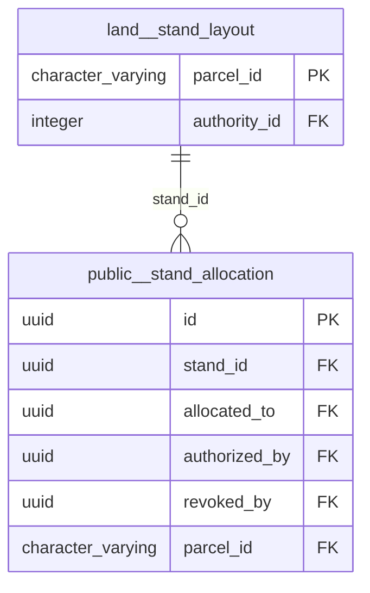

## Relationships, group 3

Tables: `admin_org_position`.

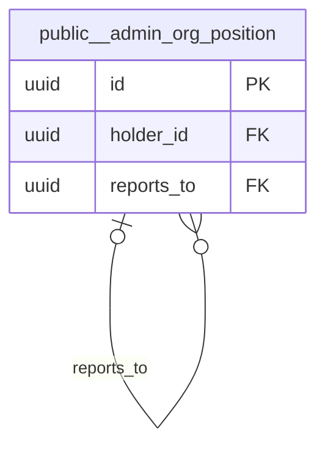

## Relationships, group 4

Tables: `audit_logs`, `admin_users`, `ingestion_jobs`, `style_templates`, `validation_rules`.

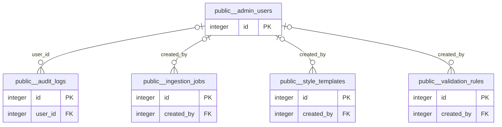

## Relationships, group 5

Tables: `application_comments`, `development_applications`, `application_documents`, `application_timeline`.

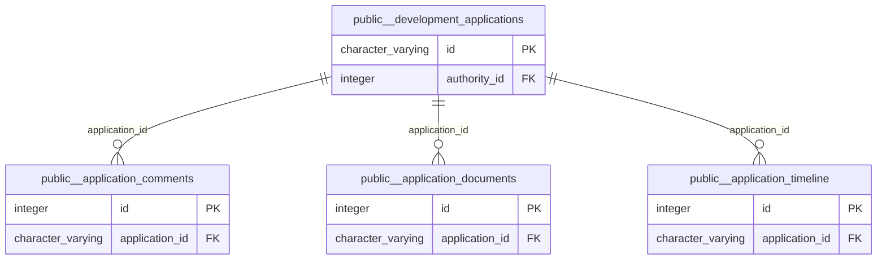

## Relationships, group 6

Tables: `data_load_row`, `data_load`.

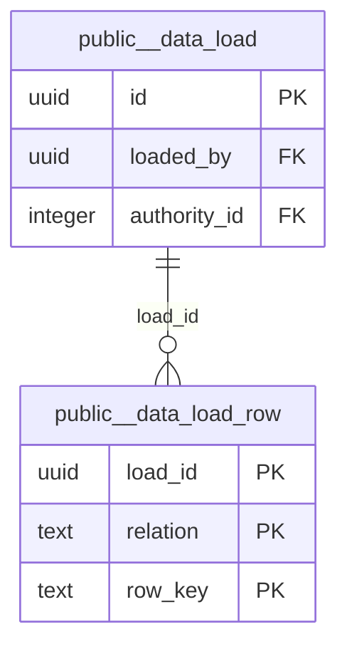

## Relationships, group 7

Tables: `payments`, `exchange_rates`.

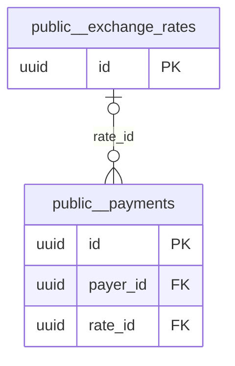

## Relationships, group 8

Tables: `gis_style`, `gis_layer`.

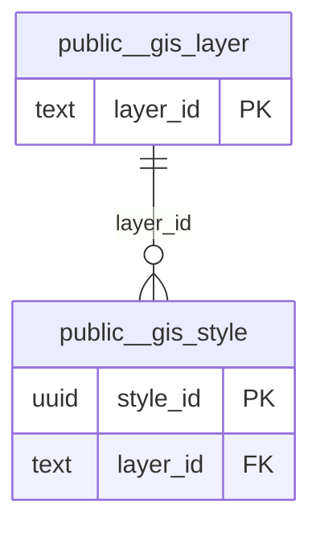

## Relationships, group 9

Tables: `inspection_photos`, `inspection_bookings`, `inspection_status_events`.

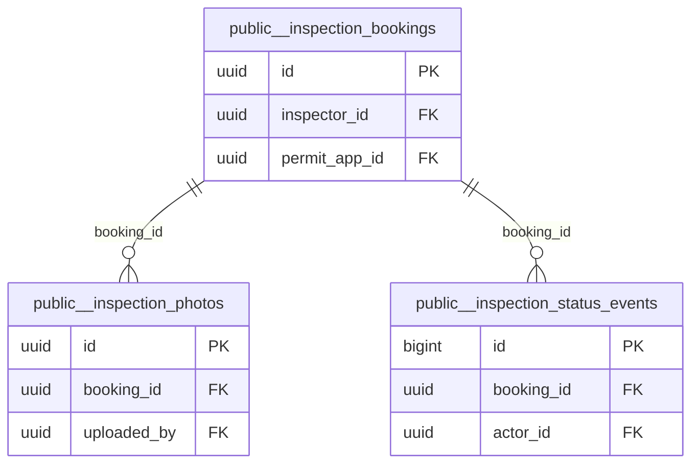

## Relationships, group 10

Tables: `layer_data`, `layers`.

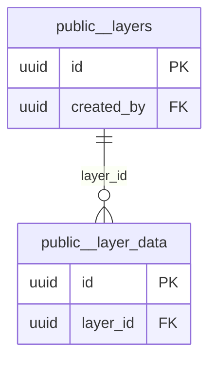

## Relationships, group 11

Tables: `plan_review_findings`, `plan_reviews`.

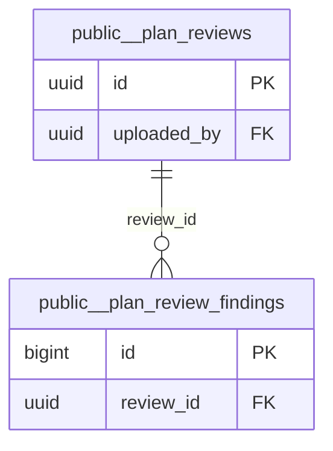

## Tables with no foreign key to or from anything

Imports, registries and reference lists are often right to stand alone. Each is listed so someone can say so on purpose.

| Table | Rows | Kind | Concept |
|---|---:|---|---|
| `admin_areas` | 11 | national | admin_district (duplicate) |
| `application_drafts` | 0 | personal |  |
| `buildings` | 139619 | national | building (canonical) |
| `country` | 1 | national | admin_country (canonical) |
| `development_matrix` | 7 | reference |  |
| `districts` | 91 | national | admin_district (canonical) |
| `farm_match` | 672 | pending |  |
| `gis_style_audit` | 201 | reference |  |
| `gweru_business_centres` | 67 | national | place (source) |
| `gweru_chiefdoms` | 5 | national | chiefdom (canonical) |
| `gweru_health_centres` | 0 | national | point_of_interest (legacy) |
| `gweru_peri_urban_zone` | 42 | pending | planning_zone (legacy) |
| `gweru_rivers` | 260 | national | watercourse (source) |
| `gweru_rural_farms` | 672 | pending | cadastral_parcel (legacy) |
| `gweru_rural_planning_boundary` | 1 | national | authority_area (legacy) |
| `lands_registry_deeds` | 10 | pending |  |
| `landuse` | 121 | national | landuse (canonical) |
| `layer_publication` | 43 | reference |  |
| `natural_areas` | 0 | national | natural_feature (canonical) |
| `natural_points` | 2 | national | natural_feature (source) |
| `notifications_outbox` | 588 | system |  |
| `page_view` | 107 | system |  |
| `places` | 0 | national | place (legacy) |
| `places_areas` | 0 | national | place (canonical) |
| `places_of_worship_areas` | 4 | national | point_of_interest (source) |
| `places_of_worship_points` | 1 | national | point_of_interest (source) |
| `places_points` | 11 | national | place (source) |
| `plan_status_transition` | 5 | reference |  |
| `pois_areas` | 42 | national | point_of_interest (canonical) |
| `pois_points` | 25 | national | point_of_interest (source) |
| `protected_areas` | 2 | national | protected_area (canonical) |
| `provinces` | 10 | national | admin_province (canonical) |
| `railways` | 225 | national | railway (canonical) |
| `ref_application_statuses` | 8 | reference |  |
| `roads` | 2876 | national | road (canonical) |
| `schema_migrations` | 7 | system |  |
| `spatial_layers` | 42 | reference |  |
| `spatial_ref_sys` | 8504 | reference |  |
| `traffic_areas` | 3 | national | transport_feature (canonical) |
| `traffic_points` | 102 | national | transport_feature (source) |
| `transport_areas` | 1 | national | transport_feature (source) |
| `transport_points` | 3 | national | transport_feature (source) |
| `vungu_beyond_peri_urban_zones` | 16 | pending | planning_zone (source) |
| `vungu_cemeteries` | 1 | pending | cemetery (canonical) |
| `vungu_clip_boundary` | 1 | national | authority_area (legacy) |
| `vungu_farm_cadastre` | 687 | national | cadastral_parcel (duplicate) |
| `vungu_parcels` | 733 | national | cadastral_parcel (canonical) |
| `vungu_waste_management` | 2 | pending | waste_facility (canonical) |
| `water_areas` | 66 | national | waterbody (canonical) |
| `waterways` | 80 | national | watercourse (canonical) |

## Tables related only to a hub table

These reference only `public.users`, `spatial_planning.permit_application`, `land.parcel`, `public.local_authorities` (or are referenced by nothing drawn): `admin_announcement`, `admin_audit_event`, `admin_ip_block`, `admin_login_attempt`, `admin_setting`, `analytics`, `api_token`, `application_status_history`, `authority_member`, `citizen_documents`, `invites`, `lands_registry_checks`, `site_content`, `user_profiles`, `user_session`, `user_sessions`.

## Data dictionary

### View `activity_spatial_gaps`

view · tenancy: reference

| Column | Type | Null | Default | Key | Comment |
|---|---|:-:|---|---|---|
| `activity_code` | text | yes |  |  |  |
| `activity` | text | yes |  |  |  |
| `test_code` | text | yes |  |  |  |
| `kind` | text | yes |  |  |  |
| `severity` | text | yes |  |  |  |
| `concept_code` | text | yes |  |  |  |
| `concept` | text | yes |  |  |  |
| `data_status` | text | yes |  |  |  |
| `implemented` | boolean | yes |  |  |  |
| `implemented_in` | text | yes |  |  |  |
| `gap` | text | yes |  |  |  |

### `activity_spatial_test`

42 rows · tenancy: reference

| Column | Type | Null | Default | Key | Comment |
|---|---|:-:|---|---|---|
| `activity_code` | text | no |  | PK FK → public.development_activity.code |  |
| `test_code` | text | no |  | PK |  |
| `concept_code` | text | no |  | FK → public.spatial_concept.code |  |
| `kind` | text | no |  |  |  |
| `distance_m` | numeric | yes |  |  |  |
| `severity` | text | no |  |  |  |
| `description` | text | no |  |  |  |
| `implemented` | boolean | no | false |  |  |
| `implemented_in` | text | yes |  |  |  |
| `evidence_status` | text | no | 'proposed'::text |  |  |

### `activity_standard_kind`

24 rows · tenancy: reference

| Column | Type | Null | Default | Key | Comment |
|---|---|:-:|---|---|---|
| `activity_code` | text | no |  | PK FK → public.development_activity.code |  |
| `kind_code` | text | no |  | PK FK → public.standard_kind.code |  |
| `evidence_status` | text | no | 'proposed'::text |  |  |

### `admin_announcement`

0 rows · tenancy: reference

| Column | Type | Null | Default | Key | Comment |
|---|---|:-:|---|---|---|
| `id` | uuid | no | gen_random_uuid() | PK |  |
| `title` | character varying(160) | no |  |  |  |
| `body` | text | no |  |  |  |
| `level` | character varying(12) | no | 'info'::character varying |  |  |
| `audience` | character varying(12) | no | 'staff'::character varying |  |  |
| `starts_at` | timestamp with time zone | no | now() |  |  |
| `ends_at` | timestamp with time zone | yes |  |  |  |
| `created_at` | timestamp with time zone | no | now() |  |  |
| `created_by` | uuid | yes |  | FK → public.users.id |  |
| `withdrawn_at` | timestamp with time zone | yes |  |  |  |

### `admin_areas`

11 rows · tenancy: national · concept: admin_district (duplicate)

| Column | Type | Null | Default | Key | Comment |
|---|---|:-:|---|---|---|
| `fid` | integer | no |  | PK |  |
| `geom` | geometry(MultiPolygon,4326) | yes |  |  |  |
| `osm_id` | character varying(12) | yes |  |  |  |
| `code` | integer | yes |  |  |  |
| `fclass` | character varying(28) | yes |  |  |  |
| `name` | character varying(100) | yes |  |  |  |

### `admin_audit_event`

1893 rows · tenancy: sensitive

Append-only audit trail: one row per mutating authenticated request. Supersedes the never-created security_audit_log of migration 041.

| Column | Type | Null | Default | Key | Comment |
|---|---|:-:|---|---|---|
| `id` | bigint | no | nextval('admin_audit_event_id_seq'::regclass) | PK |  |
| `occurred_at` | timestamp with time zone | no | now() |  |  |
| `actor_id` | uuid | yes |  | FK → public.users.id |  |
| `actor_email` | character varying(255) | yes |  |  | The actor's email as it stood at the time. Kept when the user row is deleted, because the FK is nullable and a nameless trail proves nothing. |
| `actor_role` | character varying(40) | yes |  |  |  |
| `event` | character varying(48) | no |  |  |  |
| `severity` | character varying(12) | no | 'low'::character varying |  |  |
| `method` | character varying(8) | yes |  |  |  |
| `path` | text | yes |  |  |  |
| `status` | smallint | yes |  |  |  |
| `duration_ms` | integer | yes |  |  |  |
| `entity_type` | character varying(48) | yes |  |  |  |
| `entity_id` | character varying(64) | yes |  |  |  |
| `ip` | inet | yes |  |  |  |
| `user_agent` | text | yes |  |  |  |
| `details` | jsonb | no | '{}'::jsonb |  |  |

### `admin_ip_block`

0 rows · tenancy: sensitive

| Column | Type | Null | Default | Key | Comment |
|---|---|:-:|---|---|---|
| `id` | uuid | no | gen_random_uuid() | PK |  |
| `cidr` | cidr | no |  |  | A single address is stored as a /32 (or /128). Containment `cidr >>= $ip` covers both cases. |
| `reason` | text | no |  |  |  |
| `created_at` | timestamp with time zone | no | now() |  |  |
| `created_by` | uuid | yes |  | FK → public.users.id |  |
| `expires_at` | timestamp with time zone | yes |  |  |  |
| `released_at` | timestamp with time zone | yes |  |  |  |
| `released_by` | uuid | yes |  | FK → public.users.id |  |

### `admin_login_attempt`

1936 rows · tenancy: sensitive

Every sign-in attempt. Drives the lockout rule (security.max_failed_attempts) and the console's sign-in security view.

| Column | Type | Null | Default | Key | Comment |
|---|---|:-:|---|---|---|
| `id` | bigint | no | nextval('admin_login_attempt_id_seq'::regclass) | PK |  |
| `attempted_at` | timestamp with time zone | no | now() |  |  |
| `email` | character varying(255) | no |  |  |  |
| `user_id` | uuid | yes |  | FK → public.users.id |  |
| `ip` | inet | yes |  |  |  |
| `user_agent` | text | yes |  |  |  |
| `succeeded` | boolean | no |  |  |  |
| `reason` | character varying(40) | yes |  |  |  |

### `admin_org_position`

8 rows · tenancy: sensitive

Establishment posts, not people. holder_id IS NULL is a vacancy — the case the hardcoded org chart in AdminView.vue could not represent.

| Column | Type | Null | Default | Key | Comment |
|---|---|:-:|---|---|---|
| `id` | uuid | no | gen_random_uuid() | PK |  |
| `title` | character varying(160) | no |  |  |  |
| `department` | character varying(120) | yes |  |  |  |
| `system_role` | character varying(40) | yes |  |  |  |
| `holder_id` | uuid | yes |  | FK → public.users.id |  |
| `reports_to` | uuid | yes |  | FK → public.admin_org_position.id |  |
| `sort_order` | integer | no | 0 |  |  |
| `created_at` | timestamp with time zone | no | now() |  |  |
| `updated_at` | timestamp with time zone | no | now() |  |  |

### `admin_setting`

17 rows · tenancy: reference

| Column | Type | Null | Default | Key | Comment |
|---|---|:-:|---|---|---|
| `key` | character varying(80) | no |  | PK |  |
| `value` | text | yes |  |  |  |
| `value_type` | character varying(12) | no | 'string'::character varying |  |  |
| `category` | character varying(40) | no | 'general'::character varying |  |  |
| `label` | character varying(160) | no |  |  |  |
| `description` | text | yes |  |  |  |
| `constraints` | jsonb | no | '{}'::jsonb |  |  |
| `enforced` | boolean | no | false |  | true when the server reads this key and changes behaviour. false = recorded only. The console shows the difference so an admin is never misled about what a swit |
| `secret` | boolean | no | false |  |  |
| `updated_at` | timestamp with time zone | no | now() |  |  |
| `updated_by` | uuid | yes |  | FK → public.users.id |  |

### `admin_users`

1 rows · tenancy: sensitive

Administrative users with roles and permissions

| Column | Type | Null | Default | Key | Comment |
|---|---|:-:|---|---|---|
| `id` | integer | no | nextval('admin_users_id_seq'::regclass) | PK |  |
| `email` | character varying(255) | no |  |  |  |
| `password_hash` | character varying(255) | no |  |  |  |
| `role` | character varying(50) | no | 'viewer'::character varying |  |  |
| `permissions` | jsonb | no | '[]'::jsonb |  |  |
| `first_name` | character varying(100) | yes |  |  |  |
| `last_name` | character varying(100) | yes |  |  |  |
| `is_active` | boolean | yes | true |  |  |
| `last_login` | timestamp with time zone | yes |  |  |  |
| `created_at` | timestamp with time zone | yes | now() |  |  |
| `updated_at` | timestamp with time zone | yes | now() |  |  |

### `analytics`

0 rows · tenancy: system

| Column | Type | Null | Default | Key | Comment |
|---|---|:-:|---|---|---|
| `id` | uuid | no | uuid_generate_v4() | PK |  |
| `user_id` | uuid | yes |  | FK → public.users.id |  |
| `action` | character varying(100) | no |  |  |  |
| `resource_type` | character varying(100) | yes |  |  |  |
| `resource_id` | character varying(255) | yes |  |  |  |
| `metadata` | jsonb | yes | '{}'::jsonb |  |  |
| `ip_address` | inet | yes |  |  |  |
| `user_agent` | text | yes |  |  |  |
| `created_at` | timestamp with time zone | yes | now() |  |  |

### `api_token`

1 rows · tenancy: sensitive

| Column | Type | Null | Default | Key | Comment |
|---|---|:-:|---|---|---|
| `jti` | uuid | no |  | PK |  |
| `user_id` | uuid | no |  | FK → public.users.id |  |
| `plugin` | text | yes |  |  |  |
| `issued_at` | timestamp with time zone | no | now() |  |  |
| `expires_at` | timestamp with time zone | no |  |  |  |
| `last_used_at` | timestamp with time zone | yes |  |  |  |
| `revoked_at` | timestamp with time zone | yes |  |  |  |
| `revoked_by` | uuid | yes |  | FK → public.users.id |  |

### `application_comments`

0 rows · tenancy: pending

| Column | Type | Null | Default | Key | Comment |
|---|---|:-:|---|---|---|
| `id` | integer | no | nextval('application_comments_id_seq'::regclass) | PK |  |
| `application_id` | character varying(20) | no |  | FK → public.development_applications.id |  |
| `comment_text` | text | no |  |  |  |
| `is_internal` | boolean | yes | false |  |  |
| `created_at` | timestamp with time zone | yes | now() |  |  |

### `application_documents`

0 rows · tenancy: pending

| Column | Type | Null | Default | Key | Comment |
|---|---|:-:|---|---|---|
| `id` | integer | no | nextval('application_documents_id_seq'::regclass) | PK |  |
| `application_id` | character varying(20) | no |  | FK → public.development_applications.id |  |
| `document_name` | character varying(255) | no |  |  |  |
| `document_type` | character varying(100) | no |  |  |  |
| `file_size` | bigint | yes |  |  |  |
| `file_url` | text | yes |  |  |  |
| `uploaded_at` | timestamp with time zone | yes | now() |  |  |

### `application_drafts`

0 rows · tenancy: personal

| Column | Type | Null | Default | Key | Comment |
|---|---|:-:|---|---|---|
| `id` | character varying(25) | no |  | PK |  |
| `user_id` | character varying(50) | no |  |  |  |
| `draft_data` | jsonb | no |  |  |  |
| `created_at` | timestamp with time zone | yes | now() |  |  |
| `updated_at` | timestamp with time zone | yes | now() |  |  |

### `application_status_history`

0 rows · tenancy: pending

| Column | Type | Null | Default | Key | Comment |
|---|---|:-:|---|---|---|
| `id` | bigint | no | nextval('application_status_history_id_seq'::regclass) | PK |  |
| `application_id` | character varying(32) | no |  |  |  |
| `from_status` | character varying(64) | yes |  |  |  |
| `to_status` | character varying(64) | no |  |  |  |
| `changed_by` | uuid | yes |  | FK → public.users.id |  |
| `notes` | text | yes |  |  |  |
| `changed_at` | timestamp with time zone | no | now() |  |  |

### View `application_summary`

view · tenancy: pending

| Column | Type | Null | Default | Key | Comment |
|---|---|:-:|---|---|---|
| `id` | character varying(20) | yes |  |  |  |
| `user_id` | character varying(50) | yes |  |  |  |
| `status` | character varying(50) | yes |  |  |  |
| `submitted_at` | timestamp with time zone | yes |  |  |  |
| `updated_at` | timestamp with time zone | yes |  |  |  |
| `parcel_name` | text | yes |  |  |  |
| `parcel_id` | text | yes |  |  |  |
| `applicant_name` | text | yes |  |  |  |
| `contact_email` | text | yes |  |  |  |
| `development_type` | text | yes |  |  |  |
| `total_fees` | numeric | yes |  |  |  |
| `document_count` | bigint | yes |  |  |  |

### `application_timeline`

0 rows · tenancy: pending

| Column | Type | Null | Default | Key | Comment |
|---|---|:-:|---|---|---|
| `id` | integer | no | nextval('application_timeline_id_seq'::regclass) | PK |  |
| `application_id` | character varying(20) | no |  | FK → public.development_applications.id |  |
| `event_type` | character varying(50) | no |  |  |  |
| `event_description` | text | yes |  |  |  |
| `event_date` | timestamp with time zone | no |  |  |  |
| `created_at` | timestamp with time zone | yes | now() |  |  |

### `audit_logs`

0 rows · tenancy: sensitive

Audit trail for all admin operations

| Column | Type | Null | Default | Key | Comment |
|---|---|:-:|---|---|---|
| `id` | integer | no | nextval('audit_logs_id_seq'::regclass) | PK |  |
| `entity_type` | character varying(50) | no |  |  |  |
| `entity_id` | integer | no |  |  |  |
| `action` | character varying(50) | no |  |  |  |
| `old_values` | jsonb | yes |  |  |  |
| `new_values` | jsonb | yes |  |  |  |
| `user_id` | integer | yes |  | FK → public.admin_users.id |  |
| `ip_address` | inet | yes |  |  |  |
| `user_agent` | text | yes |  |  |  |
| `session_id` | character varying(255) | yes |  |  |  |
| `created_at` | timestamp with time zone | yes | now() |  |  |

### `authority_member`

0 rows · tenancy: reference

| Column | Type | Null | Default | Key | Comment |
|---|---|:-:|---|---|---|
| `combination_id` | integer | no |  | PK FK → public.local_authorities.id |  |
| `member_id` | integer | no |  | PK FK → public.local_authorities.id |  |
| `valid_from` | date | no | CURRENT_DATE | PK |  |
| `valid_to` | date | yes |  |  |  |

### `buildings`

139619 rows · tenancy: national · concept: building (canonical)

| Column | Type | Null | Default | Key | Comment |
|---|---|:-:|---|---|---|
| `fid` | integer | no |  | PK |  |
| `geom` | geometry(MultiPolygon,4326) | yes |  |  |  |
| `osm_id` | character varying(12) | yes |  |  |  |
| `code` | integer | yes |  |  |  |
| `fclass` | character varying(28) | yes |  |  |  |
| `name` | character varying(100) | yes |  |  |  |
| `type` | character varying(20) | yes |  |  |  |

### `citizen_documents`

2 rows · tenancy: pending

| Column | Type | Null | Default | Key | Comment |
|---|---|:-:|---|---|---|
| `id` | uuid | no | gen_random_uuid() | PK |  |
| `user_id` | uuid | no |  | FK → public.users.id |  |
| `doc_kind` | character varying(32) | no |  |  |  |
| `storage_url` | text | no |  |  |  |
| `mime_type` | character varying(64) | no |  |  |  |
| `bytes` | bigint | no |  |  |  |
| `sha256_hex` | character varying(64) | yes |  |  |  |
| `extracted_name` | character varying(255) | yes |  |  |  |
| `extracted_id_number` | character varying(64) | yes |  |  |  |
| `extracted_dob` | date | yes |  |  |  |
| `verification_status` | character varying(20) | no | 'pending'::character varying |  |  |
| `verification_notes` | text | yes |  |  |  |
| `verified_by` | uuid | yes |  | FK → public.users.id |  |
| `verified_at` | timestamp with time zone | yes |  |  |  |
| `verifier_provider` | character varying(32) | yes |  |  |  |
| `verifier_payload` | jsonb | yes |  |  |  |
| `verifier_confidence` | numeric(5,4) | yes |  |  |  |
| `created_at` | timestamp with time zone | no | now() |  |  |
| `updated_at` | timestamp with time zone | no | now() |  |  |
| `deleted_at` | timestamp with time zone | yes |  |  |  |
| `deleted_by` | uuid | yes |  |  |  |

### `country`

1 rows · tenancy: national · concept: admin_country (canonical)

Zimbabwe national boundary (ADM0)

| Column | Type | Null | Default | Key | Comment |
|---|---|:-:|---|---|---|
| `fid` | integer | no | nextval('country_fid_seq'::regclass) | PK |  |
| `geom` | geometry(MultiPolygon,4326) | yes |  |  |  |
| `pcode` | character varying | yes |  |  |  |
| `name_en` | character varying | yes |  |  |  |
| `parent_pcode` | character varying | yes |  |  |  |
| `level` | bigint | yes |  |  |  |

### `data_load`

0 rows · tenancy: tenant

One row per attempt to load real data: what, from whom, the file and its checksum, the outcome. Append-only; reversal changes status. Migration 188.

| Column | Type | Null | Default | Key | Comment |
|---|---|:-:|---|---|---|
| `id` | uuid | no | gen_random_uuid() | PK |  |
| `kind` | text | no |  |  |  |
| `source` | text | no |  |  |  |
| `custodian` | text | no |  |  |  |
| `source_file` | text | yes |  |  |  |
| `source_sha256` | text | yes |  |  |  |
| `status` | text | no |  |  |  |
| `rows_read` | integer | no | 0 |  |  |
| `rows_loaded` | integer | no | 0 |  |  |
| `rows_rejected` | integer | no | 0 |  |  |
| `report` | jsonb | no | '{}'::jsonb |  |  |
| `loaded_by` | uuid | yes |  | FK → public.users.id |  |
| `loaded_by_label` | text | yes |  |  |  |
| `note` | text | yes |  |  |  |
| `started_at` | timestamp with time zone | no | now() |  |  |
| `finished_at` | timestamp with time zone | yes |  |  |  |
| `reversed_at` | timestamp with time zone | yes |  |  |  |
| `reversed_by_label` | text | yes |  |  |  |
| `reversal_report` | jsonb | yes |  |  |  |
| `authority_id` | integer | no | app.authority_id() | FK → public.local_authorities.id |  |

### `data_load_row`

0 rows · tenancy: tenant_child

The rows a load put into each relation, so a load can be found in the data and taken out again. Append-only. Migration 188.

| Column | Type | Null | Default | Key | Comment |
|---|---|:-:|---|---|---|
| `load_id` | uuid | no |  | PK FK → public.data_load.id |  |
| `relation` | text | no |  | PK |  |
| `row_key` | text | no |  | PK |  |

### `decision_pathway`

1 rows · tenancy: reference

| Column | Type | Null | Default | Key | Comment |
|---|---|:-:|---|---|---|
| `code` | text | no |  | PK |  |
| `name` | text | no |  |  |  |
| `decision` | text | no |  |  |  |
| `requires_public_notice` | boolean | yes |  |  |  |
| `notice_at_applicant_cost` | boolean | yes |  |  |  |
| `adjacent_owners_notified` | boolean | yes |  |  |  |
| `objection_days` | integer | yes |  |  |  |
| `decision_body` | text | yes |  |  |  |
| `statutory_ref` | text | yes |  |  |  |
| `evidence_status` | text | no | 'unverified'::text |  |  |
| `evidence` | text | yes |  |  |  |
| `is_default_for_decision` | boolean | no | false |  |  |
| `created_at` | timestamp with time zone | no | now() |  |  |

### `development_activity`

8 rows · tenancy: reference

| Column | Type | Null | Default | Key | Comment |
|---|---|:-:|---|---|---|
| `code` | text | no |  | PK |  |
| `name` | text | no |  |  |  |
| `tests` | text | no |  |  |  |
| `matrix_lookup` | boolean | no | false |  |  |
| `description` | text | yes |  |  |  |
| `statutory_ref` | text | yes |  |  |  |
| `evidence_status` | text | no | 'proposed'::text |  |  |
| `display_order` | integer | no | 100 |  |  |
| `is_active` | boolean | no | true |  |  |
| `created_at` | timestamp with time zone | no | now() |  |  |

### `development_applications`

0 rows · tenancy: personal

RETIRED: no caller. The canonical intake is spatial_planning.permit_application (POST /permit-applications).

| Column | Type | Null | Default | Key | Comment |
|---|---|:-:|---|---|---|
| `id` | character varying(20) | no |  | PK |  |
| `user_id` | character varying(50) | no |  |  |  |
| `selection_data` | jsonb | no |  |  |  |
| `eligibility_data` | jsonb | no |  |  |  |
| `form_data` | jsonb | no |  |  |  |
| `fees_data` | jsonb | yes |  |  |  |
| `status` | character varying(50) | yes | 'submitted'::character varying |  |  |
| `submitted_at` | timestamp with time zone | yes |  |  |  |
| `created_at` | timestamp with time zone | yes | now() |  |  |
| `updated_at` | timestamp with time zone | yes | now() |  |  |
| `authority_id` | integer | yes | 1 | FK → public.local_authorities.id |  |

### `development_matrix`

7 rows · tenancy: reference

Matrix defining permitted uses for each zone type

| Column | Type | Null | Default | Key | Comment |
|---|---|:-:|---|---|---|
| `id` | integer | no | nextval('development_matrix_id_seq'::regclass) | PK |  |
| `zone_code` | text | no |  |  |  |
| `use_code` | text | no |  |  |  |
| `permission_code` | text | no |  |  |  |
| `permission_description` | text | yes |  |  |  |
| `conditions` | text | yes |  |  |  |
| `restrictions` | text | yes |  |  |  |
| `created_at` | timestamp without time zone | yes | CURRENT_TIMESTAMP |  |  |
| `updated_at` | timestamp without time zone | yes | CURRENT_TIMESTAMP |  |  |

### `districts`

91 rows · tenancy: national · concept: admin_district (canonical)

Zimbabwe district boundaries (ADM2)

| Column | Type | Null | Default | Key | Comment |
|---|---|:-:|---|---|---|
| `fid` | integer | no | nextval('districts_fid_seq'::regclass) | PK |  |
| `geom` | geometry(MultiPolygon,4326) | yes |  |  |  |
| `pcode` | character varying | yes |  |  |  |
| `name_en` | character varying | yes |  |  |  |
| `parent_pcode` | character varying | yes |  |  |  |
| `level` | bigint | yes |  |  |  |

### `exchange_rates`

0 rows · tenancy: reference

Daily interbank rates. The system selects the most recent (rate_date DESC) when computing ZiG↔USD conversion. Authority defaults to RBZ.

| Column | Type | Null | Default | Key | Comment |
|---|---|:-:|---|---|---|
| `id` | uuid | no | gen_random_uuid() | PK |  |
| `rate_date` | date | no |  |  |  |
| `base_ccy` | character varying(8) | no | 'USD'::character varying |  |  |
| `quote_ccy` | character varying(8) | no | 'ZWG'::character varying |  |  |
| `rate` | numeric(20,8) | no |  |  |  |
| `source` | character varying(64) | no |  |  |  |
| `source_url` | text | yes |  |  |  |
| `fetched_at` | timestamp with time zone | no | now() |  |  |
| `created_at` | timestamp with time zone | no | now() |  |  |

### `farm_match`

672 rows · tenancy: pending

| Column | Type | Null | Default | Key | Comment |
|---|---|:-:|---|---|---|
| `farm_id` | integer | no |  | PK |  |
| `farm_name` | text | yes |  |  |  |
| `zone_id` | integer | yes |  |  |  |
| `farm_geometry` | text | no |  |  |  |
| `parcel_fid` | integer | yes |  |  |  |
| `parcel_name` | text | yes |  |  |  |
| `parcel_overlap` | numeric | yes |  |  |  |
| `parcel_name_match` | boolean | yes |  |  |  |
| `parcels_close` | integer | yes |  |  |  |
| `cadastre_fid` | integer | yes |  |  |  |
| `cadastre_name` | text | yes |  |  |  |
| `cadastre_overlap` | numeric | yes |  |  |  |
| `cadastre_name_match` | boolean | yes |  |  |  |
| `status` | text | no |  |  |  |
| `reason` | text | yes |  |  |  |
| `decision` | text | yes |  |  |  |
| `decided_by` | text | yes |  |  |  |
| `decided_at` | timestamp with time zone | yes |  |  |  |
| `computed_at` | timestamp with time zone | no | now() |  |  |
| `zone_old_name` | text | yes |  |  |  |
| `zone_remapped_id` | integer | yes |  |  |  |
| `zone_derived_id` | integer | yes |  |  |  |
| `zone_derived_name` | text | yes |  |  |  |
| `zone_check` | text | yes |  |  |  |

### View `geography_columns`

view · tenancy: reference

| Column | Type | Null | Default | Key | Comment |
|---|---|:-:|---|---|---|
| `f_table_catalog` | name | yes |  |  |  |
| `f_table_schema` | name | yes |  |  |  |
| `f_table_name` | name | yes |  |  |  |
| `f_geography_column` | name | yes |  |  |  |
| `coord_dimension` | integer | yes |  |  |  |
| `srid` | integer | yes |  |  |  |
| `type` | text | yes |  |  |  |

### View `geometry_columns`

view · tenancy: reference

| Column | Type | Null | Default | Key | Comment |
|---|---|:-:|---|---|---|
| `f_table_catalog` | character varying(256) | yes |  |  |  |
| `f_table_schema` | name | yes |  |  |  |
| `f_table_name` | name | yes |  |  |  |
| `f_geometry_column` | name | yes |  |  |  |
| `coord_dimension` | integer | yes |  |  |  |
| `srid` | integer | yes |  |  |  |
| `type` | character varying(30) | yes |  |  |  |

### `gis_layer`

31 rows · tenancy: reference

Governed enterprise GIS layer catalogue. Carries no symbology - see gis_style.

| Column | Type | Null | Default | Key | Comment |
|---|---|:-:|---|---|---|
| `layer_id` | text | no |  | PK |  |
| `display_name` | text | no |  |  |  |
| `description` | text | yes |  |  |  |
| `geometry` | text | no |  |  |  |
| `data_source` | text | yes |  |  |  |
| `data_srid` | integer | yes |  |  |  |
| `data_synced_at` | timestamp with time zone | yes |  |  | When spatial DATA last synced. Independent of style publication. |
| `qgis_project` | text | yes |  |  |  |
| `qgis_layer` | text | yes |  |  |  |
| `owner` | text | yes |  |  |  |
| `steward` | text | yes |  |  |  |
| `access_roles` | text[] | no | ARRAY['admin'::text, 'gis_officer'::text, 'planner'::text] |  |  |
| `min_zoom` | integer | yes |  |  |  |
| `max_zoom` | integer | yes |  |  |  |
| `is_active` | boolean | no | true |  |  |
| `metadata` | jsonb | no | '{}'::jsonb |  |  |
| `created_at` | timestamp with time zone | no | now() |  |  |
| `updated_at` | timestamp with time zone | no | now() |  |  |

### View `gis_published_style`

view · tenancy: reference

Production style resolution. LEFT JOIN: a layer with no published style resolves to NULL and the client must fall back, never guess.

| Column | Type | Null | Default | Key | Comment |
|---|---|:-:|---|---|---|
| `layer_id` | text | yes |  |  |  |
| `display_name` | text | yes |  |  |  |
| `description` | text | yes |  |  |  |
| `geometry` | text | yes |  |  |  |
| `data_source` | text | yes |  |  |  |
| `data_srid` | integer | yes |  |  |  |
| `data_synced_at` | timestamp with time zone | yes |  |  |  |
| `qgis_project` | text | yes |  |  |  |
| `qgis_layer` | text | yes |  |  |  |
| `owner` | text | yes |  |  |  |
| `steward` | text | yes |  |  |  |
| `access_roles` | text[] | yes |  |  |  |
| `min_zoom` | integer | yes |  |  |  |
| `max_zoom` | integer | yes |  |  |  |
| `style_id` | uuid | yes |  |  |  |
| `style_name` | text | yes |  |  |  |
| `style_version` | integer | yes |  |  |  |
| `source` | text | yes |  |  |  |
| `source_path` | text | yes |  |  |  |
| `definition` | jsonb | yes |  |  |  |
| `renderer_type` | text | yes |  |  |  |
| `classification_attribute` | text | yes |  |  |  |
| `classification_method` | text | yes |  |  |  |
| `opacity` | numeric(4,3) | yes |  |  |  |
| `fidelity` | text | yes |  |  |  |
| `fidelity_notes` | jsonb | yes |  |  |  |
| `checksum` | text | yes |  |  |  |
| `approved_by` | text | yes |  |  |  |
| `published_by` | text | yes |  |  |  |
| `style_published_at` | timestamp with time zone | yes |  |  |  |

### `gis_style`

33 rows · tenancy: reference

| Column | Type | Null | Default | Key | Comment |
|---|---|:-:|---|---|---|
| `style_id` | uuid | no | gen_random_uuid() | PK |  |
| `layer_id` | text | no |  | FK → public.gis_layer.layer_id |  |
| `style_name` | text | no |  |  |  |
| `style_version` | integer | no |  |  |  |
| `status` | gis_style_status | no | 'draft'::gis_style_status |  |  |
| `source` | text | no | 'qgis'::text |  |  |
| `source_path` | text | yes |  |  |  |
| `source_checksum` | text | yes |  |  |  |
| `definition` | jsonb | no |  |  | Renderer-neutral style doc (vungu.gis.style/1). Immutable once published. |
| `renderer_type` | text | no |  |  |  |
| `classification_attribute` | text | yes |  |  |  |
| `classification_method` | text | yes |  |  |  |
| `scale_min_zoom` | integer | yes |  |  |  |
| `scale_max_zoom` | integer | yes |  |  |  |
| `opacity` | numeric(4,3) | no | 1.000 |  |  |
| `fidelity` | text | no | 'direct'::text |  | MapLibre representability. `server` routes the layer to QGIS Server WMS instead of vector tiles. |
| `fidelity_notes` | jsonb | no | '[]'::jsonb |  |  |
| `checksum` | text | no |  |  |  |
| `metadata` | jsonb | no | '{}'::jsonb |  |  |
| `change_summary` | text | yes |  |  |  |
| `created_by` | text | yes |  |  |  |
| `approved_by` | text | yes |  |  |  |
| `published_by` | text | yes |  |  |  |
| `created_at` | timestamp with time zone | no | now() |  |  |
| `updated_at` | timestamp with time zone | no | now() |  |  |
| `approved_at` | timestamp with time zone | yes |  |  |  |
| `published_at` | timestamp with time zone | yes |  |  |  |

### `gis_style_audit`

201 rows · tenancy: reference

| Column | Type | Null | Default | Key | Comment |
|---|---|:-:|---|---|---|
| `audit_id` | bigint | no | nextval('gis_style_audit_audit_id_seq'::regclass) | PK |  |
| `layer_id` | text | no |  |  |  |
| `style_id` | uuid | yes |  |  |  |
| `event` | text | no |  |  |  |
| `from_status` | gis_style_status | yes |  |  |  |
| `to_status` | gis_style_status | yes |  |  |  |
| `from_version` | integer | yes |  |  |  |
| `to_version` | integer | yes |  |  |  |
| `reason` | text | yes |  |  |  |
| `change_summary` | text | yes |  |  |  |
| `source_path` | text | yes |  |  |  |
| `checksum` | text | yes |  |  |  |
| `actor` | text | yes |  |  |  |
| `actor_role` | text | yes |  |  |  |
| `detail` | jsonb | no | '{}'::jsonb |  |  |
| `created_at` | timestamp with time zone | no | now() |  |  |

### `gweru_business_centres`

67 rows · tenancy: national · concept: place (source)

| Column | Type | Null | Default | Key | Comment |
|---|---|:-:|---|---|---|
| `id` | integer | no | nextval('gweru_business_centres_id_seq'::regclass) | PK |  |
| `geom` | geometry(Point,4326) | yes |  |  |  |
| `fid` | integer | yes |  |  |  |
| `province_n` | character varying(254) | yes |  |  |  |
| `district_n` | character varying(254) | yes |  |  |  |
| `ward_no_` | integer | yes |  |  |  |
| `village_na` | character varying(254) | yes |  |  |  |
| `sector` | character varying(254) | yes |  |  |  |
| `admin3name` | character varying(254) | yes |  |  |  |
| `admin3pcod` | character varying(254) | yes |  |  |  |
| `admin2name` | character varying(254) | yes |  |  |  |
| `admin2pcod` | character varying(254) | yes |  |  |  |
| `admin1name` | character varying(254) | yes |  |  |  |
| `admin1pcod` | character varying(254) | yes |  |  |  |

### `gweru_chiefdoms`

5 rows · tenancy: national · concept: chiefdom (canonical)

| Column | Type | Null | Default | Key | Comment |
|---|---|:-:|---|---|---|
| `id` | integer | no | nextval('gweru_chiefdoms_id_seq'::regclass) | PK |  |
| `geom` | geometry(MultiPolygon,4326) | yes |  |  |  |
| `national` | character varying(254) | yes |  |  |  |
| `province` | character varying(50) | yes |  |  |  |
| `district` | character varying(50) | yes |  |  |  |
| `wardnumber` | integer | yes |  |  |  |
| `local_auth` | character varying(50) | yes |  |  |  |
| `assembly` | character varying(50) | yes |  |  |  |
| `chief` | character varying(254) | yes |  |  |  |
| `layer` | character varying(254) | yes |  |  |  |
| `path` | character varying(254) | yes |  |  |  |

### `gweru_health_centres`

0 rows · tenancy: national · concept: point_of_interest (legacy)

| Column | Type | Null | Default | Key | Comment |
|---|---|:-:|---|---|---|
| `id` | integer | no |  | PK |  |
| `geom` | geometry(MultiPoint,4326) | yes |  |  |  |
| `district` | character varying(50) | yes |  |  |  |
| `longitude` | double precision | yes |  |  |  |
| `latitude` | double precision | yes |  |  |  |
| `elevation` | double precision | yes |  |  |  |
| `updated` | integer | yes |  |  |  |
| `nameoffaci` | character varying(50) | yes |  |  |  |
| `ownership` | character varying(50) | yes |  |  |  |
| `yearbuilt` | integer | yes |  |  |  |
| `typeoffaci` | character varying(50) | yes |  |  |  |
| `numofdocto` | integer | yes |  |  |  |
| `numofnurse` | integer | yes |  |  |  |
| `numofnur_1` | integer | yes |  |  |  |
| `numofpcn` | integer | yes |  |  |  |
| `numofehts` | integer | yes |  |  |  |
| `numofpharm` | integer | yes |  |  |  |
| `numoflabte` | integer | yes |  |  |  |
| `numofbeds` | integer | yes |  |  |  |
| `numofmater` | integer | yes |  |  |  |
| `numofgener` | integer | yes |  |  |  |
| `cathmentpo` | integer | yes |  |  |  |
| `distneares` | double precision | yes |  |  |  |
| `hascommuni` | integer | yes |  |  |  |
| `hascommu_1` | integer | yes |  |  |  |
| `haswaterpi` | integer | yes |  |  |  |
| `haswaterun` | integer | yes |  |  |  |
| `haselectri` | integer | yes |  |  |  |
| `haselect_1` | integer | yes |  |  |  |
| `distnear_1` | double precision | yes |  |  |  |
| `hassanitat` | integer | yes |  |  |  |
| `hassanit_1` | integer | yes |  |  |  |
| `hassanit_2` | integer | yes |  |  |  |
| `hassecurit` | integer | yes |  |  |  |
| `hassecur_1` | integer | yes |  |  |  |
| `hasroadtar` | integer | yes |  |  |  |
| `hasroadgra` | integer | yes |  |  |  |
| `hasinciner` | integer | yes |  |  |  |
| `hasautoway` | integer | yes |  |  |  |
| `hasdental` | integer | yes |  |  |  |
| `comments` | character varying(254) | yes |  |  |  |
| `type_edite` | character varying(40) | yes |  |  |  |

### `gweru_peri_urban_zone`

42 rows · tenancy: pending · concept: planning_zone (legacy)

| Column | Type | Null | Default | Key | Comment |
|---|---|:-:|---|---|---|
| `id` | integer | no |  | PK |  |
| `geom` | geometry(MultiPolygon,4326) | yes |  |  |  |
| `fid` | double precision | yes |  |  |  |
| `area_ha` | double precision | yes |  |  |  |
| `zone` | character varying(50) | yes |  |  |  |
| `area` | double precision | yes |  |  |  |
| `lb` | character varying(50) | yes |  |  |  |
| `shape_leng` | double precision | yes |  |  |  |
| `shape_area` | double precision | yes |  |  |  |
| `zone_code` | character varying(10) | yes |  |  |  |
| `zone_type` | character varying(50) | yes |  |  |  |
| `map_color` | character varying(7) | yes |  |  |  |
| `display_order` | integer | yes |  |  |  |
| `is_active` | boolean | yes |  |  |  |

### `gweru_rivers`

260 rows · tenancy: national · concept: watercourse (source)

| Column | Type | Null | Default | Key | Comment |
|---|---|:-:|---|---|---|
| `id` | integer | no | nextval('gweru_rivers_id_seq'::regclass) | PK |  |
| `geom` | geometry(MultiLineString,4326) | yes |  |  |  |
| `fid_1` | integer | yes |  |  |  |
| `fid` | numeric | yes |  |  |  |
| `fnode_` | numeric | yes |  |  |  |
| `tnode_` | numeric | yes |  |  |  |
| `lpoly_` | numeric | yes |  |  |  |
| `rpoly_` | numeric | yes |  |  |  |
| `length` | numeric | yes |  |  |  |
| `river_n` | character varying(254) | yes |  |  |  |
| `river_type` | character varying(254) | yes |  |  |  |
| `shape_leng` | numeric | yes |  |  |  |

### `gweru_rural_farms`

672 rows · tenancy: pending · concept: cadastral_parcel (legacy)

| Column | Type | Null | Default | Key | Comment |
|---|---|:-:|---|---|---|
| `id` | integer | no | nextval('gweru_rural_farms_id_seq'::regclass) | PK |  |
| `geom` | geometry(MultiPolygon,4326) | yes |  |  |  |
| `objectid` | integer | yes |  |  |  |
| `row_id` | character varying(7) | yes |  |  |  |
| `name` | character varying(40) | yes |  |  |  |
| `name_cfu` | character varying(40) | yes |  |  |  |
| `map_sheet` | character varying(40) | yes |  |  |  |
| `province` | character varying(40) | yes |  |  |  |
| `district` | character varying(40) | yes |  |  |  |
| `status` | character varying(25) | yes |  |  |  |
| `area_km2` | double precision | yes |  |  |  |
| `area_ha` | double precision | yes |  |  |  |
| `area_acre` | double precision | yes |  |  |  |
| `area_km` | double precision | yes |  |  |  |
| `shape_leng` | double precision | yes |  |  |  |
| `shape_area` | double precision | yes |  |  |  |
| `zone_id` | integer | yes |  |  |  |
| `current_land_use_group_id` | uuid | yes |  |  |  |
| `compliance_status` | character varying(20) | yes |  |  |  |
| `last_compliance_check` | timestamp with time zone | yes |  |  |  |
| `area_hectares` | numeric(12,4) | yes |  |  |  |
| `street_address` | text | yes |  |  |  |
| `title_deed_type` | character varying(50) | yes |  |  |  |
| `title_deed_number` | character varying(100) | yes |  |  |  |
| `title_deed_info` | jsonb | yes |  |  |  |
| `communal_area_details` | jsonb | yes |  |  |  |
| `has_restrictions` | boolean | yes | false |  |  |
| `current_use_description` | text | yes |  |  |  |
| `last_use_description` | text | yes |  |  |  |
| `last_use_year` | integer | yes |  |  |  |
| `owner_id` | uuid | yes |  |  |  |

### `gweru_rural_planning_boundary`

1 rows · tenancy: national · concept: authority_area (legacy)

| Column | Type | Null | Default | Key | Comment |
|---|---|:-:|---|---|---|
| `id` | integer | no | nextval('gweru_rural_planning_boundary_id_seq'::regclass) | PK |  |
| `geom` | geometry(Polygon,4326) | yes |  |  |  |
| `adm2_en` | character varying(50) | yes |  |  |  |
| `adm2_pcode` | character varying(50) | yes |  |  |  |
| `adm1_pcode` | character varying(50) | yes |  |  |  |

### `ingestion_jobs`

0 rows · tenancy: system

Data ingestion jobs for importing spatial data

| Column | Type | Null | Default | Key | Comment |
|---|---|:-:|---|---|---|
| `id` | integer | no | nextval('ingestion_jobs_id_seq'::regclass) | PK |  |
| `job_name` | character varying(255) | no |  |  |  |
| `job_type` | character varying(50) | no |  |  |  |
| `status` | character varying(20) | yes | 'pending'::character varying |  |  |
| `file_path` | character varying(500) | yes |  |  |  |
| `file_size` | bigint | yes |  |  |  |
| `config` | jsonb | no | '{}'::jsonb |  |  |
| `results` | jsonb | no | '{}'::jsonb |  |  |
| `errors` | jsonb | yes | '[]'::jsonb |  |  |
| `progress` | jsonb | yes | '{"percentage": 0, "total_steps": 0, "current_step": ""}'::jsonb |  |  |
| `started_at` | timestamp with time zone | yes |  |  |  |
| `completed_at` | timestamp with time zone | yes |  |  |  |
| `created_by` | integer | yes |  | FK → public.admin_users.id |  |
| `created_at` | timestamp with time zone | yes | now() |  |  |
| `updated_at` | timestamp with time zone | yes | now() |  |  |

### `inspection_bookings`

0 rows · tenancy: pending

Per-stage inspection bookings. Stage names from Manual 2021 Annexure 12.

| Column | Type | Null | Default | Key | Comment |
|---|---|:-:|---|---|---|
| `id` | uuid | no | gen_random_uuid() | PK |  |
| `application_id` | character varying(32) | no |  |  |  |
| `stage_number` | integer | no |  |  |  |
| `stage_name` | character varying(64) | no |  |  |  |
| `citizen_id` | character varying(64) | yes |  |  |  |
| `inspector_id` | uuid | yes |  | FK → public.users.id |  |
| `status` | character varying(20) | no | 'pending_payment'::character varying |  |  |
| `fee_paid_at` | timestamp with time zone | yes |  |  |  |
| `scheduled_for` | timestamp with time zone | yes |  |  |  |
| `completed_at` | timestamp with time zone | yes |  |  |  |
| `passed` | boolean | yes |  |  |  |
| `citizen_notes` | text | yes |  |  |  |
| `inspector_notes` | text | yes |  |  |  |
| `created_at` | timestamp with time zone | no | now() |  |  |
| `updated_at` | timestamp with time zone | no | now() |  |  |
| `permit_app_id` | uuid | yes |  | FK → spatial_planning.permit_application.id |  |

### `inspection_photos`

0 rows · tenancy: pending

| Column | Type | Null | Default | Key | Comment |
|---|---|:-:|---|---|---|
| `id` | uuid | no | gen_random_uuid() | PK |  |
| `booking_id` | uuid | no |  | FK → public.inspection_bookings.id |  |
| `uploaded_by` | uuid | yes |  | FK → public.users.id |  |
| `storage_url` | text | no |  |  |  |
| `mime_type` | character varying(64) | no |  |  |  |
| `bytes` | bigint | no |  |  |  |
| `width_px` | integer | yes |  |  |  |
| `height_px` | integer | yes |  |  |  |
| `sha256_hex` | character varying(64) | yes |  |  |  |
| `caption` | character varying(255) | yes |  |  |  |
| `taken_at` | timestamp with time zone | yes |  |  |  |
| `taken_lng` | double precision | yes |  |  |  |
| `taken_lat` | double precision | yes |  |  |  |
| `created_at` | timestamp with time zone | no | now() |  |  |
| `deleted_at` | timestamp with time zone | yes |  |  |  |
| `deleted_by` | uuid | yes |  |  |  |

### `inspection_status_events`

0 rows · tenancy: pending

| Column | Type | Null | Default | Key | Comment |
|---|---|:-:|---|---|---|
| `id` | bigint | no | nextval('inspection_status_events_id_seq'::regclass) | PK |  |
| `booking_id` | uuid | no |  | FK → public.inspection_bookings.id |  |
| `from_status` | character varying(20) | yes |  |  |  |
| `to_status` | character varying(20) | no |  |  |  |
| `scheduled_for` | timestamp with time zone | yes |  |  |  |
| `actor_id` | uuid | yes |  | FK → public.users.id |  |
| `actor_role` | character varying(32) | yes |  |  |  |
| `notes` | text | yes |  |  |  |
| `created_at` | timestamp with time zone | no | now() |  |  |

### `invites`

2 rows · tenancy: sensitive

| Column | Type | Null | Default | Key | Comment |
|---|---|:-:|---|---|---|
| `id` | uuid | no | uuid_generate_v4() | PK |  |
| `token` | character varying(255) | no |  |  |  |
| `email` | character varying(255) | no |  |  |  |
| `role` | character varying(50) | no |  |  |  |
| `job_title` | character varying(255) | yes |  |  |  |
| `department` | character varying(255) | yes |  |  |  |
| `invited_by` | uuid | yes |  | FK → public.users.id |  |
| `used` | boolean | yes | false |  |  |
| `used_at` | timestamp with time zone | yes |  |  |  |
| `expires_at` | timestamp with time zone | yes | (now() + '7 days'::interval) |  |  |
| `created_at` | timestamp with time zone | yes | now() |  |  |

### `land_use_group_class`

168 rows · tenancy: tenant_child

| Column | Type | Null | Default | Key | Comment |
|---|---|:-:|---|---|---|
| `land_use_group_id` | uuid | no |  | PK FK → public.land_use_groups.id |  |
| `scheme` | text | no |  | PK FK → public.reference_classification.scheme |  |
| `code` | text | no |  | PK FK → public.reference_classification.code |  |
| `relation` | text | no |  |  |  |
| `status` | text | no | 'proposed'::text |  |  |

### View `land_use_group_tree`

view · tenancy: tenant_view

| Column | Type | Null | Default | Key | Comment |
|---|---|:-:|---|---|---|
| `id` | uuid | yes |  |  |  |
| `plan_instrument_id` | uuid | yes |  |  |  |
| `group_code` | character varying(32) | yes |  |  |  |
| `description` | text | yes |  |  |  |
| `group_category` | character varying(32) | yes |  |  |  |
| `parent_group_code` | text | yes |  |  |  |
| `parent_group_id` | uuid | yes |  |  |  |
| `depth` | integer | yes |  |  |  |

### `land_use_groups`

168 rows · tenancy: tenant_child

| Column | Type | Null | Default | Key | Comment |
|---|---|:-:|---|---|---|
| `id` | uuid | no | gen_random_uuid() | PK |  |
| `group_code` | character varying(32) | no |  |  |  |
| `description` | text | yes |  |  |  |
| `group_category` | character varying(32) | yes |  |  |  |
| `development_category` | character varying(32) | yes |  |  |  |
| `use_scale` | character varying(32) | yes |  |  |  |
| `notes` | text | yes |  |  |  |
| `is_active` | boolean | no | true |  |  |
| `created_at` | timestamp with time zone | yes | now() |  |  |
| `display_order` | integer | yes |  |  |  |
| `plan_instrument_id` | uuid | yes |  | FK → public.plan_instrument.id |  |
| `derived_from_id` | uuid | yes |  | FK → public.land_use_groups.id |  |
| `parent_group_code` | text | yes |  CASE     WHEN ((group_code)::text ~ '^[A-Z][0-9]+$'::text) THEN "left"((group_code)::text, 1)     ELSE NULL::text END |  |  |

### `lands_registry_checks`

2 rows · tenancy: pending

| Column | Type | Null | Default | Key | Comment |
|---|---|:-:|---|---|---|
| `id` | uuid | no | gen_random_uuid() | PK |  |
| `deed_number` | character varying(32) | no |  |  |  |
| `requested_by` | uuid | yes |  | FK → public.users.id |  |
| `requester_name` | character varying(160) | yes |  |  |  |
| `matched` | boolean | no | false |  |  |
| `holder_match` | boolean | no | false |  |  |
| `result_status` | character varying(20) | yes |  |  |  |
| `created_at` | timestamp with time zone | no | now() |  |  |

### `lands_registry_deeds`

10 rows · tenancy: pending

| Column | Type | Null | Default | Key | Comment |
|---|---|:-:|---|---|---|
| `id` | uuid | no | gen_random_uuid() | PK |  |
| `deed_number` | character varying(32) | no |  |  |  |
| `holder_name` | character varying(160) | no |  |  |  |
| `holder_national_id` | character varying(32) | yes |  |  |  |
| `stand_no` | character varying(64) | yes |  |  |  |
| `property_description` | text | yes |  |  |  |
| `district` | character varying(80) | no | 'Vungu'::character varying |  |  |
| `hectares` | numeric(12,4) | yes |  |  |  |
| `status` | character varying(20) | no | 'active'::character varying |  |  |
| `registered_at` | date | no | CURRENT_DATE |  |  |
| `created_at` | timestamp with time zone | no | now() |  |  |
| `updated_at` | timestamp with time zone | no | now() |  |  |

### `landuse`

121 rows · tenancy: national · concept: landuse (canonical)

| Column | Type | Null | Default | Key | Comment |
|---|---|:-:|---|---|---|
| `fid` | integer | no |  | PK |  |
| `geom` | geometry(MultiPolygon,4326) | yes |  |  |  |
| `osm_id` | character varying(12) | yes |  |  |  |
| `code` | integer | yes |  |  |  |
| `fclass` | character varying(28) | yes |  |  |  |
| `name` | character varying(100) | yes |  |  |  |

### `layer_data`

0 rows · tenancy: system · concept: managed_feature (legacy)

| Column | Type | Null | Default | Key | Comment |
|---|---|:-:|---|---|---|
| `id` | uuid | no | uuid_generate_v4() | PK |  |
| `layer_id` | uuid | no |  | FK → public.layers.id |  |
| `geom` | geometry(Geometry,4326) | no |  |  |  |
| `properties` | jsonb | yes | '{}'::jsonb |  |  |
| `created_at` | timestamp with time zone | yes | now() |  |  |

### `layer_publication`

43 rows · tenancy: reference

| Column | Type | Null | Default | Key | Comment |
|---|---|:-:|---|---|---|
| `table_name` | text | no |  | PK |  |
| `audience` | text | no | 'staff'::text |  |  |
| `approved_by` | text | yes |  |  |  |
| `approved_at` | timestamp with time zone | no | now() |  |  |
| `note` | text | yes |  |  |  |

### `layers`

6 rows · tenancy: reference

| Column | Type | Null | Default | Key | Comment |
|---|---|:-:|---|---|---|
| `id` | uuid | no | uuid_generate_v4() | PK |  |
| `name` | character varying(255) | no |  |  |  |
| `description` | text | yes |  |  |  |
| `type` | character varying(50) | no |  |  |  |
| `published` | boolean | yes | false |  |  |
| `visible` | boolean | yes | true |  |  |
| `style` | jsonb | yes | '{}'::jsonb |  |  |
| `metadata` | jsonb | yes | '{}'::jsonb |  |  |
| `created_by` | uuid | yes |  | FK → public.users.id |  |
| `created_at` | timestamp with time zone | yes | now() |  |  |
| `updated_at` | timestamp with time zone | yes | now() |  |  |

### `local_authorities`

2 rows · tenancy: reference · concept: authority_area (legacy)

| Column | Type | Null | Default | Key | Comment |
|---|---|:-:|---|---|---|
| `id` | integer | no | nextval('local_authorities_id_seq'::regclass) | PK |  |
| `authority_name` | text | no |  |  |  |
| `telephone` | text | yes |  |  |  |
| `email` | text | yes |  |  |  |
| `address` | text | yes |  |  |  |
| `created_at` | timestamp with time zone | no | now() |  |  |
| `code` | text | yes |  |  |  |
| `kind` | text | no |  |  |  |
| `authority_type` | text | yes |  |  |  |
| `province` | text | yes |  |  |  |
| `jurisdiction` | geometry(MultiPolygon,4326) | yes |  |  |  |
| `application_fee` | numeric(12,2) | yes |  |  |  |
| `is_active` | boolean | no | true |  |  |
| `authority_id` | integer | yes | id |  |  |

### `natural_areas`

0 rows · tenancy: national · concept: natural_feature (canonical)

| Column | Type | Null | Default | Key | Comment |
|---|---|:-:|---|---|---|
| `fid` | integer | no |  | PK |  |
| `geom` | geometry(MultiPolygon,4326) | yes |  |  |  |
| `osm_id` | character varying(12) | yes |  |  |  |
| `code` | integer | yes |  |  |  |
| `fclass` | character varying(28) | yes |  |  |  |
| `name` | character varying(100) | yes |  |  |  |

### `natural_points`

2 rows · tenancy: national · concept: natural_feature (source)

| Column | Type | Null | Default | Key | Comment |
|---|---|:-:|---|---|---|
| `fid` | integer | no |  | PK |  |
| `geom` | geometry(Point,4326) | yes |  |  |  |
| `osm_id` | character varying(12) | yes |  |  |  |
| `code` | integer | yes |  |  |  |
| `fclass` | character varying(28) | yes |  |  |  |
| `name` | character varying(100) | yes |  |  |  |

### `notifications_outbox`

588 rows · tenancy: system

Outbox-pattern queue. Every email/SMS/in-app notification is written here first; a worker drains pending rows.

| Column | Type | Null | Default | Key | Comment |
|---|---|:-:|---|---|---|
| `id` | uuid | no | gen_random_uuid() | PK |  |
| `user_id` | character varying(64) | yes |  |  |  |
| `email` | character varying(255) | yes |  |  |  |
| `channel` | character varying(16) | no | 'email'::character varying |  |  |
| `kind` | character varying(64) | no |  |  |  |
| `subject` | character varying(255) | no |  |  |  |
| `body_text` | text | no |  |  |  |
| `body_html` | text | yes |  |  |  |
| `payload` | jsonb | no | '{}'::jsonb |  |  |
| `status` | character varying(16) | no | 'pending'::character varying |  |  |
| `attempts` | integer | no | 0 |  |  |
| `last_error` | text | yes |  |  |  |
| `scheduled_at` | timestamp with time zone | no | now() |  |  |
| `sent_at` | timestamp with time zone | yes |  |  |  |
| `created_at` | timestamp with time zone | no | now() |  |  |
| `updated_at` | timestamp with time zone | no | now() |  |  |

### `page_view`

107 rows · tenancy: system

| Column | Type | Null | Default | Key | Comment |
|---|---|:-:|---|---|---|
| `id` | bigint | no | nextval('page_view_id_seq'::regclass) | PK |  |
| `path` | text | no |  |  |  |
| `visitor_id` | uuid | yes |  |  |  |
| `referrer_host` | text | yes |  |  |  |
| `occurred_at` | timestamp with time zone | no | now() |  |  |

### `parcel_zoning`

0 rows · tenancy: tenant_child

| Column | Type | Null | Default | Key | Comment |
|---|---|:-:|---|---|---|
| `parcel_layer` | text | no |  | PK |  |
| `parcel_id` | text | no |  | PK |  |
| `zone_id` | integer | no |  | PK FK → public.proposed_peri_urban_zones.id |  |
| `plan_instrument_id` | uuid | no |  | FK → public.plan_instrument.id |  |
| `plan_zone_type_id` | uuid | yes |  | FK → public.plan_zone_type.id |  |
| `share_pct` | numeric | yes |  |  |  |
| `method` | text | no |  |  |  |
| `is_governing` | boolean | no | false |  |  |
| `assigned_on` | date | no | CURRENT_DATE |  |  |
| `note` | text | yes |  |  |  |

### `payments`

1 rows · tenancy: pending

| Column | Type | Null | Default | Key | Comment |
|---|---|:-:|---|---|---|
| `id` | uuid | no | gen_random_uuid() | PK |  |
| `purpose` | character varying(32) | no |  |  |  |
| `related_kind` | character varying(32) | yes |  |  |  |
| `related_id` | character varying(64) | yes |  |  |  |
| `payer_id` | uuid | yes |  | FK → public.users.id |  |
| `payer_email` | character varying(255) | yes |  |  |  |
| `payer_phone` | character varying(32) | yes |  |  |  |
| `amount_usd` | numeric(14,2) | no |  |  |  |
| `amount_zwg` | numeric(16,2) | no |  |  |  |
| `rate_used` | numeric(20,8) | no |  |  |  |
| `rate_id` | uuid | yes |  | FK → public.exchange_rates.id |  |
| `wallet_ccy` | character varying(8) | no |  |  |  |
| `driver` | character varying(32) | no | 'manual'::character varying |  |  |
| `provider_ref` | character varying(255) | yes |  |  |  |
| `provider_status` | character varying(64) | yes |  |  |  |
| `status` | character varying(20) | no | 'pending'::character varying |  |  |
| `issued_receipt_no` | character varying(32) | yes |  |  |  |
| `paid_at` | timestamp with time zone | yes |  |  |  |
| `receipt_url` | text | yes |  |  |  |
| `metadata` | jsonb | no | '{}'::jsonb |  |  |
| `created_at` | timestamp with time zone | no | now() |  |  |
| `updated_at` | timestamp with time zone | no | now() |  |  |

### `places`

0 rows · tenancy: national · concept: place (legacy)

| Column | Type | Null | Default | Key | Comment |
|---|---|:-:|---|---|---|
| `id` | uuid | yes |  |  |  |
| `name` | character varying(255) | yes |  |  |  |
| `type` | character varying(100) | yes |  |  |  |
| `geom` | geometry(Point,4326) | yes |  |  |  |
| `relevance` | numeric(3,2) | yes |  |  |  |
| `properties` | jsonb | yes |  |  |  |
| `created_at` | timestamp with time zone | yes |  |  |  |

### `places_areas`

0 rows · tenancy: national · concept: place (canonical)

| Column | Type | Null | Default | Key | Comment |
|---|---|:-:|---|---|---|
| `fid` | integer | no |  | PK |  |
| `geom` | geometry(MultiPolygon,4326) | yes |  |  |  |
| `osm_id` | character varying(12) | yes |  |  |  |
| `code` | integer | yes |  |  |  |
| `fclass` | character varying(28) | yes |  |  |  |
| `population` | integer | yes |  |  |  |
| `name` | character varying(100) | yes |  |  |  |

### `places_of_worship_areas`

4 rows · tenancy: national · concept: point_of_interest (source)

| Column | Type | Null | Default | Key | Comment |
|---|---|:-:|---|---|---|
| `fid` | integer | no |  | PK |  |
| `geom` | geometry(MultiPolygon,4326) | yes |  |  |  |
| `osm_id` | character varying(12) | yes |  |  |  |
| `code` | integer | yes |  |  |  |
| `fclass` | character varying(28) | yes |  |  |  |
| `name` | character varying(100) | yes |  |  |  |

### `places_of_worship_points`

1 rows · tenancy: national · concept: point_of_interest (source)

| Column | Type | Null | Default | Key | Comment |
|---|---|:-:|---|---|---|
| `fid` | integer | no |  | PK |  |
| `geom` | geometry(Point,4326) | yes |  |  |  |
| `osm_id` | character varying(12) | yes |  |  |  |
| `code` | integer | yes |  |  |  |
| `fclass` | character varying(28) | yes |  |  |  |
| `name` | character varying(100) | yes |  |  |  |

### `places_points`

11 rows · tenancy: national · concept: place (source)

| Column | Type | Null | Default | Key | Comment |
|---|---|:-:|---|---|---|
| `fid` | integer | no |  | PK |  |
| `geom` | geometry(Point,4326) | yes |  |  |  |
| `osm_id` | character varying(12) | yes |  |  |  |
| `code` | integer | yes |  |  |  |
| `fclass` | character varying(28) | yes |  |  |  |
| `population` | integer | yes |  |  |  |
| `name` | character varying(100) | yes |  |  |  |

### `plan_event`

14 rows · tenancy: tenant_child

| Column | Type | Null | Default | Key | Comment |
|---|---|:-:|---|---|---|
| `id` | uuid | no | gen_random_uuid() | PK |  |
| `plan_instrument_id` | uuid | no |  | FK → public.plan_instrument.id |  |
| `event_type` | text | no |  |  |  |
| `actor_id` | uuid | yes |  |  |  |
| `actor_role` | text | yes |  |  |  |
| `detail` | jsonb | no | '{}'::jsonb |  |  |
| `at` | timestamp with time zone | no | clock_timestamp() |  |  |

### `plan_instrument`

5 rows · tenancy: tenant

| Column | Type | Null | Default | Key | Comment |
|---|---|:-:|---|---|---|
| `id` | uuid | no | gen_random_uuid() | PK |  |
| `authority_id` | integer | yes |  | FK → public.local_authorities.id |  |
| `profile_id` | uuid | no |  | FK → public.plan_profile.id |  |
| `plan_type` | text | no |  |  |  |
| `title` | text | no |  |  |  |
| `version` | integer | no | 1 |  |  |
| `status` | text | no | 'unknown'::text |  |  |
| `effective_from` | date | yes |  |  |  |
| `effective_to` | date | yes |  |  |  |
| `gazette_ref` | text | yes |  |  |  |
| `source_document` | text | yes |  |  |  |
| `is_template` | boolean | no | false |  |  |
| `derived_from_id` | uuid | yes |  | FK → public.plan_instrument.id |  |
| `supersedes_id` | uuid | yes |  | FK → public.plan_instrument.id |  |
| `notes` | text | yes |  |  |  |
| `created_at` | timestamp with time zone | no | now() |  |  |
| `updated_at` | timestamp with time zone | no | now() |  |  |
| `is_default_template` | boolean | no | false |  |  |

### View `plan_instrument_summary`

view · tenancy: tenant_view

| Column | Type | Null | Default | Key | Comment |
|---|---|:-:|---|---|---|
| `id` | uuid | yes |  |  |  |
| `title` | text | yes |  |  |  |
| `plan_type` | text | yes |  |  |  |
| `version` | integer | yes |  |  |  |
| `status` | text | yes |  |  |  |
| `is_template` | boolean | yes |  |  |  |
| `effective_from` | date | yes |  |  |  |
| `effective_to` | date | yes |  |  |  |
| `gazette_ref` | text | yes |  |  |  |
| `authority_id` | integer | yes |  |  |  |
| `authority_code` | text | yes |  |  |  |
| `authority_name` | text | yes |  |  |  |
| `authority_kind` | text | yes |  |  |  |
| `profile_code` | text | yes |  |  |  |
| `zone_types` | integer | yes |  |  |  |
| `land_uses` | integer | yes |  |  |  |
| `decisions` | integer | yes |  |  |  |
| `zone_polygons` | integer | yes |  |  |  |
| `is_default_template` | boolean | yes |  |  |  |

### View `plan_matrix_audit`

view · tenancy: tenant_view

| Column | Type | Null | Default | Key | Comment |
|---|---|:-:|---|---|---|
| `plan_instrument_id` | uuid | yes |  |  |  |
| `severity` | text | yes |  |  |  |
| `kind` | text | yes |  |  |  |
| `zone_code` | text | yes |  |  |  |
| `group_code` | text | yes |  |  |  |
| `detail` | text | yes |  |  |  |

### View `plan_matrix_audit_summary`

view · tenancy: tenant_view

| Column | Type | Null | Default | Key | Comment |
|---|---|:-:|---|---|---|
| `plan_instrument_id` | uuid | yes |  |  |  |
| `title` | text | yes |  |  |  |
| `errors` | bigint | yes |  |  |  |
| `warnings` | bigint | yes |  |  |  |
| `reviews` | bigint | yes |  |  |  |

### `plan_profile`

2 rows · tenancy: reference

| Column | Type | Null | Default | Key | Comment |
|---|---|:-:|---|---|---|
| `id` | uuid | no | gen_random_uuid() | PK |  |
| `code` | text | no |  |  |  |
| `name` | text | no |  |  |  |
| `kind` | text | no |  |  |  |
| `description` | text | yes |  |  |  |
| `status` | text | no | 'draft'::text |  |  |
| `version` | integer | no | 0 |  |  |
| `created_at` | timestamp with time zone | no | now() |  |  |

### `plan_review_findings`

0 rows · tenancy: pending

| Column | Type | Null | Default | Key | Comment |
|---|---|:-:|---|---|---|
| `id` | bigint | no | nextval('plan_review_findings_id_seq'::regclass) | PK |  |
| `review_id` | uuid | no |  | FK → public.plan_reviews.id |  |
| `severity` | character varying(8) | no |  |  |  |
| `code` | character varying(64) | no |  |  |  |
| `message` | text | no |  |  |  |
| `source` | jsonb | yes |  |  |  |
| `bbox` | jsonb | yes |  |  |  |
| `created_at` | timestamp with time zone | no | now() |  |  |

### `plan_reviews`

0 rows · tenancy: pending

| Column | Type | Null | Default | Key | Comment |
|---|---|:-:|---|---|---|
| `id` | uuid | no | gen_random_uuid() | PK |  |
| `application_id` | character varying(32) | no |  |  |  |
| `uploaded_by` | uuid | yes |  | FK → public.users.id |  |
| `storage_url` | text | no |  |  |  |
| `mime_type` | character varying(64) | no |  |  |  |
| `bytes` | bigint | no |  |  |  |
| `sha256_hex` | character varying(64) | yes |  |  |  |
| `status` | character varying(20) | no | 'pending'::character varying |  |  |
| `notes` | text | yes |  |  |  |
| `created_at` | timestamp with time zone | no | now() |  |  |
| `updated_at` | timestamp with time zone | no | now() |  |  |

### `plan_signoff`

1 rows · tenancy: tenant_child

| Column | Type | Null | Default | Key | Comment |
|---|---|:-:|---|---|---|
| `id` | uuid | no | gen_random_uuid() | PK |  |
| `plan_instrument_id` | uuid | no |  | FK → public.plan_instrument.id |  |
| `signed_by` | uuid | yes |  |  |  |
| `signer_name` | text | no |  |  |  |
| `signer_role` | text | yes |  |  |  |
| `comment` | text | yes |  |  |  |
| `content_hash` | text | no |  |  |  |
| `signed_at` | timestamp with time zone | no | clock_timestamp() |  |  |

### `plan_status_transition`

5 rows · tenancy: reference

| Column | Type | Null | Default | Key | Comment |
|---|---|:-:|---|---|---|
| `from_status` | text | no |  | PK |  |
| `to_status` | text | no |  | PK |  |

### `plan_zone_standard`

0 rows · tenancy: tenant_child

| Column | Type | Null | Default | Key | Comment |
|---|---|:-:|---|---|---|
| `id` | uuid | no | gen_random_uuid() | PK |  |
| `plan_zone_type_id` | uuid | no |  | FK → public.plan_zone_type.id |  |
| `kind_code` | text | no |  | FK → public.standard_kind.code |  |
| `land_use_group_id` | uuid | yes |  | FK → public.land_use_groups.id |  |
| `min_value` | numeric | yes |  |  |  |
| `max_value` | numeric | yes |  |  |  |
| `conditions` | text | yes |  |  |  |
| `source_ref` | text | yes |  |  |  |
| `status` | text | no | 'unverified'::text |  |  |
| `derived_from_id` | uuid | yes |  |  |  |
| `created_at` | timestamp with time zone | no | now() |  |  |

### `plan_zone_type`

64 rows · tenancy: tenant_child

| Column | Type | Null | Default | Key | Comment |
|---|---|:-:|---|---|---|
| `id` | uuid | no | gen_random_uuid() | PK |  |
| `plan_instrument_id` | uuid | no |  | FK → public.plan_instrument.id |  |
| `code` | text | no |  |  |  |
| `name` | text | no |  |  |  |
| `display_no` | integer | yes |  |  |  |
| `category` | text | yes |  |  |  |
| `colour` | text | yes |  |  |  |
| `std_zone_class` | text | yes |  |  |  |
| `derived_from_id` | uuid | yes |  | FK → public.plan_zone_type.id |  |
| `review_status` | text | no | 'unreviewed'::text |  |  |
| `reviewed_by` | text | yes |  |  |  |
| `reviewed_at` | timestamp with time zone | yes |  |  |  |

### `plan_zone_type_class`

74 rows · tenancy: tenant_child

| Column | Type | Null | Default | Key | Comment |
|---|---|:-:|---|---|---|
| `plan_zone_type_id` | uuid | no |  | PK FK → public.plan_zone_type.id |  |
| `scheme` | text | no |  | PK FK → public.reference_classification.scheme |  |
| `code` | text | no |  | PK FK → public.reference_classification.code |  |
| `relation` | text | no |  |  |  |
| `status` | text | no | 'proposed'::text |  |  |

### `planning_assistant_templates`

8 rows · tenancy: reference

Typical layout & envelope constants used by the planning-assistant rules engine. Authority: Development Management Control Manual 2021.

| Column | Type | Null | Default | Key | Comment |
|---|---|:-:|---|---|---|
| `id` | uuid | no | gen_random_uuid() | PK |  |
| `zone_type` | character varying(64) | no |  | FK → public.ref_zone_types.code |  |
| `scale_category` | character varying(20) | no |  | FK → public.ref_scale_categories.code |  |
| `purpose` | character varying(64) | no |  |  |  |
| `display_name` | character varying(128) | no |  |  |  |
| `description` | text | yes |  |  |  |
| `min_area_sqm` | numeric(12,2) | yes |  |  |  |
| `max_area_sqm` | numeric(12,2) | yes |  |  |  |
| `min_frontage_m` | numeric(8,2) | yes |  |  |  |
| `max_plot_coverage_pct` | numeric(5,2) | yes |  |  |  |
| `max_floor_area_ratio` | numeric(5,2) | yes |  |  |  |
| `max_height_m` | numeric(6,2) | yes |  |  |  |
| `max_storeys` | integer | yes |  |  |  |
| `setback_front_m` | numeric(6,2) | yes |  |  |  |
| `setback_rear_m` | numeric(6,2) | yes |  |  |  |
| `setback_side_m` | numeric(6,2) | yes |  |  |  |
| `extras` | jsonb | no | '{}'::jsonb |  |  |
| `ward` | character varying(64) | yes |  |  |  |
| `source_citation` | text | yes |  |  |  |
| `is_active` | boolean | no | true |  |  |
| `created_at` | timestamp with time zone | yes | now() |  |  |
| `updated_at` | timestamp with time zone | yes | now() |  |  |

### `pois_areas`

42 rows · tenancy: national · concept: point_of_interest (canonical)

| Column | Type | Null | Default | Key | Comment |
|---|---|:-:|---|---|---|
| `fid` | integer | no |  | PK |  |
| `geom` | geometry(MultiPolygon,4326) | yes |  |  |  |
| `osm_id` | character varying(12) | yes |  |  |  |
| `code` | integer | yes |  |  |  |
| `fclass` | character varying(28) | yes |  |  |  |
| `name` | character varying(100) | yes |  |  |  |

### `pois_points`

25 rows · tenancy: national · concept: point_of_interest (source)

| Column | Type | Null | Default | Key | Comment |
|---|---|:-:|---|---|---|
| `fid` | integer | no |  | PK |  |
| `geom` | geometry(Point,4326) | yes |  |  |  |
| `osm_id` | character varying(12) | yes |  |  |  |
| `code` | integer | yes |  |  |  |
| `fclass` | character varying(28) | yes |  |  |  |
| `name` | character varying(100) | yes |  |  |  |

### `proposed_peri_urban_zones`

36 rows · tenancy: tenant_child · concept: planning_zone (canonical)

| Column | Type | Null | Default | Key | Comment |
|---|---|:-:|---|---|---|
| `id` | integer | no | nextval('proposed_peri_urban_zones_id_seq'::regclass) | PK | Zones PK. Value supplied by proposed_peri_urban_zones_id_seq; QGIS Desktop cannot invent one when a planner draws a new zone. |
| `zone` | text | yes |  |  |  |
| `zone_code` | character varying | yes |  |  |  |
| `zone_type` | text | yes |  |  |  |
| `scale_category` | text | yes |  |  |  |
| `authority` | text | yes |  |  |  |
| `zone_description` | text | yes |  |  |  |
| `is_active` | boolean | yes |  |  |  |
| `map_color` | text | yes |  |  |  |
| `display_order` | integer | yes |  |  |  |
| `geom` | geometry(MultiPolygon,4326) | yes |  |  |  |
| `ward` | character varying | yes |  |  |  |
| `created_at` | timestamp with time zone | yes | now() |  |  |
| `updated_at` | timestamp with time zone | yes | now() |  |  |
| `area_ha` | double precision | yes | (round(((st_area((geom)::geography) / (10000.0)::double precision))::numeric, 4))::double precision |  | Zone area in hectares, generated from geom. Self-maintaining: recomputed by Postgres on any geometry change, including edits made directly in QGIS Desktop. |
| `plan_instrument_id` | uuid | yes |  | FK → public.plan_instrument.id |  |
| `plan_zone_type_id` | uuid | yes |  | FK → public.plan_zone_type.id |  |

### `protected_areas`

2 rows · tenancy: national · concept: protected_area (canonical)

| Column | Type | Null | Default | Key | Comment |
|---|---|:-:|---|---|---|
| `fid` | integer | no |  | PK |  |
| `geom` | geometry(MultiPolygon,4326) | yes |  |  |  |
| `osm_id` | character varying(12) | yes |  |  |  |
| `code` | integer | yes |  |  |  |
| `fclass` | character varying(28) | yes |  |  |  |

### `provinces`

10 rows · tenancy: national · concept: admin_province (canonical)

Zimbabwe province boundaries (ADM1)

| Column | Type | Null | Default | Key | Comment |
|---|---|:-:|---|---|---|
| `fid` | integer | no | nextval('provinces_fid_seq'::regclass) | PK |  |
| `geom` | geometry(MultiPolygon,4326) | yes |  |  |  |
| `pcode` | character varying | yes |  |  |  |
| `name_en` | character varying | yes |  |  |  |
| `parent_pcode` | character varying | yes |  |  |  |
| `level` | bigint | yes |  |  |  |

### `railways`

225 rows · tenancy: national · concept: railway (canonical)

| Column | Type | Null | Default | Key | Comment |
|---|---|:-:|---|---|---|
| `fid` | integer | no |  | PK |  |
| `geom` | geometry(LineString,4326) | yes |  |  |  |
| `osm_id` | character varying(12) | yes |  |  |  |
| `code` | integer | yes |  |  |  |
| `fclass` | character varying(28) | yes |  |  |  |
| `name` | character varying(100) | yes |  |  |  |
| `layer` | integer | yes |  |  |  |
| `bridge` | character varying(1) | yes |  |  |  |
| `tunnel` | character varying(1) | yes |  |  |  |

### `ref_application_statuses`

8 rows · tenancy: reference

| Column | Type | Null | Default | Key | Comment |
|---|---|:-:|---|---|---|
| `code` | character varying(50) | no |  | PK |  |
| `label` | character varying(64) | no |  |  |  |
| `is_terminal` | boolean | no | false |  |  |
| `sort_order` | integer | no | 0 |  |  |

### `ref_scale_categories`

3 rows · tenancy: reference

| Column | Type | Null | Default | Key | Comment |
|---|---|:-:|---|---|---|
| `code` | character varying(20) | no |  | PK |  |
| `label` | character varying(64) | no |  |  |  |

### `ref_stand_statuses`

4 rows · tenancy: reference

| Column | Type | Null | Default | Key | Comment |
|---|---|:-:|---|---|---|
| `code` | character varying(20) | no |  | PK |  |
| `label` | character varying(64) | no |  |  |  |
| `description` | text | yes |  |  |  |
| `sort_order` | integer | no | 0 |  |  |

### `ref_use_scales`

3 rows · tenancy: reference

| Column | Type | Null | Default | Key | Comment |
|---|---|:-:|---|---|---|
| `code` | character varying(20) | no |  | PK |  |
| `label` | character varying(64) | no |  |  |  |

### `ref_zone_types`

15 rows · tenancy: reference

| Column | Type | Null | Default | Key | Comment |
|---|---|:-:|---|---|---|
| `code` | character varying(64) | no |  | PK |  |
| `label` | character varying(128) | no |  |  |  |
| `category` | character varying(32) | yes |  |  |  |
| `description` | text | yes |  |  |  |
| `display_order` | integer | yes |  |  |  |

### `reference_classification`

29 rows · tenancy: reference

| Column | Type | Null | Default | Key | Comment |
|---|---|:-:|---|---|---|
| `scheme` | text | no |  | PK FK → public.reference_classification.scheme |  |
| `code` | text | no |  | PK |  |
| `short_code` | text | no |  |  |  |
| `label` | text | no |  |  |  |
| `parent_code` | text | yes |  | FK → public.reference_classification.code |  |
| `level` | integer | no |  |  |  |
| `source_url` | text | yes |  |  |  |
| `retrieved_on` | date | yes |  |  |  |

### `roads`

2876 rows · tenancy: national · concept: road (canonical)

| Column | Type | Null | Default | Key | Comment |
|---|---|:-:|---|---|---|
| `fid` | integer | no |  | PK |  |
| `geom` | geometry(LineString,4326) | yes |  |  |  |
| `osm_id` | character varying(12) | yes |  |  |  |
| `code` | integer | yes |  |  |  |
| `fclass` | character varying(28) | yes |  |  |  |
| `name` | character varying(100) | yes |  |  |  |
| `ref` | character varying(20) | yes |  |  |  |
| `oneway` | character varying(1) | yes |  |  |  |
| `maxspeed` | integer | yes |  |  |  |
| `layer` | integer | yes |  |  |  |
| `bridge` | character varying(1) | yes |  |  |  |
| `tunnel` | character varying(1) | yes |  |  |  |

### `schema_migrations`

7 rows · tenancy: system

| Column | Type | Null | Default | Key | Comment |
|---|---|:-:|---|---|---|
| `filename` | text | no |  | PK |  |
| `applied_at` | timestamp with time zone | yes | now() |  |  |

### `site_content`

0 rows · tenancy: reference

IT-Admin-editable content for the public council pages. One row per page slug; body holds the content blocks. Frontend falls back to a bundled default when a slug has no row here.

| Column | Type | Null | Default | Key | Comment |
|---|---|:-:|---|---|---|
| `slug` | text | no |  | PK |  |
| `title` | text | no |  |  |  |
| `body` | jsonb | no | '{}'::jsonb |  |  |
| `updated_at` | timestamp with time zone | no | now() |  |  |
| `updated_by` | uuid | yes |  | FK → public.users.id |  |

### `spatial_concept`

36 rows · tenancy: reference

| Column | Type | Null | Default | Key | Comment |
|---|---|:-:|---|---|---|
| `code` | text | no |  | PK |  |
| `name` | text | no |  |  |  |
| `domain` | text | no |  |  |  |
| `geometry_kind` | text | no |  |  |  |
| `status` | text | no |  |  |  |
| `authority_scoped` | boolean | no | false |  |  |
| `target_relation` | text | yes |  |  |  |
| `description` | text | yes |  |  |  |
| `note` | text | yes |  |  |  |

### `spatial_concept_source`

79 rows · tenancy: reference

| Column | Type | Null | Default | Key | Comment |
|---|---|:-:|---|---|---|
| `relation` | text | no |  | PK |  |
| `concept_code` | text | no |  | FK → public.spatial_concept.code |  |
| `role` | text | no |  |  |  |
| `note` | text | yes |  |  |  |

### View `spatial_concept_summary`

view · tenancy: reference

| Column | Type | Null | Default | Key | Comment |
|---|---|:-:|---|---|---|
| `code` | text | yes |  |  |  |
| `name` | text | yes |  |  |  |
| `domain` | text | yes |  |  |  |
| `status` | text | yes |  |  |  |
| `authority_scoped` | boolean | yes |  |  |  |
| `target_relation` | text | yes |  |  |  |
| `sources` | integer | yes |  |  |  |
| `canonical_relation` | text | yes |  |  |  |
| `to_retire` | integer | yes |  |  |  |

### `spatial_layers`

42 rows · tenancy: reference

| Column | Type | Null | Default | Key | Comment |
|---|---|:-:|---|---|---|
| `id` | integer | no | nextval('spatial_layers_id_seq'::regclass) | PK |  |
| `table_name` | character varying(255) | no |  |  |  |
| `display_name` | character varying(255) | no |  |  |  |
| `geometry_type` | character varying(50) | yes | 'point'::character varying |  |  |
| `description` | text | yes |  |  |  |
| `style_config` | jsonb | yes | '{}'::jsonb |  |  |
| `is_visible` | boolean | yes | true |  |  |
| `created_at` | timestamp without time zone | yes | now() |  |  |
| `updated_at` | timestamp without time zone | yes | now() |  |  |

### `spatial_ref_sys`

8504 rows · tenancy: reference

| Column | Type | Null | Default | Key | Comment |
|---|---|:-:|---|---|---|
| `srid` | integer | no |  | PK |  |
| `auth_name` | character varying(256) | yes |  |  |  |
| `auth_srid` | integer | yes |  |  |  |
| `srtext` | character varying(2048) | yes |  |  |  |
| `proj4text` | character varying(2048) | yes |  |  |  |

### `stand_allocation`

0 rows · tenancy: tenant_child

Auditable stand-number allocation register (H3): who received which stand, under what reference/conditions, authorised by whom. History preserved via status=revoked + soft delete.

| Column | Type | Null | Default | Key | Comment |
|---|---|:-:|---|---|---|
| `id` | uuid | no | gen_random_uuid() | PK |  |
| `stand_id` | uuid | no |  | FK → land.stand_layout.stand_id |  |
| `reference_no` | character varying(32) | no |  |  |  |
| `allocated_to` | uuid | yes |  | FK → public.users.id |  |
| `allottee_name` | character varying(160) | yes |  |  |  |
| `purpose` | character varying(40) | no | 'residential'::character varying |  |  |
| `conditions` | text | yes |  |  |  |
| `authorized_by` | uuid | yes |  | FK → public.users.id |  |
| `allocated_at` | timestamp with time zone | no | now() |  |  |
| `status` | character varying(16) | no | 'active'::character varying |  |  |
| `revoked_at` | timestamp with time zone | yes |  |  |  |
| `revoked_by` | uuid | yes |  | FK → public.users.id |  |
| `revoke_reason` | text | yes |  |  |  |
| `deleted_at` | timestamp with time zone | yes |  |  |  |
| `deleted_by` | uuid | yes |  |  |  |
| `created_at` | timestamp with time zone | no | now() |  |  |
| `parcel_id` | character varying(24) | yes |  | FK → land.parcel.parcel_id | The parcel allocated (land.parcel), filled from stand_id by trigger. Migration 182. |

### `standard_kind`

11 rows · tenancy: reference

| Column | Type | Null | Default | Key | Comment |
|---|---|:-:|---|---|---|
| `code` | text | no |  | PK |  |
| `name` | text | no |  |  |  |
| `unit` | text | no |  |  |  |

### View `stands`

view · tenancy: tenant_view · concept: cadastral_parcel (source)

Offerable land parcels, as a view over the parcel register (land.parcel and land.stand_layout) since migration 186. Writes go through INSTEAD OF triggers. Citizens see status=available rows.

| Column | Type | Null | Default | Key | Comment |
|---|---|:-:|---|---|---|
| `id` | uuid | yes |  |  |  |
| `stand_number` | character varying(64) | yes |  |  |  |
| `ward` | character varying(64) | yes |  |  |  |
| `zone_id` | uuid | yes |  |  |  |
| `zone_type` | character varying(64) | yes |  |  |  |
| `use_scale` | character varying(20) | yes |  |  |  |
| `area_sqm` | numeric(12,2) | yes |  |  |  |
| `frontage_m` | numeric(8,2) | yes |  |  |  |
| `depth_m` | numeric(8,2) | yes |  |  |  |
| `price_usd` | numeric(12,2) | yes |  |  |  |
| `status` | character varying(20) | yes |  |  |  |
| `description` | text | yes |  |  |  |
| `geom` | geometry | yes |  |  |  |
| `centroid` | geometry | yes |  |  |  |
| `reserved_by` | uuid | yes |  |  |  |
| `reserved_at` | timestamp with time zone | yes |  |  |  |
| `reserved_until` | timestamp with time zone | yes |  |  |  |
| `allocated_to` | uuid | yes |  |  |  |
| `allocated_at` | timestamp with time zone | yes |  |  |  |
| `created_by` | uuid | yes |  |  |  |
| `created_at` | timestamp with time zone | yes |  |  |  |
| `updated_at` | timestamp with time zone | yes |  |  |  |
| `ward_fid` | integer | yes |  |  |  |
| `use_scale_code` | character varying(40) | yes |  |  |  |
| `status_code` | character varying(20) | yes |  |  |  |
| `zone_type_cache` | character varying(64) | yes |  |  |  |
| `statutory_plan_id` | uuid | yes |  |  |  |
| `zone_id_int` | integer | yes |  |  |  |
| `authority_id` | integer | yes |  |  |  |

### `stands_pre_register`

20 rows · tenancy: system · concept: cadastral_parcel (legacy)

The stands table as it was before migration 186 made public.stands a view over the register. Read-only rollback copy; do not write.

| Column | Type | Null | Default | Key | Comment |
|---|---|:-:|---|---|---|
| `id` | uuid | no | gen_random_uuid() | PK |  |
| `stand_number` | character varying(64) | no |  |  |  |
| `ward` | character varying(64) | no |  |  |  |
| `zone_id` | uuid | yes |  |  | LEGACY UUID column — do not use for new joins. Prefer zone_id_int → proposed_peri_urban_zones.id / zones_master. |
| `zone_type` | character varying(64) | yes |  |  |  |
| `use_scale` | character varying(20) | yes |  |  |  |
| `area_sqm` | numeric(12,2) | no |  |  |  |
| `frontage_m` | numeric(8,2) | yes |  |  |  |
| `depth_m` | numeric(8,2) | yes |  |  |  |
| `price_usd` | numeric(12,2) | yes |  |  |  |
| `status` | character varying(20) | no | 'available'::character varying |  |  |
| `description` | text | yes |  |  |  |
| `geom` | geometry(Polygon,4326) | no |  |  |  |
| `centroid` | geometry(Point,4326) | yes | st_pointonsurface(geom) |  |  |
| `reserved_by` | uuid | yes |  | FK → public.users.id |  |
| `reserved_at` | timestamp with time zone | yes |  |  |  |
| `reserved_until` | timestamp with time zone | yes |  |  | When a citizen starts an application, the stand is reserved until this timestamp. After expiry the row reverts to 'available'. |
| `allocated_to` | uuid | yes |  | FK → public.users.id |  |
| `allocated_at` | timestamp with time zone | yes |  |  |  |
| `created_by` | uuid | yes |  | FK → public.users.id |  |
| `created_at` | timestamp with time zone | yes | now() |  |  |
| `updated_at` | timestamp with time zone | yes | now() |  |  |
| `ward_fid` | integer | yes |  | FK → admin.ward.legacy_fid |  |
| `use_scale_code` | character varying(20) | yes |  | FK → public.ref_use_scales.code |  |
| `status_code` | character varying(20) | yes |  | FK → public.ref_stand_statuses.code |  |
| `zone_type_cache` | character varying(64) | yes |  |  | 3NF: copy of zone_type for labelling. Authoritative value: v_stands.zone_type (joined from zone_id). |
| `statutory_plan_id` | uuid | yes |  |  |  |
| `zone_id_int` | integer | yes |  | FK → public.proposed_peri_urban_zones.id | Canonical zone FK (INTEGER) to proposed_peri_urban_zones.id (zones_master SSOT). |
| `authority_id` | integer | no | app.authority_id() | FK → public.local_authorities.id |  |

### View `stands_tile_view`

view · tenancy: tenant_view · concept: cadastral_parcel (derived)

MVT-compatible view of stands: integer fid + compact attributes for MapLibre vector tiles.

| Column | Type | Null | Default | Key | Comment |
|---|---|:-:|---|---|---|
| `fid` | integer | yes |  |  |  |
| `stand_id` | text | yes |  |  |  |
| `stand_number` | character varying(64) | yes |  |  |  |
| `ward` | character varying(64) | yes |  |  |  |
| `zone_type_cache` | character varying(64) | yes |  |  |  |
| `use_scale` | character varying(20) | yes |  |  |  |
| `status` | character varying(20) | yes |  |  |  |
| `area_sqm_int` | integer | yes |  |  |  |
| `price_usd_cents` | integer | yes |  |  |  |
| `geom` | geometry | yes |  |  |  |

### `style_templates`

3 rows · tenancy: reference

Style templates for different geometry types

| Column | Type | Null | Default | Key | Comment |
|---|---|:-:|---|---|---|
| `id` | integer | no | nextval('style_templates_id_seq'::regclass) | PK |  |
| `name` | character varying(255) | no |  |  |  |
| `description` | text | yes |  |  |  |
| `geometry_type` | character varying(50) | no |  |  |  |
| `style_config` | jsonb | no | '{}'::jsonb |  |  |
| `is_active` | boolean | yes | true |  |  |
| `created_by` | integer | yes |  | FK → public.admin_users.id |  |
| `created_at` | timestamp with time zone | yes | now() |  |  |
| `updated_at` | timestamp with time zone | yes | now() |  |  |

### `traffic_areas`

3 rows · tenancy: national · concept: transport_feature (canonical)

| Column | Type | Null | Default | Key | Comment |
|---|---|:-:|---|---|---|
| `fid` | integer | no |  | PK |  |
| `geom` | geometry(MultiPolygon,4326) | yes |  |  |  |
| `osm_id` | character varying(12) | yes |  |  |  |
| `code` | integer | yes |  |  |  |
| `fclass` | character varying(28) | yes |  |  |  |
| `name` | character varying(100) | yes |  |  |  |
| `calming` | character varying(30) | yes |  |  |  |

### `traffic_points`

102 rows · tenancy: national · concept: transport_feature (source)

| Column | Type | Null | Default | Key | Comment |
|---|---|:-:|---|---|---|
| `fid` | integer | no |  | PK |  |
| `geom` | geometry(Point,4326) | yes |  |  |  |
| `osm_id` | character varying(12) | yes |  |  |  |
| `code` | integer | yes |  |  |  |
| `fclass` | character varying(28) | yes |  |  |  |
| `name` | character varying(100) | yes |  |  |  |
| `calming` | character varying(30) | yes |  |  |  |

### `transport_areas`

1 rows · tenancy: national · concept: transport_feature (source)

| Column | Type | Null | Default | Key | Comment |
|---|---|:-:|---|---|---|
| `fid` | integer | no |  | PK |  |
| `geom` | geometry(MultiPolygon,4326) | yes |  |  |  |
| `osm_id` | character varying(12) | yes |  |  |  |
| `code` | integer | yes |  |  |  |
| `fclass` | character varying(28) | yes |  |  |  |
| `name` | character varying(100) | yes |  |  |  |

### `transport_points`

3 rows · tenancy: national · concept: transport_feature (source)

| Column | Type | Null | Default | Key | Comment |
|---|---|:-:|---|---|---|
| `fid` | integer | no |  | PK |  |
| `geom` | geometry(Point,4326) | yes |  |  |  |
| `osm_id` | character varying(12) | yes |  |  |  |
| `code` | integer | yes |  |  |  |
| `fclass` | character varying(28) | yes |  |  |  |
| `name` | character varying(100) | yes |  |  |  |

### `user_profiles`

18 rows · tenancy: pending

3NF: non-authentication profile attributes separated from the users auth table.

| Column | Type | Null | Default | Key | Comment |
|---|---|:-:|---|---|---|
| `user_id` | uuid | no |  | PK FK → public.users.id |  |
| `full_name` | character varying(255) | yes |  |  |  |
| `phone` | character varying(32) | yes |  |  |  |
| `job_title` | character varying(128) | yes |  |  |  |
| `department` | character varying(128) | yes |  |  |  |
| `avatar_url` | text | yes |  |  |  |
| `bio` | text | yes |  |  |  |
| `created_at` | timestamp with time zone | yes | now() |  |  |
| `updated_at` | timestamp with time zone | yes | now() |  |  |

### `user_session`

2641 rows · tenancy: sensitive

One row per issued refresh token (device/session). Login/refresh insert or rotate a row; logout and admin "revoke session" set revoked_at. /auth/refresh rejects a token whose session row is missing, revoked, or past expires_at, giving real (not just stateless-JWT) logout invalidation and device revocation.

| Column | Type | Null | Default | Key | Comment |
|---|---|:-:|---|---|---|
| `id` | uuid | no | gen_random_uuid() | PK |  |
| `user_id` | uuid | no |  | FK → public.users.id |  |
| `refresh_token_hash` | character varying(64) | no |  |  |  |
| `user_agent` | text | yes |  |  |  |
| `ip` | character varying(64) | yes |  |  |  |
| `created_at` | timestamp with time zone | no | now() |  |  |
| `last_used_at` | timestamp with time zone | no | now() |  |  |
| `expires_at` | timestamp with time zone | no |  |  |  |
| `revoked_at` | timestamp with time zone | yes |  |  |  |

### `user_sessions`

0 rows · tenancy: sensitive

| Column | Type | Null | Default | Key | Comment |
|---|---|:-:|---|---|---|
| `id` | uuid | no | uuid_generate_v4() | PK |  |
| `user_id` | uuid | no |  | FK → public.users.id |  |
| `token_hash` | character varying(255) | no |  |  |  |
| `expires_at` | timestamp with time zone | no |  |  |  |
| `created_at` | timestamp with time zone | yes | now() |  |  |
| `last_used` | timestamp with time zone | yes | now() |  |  |

### `users`

27 rows · tenancy: sensitive

| Column | Type | Null | Default | Key | Comment |
|---|---|:-:|---|---|---|
| `id` | uuid | no | uuid_generate_v4() | PK |  |
| `email` | character varying(255) | no |  |  |  |
| `password_hash` | character varying(255) | no |  |  |  |
| `name` | character varying(255) | no |  |  |  |
| `organization` | character varying(255) | yes |  |  |  |
| `role` | character varying(50) | yes | 'registered'::character varying |  |  |
| `active` | boolean | yes | true |  |  |
| `created_at` | timestamp with time zone | yes | now() |  |  |
| `last_login` | timestamp with time zone | yes |  |  |  |
| `full_name` | character varying(255) | yes |  |  |  |
| `last_login_at` | timestamp with time zone | yes |  |  |  |
| `job_title` | character varying(255) | yes |  |  |  |
| `department` | character varying(255) | yes |  |  |  |
| `phone` | character varying(50) | yes |  |  |  |
| `status` | character varying(20) | yes | 'active'::character varying |  |  |
| `applicant_type` | character varying(32) | yes |  |  |  |
| `national_id` | character varying(64) | yes |  |  | Applicant national ID / passport number, captured once and reused to prefill development applications. |
| `physical_address` | text | yes |  |  | Applicant postal/physical address, captured once and reused to prefill development applications. |
| `deleted_at` | timestamp with time zone | yes |  |  |  |
| `deleted_by` | uuid | yes |  |  |  |
| `mfa_enabled` | boolean | no | false |  |  |
| `mfa_secret` | text | yes |  |  | Base32 TOTP secret. Only present while mfa_enabled=true or between /mfa/setup and /mfa/verify. Never returned to the client after enrolment. |
| `mfa_backup_codes` | jsonb | yes |  |  | Array of bcrypt-hashed one-time backup codes, consumed on use. Regenerated whenever MFA is re-enabled. |
| `residency_status` | character varying(16) | no | 'unverified'::character varying |  |  |
| `residency_method` | character varying(32) | yes |  |  |  |
| `residency_verified_at` | timestamp with time zone | yes |  |  |  |
| `authority_id` | integer | yes |  | FK → public.local_authorities.id |  |
| `is_platform` | boolean | no | false |  |  |

### View `v_stands`

view · tenancy: tenant_view · concept: cadastral_parcel (derived)

| Column | Type | Null | Default | Key | Comment |
|---|---|:-:|---|---|---|
| `id` | uuid | yes |  |  |  |
| `stand_number` | character varying(64) | yes |  |  |  |
| `ward` | character varying(64) | yes |  |  |  |
| `ward_fid` | integer | yes |  |  |  |
| `ward_name` | text | yes |  |  |  |
| `zone_id` | uuid | yes |  |  |  |
| `zone_type` | text | yes |  |  |  |
| `use_scale` | character varying(20) | yes |  |  |  |
| `use_scale_code` | character varying(40) | yes |  |  |  |
| `status_code` | character varying(20) | yes |  |  |  |
| `area_sqm` | numeric(12,2) | yes |  |  |  |
| `frontage_m` | numeric(8,2) | yes |  |  |  |
| `depth_m` | numeric(8,2) | yes |  |  |  |
| `price_usd` | numeric(12,2) | yes |  |  |  |
| `status` | character varying(20) | yes |  |  |  |
| `description` | text | yes |  |  |  |
| `geom` | geometry | yes |  |  |  |
| `centroid` | geometry | yes |  |  |  |
| `reserved_by` | uuid | yes |  |  |  |
| `reserved_at` | timestamp with time zone | yes |  |  |  |
| `reserved_until` | timestamp with time zone | yes |  |  |  |
| `allocated_to` | uuid | yes |  |  |  |
| `allocated_at` | timestamp with time zone | yes |  |  |  |
| `created_by` | uuid | yes |  |  |  |
| `created_at` | timestamp with time zone | yes |  |  |  |
| `updated_at` | timestamp with time zone | yes |  |  |  |

### `validation_rules`

4 rows · tenancy: reference

Validation rules for data quality checks

| Column | Type | Null | Default | Key | Comment |
|---|---|:-:|---|---|---|
| `id` | integer | no | nextval('validation_rules_id_seq'::regclass) | PK |  |
| `name` | character varying(255) | no |  |  |  |
| `description` | text | yes |  |  |  |
| `rule_type` | character varying(50) | no |  |  |  |
| `geometry_type` | character varying(50) | yes |  |  |  |
| `rule_config` | jsonb | no | '{}'::jsonb |  |  |
| `is_active` | boolean | yes | true |  |  |
| `created_by` | integer | yes |  | FK → public.admin_users.id |  |
| `created_at` | timestamp with time zone | yes | now() |  |  |
| `updated_at` | timestamp with time zone | yes | now() |  |  |

### `vungu_beyond_peri_urban_zones`

16 rows · tenancy: pending · concept: planning_zone (source)

| Column | Type | Null | Default | Key | Comment |
|---|---|:-:|---|---|---|
| `fid` | integer | no | nextval('vungu_beyond_peri_urban_zones_fid_seq'::regclass) | PK |  |
| `shape_leng` | text | yes |  |  |  |
| `shape_area` | text | yes |  |  |  |
| `adm3_en` | text | yes |  |  |  |
| `adm3_pcode` | text | yes |  |  |  |
| `adm3_ref` | text | yes |  |  |  |
| `adm3alt1en` | text | yes |  |  |  |
| `adm3alt2en` | text | yes |  |  |  |
| `adm2_en` | text | yes |  |  |  |
| `adm2_pcode` | text | yes |  |  |  |
| `adm1_en` | text | yes |  |  |  |
| `adm1_pcode` | text | yes |  |  |  |
| `adm0_en` | text | yes |  |  |  |
| `adm0_pcode` | text | yes |  |  |  |
| `date` | text | yes |  |  |  |
| `validon` | text | yes |  |  |  |
| `validto` | text | yes |  |  |  |
| `prov_id` | text | yes |  |  |  |
| `settlement` | text | yes |  |  |  |
| `layer` | text | yes |  |  |  |
| `path` | text | yes |  |  |  |
| `zone_code` | text | yes |  |  |  |
| `geom` | geometry(MultiPolygon,4326) | yes |  |  |  |

### `vungu_cemeteries`

1 rows · tenancy: pending · concept: cemetery (canonical)

| Column | Type | Null | Default | Key | Comment |
|---|---|:-:|---|---|---|
| `fid` | integer | no | nextval('vungu_cemeteries_fid_seq'::regclass) | PK |  |
| `id` | text | yes |  |  |  |
| `name` | text | yes |  |  |  |
| `geom` | geometry(MultiPolygon,4326) | yes |  |  |  |

### `vungu_clip_boundary`

1 rows · tenancy: national · concept: authority_area (legacy)

Single MultiPolygon SSOT for clipping OSM basemap tables to Vungu RDC (ZW1704 wards + 250m).

| Column | Type | Null | Default | Key | Comment |
|---|---|:-:|---|---|---|
| `id` | integer | no | 1 | PK |  |
| `geom` | geometry(MultiPolygon,4326) | no |  |  |  |
| `source` | text | no | 'wards ZW1704% + 250m buffer'::text |  |  |
| `created_at` | timestamp with time zone | no | now() |  |  |

### `vungu_farm_cadastre`

687 rows · tenancy: national · concept: cadastral_parcel (duplicate)

| Column | Type | Null | Default | Key | Comment |
|---|---|:-:|---|---|---|
| `fid` | integer | no | nextval('vungu_farm_cadastre_fid_seq'::regclass) | PK |  |
| `objectid` | text | yes |  |  |  |
| `row_id` | text | yes |  |  |  |
| `name` | text | yes |  |  |  |
| `name_cfu` | text | yes |  |  |  |
| `map_sheet` | text | yes |  |  |  |
| `province` | text | yes |  |  |  |
| `district` | text | yes |  |  |  |
| `status` | text | yes |  |  |  |
| `area_km2` | text | yes |  |  |  |
| `area_ha` | text | yes |  |  |  |
| `area_acre` | text | yes |  |  |  |
| `area_km` | text | yes |  |  |  |
| `shape_leng` | text | yes |  |  |  |
| `shape_area` | text | yes |  |  |  |
| `geom` | geometry(MultiPolygon,4326) | yes |  |  |  |

### `vungu_parcels`

733 rows · tenancy: national · concept: cadastral_parcel (canonical)

| Column | Type | Null | Default | Key | Comment |
|---|---|:-:|---|---|---|
| `fid` | integer | no | nextval('vungu_parcels_fid_seq'::regclass) | PK |  |
| `gid` | text | yes |  |  |  |
| `objectid` | text | yes |  |  |  |
| `row_id` | text | yes |  |  |  |
| `name` | text | yes |  |  |  |
| `name_cfu` | text | yes |  |  |  |
| `map_sheet` | text | yes |  |  |  |
| `province` | text | yes |  |  |  |
| `district` | text | yes |  |  |  |
| `status` | text | yes |  |  |  |
| `area_km2` | text | yes |  |  |  |
| `area_ha` | text | yes |  |  |  |
| `area_acre` | text | yes |  |  |  |
| `area_km` | text | yes |  |  |  |
| `shape_leng` | text | yes |  |  |  |
| `shape_area` | text | yes |  |  |  |
| `geom` | geometry(MultiPolygon,4326) | yes |  |  |  |

### `vungu_waste_management`

2 rows · tenancy: pending · concept: waste_facility (canonical)

| Column | Type | Null | Default | Key | Comment |
|---|---|:-:|---|---|---|
| `fid` | integer | no | nextval('vungu_waste_management_fid_seq'::regclass) | PK |  |
| `id` | text | yes |  |  |  |
| `use` | text | yes |  |  |  |
| `geom` | geometry(MultiPolygon,4326) | yes |  |  |  |

### View `wards`

view · tenancy: national · concept: admin_ward (derived)

Compatibility view over admin.ward (migration 163): the current wards. Read-only; edit admin.ward.

| Column | Type | Null | Default | Key | Comment |
|---|---|:-:|---|---|---|
| `fid` | integer | yes |  |  |  |
| `pcode` | character varying(24) | yes |  |  |  |
| `name_en` | text | yes |  |  |  |
| `parent_pcode` | text | yes |  |  |  |
| `level` | bigint | yes |  |  |  |
| `geom` | geometry(MultiPolygon,4326) | yes |  |  |  |

### `water_areas`

66 rows · tenancy: national · concept: waterbody (canonical)

| Column | Type | Null | Default | Key | Comment |
|---|---|:-:|---|---|---|
| `fid` | integer | no |  | PK |  |
| `geom` | geometry(MultiPolygon,4326) | yes |  |  |  |
| `osm_id` | character varying(12) | yes |  |  |  |
| `code` | integer | yes |  |  |  |
| `fclass` | character varying(28) | yes |  |  |  |
| `name` | character varying(100) | yes |  |  |  |

### `waterways`

80 rows · tenancy: national · concept: watercourse (canonical)

| Column | Type | Null | Default | Key | Comment |
|---|---|:-:|---|---|---|
| `fid` | integer | no |  | PK |  |
| `geom` | geometry(LineString,4326) | yes |  |  |  |
| `osm_id` | character varying(12) | yes |  |  |  |
| `code` | integer | yes |  |  |  |
| `fclass` | character varying(28) | yes |  |  |  |
| `width` | integer | yes |  |  |  |
| `name` | character varying(100) | yes |  |  |  |

### View `zone_decision_status`

view · tenancy: tenant_view

| Column | Type | Null | Default | Key | Comment |
|---|---|:-:|---|---|---|
| `zone_id` | integer | yes |  |  |  |
| `plan_id` | uuid | yes |  |  |  |
| `plan_title` | text | yes |  |  |  |
| `plan_version` | integer | yes |  |  |  |
| `plan_status` | text | yes |  |  |  |
| `provisional` | boolean | yes |  |  |  |
| `zone_type_code` | text | yes |  |  |  |
| `review_status` | text | yes |  |  |  |
| `reviewed_by` | text | yes |  |  |  |
| `reviewed_at` | timestamp with time zone | yes |  |  |  |

### View `zone_effective_controls`

view · tenancy: tenant_view

Per zone polygon: its own control rows plus those of its zone type; the polygon's own rule wins for a given land use.

| Column | Type | Null | Default | Key | Comment |
|---|---|:-:|---|---|---|
| `id` | uuid | yes |  |  |  |
| `zone_id` | integer | yes |  |  |  |
| `land_use_group_id` | uuid | yes |  |  |  |
| `control_type` | character varying(20) | yes |  |  |  |
| `authority` | character varying(100) | yes |  |  |  |
| `notes` | text | yes |  |  |  |
| `conditions` | text | yes |  |  |  |
| `created_at` | timestamp with time zone | yes |  |  |  |
| `updated_at` | timestamp with time zone | yes |  |  |  |
| `deleted_at` | timestamp with time zone | yes |  |  |  |
| `deleted_by` | uuid | yes |  |  |  |
| `source` | text | yes |  |  |  |
| `pathway_code` | text | yes |  |  |  |

### `zone_land_use_controls`

1026 rows · tenancy: tenant_child

| Column | Type | Null | Default | Key | Comment |
|---|---|:-:|---|---|---|
| `id` | uuid | no | gen_random_uuid() | PK |  |
| `zone_id` | integer | yes |  | FK → public.proposed_peri_urban_zones.id |  |
| `land_use_group_id` | uuid | no |  | FK → public.land_use_groups.id |  |
| `control_type` | character varying(20) | no |  |  |  |
| `authority` | character varying(100) | yes | 'Vungu RDC'::character varying |  |  |
| `notes` | text | yes |  |  |  |
| `conditions` | text | yes |  |  |  |
| `created_at` | timestamp with time zone | yes | now() |  |  |
| `updated_at` | timestamp with time zone | yes | now() |  |  |
| `deleted_at` | timestamp with time zone | yes |  |  |  |
| `deleted_by` | uuid | yes |  |  |  |
| `zone_type` | character varying(100) | yes |  | FK → public.ref_zone_types.code |  |
| `plan_instrument_id` | uuid | yes |  | FK → public.plan_instrument.id |  |
| `plan_zone_type_id` | uuid | yes |  | FK → public.plan_zone_type.id |  |
| `derived_from_id` | uuid | yes |  | FK → public.zone_land_use_controls.id |  |
| `pathway_code` | text | yes |  | FK → public.decision_pathway.code |  |

### View `zones_master`

view · tenancy: tenant_view · concept: planning_zone (derived)

Canonical peri-urban zoning (SSOT). Mirrors proposed_peri_urban_zones (permit master, FK target). Map + permits both read this. See docs/SSOT-spatial.md.

| Column | Type | Null | Default | Key | Comment |
|---|---|:-:|---|---|---|
| `id` | integer | yes |  |  |  |
| `zone` | text | yes |  |  |  |
| `zone_code` | character varying | yes |  |  |  |
| `is_active` | boolean | yes |  |  |  |
| `display_order` | integer | yes |  |  |  |
| `geom` | geometry(MultiPolygon,4326) | yes |  |  |  |
| `area_ha` | double precision | yes |  |  |  |
