# Physical model: schema `spatial_planning`

Generated by `app-backend/scripts/generate-data-model.js` from the live database. Do not edit by hand: regenerate.

70 tables, 9 views. Diagrams show keys only (primary key, foreign keys); the data dictionary below lists every column. References to the hub tables `public.users`, `spatial_planning.permit_application`, `land.parcel`, `public.local_authorities` (created_by, authority_id and the like) are left out of the diagrams so the groups stay readable; they are in the dictionary. A relationship leaving this schema shows the other schema's table by its `schema__table` name.

## Relationships, group 1

Tables: `permit_application`, `permit_rule_snapshot`.

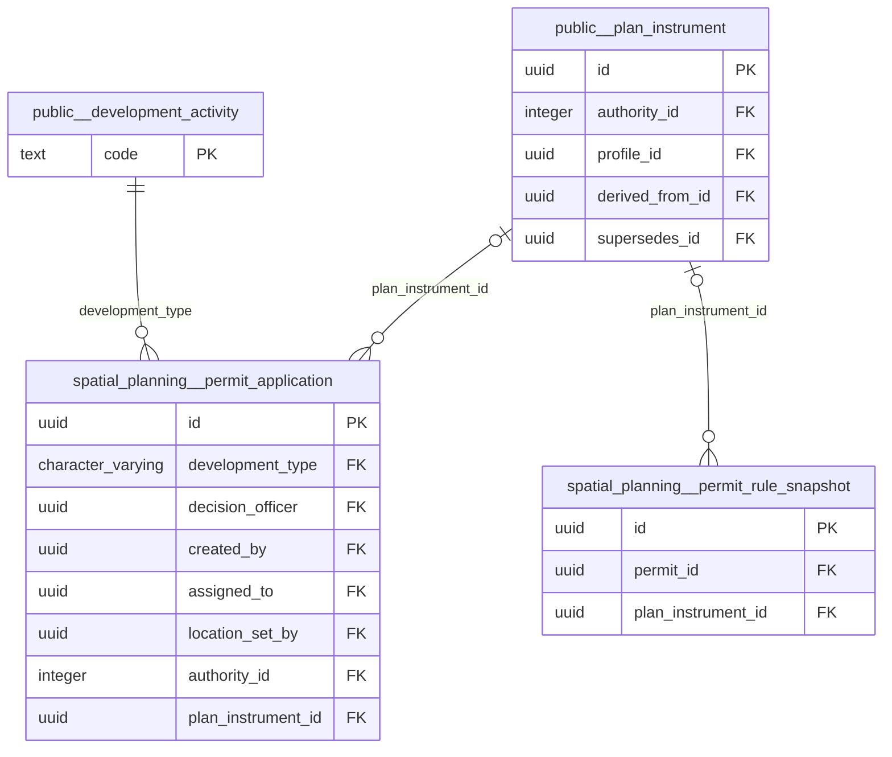

## Relationships, group 2

Tables: `agenda_item`, `committee_meeting`, `meeting_attendance`, `committee_member`.

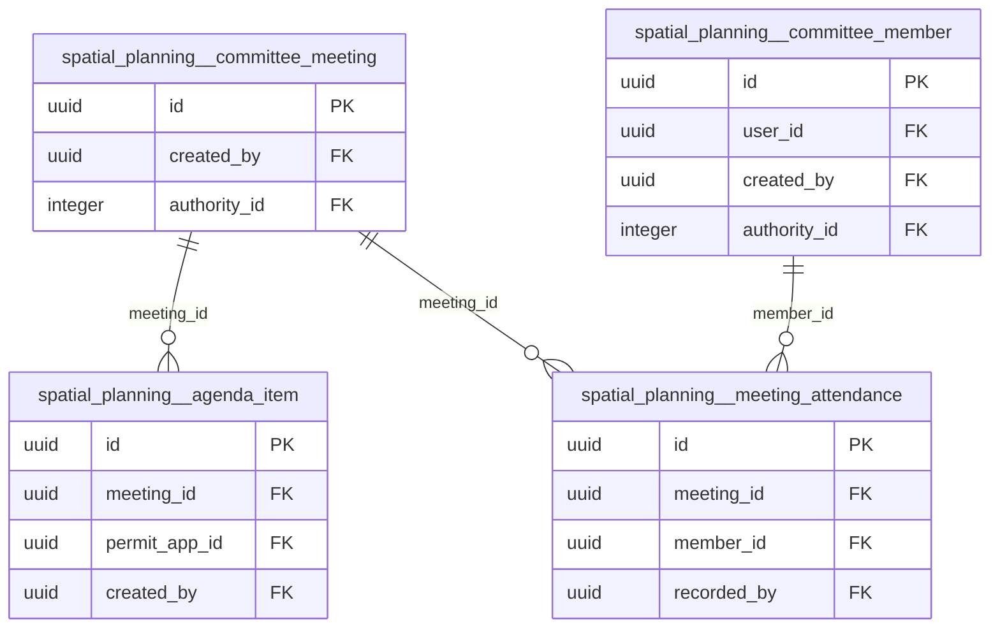

## Relationships, group 3

Tables: `title_notice_appeal`, `title_notice`, `building_complaint`, `title_notice_service`, `title_notice_action`.

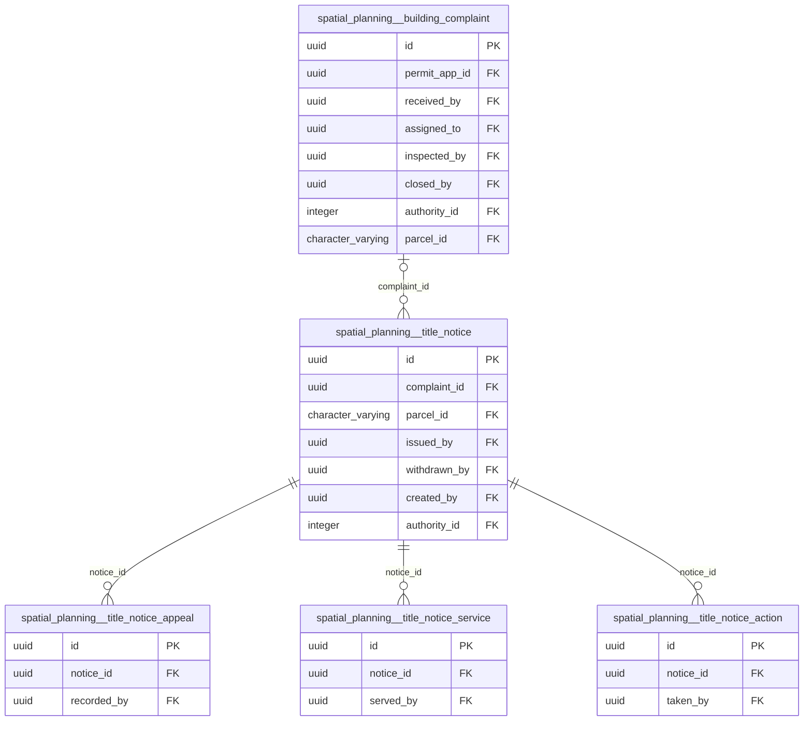

## Relationships, group 4

Tables: `building_plan_annotation`, `building_plan`, `checklist_item`, `checklist_category`, `inspection_checklist_result`, `stage_inspection_photo`, `stage_inspection`, `stage_inspection_field_event`, `stage_inspection_flag`, `inspection_stage`.

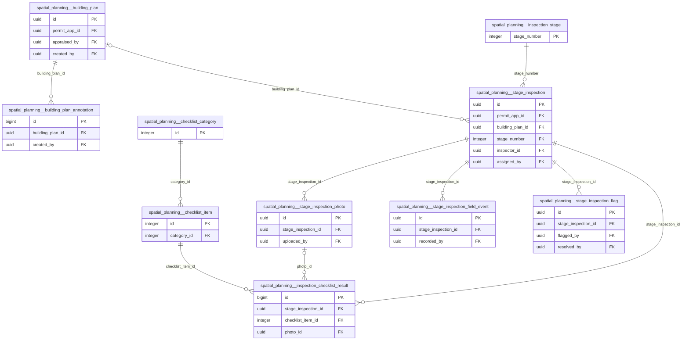

## Relationships, group 5

Tables: `case_message`.

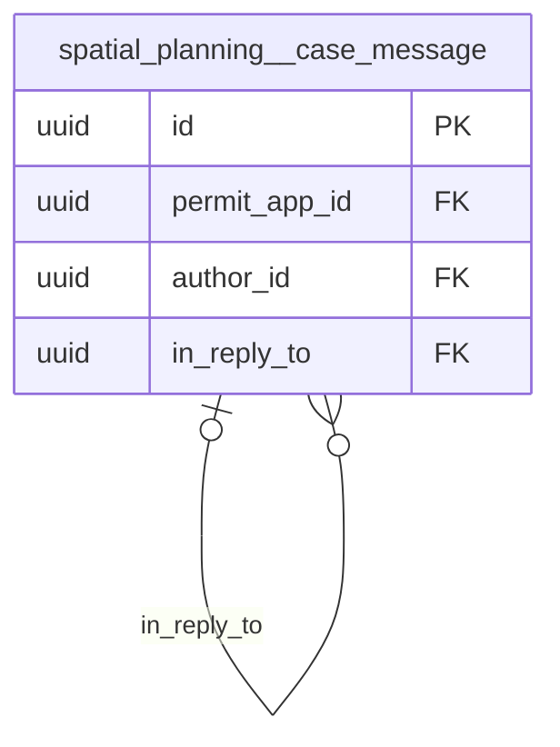

## Relationships, group 6

Tables: `survey_beacon`, `survey_task`, `survey_comment`, `survey_coordinate`, `survey_document`, `survey_finding`, `survey_layout`, `survey_parcel`, `survey_task_control_point`, `control_point`.

```mermaid
erDiagram
  spatial_planning__survey_task ||--o{ spatial_planning__survey_beacon : "survey_task_id"
  spatial_planning__survey_task ||--o{ spatial_planning__survey_comment : "survey_task_id"
  spatial_planning__survey_task ||--o{ spatial_planning__survey_coordinate : "survey_task_id"
  spatial_planning__survey_task ||--o{ spatial_planning__survey_document : "survey_task_id"
  spatial_planning__survey_task ||--o{ spatial_planning__survey_finding : "survey_task_id"
  spatial_planning__survey_task |o--o{ spatial_planning__survey_layout : "survey_task_id"
  spatial_planning__survey_task ||--o{ spatial_planning__survey_parcel : "survey_task_id"
  spatial_planning__control_point ||--o{ spatial_planning__survey_task_control_point : "control_point_id"
  spatial_planning__survey_task ||--o{ spatial_planning__survey_task_control_point : "survey_task_id"
  spatial_planning__survey_beacon {
    uuid id PK
    uuid survey_task_id FK
    uuid recorded_by FK
  }
  spatial_planning__survey_task {
    uuid id PK
    uuid permit_app_id FK
    uuid assigned_by FK
    uuid assigned_to FK
    integer authority_id FK
    character_varying parcel_id FK
  }
  spatial_planning__survey_comment {
    uuid id PK
    uuid survey_task_id FK
    uuid author_id FK
  }
  spatial_planning__survey_coordinate {
    uuid id PK
    uuid survey_task_id FK
    uuid recorded_by FK
  }
  spatial_planning__survey_document {
    uuid id PK
    uuid survey_task_id FK
    uuid generated_by FK
  }
  spatial_planning__survey_finding {
    uuid id PK
    uuid survey_task_id FK
    uuid submitted_by FK
  }
  spatial_planning__survey_layout {
    uuid id PK
    uuid survey_task_id FK
    uuid created_by FK
    integer authority_id FK
  }
  spatial_planning__survey_parcel {
    uuid id PK
    uuid survey_task_id FK
    uuid created_by FK
  }
  spatial_planning__survey_task_control_point {
    uuid survey_task_id PK
    integer control_point_id PK
  }
  spatial_planning__control_point {
    integer id PK
    uuid created_by FK
    integer authority_id FK
  }
```

## Relationships, group 7

Tables: `document_review`, `document_request`, `permit_document`.

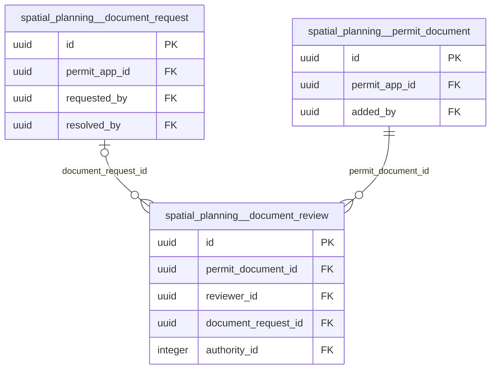

## Relationships, group 8

Tables: `enforcement_compliance_check`, `enforcement_order`, `prohibition_order`.

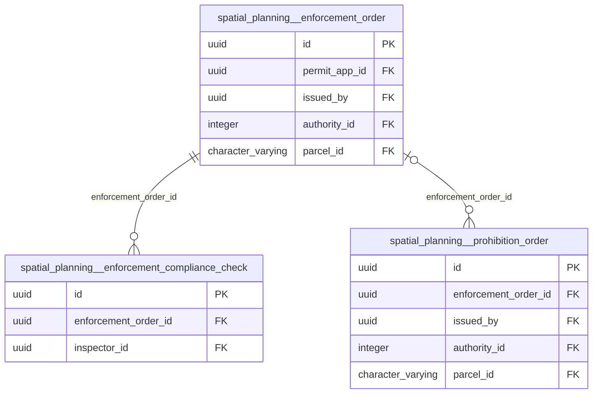

## Relationships, group 9

Tables: `existing_use`, `property`, `parcel_lineage`, `parcel_owner`, `property_assessment`, `zoning_designation`.

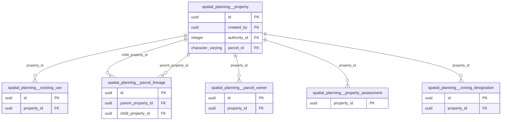

## Relationships, group 10

Tables: `generated_document`.

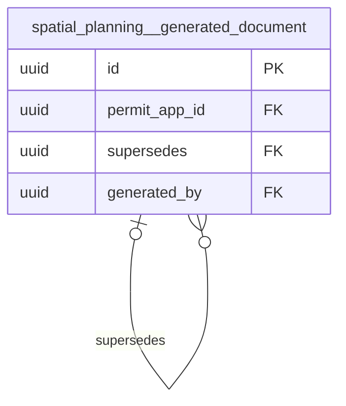

## Relationships, group 11

Tables: `health_abatement_notice`, `health_nuisance_complaint`, `health_premises`, `health_food_handler_cert`, `health_licence_clearance`, `health_premises_inspection`.

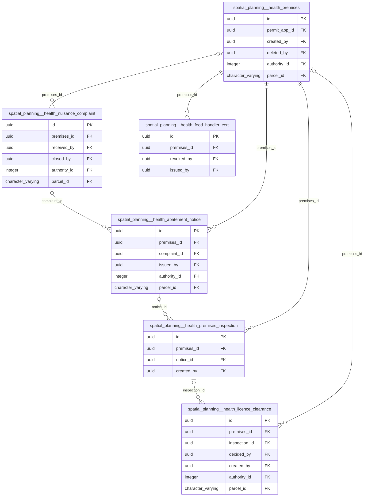

## Relationships, group 12

Tables: `planning_revision`, `planning_project`.

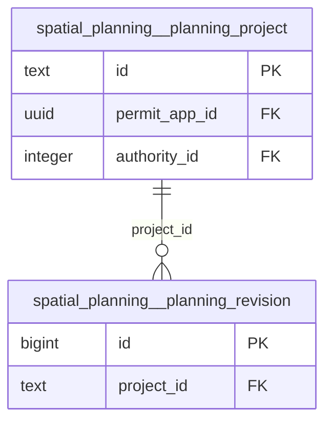

## Tables related only to a hub table

These reference only `public.users`, `spatial_planning.permit_application`, `land.parcel`, `public.local_authorities` (or are referenced by nothing drawn): `application_appeal`, `application_consultation`, `application_objection`, `available_stand`, `eo_handoff_package`, `gis_feature`, `gis_feature_history`, `health_burial_permit`, `health_field_programme`, `health_outbreak`, `health_water_sample`, `occupation_certificate`, `permit_event`, `public_notice`, `spatial_analysis_result`, `statutory_clock_event`, `statutory_plan`.

## Data dictionary

### `agenda_item`

1 rows · tenancy: tenant_child

| Column | Type | Null | Default | Key | Comment |
|---|---|:-:|---|---|---|
| `id` | uuid | no | gen_random_uuid() | PK |  |
| `meeting_id` | uuid | no |  | FK → spatial_planning.committee_meeting.id |  |
| `permit_app_id` | uuid | no |  | FK → spatial_planning.permit_application.id |  |
| `item_order` | integer | yes |  |  |  |
| `purpose` | character varying(40) | no | 'determination'::character varying |  |  |
| `outcome` | character varying(30) | no | 'pending'::character varying |  |  |
| `resolution` | text | yes |  |  |  |
| `heard_at` | timestamp with time zone | yes |  |  |  |
| `created_by` | uuid | yes |  | FK → public.users.id |  |
| `created_at` | timestamp with time zone | no | now() |  |  |
| `deleted_at` | timestamp with time zone | yes |  |  |  |
| `deleted_by` | uuid | yes |  |  |  |

### `application_appeal`

0 rows · tenancy: tenant_child

| Column | Type | Null | Default | Key | Comment |
|---|---|:-:|---|---|---|
| `id` | uuid | no | gen_random_uuid() | PK |  |
| `permit_app_id` | uuid | no |  | FK → spatial_planning.permit_application.id |  |
| `appellant_type` | character varying(20) | no |  |  |  |
| `appellant_name` | character varying(255) | no |  |  |  |
| `appellant_address` | text | yes |  |  |  |
| `appeal_grounds` | text | no |  |  |  |
| `lodged_at` | date | no | CURRENT_DATE |  |  |
| `document_url` | text | yes |  |  |  |
| `status` | character varying(20) | no | 'lodged'::character varying |  |  |
| `hearing_date` | date | yes |  |  |  |
| `decision` | character varying(20) | yes |  |  |  |
| `decision_notes` | text | yes |  |  |  |
| `decided_at` | date | yes |  |  |  |
| `created_at` | timestamp with time zone | no | now() |  |  |
| `updated_at` | timestamp with time zone | no | now() |  |  |

### `application_consultation`

0 rows · tenancy: tenant_child

| Column | Type | Null | Default | Key | Comment |
|---|---|:-:|---|---|---|
| `id` | uuid | no | gen_random_uuid() | PK |  |
| `permit_app_id` | uuid | no |  | FK → spatial_planning.permit_application.id |  |
| `body_name` | character varying(120) | no |  |  |  |
| `body_type` | character varying(40) | yes |  |  |  |
| `contact_name` | character varying(120) | yes |  |  |  |
| `contact_email` | character varying(255) | yes |  |  |  |
| `circulated_at` | date | yes |  |  |  |
| `response_due_at` | date | yes |  |  |  |
| `response_status` | character varying(20) | no | 'pending'::character varying |  |  |
| `response_received_at` | date | yes |  |  |  |
| `response_notes` | text | yes |  |  |  |
| `response_document_url` | text | yes |  |  |  |
| `created_by` | uuid | yes |  | FK → public.users.id |  |
| `created_at` | timestamp with time zone | no | now() |  |  |
| `updated_at` | timestamp with time zone | no | now() |  |  |
| `assigned_to` | uuid | yes |  | FK → public.users.id |  |
| `blocking` | boolean | no | false |  | TRUE = this referral's finding is a blocking condition for the determination; FALSE = advisory / non-blocking. |
| `escalated_at` | timestamp with time zone | yes |  |  | Set when the referral is escalated / reminded (overdue chase). NULL until first escalation. |
| `priority` | character varying(10) | no | 'normal'::character varying |  |  |
| `task_status` | character varying(16) | no | 'open'::character varying |  | Task lifecycle (who/where it is). Distinct from response_status, which is the specialist's finding outcome. |
| `task_type` | character varying(40) | yes |  |  | Routes the task to a specialist workspace: gis_review \| survey \| environmental \| building_plan \| eo_review \| statutory_body \| other. |

### `application_objection`

1 rows · tenancy: tenant_child

| Column | Type | Null | Default | Key | Comment |
|---|---|:-:|---|---|---|
| `id` | uuid | no | gen_random_uuid() | PK |  |
| `permit_app_id` | uuid | no |  | FK → spatial_planning.permit_application.id |  |
| `objector_name` | character varying(255) | no |  |  |  |
| `objector_address` | text | yes |  |  |  |
| `objector_id_number` | character varying(40) | yes |  |  |  |
| `grounds` | jsonb | no | '[]'::jsonb |  |  |
| `grounds_detail` | text | yes |  |  |  |
| `received_at` | date | no | CURRENT_DATE |  |  |
| `document_url` | text | yes |  |  |  |
| `consideration_notes` | text | yes |  |  |  |
| `sustained` | boolean | yes |  |  |  |
| `considered_at` | date | yes |  |  |  |
| `considered_by` | uuid | yes |  | FK → public.users.id |  |
| `created_at` | timestamp with time zone | no | now() |  |  |
| `updated_at` | timestamp with time zone | no | now() |  |  |
| `resolution_document_url` | text | yes |  |  |  |

### `available_stand`

2 rows · tenancy: tenant

| Column | Type | Null | Default | Key | Comment |
|---|---|:-:|---|---|---|
| `id` | uuid | no | gen_random_uuid() | PK |  |
| `stand_number` | character varying(50) | no |  |  |  |
| `suburb_ward` | character varying(100) | yes |  |  |  |
| `area_sqm` | numeric | yes |  |  |  |
| `zone` | character varying(32) | yes |  |  |  |
| `status` | character varying(20) | no | 'available'::character varying |  |  |
| `description` | text | yes |  |  |  |
| `longitude` | double precision | yes |  |  |  |
| `latitude` | double precision | yes |  |  |  |
| `created_at` | timestamp with time zone | no | now() |  |  |
| `updated_at` | timestamp with time zone | no | now() |  |  |
| `authority_id` | integer | no | app.authority_id() | FK → public.local_authorities.id |  |
| `parcel_id` | character varying(24) | yes |  | FK → land.parcel.parcel_id | The parcel this row concerns (land.parcel). NULL while only the free-text stand_number is known. Migration 181. |

### `building_complaint`

0 rows · tenancy: tenant

Public reports of unauthorised or dangerous building work. Anonymous reports are first-class.

| Column | Type | Null | Default | Key | Comment |
|---|---|:-:|---|---|---|
| `id` | uuid | no | gen_random_uuid() | PK |  |
| `reference` | character varying(24) | no |  |  |  |
| `category` | character varying(30) | no |  |  |  |
| `severity` | character varying(12) | no | 'routine'::character varying |  | emergency = danger to life; drives queue order, not a free-text priority. |
| `status` | character varying(20) | no | 'received'::character varying |  |  |
| `description` | text | no |  |  |  |
| `stand_number` | character varying(40) | yes |  |  |  |
| `suburb_ward` | character varying(120) | yes |  |  |  |
| `location_note` | text | yes |  |  |  |
| `observed_lat` | numeric(10,7) | yes |  |  |  |
| `observed_lng` | numeric(10,7) | yes |  |  |  |
| `reporter_name` | character varying(160) | yes |  |  |  |
| `reporter_phone` | character varying(40) | yes |  |  |  |
| `anonymous` | boolean | no | false |  |  |
| `permit_app_id` | uuid | yes |  | FK → spatial_planning.permit_application.id |  |
| `received_at` | timestamp with time zone | no | now() |  |  |
| `received_by` | uuid | yes |  | FK → public.users.id |  |
| `assigned_to` | uuid | yes |  | FK → public.users.id |  |
| `inspected_at` | timestamp with time zone | yes |  |  |  |
| `inspected_by` | uuid | yes |  | FK → public.users.id |  |
| `finding` | text | yes |  |  |  |
| `closed_at` | timestamp with time zone | yes |  |  |  |
| `closed_by` | uuid | yes |  | FK → public.users.id |  |
| `updated_at` | timestamp with time zone | no | now() |  |  |
| `authority_id` | integer | no | app.authority_id() | FK → public.local_authorities.id |  |
| `parcel_id` | character varying(24) | yes |  | FK → land.parcel.parcel_id | The parcel this row concerns (land.parcel). NULL while only the free-text stand_number is known. Migration 181. |

### `building_plan`

0 rows · tenancy: tenant_child

| Column | Type | Null | Default | Key | Comment |
|---|---|:-:|---|---|---|
| `id` | uuid | no | gen_random_uuid() | PK |  |
| `permit_app_id` | uuid | no |  | FK → spatial_planning.permit_application.id |  |
| `revision` | integer | no | 1 |  |  |
| `revision_label` | character varying(20) | yes |  |  |  |
| `plan_document_url` | text | no |  |  |  |
| `site_plan_url` | text | yes |  |  |  |
| `structural_drawings_url` | text | yes |  |  |  |
| `services_drawings_url` | text | yes |  |  |  |
| `architect_name` | character varying(120) | yes |  |  |  |
| `architect_reg_no` | character varying(40) | yes |  |  |  |
| `engineer_name` | character varying(120) | yes |  |  |  |
| `engineer_reg_no` | character varying(40) | yes |  |  |  |
| `gross_floor_area_sqm` | numeric(10,2) | yes |  |  |  |
| `number_of_storeys` | integer | yes |  |  |  |
| `building_use` | character varying(60) | yes |  |  |  |
| `submitted_at` | date | no | CURRENT_DATE |  |  |
| `status` | character varying(30) | no | 'submitted'::character varying |  |  |
| `appraised_by` | uuid | yes |  | FK → public.users.id |  |
| `appraised_at` | date | yes |  |  |  |
| `appraisal_notes` | text | yes |  |  |  |
| `created_by` | uuid | yes |  | FK → public.users.id |  |
| `created_at` | timestamp with time zone | no | now() |  |  |
| `updated_at` | timestamp with time zone | no | now() |  |  |

### `building_plan_annotation`

0 rows · tenancy: tenant_child

| Column | Type | Null | Default | Key | Comment |
|---|---|:-:|---|---|---|
| `id` | bigint | no | nextval('spatial_planning.building_plan_annotation_id_seq'::regclass) | PK |  |
| `building_plan_id` | uuid | no |  | FK → spatial_planning.building_plan.id |  |
| `page_number` | integer | yes |  |  |  |
| `severity` | character varying(8) | no |  |  |  |
| `code` | character varying(40) | yes |  |  |  |
| `message` | text | no |  |  |  |
| `bbox` | jsonb | yes |  |  |  |
| `resolved` | boolean | no | false |  |  |
| `resolved_at` | timestamp with time zone | yes |  |  |  |
| `created_by` | uuid | yes |  | FK → public.users.id |  |
| `created_at` | timestamp with time zone | no | now() |  |  |

### `case_message`

0 rows · tenancy: tenant_child

Shared per-permit conversation: internal notes, citizen messages, specialist comments, decision/document-request notes. visibility column is the read-access model.

| Column | Type | Null | Default | Key | Comment |
|---|---|:-:|---|---|---|
| `id` | uuid | no | gen_random_uuid() | PK |  |
| `permit_app_id` | uuid | no |  | FK → spatial_planning.permit_application.id |  |
| `author_id` | uuid | yes |  | FK → public.users.id |  |
| `author_role` | character varying(40) | yes |  |  |  |
| `message_type` | character varying(30) | no | 'internal_note'::character varying |  |  |
| `visibility` | character varying(20) | no | 'internal'::character varying |  |  |
| `body` | text | no |  |  |  |
| `in_reply_to` | uuid | yes |  | FK → spatial_planning.case_message.id |  |
| `attachments` | jsonb | no | '[]'::jsonb |  |  |
| `related_request_id` | uuid | yes |  |  |  |
| `created_at` | timestamp with time zone | no | now() |  |  |
| `edited_at` | timestamp with time zone | yes |  |  |  |

### `checklist_category`

8 rows · tenancy: reference

| Column | Type | Null | Default | Key | Comment |
|---|---|:-:|---|---|---|
| `id` | integer | no | nextval('spatial_planning.checklist_category_id_seq'::regclass) | PK |  |
| `code` | character varying(20) | no |  |  |  |
| `label` | character varying(120) | no |  |  |  |
| `sort_order` | integer | no | 0 |  |  |

### `checklist_item`

39 rows · tenancy: reference

| Column | Type | Null | Default | Key | Comment |
|---|---|:-:|---|---|---|
| `id` | integer | no | nextval('spatial_planning.checklist_item_id_seq'::regclass) | PK |  |
| `category_id` | integer | no |  | FK → spatial_planning.checklist_category.id |  |
| `applicable_stages` | integer[] | no |  |  |  |
| `code` | character varying(20) | no |  |  |  |
| `description` | text | no |  |  |  |
| `is_mandatory` | boolean | no | true |  |  |
| `sort_order` | integer | no | 0 |  |  |

### `committee_meeting`

1 rows · tenancy: tenant

Town-planning committee meetings; agenda_item tables applications onto them for hearing.

| Column | Type | Null | Default | Key | Comment |
|---|---|:-:|---|---|---|
| `id` | uuid | no | gen_random_uuid() | PK |  |
| `title` | character varying(160) | no |  |  |  |
| `meeting_date` | date | no |  |  |  |
| `location` | character varying(160) | yes |  |  |  |
| `status` | character varying(20) | no | 'scheduled'::character varying |  |  |
| `notes` | text | yes |  |  |  |
| `created_by` | uuid | yes |  | FK → public.users.id |  |
| `created_at` | timestamp with time zone | no | now() |  |  |
| `updated_at` | timestamp with time zone | no | now() |  |  |
| `quorum` | integer | yes |  |  | Minimum members present for a valid resolution; NULL = not enforced. |
| `deleted_at` | timestamp with time zone | yes |  |  |  |
| `deleted_by` | uuid | yes |  |  |  |
| `authority_id` | integer | no | app.authority_id() | FK → public.local_authorities.id |  |

### `committee_member`

2 rows · tenancy: tenant

Standing committee roster; members may be councillors without app accounts.

| Column | Type | Null | Default | Key | Comment |
|---|---|:-:|---|---|---|
| `id` | uuid | no | gen_random_uuid() | PK |  |
| `full_name` | character varying(160) | no |  |  |  |
| `title` | character varying(120) | yes |  |  |  |
| `user_id` | uuid | yes |  | FK → public.users.id |  |
| `active` | boolean | no | true |  |  |
| `created_by` | uuid | yes |  | FK → public.users.id |  |
| `created_at` | timestamp with time zone | no | now() |  |  |
| `updated_at` | timestamp with time zone | no | now() |  |  |
| `authority_id` | integer | no | app.authority_id() | FK → public.local_authorities.id |  |

### `control_point`

0 rows · tenancy: tenant

| Column | Type | Null | Default | Key | Comment |
|---|---|:-:|---|---|---|
| `id` | integer | no | nextval('spatial_planning.control_point_id_seq'::regclass) | PK |  |
| `monu_num` | character varying(20) | no |  |  |  |
| `monu_name` | character varying(100) | no |  |  |  |
| `type` | character varying(10) | no | 'SEC'::character varying |  |  |
| `gauss_lo` | smallint | yes |  |  |  |
| `y_gauss` | numeric(15,3) | yes |  |  |  |
| `x_gauss` | numeric(15,3) | yes |  |  |  |
| `msl_hgt` | numeric(10,3) | yes |  |  |  |
| `created_by` | uuid | yes |  | FK → public.users.id |  |
| `created_at` | timestamp with time zone | no | now() |  |  |
| `authority_id` | integer | no | app.authority_id() | FK → public.local_authorities.id |  |

### `document_request`

0 rows · tenancy: tenant_child

| Column | Type | Null | Default | Key | Comment |
|---|---|:-:|---|---|---|
| `id` | uuid | no | gen_random_uuid() | PK |  |
| `permit_app_id` | uuid | no |  | FK → spatial_planning.permit_application.id |  |
| `requested_by` | uuid | yes |  | FK → public.users.id |  |
| `doc_kind` | character varying(40) | no |  |  |  |
| `reason` | text | yes |  |  |  |
| `status` | character varying(20) | no | 'open'::character varying |  |  |
| `due_at` | date | yes |  |  |  |
| `fulfilled_document_id` | uuid | yes |  |  |  |
| `fulfilled_at` | timestamp with time zone | yes |  |  |  |
| `resolved_by` | uuid | yes |  | FK → public.users.id |  |
| `created_at` | timestamp with time zone | no | now() |  |  |
| `updated_at` | timestamp with time zone | no | now() |  |  |

### `document_review`

0 rows · tenancy: tenant

| Column | Type | Null | Default | Key | Comment |
|---|---|:-:|---|---|---|
| `id` | uuid | no | gen_random_uuid() | PK |  |
| `permit_document_id` | uuid | no |  | FK → spatial_planning.permit_document.id |  |
| `reviewer_id` | uuid | yes |  | FK → public.users.id |  |
| `decision` | character varying(24) | no |  |  |  |
| `notes` | text | yes |  |  |  |
| `document_request_id` | uuid | yes |  | FK → spatial_planning.document_request.id |  |
| `reviewed_at` | timestamp with time zone | no | now() |  |  |
| `authority_id` | integer | no | app.authority_id() | FK → public.local_authorities.id |  |

### `enforcement_compliance_check`

0 rows · tenancy: tenant_child

| Column | Type | Null | Default | Key | Comment |
|---|---|:-:|---|---|---|
| `id` | uuid | no | gen_random_uuid() | PK |  |
| `enforcement_order_id` | uuid | no |  | FK → spatial_planning.enforcement_order.id |  |
| `visited_at` | date | no |  |  |  |
| `complied` | boolean | yes |  |  |  |
| `notes` | text | yes |  |  |  |
| `photo_urls` | jsonb | no | '[]'::jsonb |  |  |
| `inspector_id` | uuid | yes |  | FK → public.users.id |  |
| `created_at` | timestamp with time zone | no | now() |  |  |

### `enforcement_order`

0 rows · tenancy: tenant · concept: case_location (source)

| Column | Type | Null | Default | Key | Comment |
|---|---|:-:|---|---|---|
| `id` | uuid | no | gen_random_uuid() | PK |  |
| `permit_app_id` | uuid | yes |  | FK → spatial_planning.permit_application.id |  |
| `order_reference` | character varying(40) | yes |  |  |  |
| `order_type` | character varying(30) | no |  |  |  |
| `subject_name` | character varying(255) | no |  |  |  |
| `subject_address` | text | no |  |  |  |
| `stand_number` | character varying(40) | yes |  |  |  |
| `location` | geometry(Point,4326) | yes |  |  |  |
| `breach_description` | text | no |  |  |  |
| `required_action` | text | no |  |  |  |
| `compliance_period` | integer | no | 30 |  |  |
| `issued_at` | date | no | CURRENT_DATE |  |  |
| `compliance_due_at` | date | yes |  |  |  |
| `served_at` | date | yes |  |  |  |
| `status` | character varying(20) | no | 'draft'::character varying |  |  |
| `notes` | text | yes |  |  |  |
| `issued_by` | uuid | yes |  | FK → public.users.id |  |
| `created_at` | timestamp with time zone | no | now() |  |  |
| `updated_at` | timestamp with time zone | no | now() |  |  |
| `authority_id` | integer | no | app.authority_id() | FK → public.local_authorities.id |  |
| `parcel_id` | character varying(24) | yes |  | FK → land.parcel.parcel_id | The parcel this row concerns (land.parcel). NULL while only the free-text stand_number is known. Migration 181. |

### `eo_handoff_package`

0 rows · tenancy: tenant_child

| Column | Type | Null | Default | Key | Comment |
|---|---|:-:|---|---|---|
| `id` | uuid | no | gen_random_uuid() | PK |  |
| `permit_app_id` | uuid | no |  | FK → spatial_planning.permit_application.id |  |
| `submitted_by` | uuid | yes |  | FK → public.users.id |  |
| `recommendation` | character varying(40) | yes |  |  |  |
| `reasons` | text | yes |  |  |  |
| `conditions` | jsonb | no | '[]'::jsonb |  |  |
| `attachments` | jsonb | no | '[]'::jsonb |  |  |
| `findings_snapshot` | jsonb | yes |  |  |  |
| `status` | character varying(20) | no | 'submitted'::character varying |  |  |
| `eo_decision` | character varying(40) | yes |  |  |  |
| `eo_notes` | text | yes |  |  |  |
| `decided_by` | uuid | yes |  | FK → public.users.id |  |
| `decided_at` | timestamp with time zone | yes |  |  |  |
| `created_at` | timestamp with time zone | no | now() |  |  |
| `updated_at` | timestamp with time zone | no | now() |  |  |
| `returned_to_role` | character varying(40) | yes |  |  | When status = 'returned': the role the EO Planner sent the case back to (planner \| gis_officer \| surveyor \| env_officer \| building_inspector). |
| `return_reason` | text | yes |  |  | When status = 'returned': the EO Planner's reason / instruction to that role. |

### `existing_use`

0 rows · tenancy: tenant_child

| Column | Type | Null | Default | Key | Comment |
|---|---|:-:|---|---|---|
| `id` | uuid | no | gen_random_uuid() | PK |  |
| `property_id` | uuid | no |  | FK → spatial_planning.property.id |  |
| `land_use` | character varying(120) | no |  |  |  |
| `recorded_at` | date | yes |  |  |  |
| `notes` | text | yes |  |  |  |
| `created_at` | timestamp with time zone | no | now() |  |  |
| `land_use_group_code` | text | yes |  |  |  |

### `generated_document`

2 rows · tenancy: tenant_child

| Column | Type | Null | Default | Key | Comment |
|---|---|:-:|---|---|---|
| `id` | uuid | no | gen_random_uuid() | PK |  |
| `permit_app_id` | uuid | no |  | FK → spatial_planning.permit_application.id |  |
| `doc_type` | character varying(30) | no |  |  |  |
| `storage_url` | text | yes |  |  |  |
| `mime_type` | character varying(64) | no | 'application/pdf'::character varying |  |  |
| `bytes` | bigint | yes |  |  |  |
| `sha256_hex` | character varying(64) | yes |  |  |  |
| `version` | integer | no | 1 |  |  |
| `supersedes` | uuid | yes |  | FK → spatial_planning.generated_document.id |  |
| `payload` | jsonb | yes |  |  |  |
| `generated_by` | uuid | yes |  | FK → public.users.id |  |
| `created_at` | timestamp with time zone | no | now() |  |  |
| `content` | text | yes |  |  | Rendered document body (HTML) stored in-DB. Used when storage_url is NULL (ephemeral-filesystem deploys). Served via GET /generated-documents/:id. |
| `title` | character varying(200) | yes |  |  | Human-readable document title for listings (e.g. "Development Permit — Conditional Approval"). |
| `status` | character varying(16) | no | 'issued'::character varying |  | Lifecycle of this document version: draft (not yet finalised) \| approved (signed off, not yet sent) \| issued (the authoritative copy) \| superseded (a later v |

### `gis_feature`

0 rows · tenancy: tenant · concept: managed_feature (canonical)

| Column | Type | Null | Default | Key | Comment |
|---|---|:-:|---|---|---|
| `id` | bigint | no | nextval('spatial_planning.gis_feature_id_seq'::regclass) | PK |  |
| `layer` | text | no | 'digitized'::text |  |  |
| `props` | jsonb | no | '{}'::jsonb |  |  |
| `geom` | geometry(Geometry,4326) | no |  |  |  |
| `created_by` | text | yes |  |  |  |
| `created_at` | timestamp with time zone | no | now() |  |  |
| `updated_at` | timestamp with time zone | no | now() |  |  |
| `deleted_at` | timestamp with time zone | yes |  |  |  |
| `deleted_by` | uuid | yes |  |  |  |
| `authority_id` | integer | no | app.authority_id() | FK → public.local_authorities.id |  |

### `gis_feature_history`

0 rows · tenancy: tenant · concept: managed_feature (source)

| Column | Type | Null | Default | Key | Comment |
|---|---|:-:|---|---|---|
| `id` | bigint | no | nextval('spatial_planning.gis_feature_history_id_seq'::regclass) | PK |  |
| `feature_id` | bigint | yes |  |  |  |
| `layer` | text | yes |  |  |  |
| `action` | text | no |  |  |  |
| `props` | jsonb | yes |  |  |  |
| `geom` | geometry(Geometry,4326) | yes |  |  |  |
| `detail` | jsonb | yes |  |  |  |
| `actor` | text | yes |  |  |  |
| `at` | timestamp with time zone | no | now() |  |  |
| `authority_id` | integer | no | app.authority_id() | FK → public.local_authorities.id |  |

### `health_abatement_notice`

0 rows · tenancy: tenant

Public Health Act notices: abatement (s. 83), closure (s. 87), works in default (s. 84), prohibition.

| Column | Type | Null | Default | Key | Comment |
|---|---|:-:|---|---|---|
| `id` | uuid | no | gen_random_uuid() | PK |  |
| `reference` | character varying(24) | no |  |  |  |
| `notice_type` | character varying(20) | no |  |  |  |
| `premises_id` | uuid | yes |  | FK → spatial_planning.health_premises.id |  |
| `complaint_id` | uuid | yes |  | FK → spatial_planning.health_nuisance_complaint.id |  |
| `stand_number` | character varying(40) | yes |  |  |  |
| `suburb_ward` | character varying(120) | yes |  |  |  |
| `subject_name` | character varying(160) | no |  |  |  |
| `subject_address` | character varying(300) | yes |  |  |  |
| `subject_contact` | character varying(40) | yes |  |  |  |
| `nuisance_description` | text | no |  |  |  |
| `required_action` | text | no |  |  |  |
| `compliance_days` | integer | no |  |  |  |
| `served_at` | timestamp with time zone | no | now() |  |  |
| `served_method` | character varying(16) | no | 'hand'::character varying |  |  |
| `status` | character varying(16) | no | 'served'::character varying |  |  |
| `extended_to` | date | yes |  |  |  |
| `escalation` | character varying(20) | yes |  |  |  |
| `outcome_notes` | text | yes |  |  |  |
| `closed_at` | timestamp with time zone | yes |  |  |  |
| `issued_by_name` | character varying(160) | no |  |  |  |
| `issued_by` | uuid | yes |  | FK → public.users.id |  |
| `created_at` | timestamp with time zone | no | now() |  |  |
| `updated_at` | timestamp with time zone | no | now() |  |  |
| `authority_id` | integer | no | app.authority_id() | FK → public.local_authorities.id |  |
| `parcel_id` | character varying(24) | yes |  | FK → land.parcel.parcel_id | The parcel this row concerns (land.parcel). NULL while only the free-text stand_number is known. Migration 181. |

### `health_burial_permit`

0 rows · tenancy: tenant

Burial, exhumation and reburial permits under the Public Health Act [Ch. 15:09].

| Column | Type | Null | Default | Key | Comment |
|---|---|:-:|---|---|---|
| `id` | uuid | no | gen_random_uuid() | PK |  |
| `reference` | character varying(24) | no |  |  |  |
| `permit_kind` | character varying(12) | no | 'burial'::character varying |  |  |
| `deceased_name` | character varying(160) | no |  |  |  |
| `deceased_id_number` | character varying(40) | yes |  |  |  |
| `date_of_death` | date | no |  |  |  |
| `cause_of_death` | character varying(200) | yes |  |  |  |
| `cemetery` | character varying(160) | no |  |  |  |
| `ward` | character varying(120) | yes |  |  |  |
| `interment_at` | timestamp with time zone | yes |  |  |  |
| `applicant_name` | character varying(160) | yes |  |  |  |
| `applicant_relation` | character varying(60) | yes |  |  |  |
| `applicant_contact` | character varying(40) | yes |  |  |  |
| `issued_by_name` | character varying(160) | no |  |  |  |
| `issued_at` | timestamp with time zone | no | now() |  |  |
| `issued_by` | uuid | yes |  | FK → public.users.id |  |
| `notes` | text | yes |  |  |  |
| `cancelled_at` | timestamp with time zone | yes |  |  |  |
| `cancelled_by` | uuid | yes |  | FK → public.users.id |  |
| `cancelled_reason` | text | yes |  |  |  |
| `created_at` | timestamp with time zone | no | now() |  |  |
| `authority_id` | integer | no | app.authority_id() | FK → public.local_authorities.id |  |

### `health_field_programme`

0 rows · tenancy: tenant · concept: case_location (source)

One round of a recurring public-health field programme: refuse, sanitation, vector control, education.

| Column | Type | Null | Default | Key | Comment |
|---|---|:-:|---|---|---|
| `id` | uuid | no | gen_random_uuid() | PK |  |
| `reference` | character varying(24) | no |  |  |  |
| `programme_type` | character varying(24) | no |  |  |  |
| `title` | character varying(200) | no |  |  |  |
| `ward` | character varying(120) | no |  |  |  |
| `village_or_area` | character varying(200) | yes |  |  |  |
| `scheduled_for` | date | no |  |  |  |
| `executed_at` | timestamp with time zone | yes |  |  |  |
| `status` | character varying(16) | no | 'planned'::character varying |  |  |
| `target_quantity` | integer | yes |  |  |  |
| `achieved_quantity` | integer | yes |  |  |  |
| `quantity_unit` | character varying(40) | yes |  |  |  |
| `team_lead` | character varying(160) | yes |  |  |  |
| `team_size` | integer | yes |  |  |  |
| `notes` | text | yes |  |  |  |
| `cancelled_reason` | text | yes |  |  |  |
| `location` | geometry(Point,4326) | yes |  |  |  |
| `location_source` | character varying(20) | yes |  |  |  |
| `location_accuracy_m` | numeric(8,2) | yes |  |  |  |
| `created_at` | timestamp with time zone | no | now() |  |  |
| `created_by` | uuid | yes |  | FK → public.users.id |  |
| `updated_at` | timestamp with time zone | no | now() |  |  |
| `authority_id` | integer | no | app.authority_id() | FK → public.local_authorities.id |  |

### `health_food_handler_cert`

0 rows · tenancy: tenant_child

Food-handler health certificates issued by the council. Revoked, never deleted.

| Column | Type | Null | Default | Key | Comment |
|---|---|:-:|---|---|---|
| `id` | uuid | no | gen_random_uuid() | PK |  |
| `reference` | character varying(24) | no |  |  |  |
| `premises_id` | uuid | no |  | FK → spatial_planning.health_premises.id |  |
| `handler_name` | character varying(160) | no |  |  |  |
| `handler_id_number` | character varying(40) | yes |  |  |  |
| `issued_at` | timestamp with time zone | no | now() |  |  |
| `expires_at` | date | no |  |  |  |
| `medical_clearance_source` | character varying(200) | no |  |  |  |
| `notes` | text | yes |  |  |  |
| `revoked_at` | timestamp with time zone | yes |  |  |  |
| `revoked_by` | uuid | yes |  | FK → public.users.id |  |
| `revoked_reason` | text | yes |  |  |  |
| `created_at` | timestamp with time zone | no | now() |  |  |
| `issued_by` | uuid | yes |  | FK → public.users.id |  |

### `health_licence_clearance`

0 rows · tenancy: tenant

EHO health clearance a shop, liquor or hawker licence cannot be granted without.

| Column | Type | Null | Default | Key | Comment |
|---|---|:-:|---|---|---|
| `id` | uuid | no | gen_random_uuid() | PK |  |
| `reference` | character varying(24) | no |  |  |  |
| `licence_type` | character varying(20) | no |  |  |  |
| `applicant_name` | character varying(160) | no |  |  |  |
| `applicant_contact` | character varying(40) | yes |  |  |  |
| `trading_name` | character varying(200) | yes |  |  |  |
| `premises_id` | uuid | yes |  | FK → spatial_planning.health_premises.id |  |
| `stand_number` | character varying(40) | yes |  |  |  |
| `suburb_ward` | character varying(120) | yes |  |  |  |
| `received_at` | timestamp with time zone | no | now() |  |  |
| `inspection_id` | uuid | yes |  | FK → spatial_planning.health_premises_inspection.id |  |
| `status` | character varying(16) | no | 'pending'::character varying |  |  |
| `conditions` | text | yes |  |  |  |
| `refusal_reason` | text | yes |  |  |  |
| `decided_at` | timestamp with time zone | yes |  |  |  |
| `decided_by` | uuid | yes |  | FK → public.users.id |  |
| `decided_by_name` | character varying(160) | yes |  |  |  |
| `valid_until` | date | yes |  |  |  |
| `notes` | text | yes |  |  |  |
| `created_at` | timestamp with time zone | no | now() |  |  |
| `created_by` | uuid | yes |  | FK → public.users.id |  |
| `updated_at` | timestamp with time zone | no | now() |  |  |
| `authority_id` | integer | no | app.authority_id() | FK → public.local_authorities.id |  |
| `parcel_id` | character varying(24) | yes |  | FK → land.parcel.parcel_id | The parcel this row concerns (land.parcel). NULL while only the free-text stand_number is known. Migration 181. |

### `health_nuisance_complaint`

0 rows · tenancy: tenant · concept: case_location (source)

Nuisance and public-health complaints. Anonymous reports are first-class and carry no contact details.

| Column | Type | Null | Default | Key | Comment |
|---|---|:-:|---|---|---|
| `id` | uuid | no | gen_random_uuid() | PK |  |
| `reference` | character varying(24) | no |  |  |  |
| `category` | character varying(16) | no |  |  |  |
| `description` | text | no |  |  |  |
| `status` | character varying(16) | no | 'open'::character varying |  |  |
| `premises_id` | uuid | yes |  | FK → spatial_planning.health_premises.id |  |
| `stand_number` | character varying(40) | yes |  |  |  |
| `suburb_ward` | character varying(120) | yes |  |  |  |
| `location_note` | text | yes |  |  |  |
| `complainant_name` | character varying(160) | yes |  |  |  |
| `complainant_contact` | character varying(40) | yes |  |  |  |
| `anonymous` | boolean | no | false |  |  |
| `abatement_notice_ref` | character varying(40) | yes |  |  |  |
| `location` | geometry(Point,4326) | yes |  |  |  |
| `location_source` | character varying(20) | yes |  |  |  |
| `location_accuracy_m` | numeric(8,2) | yes |  |  |  |
| `received_at` | timestamp with time zone | no | now() |  |  |
| `received_by` | uuid | yes |  | FK → public.users.id |  |
| `updated_at` | timestamp with time zone | no | now() |  |  |
| `closed_at` | timestamp with time zone | yes |  |  |  |
| `closed_by` | uuid | yes |  | FK → public.users.id |  |
| `authority_id` | integer | no | app.authority_id() | FK → public.local_authorities.id |  |
| `parcel_id` | character varying(24) | yes |  | FK → land.parcel.parcel_id | The parcel this row concerns (land.parcel). NULL while only the free-text stand_number is known. Migration 181. |

### `health_outbreak`

0 rows · tenancy: tenant · concept: case_location (source)

Notifiable disease outbreak log. location is the cluster centre or suspected source, never a patient address.

| Column | Type | Null | Default | Key | Comment |
|---|---|:-:|---|---|---|
| `id` | uuid | no | gen_random_uuid() | PK |  |
| `reference` | character varying(24) | no |  |  |  |
| `disease` | character varying(20) | no |  |  |  |
| `first_reported_at` | timestamp with time zone | no | now() |  |  |
| `suspected_source` | text | no |  |  |  |
| `cases_count` | integer | no | 1 |  |  |
| `ward` | character varying(120) | no |  |  |  |
| `status` | character varying(16) | no | 'investigating'::character varying |  |  |
| `actions_taken` | text | yes |  |  |  |
| `location` | geometry(Point,4326) | yes |  |  |  |
| `location_source` | character varying(20) | yes |  |  |  |
| `location_accuracy_m` | numeric(8,2) | yes |  |  |  |
| `catchment_m` | integer | yes |  |  | Officer-recorded catchment radius in metres; drives the "what is inside this outbreak" query. |
| `reported_by` | uuid | yes |  | FK → public.users.id |  |
| `created_at` | timestamp with time zone | no | now() |  |  |
| `updated_at` | timestamp with time zone | no | now() |  |  |
| `closed_at` | timestamp with time zone | yes |  |  |  |
| `closed_by` | uuid | yes |  | FK → public.users.id |  |
| `authority_id` | integer | no | app.authority_id() | FK → public.local_authorities.id |  |

### `health_premises`

0 rows · tenancy: tenant · concept: case_location (source)

Premises the Public Health Act requires the council to inspect. Soft-deletes; the base layer for EHO spatial queries.

| Column | Type | Null | Default | Key | Comment |
|---|---|:-:|---|---|---|
| `id` | uuid | no | gen_random_uuid() | PK |  |
| `reference` | character varying(24) | no |  |  |  |
| `name` | character varying(200) | no |  |  |  |
| `premises_type` | character varying(24) | no |  |  |  |
| `stand_number` | character varying(40) | yes |  |  |  |
| `suburb_ward` | character varying(120) | yes |  |  |  |
| `operator_name` | character varying(160) | yes |  |  |  |
| `operator_contact` | character varying(40) | yes |  |  |  |
| `permit_app_id` | uuid | yes |  | FK → spatial_planning.permit_application.id |  |
| `fitness_certificate_no` | character varying(40) | yes |  |  |  |
| `fitness_certificate_expiry` | date | yes |  |  |  |
| `last_inspected_at` | timestamp with time zone | yes |  |  |  |
| `notes` | text | yes |  |  |  |
| `location` | geometry(Point,4326) | yes |  |  |  |
| `location_source` | character varying(20) | yes |  |  | Where the position came from. A map_pick is a guess and must not be read as a survey. |
| `location_accuracy_m` | numeric(8,2) | yes |  |  |  |
| `created_at` | timestamp with time zone | no | now() |  |  |
| `created_by` | uuid | yes |  | FK → public.users.id |  |
| `updated_at` | timestamp with time zone | no | now() |  |  |
| `deleted_at` | timestamp with time zone | yes |  |  |  |
| `deleted_by` | uuid | yes |  | FK → public.users.id |  |
| `authority_id` | integer | no | app.authority_id() | FK → public.local_authorities.id |  |
| `parcel_id` | character varying(24) | yes |  | FK → land.parcel.parcel_id | The parcel this row concerns (land.parcel). NULL while only the free-text stand_number is known. Migration 181. |

### `health_premises_inspection`

0 rows · tenancy: tenant_child · concept: case_location (source)

Routine EHO inspection of premises in use. The evidence an abatement notice rests on.

| Column | Type | Null | Default | Key | Comment |
|---|---|:-:|---|---|---|
| `id` | uuid | no | gen_random_uuid() | PK |  |
| `reference` | character varying(24) | no |  |  |  |
| `premises_id` | uuid | no |  | FK → spatial_planning.health_premises.id |  |
| `inspected_at` | timestamp with time zone | no | now() |  |  |
| `inspector_name` | character varying(160) | no |  |  |  |
| `scope` | character varying(20) | no |  |  |  |
| `verdict` | character varying(16) | no |  |  |  |
| `findings` | text | no |  |  |  |
| `action_required` | text | yes |  |  |  |
| `follow_up_date` | date | yes |  |  |  |
| `notice_id` | uuid | yes |  | FK → spatial_planning.health_abatement_notice.id |  |
| `location` | geometry(Point,4326) | yes |  |  |  |
| `location_source` | character varying(20) | yes |  |  |  |
| `location_accuracy_m` | numeric(8,2) | yes |  |  |  |
| `created_at` | timestamp with time zone | no | now() |  |  |
| `created_by` | uuid | yes |  | FK → public.users.id |  |
| `updated_at` | timestamp with time zone | no | now() |  |  |

### `health_water_sample`

0 rows · tenancy: tenant · concept: case_location (source)

Water quality register. A NULL count means not tested, which is not a pass.

| Column | Type | Null | Default | Key | Comment |
|---|---|:-:|---|---|---|
| `id` | uuid | no | gen_random_uuid() | PK |  |
| `reference` | character varying(24) | no |  |  |  |
| `source_label` | character varying(200) | no |  |  |  |
| `source_type` | character varying(20) | yes |  |  |  |
| `sampled_at` | timestamp with time zone | no | now() |  |  |
| `ecoli_count` | integer | yes |  |  |  |
| `faecal_coliform` | integer | yes |  |  |  |
| `free_chlorine` | numeric(6,3) | yes |  |  |  |
| `ph` | numeric(4,2) | yes |  |  |  |
| `result` | character varying(16) | no | 'pending'::character varying |  |  |
| `actions_taken` | text | yes |  |  |  |
| `location` | geometry(Point,4326) | yes |  |  |  |
| `location_source` | character varying(20) | yes |  |  |  |
| `location_accuracy_m` | numeric(8,2) | yes |  |  |  |
| `sampled_by` | uuid | yes |  | FK → public.users.id |  |
| `created_at` | timestamp with time zone | no | now() |  |  |
| `updated_at` | timestamp with time zone | no | now() |  |  |
| `authority_id` | integer | no | app.authority_id() | FK → public.local_authorities.id |  |

### `inspection_checklist_result`

0 rows · tenancy: tenant_child

| Column | Type | Null | Default | Key | Comment |
|---|---|:-:|---|---|---|
| `id` | bigint | no | nextval('spatial_planning.inspection_checklist_result_id_seq'::regclass) | PK |  |
| `stage_inspection_id` | uuid | no |  | FK → spatial_planning.stage_inspection.id |  |
| `checklist_item_id` | integer | no |  | FK → spatial_planning.checklist_item.id |  |
| `result` | character varying(10) | no |  |  |  |
| `notes` | text | yes |  |  |  |
| `score` | numeric(4,1) | yes |  |  | Inspector-assigned score 0.0–10.0 for this checklist item. NULL if not applicable. |
| `photo_id` | uuid | yes |  | FK → spatial_planning.stage_inspection_photo.id | Optional photo evidence specifically captured for this checklist item. |

### `inspection_stage`

9 rows · tenancy: reference

| Column | Type | Null | Default | Key | Comment |
|---|---|:-:|---|---|---|
| `stage_number` | integer | no |  | PK |  |
| `stage_name` | character varying(80) | no |  |  |  |
| `description` | text | yes |  |  |  |
| `prerequisites` | integer[] | no | '{}'::integer[] |  |  |
| `sort_order` | integer | no | 0 |  |  |

### `meeting_attendance`

2 rows · tenancy: tenant_child

| Column | Type | Null | Default | Key | Comment |
|---|---|:-:|---|---|---|
| `id` | uuid | no | gen_random_uuid() | PK |  |
| `meeting_id` | uuid | no |  | FK → spatial_planning.committee_meeting.id |  |
| `member_id` | uuid | no |  | FK → spatial_planning.committee_member.id |  |
| `status` | character varying(12) | no | 'present'::character varying |  |  |
| `recorded_by` | uuid | yes |  | FK → public.users.id |  |
| `recorded_at` | timestamp with time zone | no | now() |  |  |

### `occupation_certificate`

0 rows · tenancy: tenant_child

| Column | Type | Null | Default | Key | Comment |
|---|---|:-:|---|---|---|
| `id` | uuid | no | gen_random_uuid() | PK |  |
| `permit_app_id` | uuid | no |  | FK → spatial_planning.permit_application.id |  |
| `certificate_no` | character varying(40) | no |  |  |  |
| `issued_at` | date | no | CURRENT_DATE |  |  |
| `occupant_name` | character varying(255) | yes |  |  |  |
| `building_use` | character varying(60) | yes |  |  |  |
| `gross_floor_area_sqm` | numeric(10,2) | yes |  |  |  |
| `issued_by` | uuid | yes |  | FK → public.users.id |  |
| `countersigned_by` | uuid | yes |  | FK → public.users.id |  |
| `certificate_pdf_url` | text | yes |  |  |  |
| `notes` | text | yes |  |  |  |
| `created_at` | timestamp with time zone | no | now() |  |  |

### `parcel_lineage`

0 rows · tenancy: tenant_child

| Column | Type | Null | Default | Key | Comment |
|---|---|:-:|---|---|---|
| `id` | uuid | no | gen_random_uuid() | PK |  |
| `parent_property_id` | uuid | no |  | FK → spatial_planning.property.id |  |
| `child_property_id` | uuid | no |  | FK → spatial_planning.property.id |  |
| `action` | character varying(20) | no |  |  |  |
| `created_at` | timestamp with time zone | no | now() |  |  |

### `parcel_owner`

0 rows · tenancy: tenant_child

| Column | Type | Null | Default | Key | Comment |
|---|---|:-:|---|---|---|
| `id` | uuid | no | gen_random_uuid() | PK |  |
| `property_id` | uuid | no |  | FK → spatial_planning.property.id |  |
| `name` | character varying(255) | no |  |  |  |
| `company` | character varying(255) | yes |  |  |  |
| `role` | character varying(20) | no | 'owner'::character varying |  |  |
| `postal_address` | text | yes |  |  |  |
| `phone` | character varying(40) | yes |  |  |  |
| `email` | character varying(255) | yes |  |  |  |
| `since` | date | yes |  |  |  |
| `created_at` | timestamp with time zone | no | now() |  |  |

### `permit_application`

50 rows · tenancy: tenant_child · concept: case_location (source)

Statutory permit application with TPD reference and DM Handbook 2021 workflow.

| Column | Type | Null | Default | Key | Comment |
|---|---|:-:|---|---|---|
| `id` | uuid | no | gen_random_uuid() | PK |  |
| `dev_app_id` | character varying(20) | yes |  |  |  |
| `tpd_reference` | character varying(40) | yes |  |  |  |
| `dev_register_no` | character varying(40) | yes |  |  |  |
| `stand_number` | character varying(40) | yes |  |  |  |
| `suburb_ward` | character varying(80) | yes |  |  |  |
| `street_address` | text | yes |  |  |  |
| `stand_area_sqm` | numeric(12,2) | yes |  |  |  |
| `location` | geometry(Point,4326) | yes |  |  |  |
| `applicant_name` | character varying(255) | no |  |  |  |
| `applicant_id_number` | character varying(40) | yes |  |  |  |
| `applicant_phone` | character varying(32) | yes |  |  |  |
| `applicant_email` | character varying(255) | yes |  |  |  |
| `development_type` | character varying(60) | no |  | FK → public.development_activity.code |  |
| `description` | text | yes |  |  |  |
| `site_plan_url` | text | yes |  |  |  |
| `status` | character varying(30) | no | 'registered'::character varying |  |  |
| `received_at` | date | no | CURRENT_DATE |  |  |
| `acknowledged_at` | date | yes |  |  |  |
| `decision_at` | date | yes |  |  |  |
| `decision_conditions` | text | yes |  |  |  |
| `decision_officer` | uuid | yes |  | FK → public.users.id |  |
| `created_by` | uuid | yes |  | FK → public.users.id |  |
| `created_at` | timestamp with time zone | no | now() |  |  |
| `updated_at` | timestamp with time zone | no | now() |  |  |
| `fee_paid_at` | timestamp with time zone | yes |  |  |  |
| `estimated_cost` | numeric(14,2) | yes |  |  |  |
| `plinth_area` | numeric(12,2) | yes |  |  |  |
| `floors` | integer | yes |  |  |  |
| `parking_bays` | integer | yes |  |  |  |
| `title_deed_no` | character varying(60) | yes |  |  |  |
| `classification` | character varying(40) | yes |  |  |  |
| `recommendation` | character varying(40) | yes |  |  |  |
| `recommendation_reasons` | text | yes |  |  |  |
| `due_diligence` | jsonb | yes |  |  |  |
| `committee_report` | jsonb | yes |  |  |  |
| `zoning_assessment` | jsonb | yes |  |  |  |
| `permit_conditions` | jsonb | yes |  |  | Structured conditions of approval (array of {id,text,test flags}). The authoritative, enforceable list — inspectors and citizens read this. |
| `assigned_to` | uuid | yes |  | FK → public.users.id |  |
| `statutory_due_date` | date | yes |  |  |  |
| `clock_state` | character varying(10) | no | 'running'::character varying |  |  |
| `clock_paused_days` | integer | no | 0 |  |  |
| `revision` | integer | no | 0 |  | Optimistic-lock counter. Case/status PATCH routes require the caller's expectedRevision to match before writing, and bump this by 1 on success. Mismatch => 409  |
| `location_source` | character varying(20) | yes |  |  |  |
| `location_accuracy_m` | numeric(8,2) | yes |  |  |  |
| `location_set_by` | uuid | yes |  | FK → public.users.id |  |
| `location_set_at` | timestamp with time zone | yes |  |  |  |
| `authority_id` | integer | yes | 1 | FK → public.local_authorities.id |  |
| `parcel_layer` | text | yes |  |  |  |
| `parcel_id` | text | yes |  |  |  |
| `parcel_match` | text | yes |  |  |  |
| `plan_instrument_id` | uuid | yes |  | FK → public.plan_instrument.id |  |

### `permit_document`

0 rows · tenancy: tenant_child

| Column | Type | Null | Default | Key | Comment |
|---|---|:-:|---|---|---|
| `id` | uuid | no | gen_random_uuid() | PK |  |
| `permit_app_id` | uuid | no |  | FK → spatial_planning.permit_application.id |  |
| `document_id` | uuid | no |  |  |  |
| `source` | character varying(20) | no |  |  |  |
| `doc_role` | character varying(40) | yes |  |  |  |
| `storage_url` | text | yes |  |  |  |
| `added_by` | uuid | yes |  | FK → public.users.id |  |
| `created_at` | timestamp with time zone | no | now() |  |  |
| `file_name` | character varying(255) | yes |  |  |  |
| `mime_type` | character varying(64) | yes |  |  |  |
| `bytes` | bigint | yes |  |  |  |
| `sha256_hex` | character(64) | yes |  |  | Content hash of a directly uploaded file (source = external). NULL for rows that link an existing document. |

### `permit_event`

52 rows · tenancy: tenant_child

Append-only audit trail for a permit application (status changes, case updates, referrals, decisions). Display source for "who did what, when".

| Column | Type | Null | Default | Key | Comment |
|---|---|:-:|---|---|---|
| `id` | uuid | no | gen_random_uuid() | PK |  |
| `permit_app_id` | uuid | no |  | FK → spatial_planning.permit_application.id |  |
| `event_type` | character varying(60) | no |  |  |  |
| `actor_id` | uuid | yes |  | FK → public.users.id |  |
| `actor_role` | character varying(40) | yes |  |  |  |
| `detail` | jsonb | yes |  |  |  |
| `created_at` | timestamp with time zone | no | now() |  |  |

### `permit_rule_snapshot`

0 rows · tenancy: tenant_child

| Column | Type | Null | Default | Key | Comment |
|---|---|:-:|---|---|---|
| `id` | uuid | no | gen_random_uuid() | PK |  |
| `permit_id` | uuid | no |  | FK → spatial_planning.permit_application.id |  |
| `kind` | text | no |  |  |  |
| `land_use_code` | text | yes |  |  |  |
| `plan_instrument_id` | uuid | yes |  | FK → public.plan_instrument.id |  |
| `snapshot` | jsonb | no |  |  |  |
| `taken_by` | uuid | yes |  |  |  |
| `taken_at` | timestamp with time zone | no | clock_timestamp() |  |  |

### `planning_project`

7 rows · tenancy: tenant · concept: planning_project (canonical)

| Column | Type | Null | Default | Key | Comment |
|---|---|:-:|---|---|---|
| `id` | text | no |  | PK |  |
| `name` | text | no | 'Untitled subdivision'::text |  |  |
| `source_parcel_id` | text | yes |  |  |  |
| `area_sqm` | double precision | yes |  |  |  |
| `lot_count` | integer | no | 0 |  |  |
| `road_length_m` | double precision | yes |  |  |  |
| `data` | jsonb | no |  |  |  |
| `geom` | geometry(MultiPolygon,4326) | yes |  |  |  |
| `created_by` | text | yes |  |  |  |
| `created_at` | timestamp with time zone | no | now() |  |  |
| `updated_at` | timestamp with time zone | no | now() |  |  |
| `revision` | integer | no | 0 |  |  |
| `deleted_at` | timestamp with time zone | yes |  |  |  |
| `deleted_by` | uuid | yes |  |  |  |
| `permit_app_id` | uuid | yes |  | FK → spatial_planning.permit_application.id |  |
| `authority_id` | integer | no | app.authority_id() | FK → public.local_authorities.id |  |

### `planning_revision`

10 rows · tenancy: tenant_child

| Column | Type | Null | Default | Key | Comment |
|---|---|:-:|---|---|---|
| `id` | bigint | no | nextval('spatial_planning.planning_revision_id_seq'::regclass) | PK |  |
| `project_id` | text | no |  | FK → spatial_planning.planning_project.id |  |
| `revision` | integer | no |  |  |  |
| `name` | text | yes |  |  |  |
| `status` | text | no | 'draft'::text |  |  |
| `data` | jsonb | no |  |  |  |
| `created_by` | text | yes |  |  |  |
| `created_at` | timestamp with time zone | no | now() |  |  |

### `prohibition_order`

0 rows · tenancy: tenant · concept: case_location (source)

| Column | Type | Null | Default | Key | Comment |
|---|---|:-:|---|---|---|
| `id` | uuid | no | gen_random_uuid() | PK |  |
| `enforcement_order_id` | uuid | yes |  | FK → spatial_planning.enforcement_order.id |  |
| `order_reference` | character varying(40) | yes |  |  |  |
| `subject_name` | character varying(255) | no |  |  |  |
| `subject_address` | text | no |  |  |  |
| `stand_number` | character varying(40) | yes |  |  |  |
| `location` | geometry(Point,4326) | yes |  |  |  |
| `prohibited_activity` | text | no |  |  |  |
| `reason` | text | no |  |  |  |
| `issued_at` | date | no | CURRENT_DATE |  |  |
| `served_at` | date | yes |  |  |  |
| `lifted_at` | date | yes |  |  |  |
| `status` | character varying(20) | no | 'issued'::character varying |  |  |
| `issued_by` | uuid | yes |  | FK → public.users.id |  |
| `created_at` | timestamp with time zone | no | now() |  |  |
| `updated_at` | timestamp with time zone | no | now() |  |  |
| `authority_id` | integer | no | app.authority_id() | FK → public.local_authorities.id |  |
| `parcel_id` | character varying(24) | yes |  | FK → land.parcel.parcel_id | The parcel this row concerns (land.parcel). NULL while only the free-text stand_number is known. Migration 181. |

### `property`

0 rows · tenancy: tenant

Parcel-centric land register: permanent property record keyed by stand_number.

| Column | Type | Null | Default | Key | Comment |
|---|---|:-:|---|---|---|
| `id` | uuid | no | gen_random_uuid() | PK |  |
| `stand_number` | character varying(60) | no |  |  |  |
| `suburb_ward` | character varying(120) | yes |  |  |  |
| `street_address` | text | yes |  |  |  |
| `aan` | character varying(40) | yes |  |  |  |
| `pid` | character varying(40) | yes |  |  |  |
| `area_sqm` | numeric(12,2) | yes |  |  |  |
| `frontage_m` | numeric(10,2) | yes |  |  |  |
| `units` | integer | yes |  |  |  |
| `dwellings` | integer | yes |  |  |  |
| `corner_lot` | boolean | no | false |  |  |
| `dev_agreement` | boolean | no | false |  |  |
| `follow_up_date` | date | yes |  |  |  |
| `heritage_conservation_district` | boolean | no | false |  |  |
| `heritage_municipal` | boolean | no | false |  |  |
| `heritage_national` | boolean | no | false |  |  |
| `heritage_notes` | text | yes |  |  |  |
| `created_by` | uuid | yes |  | FK → public.users.id |  |
| `created_at` | timestamp with time zone | no | now() |  |  |
| `updated_at` | timestamp with time zone | no | now() |  |  |
| `authority_id` | integer | no | app.authority_id() | FK → public.local_authorities.id |  |
| `parcel_id` | character varying(24) | yes |  | FK → land.parcel.parcel_id | The parcel this row concerns (land.parcel). NULL while only the free-text stand_number is known. Migration 181. |

### `property_assessment`

0 rows · tenancy: tenant_child

| Column | Type | Null | Default | Key | Comment |
|---|---|:-:|---|---|---|
| `property_id` | uuid | no |  | PK FK → spatial_planning.property.id |  |
| `aan` | character varying(40) | yes |  |  |  |
| `roll_number` | character varying(40) | yes |  |  |  |
| `valuation` | numeric(14,2) | yes |  |  |  |
| `rateable_value` | numeric(14,2) | yes |  |  |  |
| `rates_balance` | numeric(14,2) | yes |  |  |  |
| `last_paid_at` | date | yes |  |  |  |
| `updated_at` | timestamp with time zone | no | now() |  |  |

### `public_notice`

0 rows · tenancy: tenant_child

Section 26(3) public-notification record: advert / abutting-owner / site-notice verification + objection-period window and closure. One row per permit.

| Column | Type | Null | Default | Key | Comment |
|---|---|:-:|---|---|---|
| `id` | uuid | no | gen_random_uuid() | PK |  |
| `permit_app_id` | uuid | no |  | FK → spatial_planning.permit_application.id |  |
| `advert_verified` | boolean | no | false |  |  |
| `advert_reference` | text | yes |  |  |  |
| `advert_verified_at` | timestamp with time zone | yes |  |  |  |
| `advert_verified_by` | uuid | yes |  | FK → public.users.id |  |
| `abutting_owners_verified` | boolean | no | false |  |  |
| `abutting_owners_verified_at` | timestamp with time zone | yes |  |  |  |
| `abutting_owners_verified_by` | uuid | yes |  | FK → public.users.id |  |
| `site_notice_verified` | boolean | no | false |  |  |
| `site_notice_verified_at` | timestamp with time zone | yes |  |  |  |
| `site_notice_verified_by` | uuid | yes |  | FK → public.users.id |  |
| `objection_period_start` | date | yes |  |  |  |
| `objection_period_end` | date | yes |  |  |  |
| `objection_period_closed` | boolean | no | false |  |  |
| `objection_period_closed_at` | timestamp with time zone | yes |  |  |  |
| `objection_period_closed_by` | uuid | yes |  | FK → public.users.id |  |
| `notes` | text | yes |  |  |  |
| `created_at` | timestamp with time zone | no | now() |  |  |
| `updated_at` | timestamp with time zone | no | now() |  |  |

### `spatial_analysis_result`

0 rows · tenancy: tenant · concept: case_location (source)

| Column | Type | Null | Default | Key | Comment |
|---|---|:-:|---|---|---|
| `id` | uuid | no | gen_random_uuid() | PK |  |
| `permit_app_id` | uuid | yes |  | FK → spatial_planning.permit_application.id |  |
| `requested_by` | uuid | yes |  | FK → public.users.id |  |
| `analysis_type` | character varying(40) | no | 'overlay'::character varying |  |  |
| `input_geom` | geometry(Geometry,4326) | yes |  |  |  |
| `result` | jsonb | no | '{}'::jsonb |  |  |
| `result_geom` | geometry(Geometry,4326) | yes |  |  |  |
| `created_at` | timestamp with time zone | no | now() |  |  |
| `authority_id` | integer | no | app.authority_id() | FK → public.local_authorities.id |  |

### `stage_inspection`

0 rows · tenancy: tenant_child

| Column | Type | Null | Default | Key | Comment |
|---|---|:-:|---|---|---|
| `id` | uuid | no | gen_random_uuid() | PK |  |
| `permit_app_id` | uuid | no |  | FK → spatial_planning.permit_application.id |  |
| `building_plan_id` | uuid | yes |  | FK → spatial_planning.building_plan.id |  |
| `stage_number` | integer | no |  | FK → spatial_planning.inspection_stage.stage_number |  |
| `attempt` | integer | no | 1 |  |  |
| `inspector_id` | uuid | yes |  | FK → public.users.id |  |
| `scheduled_at` | timestamp with time zone | yes |  |  |  |
| `inspected_at` | timestamp with time zone | yes |  |  |  |
| `stamp_reference` | character varying(40) | yes |  |  |  |
| `weather_conditions` | character varying(60) | yes |  |  |  |
| `site_ready` | boolean | yes |  |  |  |
| `result` | character varying(25) | yes |  |  |  |
| `result_notes` | text | yes |  |  |  |
| `photo_urls` | jsonb | no | '[]'::jsonb |  |  |
| `signature_url` | text | yes |  |  |  |
| `created_at` | timestamp with time zone | no | now() |  |  |
| `updated_at` | timestamp with time zone | no | now() |  |  |
| `assigned_at` | timestamp with time zone | yes |  |  |  |
| `assigned_by` | uuid | yes |  | FK → public.users.id |  |

### `stage_inspection_field_event`

0 rows · tenancy: tenant_child

Append-only inspector movement log. The arrived event carries the attendance GPS fix.

| Column | Type | Null | Default | Key | Comment |
|---|---|:-:|---|---|---|
| `id` | uuid | no | gen_random_uuid() | PK |  |
| `stage_inspection_id` | uuid | no |  | FK → spatial_planning.stage_inspection.id |  |
| `event_type` | character varying(30) | no |  |  |  |
| `recorded_at` | timestamp with time zone | no | now() |  |  |
| `recorded_by` | uuid | yes |  | FK → public.users.id |  |
| `observed_lat` | numeric(10,7) | yes |  |  |  |
| `observed_lng` | numeric(10,7) | yes |  |  |  |
| `accuracy_m` | numeric(8,2) | yes |  |  |  |
| `note` | text | yes |  |  |  |
| `site_distance_m` | numeric(12,2) | yes |  |  |  |
| `geofence_result` | character varying(16) | yes |  |  |  |
| `site_precision` | character varying(16) | yes |  |  |  |

### `stage_inspection_flag`

0 rows · tenancy: tenant_child

Anti-corruption / quality concern raised against a stage inspection. Allows a later inspector to formally report that a previous inspection was not carried out properly.

| Column | Type | Null | Default | Key | Comment |
|---|---|:-:|---|---|---|
| `id` | uuid | no | gen_random_uuid() | PK |  |
| `stage_inspection_id` | uuid | no |  | FK → spatial_planning.stage_inspection.id |  |
| `reason_code` | character varying(40) | no |  |  |  |
| `description` | text | no |  |  |  |
| `evidence_photo_ids` | uuid[] | no | '{}'::uuid[] |  |  |
| `flagged_by` | uuid | no |  | FK → public.users.id |  |
| `flagged_by_role` | character varying(40) | no |  |  |  |
| `status` | character varying(20) | no | 'open'::character varying |  |  |
| `resolution_notes` | text | yes |  |  |  |
| `resolved_by` | uuid | yes |  | FK → public.users.id |  |
| `resolved_at` | timestamp with time zone | yes |  |  |  |
| `created_at` | timestamp with time zone | no | now() |  |  |
| `updated_at` | timestamp with time zone | no | now() |  |  |

### View `stage_inspection_flag_summary`

view · tenancy: tenant_view

| Column | Type | Null | Default | Key | Comment |
|---|---|:-:|---|---|---|
| `stage_inspection_id` | uuid | yes |  |  |  |
| `total_flags` | bigint | yes |  |  |  |
| `open_flags` | bigint | yes |  |  |  |
| `upheld_flags` | bigint | yes |  |  |  |
| `latest_flag_at` | timestamp with time zone | yes |  |  |  |

### `stage_inspection_photo`

0 rows · tenancy: tenant_child

Photographic evidence captured during a stage inspection. Anti-corruption: every photo is hashed and tied to the uploader so it cannot be silently substituted.

| Column | Type | Null | Default | Key | Comment |
|---|---|:-:|---|---|---|
| `id` | uuid | no | gen_random_uuid() | PK |  |
| `stage_inspection_id` | uuid | no |  | FK → spatial_planning.stage_inspection.id |  |
| `storage_url` | text | no |  |  |  |
| `mime_type` | character varying(40) | no |  |  |  |
| `bytes` | integer | no |  |  |  |
| `sha256_hex` | character(64) | no |  |  |  |
| `caption` | character varying(255) | yes |  |  |  |
| `taken_at` | timestamp with time zone | yes |  |  |  |
| `taken_lng` | double precision | yes |  |  |  |
| `taken_lat` | double precision | yes |  |  |  |
| `uploaded_by` | uuid | yes |  | FK → public.users.id |  |
| `created_at` | timestamp with time zone | no | now() |  |  |

### View `stage_inspection_scoring`

view · tenancy: tenant_view

System-computed pass/fail per stage inspection. N/A items count as score 0 in the average — DM Handbook 2021 strict-scoring rule (migration 073).

| Column | Type | Null | Default | Key | Comment |
|---|---|:-:|---|---|---|
| `stage_inspection_id` | uuid | yes |  |  |  |
| `item_count` | bigint | yes |  |  |  |
| `scored_count` | bigint | yes |  |  |  |
| `photo_count` | bigint | yes |  |  |  |
| `avg_score` | numeric | yes |  |  |  |
| `min_score` | numeric | yes |  |  |  |
| `max_score` | numeric | yes |  |  |  |
| `computed_result` | text | yes |  |  |  |

### `statutory_clock_event`

0 rows · tenancy: tenant_child

| Column | Type | Null | Default | Key | Comment |
|---|---|:-:|---|---|---|
| `id` | uuid | no | gen_random_uuid() | PK |  |
| `permit_app_id` | uuid | no |  | FK → spatial_planning.permit_application.id |  |
| `event_type` | character varying(16) | no |  |  |  |
| `reason` | text | yes |  |  |  |
| `days_delta` | integer | yes |  |  |  |
| `new_due_date` | date | yes |  |  |  |
| `actor_id` | uuid | yes |  | FK → public.users.id |  |
| `effective_at` | timestamp with time zone | no | now() |  |  |
| `created_at` | timestamp with time zone | no | now() |  |  |

### `statutory_plan`

0 rows · tenancy: tenant · concept: planning_project (source)

RTCP Parts II/IV plan register: regional/master/local plans, s7/16/19 lifecycle, s71 operative date.

| Column | Type | Null | Default | Key | Comment |
|---|---|:-:|---|---|---|
| `id` | character varying(60) | no |  | PK |  |
| `kind` | character varying(10) | no |  |  |  |
| `name` | character varying(255) | no |  |  |  |
| `authority_id` | character varying(60) | no | 'lpa'::character varying |  |  |
| `status` | character varying(12) | no | 'draft'::character varying |  |  |
| `effective_date` | timestamp with time zone | yes |  |  |  |
| `doc` | jsonb | no |  |  |  |
| `boundary` | geometry(MultiPolygon,4326) | yes |  |  |  |
| `created_by` | uuid | yes |  | FK → public.users.id |  |
| `created_at` | timestamp with time zone | no | now() |  |  |
| `updated_at` | timestamp with time zone | no | now() |  |  |
| `local_authority_id` | integer | no | app.authority_id() | FK → public.local_authorities.id |  |

### `survey_beacon`

0 rows · tenancy: tenant_child

| Column | Type | Null | Default | Key | Comment |
|---|---|:-:|---|---|---|
| `id` | uuid | no | gen_random_uuid() | PK |  |
| `survey_task_id` | uuid | no |  | FK → spatial_planning.survey_task.id |  |
| `corner_label` | character varying(40) | yes |  |  |  |
| `beacon_type` | character varying(20) | no | 'iron_peg'::character varying |  |  |
| `easting` | numeric(14,3) | yes |  |  |  |
| `northing` | numeric(14,3) | yes |  |  |  |
| `status` | character varying(15) | no | 'intact'::character varying |  |  |
| `notes` | text | yes |  |  |  |
| `recorded_by` | uuid | yes |  | FK → public.users.id |  |
| `recorded_at` | timestamp with time zone | no | now() |  |  |
| `created_at` | timestamp with time zone | no | now() |  |  |

### `survey_comment`

0 rows · tenancy: tenant_child

| Column | Type | Null | Default | Key | Comment |
|---|---|:-:|---|---|---|
| `id` | uuid | no | gen_random_uuid() | PK |  |
| `survey_task_id` | uuid | no |  | FK → spatial_planning.survey_task.id |  |
| `author_id` | uuid | yes |  | FK → public.users.id |  |
| `author_role` | character varying(30) | yes |  |  |  |
| `audience` | character varying(15) | no | 'all'::character varying |  |  |
| `body` | text | no |  |  |  |
| `created_at` | timestamp with time zone | no | now() |  |  |

### `survey_coordinate`

0 rows · tenancy: tenant_child

| Column | Type | Null | Default | Key | Comment |
|---|---|:-:|---|---|---|
| `id` | uuid | no | gen_random_uuid() | PK |  |
| `survey_task_id` | uuid | no |  | FK → spatial_planning.survey_task.id |  |
| `label` | character varying(60) | yes |  |  |  |
| `coord_system` | character varying(20) | no | 'WGS84'::character varying |  |  |
| `easting` | numeric(14,3) | yes |  |  |  |
| `northing` | numeric(14,3) | yes |  |  |  |
| `longitude` | double precision | yes |  |  |  |
| `latitude` | double precision | yes |  |  |  |
| `elevation` | numeric(8,2) | yes |  |  |  |
| `notes` | text | yes |  |  |  |
| `recorded_by` | uuid | yes |  | FK → public.users.id |  |
| `recorded_at` | timestamp with time zone | no | now() |  |  |
| `created_at` | timestamp with time zone | no | now() |  |  |

### `survey_document`

0 rows · tenancy: tenant_child

| Column | Type | Null | Default | Key | Comment |
|---|---|:-:|---|---|---|
| `id` | uuid | no | gen_random_uuid() | PK |  |
| `survey_task_id` | uuid | no |  | FK → spatial_planning.survey_task.id |  |
| `doc_type` | character varying(20) | no |  |  |  |
| `title` | character varying(200) | no |  |  |  |
| `content` | text | no |  |  |  |
| `generated_by` | uuid | yes |  | FK → public.users.id |  |
| `created_at` | timestamp with time zone | no | now() |  |  |

### `survey_finding`

0 rows · tenancy: tenant_child

| Column | Type | Null | Default | Key | Comment |
|---|---|:-:|---|---|---|
| `id` | uuid | no | gen_random_uuid() | PK |  |
| `survey_task_id` | uuid | no |  | FK → spatial_planning.survey_task.id |  |
| `summary` | text | no |  |  |  |
| `recommendation` | character varying(20) | yes |  |  |  |
| `conditions` | text | yes |  |  |  |
| `notes` | text | yes |  |  |  |
| `submitted_by` | uuid | yes |  | FK → public.users.id |  |
| `submitted_at` | timestamp with time zone | no | now() |  |  |
| `created_at` | timestamp with time zone | no | now() |  |  |

### `survey_layout`

0 rows · tenancy: tenant

| Column | Type | Null | Default | Key | Comment |
|---|---|:-:|---|---|---|
| `id` | uuid | no | gen_random_uuid() | PK |  |
| `survey_task_id` | uuid | yes |  | FK → spatial_planning.survey_task.id |  |
| `layout_name` | character varying(120) | no |  |  |  |
| `parent_property` | character varying(120) | yes |  |  |  |
| `ward` | character varying(80) | yes |  |  |  |
| `parent_area_ha` | numeric(10,3) | yes |  |  |  |
| `stands_planned` | integer | yes |  |  |  |
| `status` | character varying(15) | no | 'pre_survey'::character varying |  |  |
| `designer` | character varying(120) | yes |  |  |  |
| `notes` | text | yes |  |  |  |
| `created_by` | uuid | yes |  | FK → public.users.id |  |
| `created_at` | timestamp with time zone | no | now() |  |  |
| `updated_at` | timestamp with time zone | no | now() |  |  |
| `authority_id` | integer | no | app.authority_id() | FK → public.local_authorities.id |  |

### `survey_parcel`

0 rows · tenancy: tenant_child

| Column | Type | Null | Default | Key | Comment |
|---|---|:-:|---|---|---|
| `id` | uuid | no | gen_random_uuid() | PK |  |
| `survey_task_id` | uuid | no |  | FK → spatial_planning.survey_task.id |  |
| `points` | jsonb | no |  |  |  |
| `area_m2` | numeric(14,3) | no |  |  |  |
| `perimeter_m` | numeric(12,3) | no |  |  |  |
| `closure_error_m` | numeric(10,3) | no |  |  |  |
| `closure_ratio` | character varying(30) | yes |  |  |  |
| `status` | character varying(15) | no | 'draft'::character varying |  |  |
| `created_by` | uuid | yes |  | FK → public.users.id |  |
| `created_at` | timestamp with time zone | no | now() |  |  |

### `survey_task`

3 rows · tenancy: tenant · concept: case_location (source)

| Column | Type | Null | Default | Key | Comment |
|---|---|:-:|---|---|---|
| `id` | uuid | no | gen_random_uuid() | PK |  |
| `permit_app_id` | uuid | yes |  | FK → spatial_planning.permit_application.id |  |
| `task_type` | character varying(30) | no | 'general'::character varying |  |  |
| `stand_number` | character varying(40) | yes |  |  |  |
| `suburb_ward` | character varying(80) | yes |  |  |  |
| `location` | geometry(Point,4326) | yes |  |  |  |
| `instructions` | text | yes |  |  |  |
| `priority` | character varying(10) | no | 'normal'::character varying |  |  |
| `due_date` | date | yes |  |  |  |
| `status` | character varying(20) | no | 'assigned'::character varying |  |  |
| `assigned_by` | uuid | yes |  | FK → public.users.id |  |
| `assigned_to` | uuid | yes |  | FK → public.users.id |  |
| `created_at` | timestamp with time zone | no | now() |  |  |
| `updated_at` | timestamp with time zone | no | now() |  |  |
| `gauss_lo` | smallint | no | 31 |  |  |
| `authority_id` | integer | no | app.authority_id() | FK → public.local_authorities.id |  |
| `parcel_id` | character varying(24) | yes |  | FK → land.parcel.parcel_id | The parcel this row concerns (land.parcel). NULL while only the free-text stand_number is known. Migration 181. |

### `survey_task_control_point`

0 rows · tenancy: tenant_child

| Column | Type | Null | Default | Key | Comment |
|---|---|:-:|---|---|---|
| `survey_task_id` | uuid | no |  | PK FK → spatial_planning.survey_task.id |  |
| `control_point_id` | integer | no |  | PK FK → spatial_planning.control_point.id |  |

### `title_notice`

0 rows · tenancy: tenant

Notice before action on a breach of a condition of title or of a township's establishment. Rural District Councils Act s73. Frozen once issued; withdrawn, never deleted.

| Column | Type | Null | Default | Key | Comment |
|---|---|:-:|---|---|---|
| `id` | uuid | no | gen_random_uuid() | PK |  |
| `reference` | character varying(24) | no | ((('TN-'::text \|\| to_char(now(), 'YYYY'::text)) \|\| '-'::text) \|\| lpad((nextval('spatial_planning.title_notice_seq'::regclass))::text, 4, '0'::text)) |  |  |
| `complaint_id` | uuid | yes |  | FK → spatial_planning.building_complaint.id |  |
| `parcel_id` | character varying(24) | yes |  | FK → land.parcel.parcel_id |  |
| `stand_number` | character varying(40) | yes |  |  |  |
| `location_note` | text | yes |  |  |  |
| `condition_source` | character varying(24) | no |  |  |  |
| `condition_text` | text | no |  |  |  |
| `condition_class` | character varying(24) | no |  |  |  |
| `proposed_action` | character varying(16) | no |  |  |  |
| `action_detail` | text | yes |  |  |  |
| `wilful` | boolean | no | false |  |  |
| `grounds` | text | no |  |  |  |
| `no_occupier` | boolean | no | false |  |  |
| `no_occupier_reason` | text | yes |  |  |  |
| `status` | character varying(10) | no | 'draft'::character varying |  |  |
| `issued_at` | timestamp with time zone | yes |  |  |  |
| `issued_by` | uuid | yes |  | FK → public.users.id |  |
| `withdrawn_at` | timestamp with time zone | yes |  |  |  |
| `withdrawn_by` | uuid | yes |  | FK → public.users.id |  |
| `withdraw_reason` | text | yes |  |  |  |
| `created_by` | uuid | yes |  | FK → public.users.id |  |
| `created_at` | timestamp with time zone | no | now() |  |  |
| `updated_at` | timestamp with time zone | no | now() |  |  |
| `deleted_at` | timestamp with time zone | yes |  |  |  |
| `deleted_by` | uuid | yes |  |  |  |
| `authority_id` | integer | no | app.authority_id() | FK → public.local_authorities.id |  |

### `title_notice_action`

0 rows · tenancy: tenant_child

What the council did on a notice. Append-only; the insert is refused unless title_notice_stage says may_act and the action is the one the notice proposed.

| Column | Type | Null | Default | Key | Comment |
|---|---|:-:|---|---|---|
| `id` | uuid | no | gen_random_uuid() | PK |  |
| `notice_id` | uuid | no |  | FK → spatial_planning.title_notice.id |  |
| `action` | character varying(16) | no |  |  |  |
| `taken_on` | date | no |  |  |  |
| `description` | text | no |  |  |  |
| `expenses` | numeric(12,2) | yes |  |  |  |
| `taken_by` | uuid | yes |  | FK → public.users.id |  |
| `created_at` | timestamp with time zone | no | now() |  |  |

### `title_notice_appeal`

0 rows · tenancy: tenant_child

| Column | Type | Null | Default | Key | Comment |
|---|---|:-:|---|---|---|
| `id` | uuid | no | gen_random_uuid() | PK |  |
| `notice_id` | uuid | no |  | FK → spatial_planning.title_notice.id |  |
| `appellant_name` | character varying(200) | no |  |  |  |
| `court_ref` | character varying(80) | yes |  |  |  |
| `lodged_on` | date | no |  |  |  |
| `outcome` | character varying(10) | yes |  |  |  |
| `decided_on` | date | yes |  |  |  |
| `recorded_by` | uuid | yes |  | FK → public.users.id |  |
| `created_at` | timestamp with time zone | no | now() |  |  |
| `updated_at` | timestamp with time zone | no | now() |  |  |

### `title_notice_service`

0 rows · tenancy: tenant_child

| Column | Type | Null | Default | Key | Comment |
|---|---|:-:|---|---|---|
| `id` | uuid | no | gen_random_uuid() | PK |  |
| `notice_id` | uuid | no |  | FK → spatial_planning.title_notice.id |  |
| `recipient_role` | character varying(20) | no |  |  |  |
| `recipient_name` | character varying(200) | no |  |  |  |
| `recipient_address` | text | yes |  |  |  |
| `method` | character varying(16) | no |  |  |  |
| `served_on` | date | no |  |  |  |
| `served_by` | uuid | yes |  | FK → public.users.id |  |
| `proof_ref` | text | yes |  |  |  |
| `created_at` | timestamp with time zone | no | now() |  |  |

### View `v_application_summary`

view · tenancy: tenant_view

| Column | Type | Null | Default | Key | Comment |
|---|---|:-:|---|---|---|
| `id` | uuid | yes |  |  |  |
| `tpd_reference` | character varying(40) | yes |  |  |  |
| `dev_register_no` | character varying(40) | yes |  |  |  |
| `stand_number` | character varying(40) | yes |  |  |  |
| `suburb_ward` | character varying(80) | yes |  |  |  |
| `applicant_name` | character varying(255) | yes |  |  |  |
| `development_type` | character varying(60) | yes |  |  |  |
| `status` | character varying(30) | yes |  |  |  |
| `received_at` | date | yes |  |  |  |
| `decision_at` | date | yes |  |  |  |
| `consultation_count` | bigint | yes |  |  |  |
| `objection_count` | bigint | yes |  |  |  |
| `building_plan_count` | bigint | yes |  |  |  |
| `inspection_count` | bigint | yes |  |  |  |
| `has_occupation_certificate` | boolean | yes |  |  |  |
| `created_by` | uuid | yes |  |  |  |

### View `v_eo_decision_queue`

view · tenancy: tenant_view

EO Planner inbox: permits awaiting determination with latest handoff state. days_to_deemed counts from acknowledgement (s.26(7)); NULL until acknowledged, when ack_due_in_days applies. Read by GET /eo-planner/cases.

| Column | Type | Null | Default | Key | Comment |
|---|---|:-:|---|---|---|
| `id` | uuid | yes |  |  |  |
| `dev_register_no` | character varying(40) | yes |  |  |  |
| `tpd_reference` | character varying(40) | yes |  |  |  |
| `stand_number` | character varying(40) | yes |  |  |  |
| `suburb_ward` | character varying(80) | yes |  |  |  |
| `applicant_name` | character varying(255) | yes |  |  |  |
| `development_type` | character varying(60) | yes |  |  |  |
| `description` | text | yes |  |  |  |
| `status` | character varying(30) | yes |  |  |  |
| `fee_paid` | boolean | yes |  |  |  |
| `received_at` | date | yes |  |  |  |
| `statutory_due_date` | date | yes |  |  |  |
| `recommendation` | character varying(40) | yes |  |  |  |
| `created_at` | timestamp with time zone | yes |  |  |  |
| `updated_at` | timestamp with time zone | yes |  |  |  |
| `lng` | double precision | yes |  |  |  |
| `lat` | double precision | yes |  |  |  |
| `handoff_id` | uuid | yes |  |  |  |
| `handoff_status` | character varying(20) | yes |  |  |  |
| `handoff_recommendation` | character varying(40) | yes |  |  |  |
| `handoff_submitted_by` | uuid | yes |  |  |  |
| `handoff_submitted_at` | timestamp with time zone | yes |  |  |  |
| `returned_to_role` | character varying(40) | yes |  |  |  |
| `days_to_deemed` | integer | yes |  |  |  |
| `acknowledged_at` | date | yes |  |  |  |
| `ack_due_in_days` | integer | yes |  |  |  |

### View `v_inspection_progress`

view · tenancy: tenant_view

| Column | Type | Null | Default | Key | Comment |
|---|---|:-:|---|---|---|
| `permit_app_id` | uuid | yes |  |  |  |
| `stage_number` | integer | yes |  |  |  |
| `stage_name` | character varying(80) | yes |  |  |  |
| `prerequisites` | integer[] | yes |  |  |  |
| `inspection_id` | uuid | yes |  |  |  |
| `attempt` | integer | yes |  |  |  |
| `inspector_id` | uuid | yes |  |  |  |
| `scheduled_at` | timestamp with time zone | yes |  |  |  |
| `inspected_at` | timestamp with time zone | yes |  |  |  |
| `result` | character varying(25) | yes |  |  |  |
| `failed_items` | bigint | yes |  |  |  |
| `total_items` | bigint | yes |  |  |  |

### View `v_inspector_queue`

view · tenancy: tenant_view

| Column | Type | Null | Default | Key | Comment |
|---|---|:-:|---|---|---|
| `permit_app_id` | uuid | yes |  |  |  |
| `dev_app_id` | character varying(20) | yes |  |  |  |
| `tpd_reference` | character varying(40) | yes |  |  |  |
| `dev_register_no` | character varying(40) | yes |  |  |  |
| `stand_number` | character varying(40) | yes |  |  |  |
| `suburb_ward` | character varying(80) | yes |  |  |  |
| `street_address` | text | yes |  |  |  |
| `applicant_name` | character varying(255) | yes |  |  |  |
| `development_type` | character varying(60) | yes |  |  |  |
| `description` | text | yes |  |  |  |
| `permit_status` | character varying(30) | yes |  |  |  |
| `permit_assigned_to` | uuid | yes |  |  |  |
| `statutory_due_date` | date | yes |  |  |  |
| `received_at` | date | yes |  |  |  |
| `permit_updated_at` | timestamp with time zone | yes |  |  |  |
| `lng` | double precision | yes |  |  |  |
| `lat` | double precision | yes |  |  |  |
| `stage_inspection_id` | uuid | yes |  |  |  |
| `stage_number` | integer | yes |  |  |  |
| `attempt` | integer | yes |  |  |  |
| `inspector_id` | uuid | yes |  |  |  |
| `scheduled_at` | timestamp with time zone | yes |  |  |  |
| `inspected_at` | timestamp with time zone | yes |  |  |  |
| `assigned_at` | timestamp with time zone | yes |  |  |  |
| `assigned_by` | uuid | yes |  |  |  |
| `result` | character varying(25) | yes |  |  |  |
| `booking_id` | uuid | yes |  |  |  |
| `booking_application_id` | character varying(32) | yes |  |  |  |
| `booking_status` | character varying(20) | yes |  |  |  |
| `booking_scheduled_for` | timestamp with time zone | yes |  |  |  |
| `fee_paid_at` | timestamp with time zone | yes |  |  |  |
| `has_occupation_certificate` | boolean | yes |  |  |  |

### View `v_specialist_findings`

view · tenancy: tenant_view

Federated, read-only roll-up of every specialist finding for a permit: statutory consultations, surveyor findings, stage inspections, and plan-review findings — keyed on permit_app_id.

| Column | Type | Null | Default | Key | Comment |
|---|---|:-:|---|---|---|
| `permit_app_id` | uuid | yes |  |  |  |
| `finding_type` | text | yes |  |  |  |
| `source_id` | uuid | yes |  |  |  |
| `source_label` | character varying | yes |  |  |  |
| `specialist_id` | uuid | yes |  |  |  |
| `outcome` | character varying | yes |  |  |  |
| `summary` | text | yes |  |  |  |
| `task_status` | character varying | yes |  |  |  |
| `priority` | character varying | yes |  |  |  |
| `received_at` | timestamp with time zone | yes |  |  |  |
| `created_at` | timestamp with time zone | yes |  |  |  |

### View `v_survey_task`

view · tenancy: tenant_view

| Column | Type | Null | Default | Key | Comment |
|---|---|:-:|---|---|---|
| `id` | uuid | yes |  |  |  |
| `permit_app_id` | uuid | yes |  |  |  |
| `task_type` | character varying(30) | yes |  |  |  |
| `stand_number` | character varying(40) | yes |  |  |  |
| `suburb_ward` | character varying(80) | yes |  |  |  |
| `lng` | double precision | yes |  |  |  |
| `lat` | double precision | yes |  |  |  |
| `instructions` | text | yes |  |  |  |
| `priority` | character varying(10) | yes |  |  |  |
| `due_date` | date | yes |  |  |  |
| `status` | character varying(20) | yes |  |  |  |
| `assigned_by` | uuid | yes |  |  |  |
| `assigned_to` | uuid | yes |  |  |  |
| `created_at` | timestamp with time zone | yes |  |  |  |
| `updated_at` | timestamp with time zone | yes |  |  |  |
| `applicant_name` | character varying(255) | yes |  |  |  |
| `applicant_phone` | character varying(32) | yes |  |  |  |
| `applicant_email` | character varying(255) | yes |  |  |  |
| `development_type` | character varying(60) | yes |  |  |  |
| `application_description` | text | yes |  |  |  |
| `application_status` | character varying(30) | yes |  |  |  |
| `site_plan_url` | text | yes |  |  |  |
| `dev_register_no` | character varying(40) | yes |  |  |  |
| `tpd_reference` | character varying(40) | yes |  |  |  |
| `finding_count` | bigint | yes |  |  |  |
| `gauss_lo` | smallint | yes |  |  |  |

### View `v_title_notice`

view · tenancy: tenant_view

| Column | Type | Null | Default | Key | Comment |
|---|---|:-:|---|---|---|
| `id` | uuid | yes |  |  |  |
| `reference` | character varying(24) | yes |  |  |  |
| `complaint_id` | uuid | yes |  |  |  |
| `parcel_id` | character varying(24) | yes |  |  |  |
| `stand_number` | character varying(40) | yes |  |  |  |
| `location_note` | text | yes |  |  |  |
| `condition_source` | character varying(24) | yes |  |  |  |
| `condition_text` | text | yes |  |  |  |
| `condition_class` | character varying(24) | yes |  |  |  |
| `proposed_action` | character varying(16) | yes |  |  |  |
| `action_detail` | text | yes |  |  |  |
| `wilful` | boolean | yes |  |  |  |
| `grounds` | text | yes |  |  |  |
| `no_occupier` | boolean | yes |  |  |  |
| `no_occupier_reason` | text | yes |  |  |  |
| `status` | character varying(10) | yes |  |  |  |
| `issued_at` | timestamp with time zone | yes |  |  |  |
| `issued_by` | uuid | yes |  |  |  |
| `withdrawn_at` | timestamp with time zone | yes |  |  |  |
| `withdraw_reason` | text | yes |  |  |  |
| `created_by` | uuid | yes |  |  |  |
| `created_at` | timestamp with time zone | yes |  |  |  |
| `updated_at` | timestamp with time zone | yes |  |  |  |
| `complaint_reference` | character varying(24) | yes |  |  |  |
| `stage` | text | yes |  |  |  |
| `stage_reason` | text | yes |  |  |  |
| `appealable` | boolean | yes |  |  |  |
| `owner_served` | boolean | yes |  |  |  |
| `occupier_served` | boolean | yes |  |  |  |
| `last_served_on` | date | yes |  |  |  |
| `window_closes_on` | date | yes |  |  |  |
| `may_act_from` | date | yes |  |  |  |
| `open_appeals` | integer | yes |  |  |  |
| `appeal_allowed` | boolean | yes |  |  |  |

### `zoning_designation`

0 rows · tenancy: reference

| Column | Type | Null | Default | Key | Comment |
|---|---|:-:|---|---|---|
| `id` | uuid | no | gen_random_uuid() | PK |  |
| `property_id` | uuid | no |  | FK → spatial_planning.property.id |  |
| `designation` | character varying(80) | no |  |  |  |
| `effective_date` | date | yes |  |  |  |
| `notes` | text | yes |  |  |  |
| `reference` | character varying(120) | yes |  |  |  |
| `created_at` | timestamp with time zone | no | now() |  |  |
