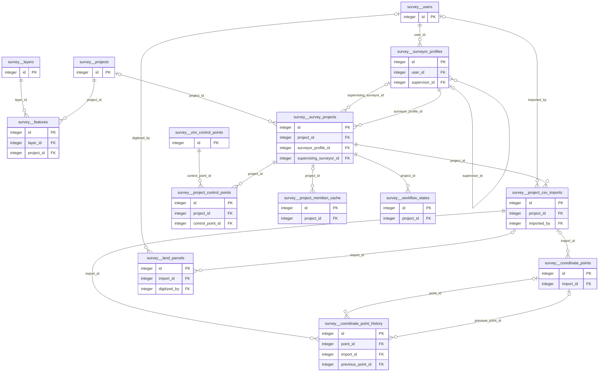

# Physical model: schema `survey`

Generated by `app-backend/scripts/generate-data-model.js` from the live database. Do not edit by hand: regenerate.

16 tables, 4 views. Diagrams show keys only (primary key, foreign keys); the data dictionary below lists every column. References to the hub tables `public.users`, `spatial_planning.permit_application`, `land.parcel`, `public.local_authorities` (created_by, authority_id and the like) are left out of the diagrams so the groups stay readable; they are in the dictionary. A relationship leaving this schema shows the other schema's table by its `schema__table` name.

## Relationships, group 1

Tables: `coordinate_point_history`, `project_csv_imports`, `coordinate_points`, `features`, `layers`, `projects`, `land_parcels`, `users`, `project_control_points`, `zim_control_points`, `survey_projects`, `project_meridian_cache`, `surveyor_profiles`, `workflow_states`.

## Tables with no foreign key to or from anything

Imports, registries and reference lists are often right to stand alone. Each is listed so someone can say so on purpose.

| Table | Rows | Kind | Concept |
|---|---:|---|---|
| `migrations_history` | 0 | system |  |
| `surveyors` | 0 | system |  |

## Data dictionary

### View `area_parcels`

view · tenancy: system · concept: surveyed_parcel (derived)

Backward compatibility view - maps land_parcels to old area_parcels schema

| Column | Type | Null | Default | Key | Comment |
|---|---|:-:|---|---|---|
| `id` | integer | yes |  |  |  |
| `project_id` | integer | yes |  |  |  |
| `designation` | character varying(100) | yes |  |  |  |
| `geometry` | geometry(Polygon,22291) | yes |  |  |  |
| `area_sqm` | numeric | yes |  |  |  |
| `perimeter_m` | numeric | yes |  |  |  |
| `closure_ratio` | text | yes |  |  |  |
| `closure_error` | numeric(15,3) | yes |  |  |  |
| `status` | character varying(20) | yes |  |  |  |
| `digitized_at` | timestamp with time zone | yes |  |  |  |
| `digitized_by` | integer | yes |  |  |  |
| `finalized_at` | timestamp without time zone | yes |  |  |  |
| `metadata` | jsonb | yes |  |  |  |
| `created_at` | timestamp with time zone | yes |  |  |  |
| `updated_at` | timestamp with time zone | yes |  |  |  |

### `coordinate_point_history`

0 rows · tenancy: system

Maintains history of coordinate point changes across imports for audit trail

| Column | Type | Null | Default | Key | Comment |
|---|---|:-:|---|---|---|
| `id` | integer | no | nextval('survey.coordinate_point_history_id_seq'::regclass) | PK |  |
| `point_id` | integer | yes |  | FK → survey.coordinate_points.id |  |
| `import_id` | integer | no |  | FK → survey.project_csv_imports.id |  |
| `previous_point_id` | integer | yes |  | FK → survey.coordinate_points.id |  |
| `action` | character varying(20) | no |  |  |  |
| `point_name` | character varying(50) | yes |  |  |  |
| `coordinates` | jsonb | yes |  |  |  |
| `metadata` | jsonb | yes | '{}'::jsonb |  |  |
| `created_at` | timestamp without time zone | yes | now() |  |  |

### `coordinate_points`

0 rows · tenancy: system · concept: survey_control_point (canonical)

| Column | Type | Null | Default | Key | Comment |
|---|---|:-:|---|---|---|
| `id` | integer | no | nextval('survey.coordinate_points_id_seq'::regclass) | PK |  |
| `project_id` | integer | yes |  |  |  |
| `name` | character varying(50) | no |  |  |  |
| `geom` | geometry(Point,22291) | no |  |  |  |
| `elevation` | numeric | yes |  |  |  |
| `description` | text | yes |  |  |  |
| `survey_date` | date | yes |  |  |  |
| `surveyor` | character varying(255) | yes |  |  |  |
| `created_at` | timestamp with time zone | yes | CURRENT_TIMESTAMP |  |  |
| `updated_at` | timestamp with time zone | yes | CURRENT_TIMESTAMP |  |  |
| `import_id` | integer | yes |  | FK → survey.project_csv_imports.id |  |

### View `coordinate_points_full`

view · tenancy: system · concept: survey_control_point (derived)

| Column | Type | Null | Default | Key | Comment |
|---|---|:-:|---|---|---|
| `id` | integer | yes |  |  |  |
| `project_id` | integer | yes |  |  |  |
| `name` | character varying(50) | yes |  |  |  |
| `geom` | geometry(Point,22291) | yes |  |  |  |
| `elevation` | numeric | yes |  |  |  |
| `description` | text | yes |  |  |  |
| `survey_date` | date | yes |  |  |  |
| `surveyor` | character varying(255) | yes |  |  |  |
| `created_at` | timestamp with time zone | yes |  |  |  |
| `updated_at` | timestamp with time zone | yes |  |  |  |
| `geojson` | jsonb | yes |  |  |  |
| `y` | double precision | yes |  |  |  |
| `x` | double precision | yes |  |  |  |

### `features`

0 rows · tenancy: system · concept: managed_feature (source)

| Column | Type | Null | Default | Key | Comment |
|---|---|:-:|---|---|---|
| `id` | integer | no | nextval('survey.features_id_seq'::regclass) | PK |  |
| `geometry` | jsonb | yes |  |  |  |
| `properties` | jsonb | yes |  |  |  |
| `layer_id` | integer | no |  | FK → survey.layers.id |  |
| `project_id` | integer | no |  | FK → survey.projects.id |  |
| `created_at` | timestamp with time zone | yes | CURRENT_TIMESTAMP |  |  |
| `bbox` | jsonb | yes |  |  |  |
| `updated_at` | timestamp with time zone | yes | CURRENT_TIMESTAMP |  |  |
| `geom` | geometry | yes |  |  |  |
| `name` | character varying(255) | yes |  |  |  |

### `land_parcels`

0 rows · tenancy: system · concept: surveyed_parcel (canonical)

Land parcels with geometries in Cape Lo convention (y=Westing, x=Southing) - updated by migration 063

| Column | Type | Null | Default | Key | Comment |
|---|---|:-:|---|---|---|
| `id` | integer | no | nextval('survey.land_parcels_id_seq1'::regclass) | PK |  |
| `project_id` | integer | yes |  |  |  |
| `stand` | character varying(100) | no |  |  |  |
| `geom` | geometry(Polygon,22291) | no |  |  |  |
| `owner` | character varying(255) | yes |  |  |  |
| `title_deed` | character varying(100) | yes |  |  |  |
| `survey_date` | date | yes |  |  |  |
| `surveyor` | character varying(255) | yes |  |  |  |
| `notes` | text | yes |  |  |  |
| `created_at` | timestamp with time zone | yes | CURRENT_TIMESTAMP |  |  |
| `updated_at` | timestamp with time zone | yes | CURRENT_TIMESTAMP |  | Timestamp of last update (auto-updated by trigger) |
| `area_m2` | numeric | yes | st_area(geom) |  | Calculated area in square meters |
| `area_ha` | numeric | yes | (st_area(geom) / (10000)::double precision) |  |  |
| `perimeter_m` | numeric | yes | st_perimeter(geom) |  |  |
| `area_calculated` | boolean | yes | false |  | Whether area has been calculated using shoelace method |
| `centroid_y` | numeric(15,3) | yes |  |  | Centroid Y coordinate (Westing) in Cape Lo 31 |
| `centroid_x` | numeric(15,3) | yes |  |  | Centroid X coordinate (Southing) in Cape Lo 31 |
| `calculation_data` | jsonb | yes |  |  | Full area calculation results (JSONB) |
| `closure_error_m` | numeric(15,3) | yes |  |  | Closure error in meters from area calculation |
| `import_id` | integer | yes |  | FK → survey.project_csv_imports.id |  |
| `parcel_status` | character varying(20) | yes | 'active'::character varying |  | Status: active, orphaned (no matching points), partial (some points missing), pending_review |
| `status` | character varying(20) | yes | 'draft'::character varying |  | Parcel status: draft (auto-saved), finalized (user confirmed), approved (surveyor approved) |
| `digitized_by` | integer | yes |  | FK → survey.users.id | User ID who digitized this parcel |
| `finalized_at` | timestamp without time zone | yes |  |  | Timestamp when parcel was finalized |
| `metadata` | jsonb | yes | '{}'::jsonb |  | JSONB metadata for land parcel. Expected structure:   {     "vertices": [       {"id": "1463A", "y": 18862.52, "x": 2268555.01, "order": 1},       {"id": "1462A |
| `designation` | character varying(100) | yes |  |  | Parcel designation/stand number (modern naming, alias for stand) |
| `closure_ratio` | character varying(50) | yes |  |  | Closure ratio in format 1:XXXX |

### View `land_parcels_full`

view · tenancy: system · concept: surveyed_parcel (derived)

| Column | Type | Null | Default | Key | Comment |
|---|---|:-:|---|---|---|
| `id` | integer | yes |  |  |  |
| `project_id` | integer | yes |  |  |  |
| `stand` | character varying(100) | yes |  |  |  |
| `geom` | geometry(Polygon,22291) | yes |  |  |  |
| `owner` | character varying(255) | yes |  |  |  |
| `title_deed` | character varying(100) | yes |  |  |  |
| `survey_date` | date | yes |  |  |  |
| `surveyor` | character varying(255) | yes |  |  |  |
| `notes` | text | yes |  |  |  |
| `created_at` | timestamp with time zone | yes |  |  |  |
| `updated_at` | timestamp with time zone | yes |  |  |  |
| `area_m2` | numeric | yes |  |  |  |
| `area_ha` | numeric | yes |  |  |  |
| `perimeter_m` | numeric | yes |  |  |  |
| `centroid` | geometry | yes |  |  |  |
| `geojson` | jsonb | yes |  |  |  |
| `vertex_count` | integer | yes |  |  |  |
| `centroid_y` | double precision | yes |  |  |  |
| `centroid_x` | double precision | yes |  |  |  |

### `layers`

0 rows · tenancy: system

| Column | Type | Null | Default | Key | Comment |
|---|---|:-:|---|---|---|
| `id` | integer | no | nextval('survey.layers_id_seq'::regclass) | PK |  |
| `name` | character varying(255) | no |  |  |  |
| `layer_type` | character varying(50) | yes |  |  |  |
| `geom_type` | character varying(50) | yes |  |  |  |
| `srid` | integer | yes | 4326 |  |  |
| `project_id` | integer | no |  |  |  |
| `created_at` | timestamp with time zone | yes | CURRENT_TIMESTAMP |  |  |
| `updated_at` | timestamp with time zone | yes | CURRENT_TIMESTAMP |  |  |
| `params` | jsonb | yes |  |  |  |

### `migrations_history`

0 rows · tenancy: system

| Column | Type | Null | Default | Key | Comment |
|---|---|:-:|---|---|---|
| `id` | integer | no |  |  |  |
| `migration_name` | character varying(255) | no |  |  |  |
| `applied_at` | timestamp without time zone | yes | CURRENT_TIMESTAMP |  |  |

### `project_control_points`

0 rows · tenancy: system

Control points used to connect survey project to national trig system

| Column | Type | Null | Default | Key | Comment |
|---|---|:-:|---|---|---|
| `id` | integer | no | nextval('survey.project_control_points_id_seq'::regclass) | PK |  |
| `project_id` | integer | no |  | FK → survey.survey_projects.id |  |
| `control_point_id` | integer | no |  | FK → survey.zim_control_points.id |  |
| `point_order` | integer | no | 1 |  | Display order in coordinate list (1, 2, 3...) |
| `created_at` | timestamp without time zone | yes | CURRENT_TIMESTAMP |  |  |

### `project_csv_imports`

0 rows · tenancy: system

Tracks CSV imports for projects to enable smart re-import and merge functionality

| Column | Type | Null | Default | Key | Comment |
|---|---|:-:|---|---|---|
| `id` | integer | no | nextval('survey.project_csv_imports_id_seq'::regclass) | PK |  |
| `project_id` | integer | no |  | FK → survey.survey_projects.id |  |
| `import_date` | timestamp without time zone | yes | now() |  |  |
| `csv_hash` | character varying(64) | no |  |  | SHA256 hash of CSV content to detect duplicate imports |
| `point_count` | integer | no |  |  |  |
| `filename` | character varying(255) | yes |  |  |  |
| `imported_by` | integer | yes |  | FK → survey.users.id |  |
| `coordinate_system` | character varying(50) | yes |  |  |  |
| `metadata` | jsonb | yes | '{}'::jsonb |  |  |
| `has_generated_documents` | boolean | yes | false |  | TRUE if Field Book, Calculations, etc. have been generated from this import |
| `has_land_parcels` | boolean | yes | false |  | TRUE if land parcels have been digitized based on this import |
| `created_at` | timestamp without time zone | yes | now() |  |  |
| `updated_at` | timestamp without time zone | yes | now() |  |  |

### `project_meridian_cache`

0 rows · tenancy: system

Temporary cache of control point selections per meridian during project editing

| Column | Type | Null | Default | Key | Comment |
|---|---|:-:|---|---|---|
| `id` | integer | no | nextval('survey.project_meridian_cache_id_seq'::regclass) | PK |  |
| `project_id` | integer | yes |  | FK → survey.survey_projects.id | Reference to survey project |
| `meridian` | integer | no |  |  | Central meridian (Lo27, Lo29, Lo31, Lo33) |
| `control_point_ids` | integer[] | no | '{}'::integer[] |  | Array of control point IDs selected for this meridian |
| `updated_at` | timestamp without time zone | yes | CURRENT_TIMESTAMP |  | Last update timestamp |

### `projects`

0 rows · tenancy: system

| Column | Type | Null | Default | Key | Comment |
|---|---|:-:|---|---|---|
| `id` | integer | no | nextval('survey.projects_id_seq'::regclass) | PK |  |
| `name` | character varying(255) | no |  |  |  |
| `code` | character varying(50) | yes |  |  |  |
| `description` | text | yes |  |  |  |
| `user_id` | integer | no |  |  |  |
| `created_at` | timestamp with time zone | yes | CURRENT_TIMESTAMP |  |  |

### `survey_projects`

0 rows · tenancy: system

| Column | Type | Null | Default | Key | Comment |
|---|---|:-:|---|---|---|
| `id` | integer | no | nextval('survey.survey_projects_id_seq'::regclass) | PK |  |
| `name` | character varying(255) | no |  |  |  |
| `project_id` | integer | yes |  | FK → survey.projects.id |  |
| `client_name` | character varying(255) | yes |  |  |  |
| `district` | text | yes |  |  |  |
| `survey_type` | character varying(100) | yes |  |  | Survey type (subdivision, mining-lease, state-land, municipal-land, private-land, servitude, replacement, other) - from Project Setup |
| `survey_date` | date | yes |  |  |  |
| `instruments` | text | yes |  |  |  |
| `designation` | text | yes |  |  |  |
| `status` | character varying(50) | yes | 'active'::character varying |  |  |
| `created_at` | timestamp with time zone | yes | CURRENT_TIMESTAMP |  |  |
| `updated_at` | timestamp with time zone | yes | CURRENT_TIMESTAMP |  |  |
| `central_meridian` | integer | yes |  |  | Gauss-Conformal central meridian (Lo27, Lo29, Lo31, Lo33) |
| `working_directory` | text | yes |  |  | Working directory path for project files (input CSV, output PDFs, etc.) |
| `surveyor_profile_id` | integer | no |  | FK → survey.surveyor_profiles.id |  |
| `supervising_surveyor_id` | integer | yes |  | FK → survey.surveyor_profiles.id |  |
| `workflow_state` | jsonb | yes | '{"step_data": {}, "can_finalize": false, "current_step": "import_csv", "finalized_at": null, "completed_steps": [], "generated_documents": {}}'::jsonb |  | Tracks cadastral workflow progress: completed steps, current step, document metadata, and finalization status |
| `last_used` | timestamp with time zone | yes | CURRENT_TIMESTAMP |  | Timestamp of when project was last accessed/selected by user |
| `stand_reference` | character varying(255) | yes |  |  | Stand/Reference number (e.g., STANDS 1-50, STAND 9723, Mining Lease No.44) - from Project Setup |
| `township` | character varying(255) | yes |  |  | Township name (e.g., Shabani Mine Surface Rights A, Gweru Township) - from Project Setup |
| `parent_property` | character varying(500) | yes |  |  |  |

### `surveyor_profiles`

2 rows · tenancy: system

| Column | Type | Null | Default | Key | Comment |
|---|---|:-:|---|---|---|
| `id` | integer | no | nextval('survey.surveyor_profiles_id_seq'::regclass) | PK |  |
| `user_id` | integer | no |  | FK → survey.users.id |  |
| `name` | character varying(255) | no |  |  |  |
| `surveyor_type` | character varying(50) | no |  |  |  |
| `license_number` | character varying(100) | yes |  |  |  |
| `registration_number` | character varying(100) | yes |  |  |  |
| `student_number` | character varying(100) | yes |  |  |  |
| `firm` | character varying(255) | yes |  |  |  |
| `address` | text | yes |  |  |  |
| `phone` | character varying(50) | yes |  |  |  |
| `institution` | character varying(255) | yes |  |  |  |
| `supervisor_id` | integer | yes |  | FK → survey.surveyor_profiles.id |  |
| `qualification_date` | date | yes |  |  |  |
| `specializations` | text[] | yes |  |  |  |
| `created_at` | timestamp with time zone | yes | CURRENT_TIMESTAMP |  |  |
| `updated_at` | timestamp with time zone | yes | CURRENT_TIMESTAMP |  |  |
| `schema_name` | character varying(63) | yes |  |  | PostgreSQL schema name for this surveyor (e.g., surveyor_john_doe) |

### `surveyors`

0 rows · tenancy: system

| Column | Type | Null | Default | Key | Comment |
|---|---|:-:|---|---|---|
| `id` | integer | no | nextval('survey.surveyors_id_seq'::regclass) | PK |  |
| `name` | character varying(255) | no |  |  |  |
| `license_number` | character varying(100) | no |  |  |  |
| `firm` | character varying(255) | yes |  |  |  |
| `address` | text | yes |  |  |  |
| `phone` | character varying(50) | yes |  |  |  |
| `email` | character varying(255) | yes |  |  |  |
| `user_id` | integer | yes |  |  |  |
| `is_active` | boolean | yes | true |  |  |
| `created_at` | timestamp with time zone | yes | CURRENT_TIMESTAMP |  |  |
| `updated_at` | timestamp with time zone | yes | CURRENT_TIMESTAMP |  |  |

### `users`

2 rows · tenancy: system

| Column | Type | Null | Default | Key | Comment |
|---|---|:-:|---|---|---|
| `id` | integer | no | nextval('survey.users_new_id_seq'::regclass) | PK |  |
| `email` | character varying(255) | no |  |  |  |
| `password_hash` | character varying(255) | no |  |  |  |
| `user_type` | character varying(50) | no |  |  |  |
| `is_active` | boolean | yes | true |  |  |
| `last_login` | timestamp with time zone | yes |  |  |  |
| `created_at` | timestamp with time zone | yes | CURRENT_TIMESTAMP |  |  |
| `updated_at` | timestamp with time zone | yes | CURRENT_TIMESTAMP |  |  |

### View `v_import_summary`

view · tenancy: system

| Column | Type | Null | Default | Key | Comment |
|---|---|:-:|---|---|---|
| `id` | integer | yes |  |  |  |
| `project_id` | integer | yes |  |  |  |
| `import_date` | timestamp without time zone | yes |  |  |  |
| `point_count` | integer | yes |  |  |  |
| `filename` | character varying(255) | yes |  |  |  |
| `has_generated_documents` | boolean | yes |  |  |  |
| `has_land_parcels` | boolean | yes |  |  |  |
| `parcel_count` | bigint | yes |  |  |  |
| `active_point_count` | bigint | yes |  |  |  |
| `imported_by_username` | character varying(255) | yes |  |  |  |

### `workflow_states`

0 rows · tenancy: system

Stores cadastral workflow state for each project including imported points, calculations, and step progress

| Column | Type | Null | Default | Key | Comment |
|---|---|:-:|---|---|---|
| `id` | integer | no | nextval('survey.workflow_states_id_seq'::regclass) | PK |  |
| `project_id` | integer | no |  | FK → survey.survey_projects.id | Foreign key to survey_projects table |
| `current_step` | character varying(100) | no |  |  | Current workflow step (e.g., csv-import, field-book, calculations-part1) |
| `step_data` | jsonb | no | '{}'::jsonb |  | JSONB object containing data for each step (points, calculations, documents, etc.) |
| `completed_steps` | text[] | yes | '{}'::text[] |  | Array of completed step names |
| `created_at` | timestamp without time zone | yes | CURRENT_TIMESTAMP |  |  |
| `updated_at` | timestamp without time zone | yes | CURRENT_TIMESTAMP |  |  |

### `zim_control_points`

0 rows · tenancy: system

Zimbabwe national control point database

| Column | Type | Null | Default | Key | Comment |
|---|---|:-:|---|---|---|
| `id` | integer | no | nextval('survey.control_points_id_seq'::regclass) | PK |  |
| `monu_num` | character varying(20) | no |  |  | Monument number (unique identifier) |
| `monu_name` | character varying(100) | yes |  |  | Monument name (can be NULL for TSM records) |
| `type` | character varying(10) | no |  |  | Monument type: PRIM (Primary), SEC (Secondary), TERT (Tertiary), QUART (Quaternary) |
| `comp_sheet` | character varying(20) | yes |  |  | Computation sheet reference |
| `topo` | character varying(20) | yes |  |  | Topographic map reference |
| `gauss_lo` | integer | yes |  |  | Gauss-Conformal longitude zone (27, 29, 31, 33) |
| `y_gauss` | numeric(15,3) | yes |  |  | Y coordinate (Gauss-Conformal, Westing) |
| `x_gauss` | numeric(15,3) | yes |  |  | X coordinate (Gauss-Conformal, Southing) |
| `msl_hgt` | numeric(10,3) | yes |  |  | Mean sea level height (meters) |
| `ped_hgt` | numeric(10,3) | yes |  |  | Pedestal height (meters) |
| `pill_hgt` | numeric(10,3) | yes |  |  | Pillar height (meters) |
| `top_signal` | numeric(10,3) | yes |  |  | Top of signal height (meters) |
| `bot_signal` | numeric(10,3) | yes |  |  | Bottom of signal height (meters) |
| `last_insp` | date | yes |  |  | Last inspection date |
| `deg_sqr` | character varying(10) | yes |  |  | Degree square reference |
| `remark` | text | yes |  |  |  |
| `area_nm` | character varying(100) | yes |  |  | Area name / locality |
| `created_at` | timestamp without time zone | yes | CURRENT_TIMESTAMP |  |  |
| `updated_at` | timestamp without time zone | yes | CURRENT_TIMESTAMP |  |  |
| `created_by` | integer | yes |  |  |  |
| `updated_by` | integer | yes |  |  |  |
| `lat_wgs84` | numeric(10,7) | yes |  |  | Latitude in WGS84 decimal degrees |
| `lng_wgs84` | numeric(10,7) | yes |  |  | Longitude in WGS84 decimal degrees |
