# Executive Officer (Planning): user manual

**Status: DRAFT, 16 November 2026 (with figures and worked examples). For the Executive Officer's and the council's review.**
Use: how to work a development application in the EO Planning console, from the day it is lodged to the day the permit is issued and the appeal window closes. It describes what the software does **today**. Where the council has not yet confirmed a rule, the manual says so. The reasons for each rule are in [the working workflow](../workflows/eo-planning-working-workflow.md) and [the workflow definition](../workflows/eo-planning-workflow.md).

## 1. What this console is for

The Regional, Town and Country Planning Act [Chapter 29:12] gives the council a fixed period to decide each application for a development permit. The EO Planning console helps you do four things:

1. **See what needs you today**, and how many days each application has left.
2. **Check, before you decide, that the council can lawfully decide**: the application has been acknowledged, the committee has resolved, no ministerial direction stops it, and nothing the Act requires is outstanding.
3. **Record the decision and issue the permit**, so that the record is the council's and not on one person's computer.
4. **Keep the record of what was sent to the Department of Spatial Planning and Development and to the Minister**, and what came back.

The console does not decide for you. It refuses a decision the council has not authorised, and it tells you why.

## 2. Signing in and finding your way

Sign in with the account issued by the council's IT administrator. Sessions end after the working day on shared computers, and may end earlier if the server is restarted; sign in again if that happens.

The EO Planner has two panes, chosen at the top of the screen:

| Pane | What it shows | Use it to |
|---|---|---|
| **Command centre** | A map of the district with the applications on it | See where an application is, and open it |
| **Case console** | The working screens, listed in a menu on the left | Do the work: open a case and take it through its steps |

Hold the pointer over either name for a reminder of what it is for.

### The menu

The Case console menu has four groups, in the order you use them.

| Group | Screens | What they are for |
|---|---|---|
| **Your cases** | Dashboard, Applications, Committee, Determination, Permits | The EO's own steps |
| **Prepared for you** | Intake review, Due diligence, Public notice, Circulation | What the clerk and the planner prepare. **Folded away** until you ask for it (*Show what is prepared for you*), and open whenever you are on one of these screens |
| **Registers** | Enforcement, Appeals, Building plans, Referrals & switches | What the council keeps afterwards |
| **Office** | Reports, Development matrix, Reference, Settings | Periodic work and reference |

On a phone or a narrow window the menu becomes a bar at the bottom with five items; the others are under **More**.

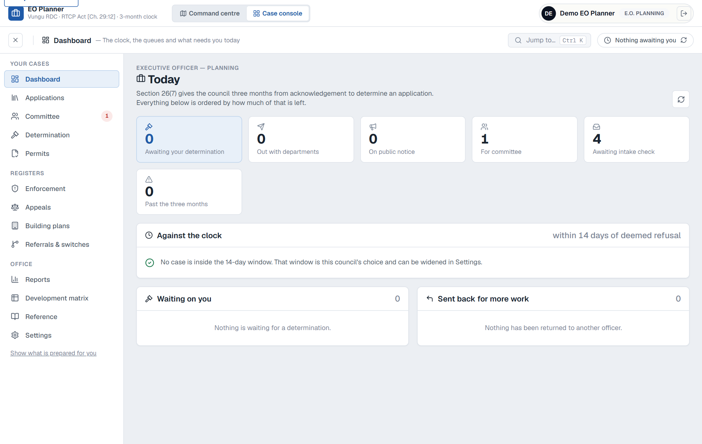

*Screen 1. The EO console. The menu is on the left, in four groups; the open screen is on the right. This is the Today dashboard.*

### Opening a case

Most screens work on one **open case**. Open it by choosing an application in **Applications** or on the **Dashboard**. The **case bar** under the title then shows the application reference, the stand, its status, and the clock. The case stays open as you move between screens, so you choose it once. Close it with the **×** at the right of the case bar.

Under the case bar is the **road of the case**: seven steps (Registered, Acknowledged, Circulated and noticed, Assessed, Committee resolved, Decided, Applicant notified), with the one the case has reached marked, **who normally does the next one** (clerk, planner, committee or EO), the **lane** (section 6), and **the next date to work to**. It is read from the council's record; it is not something you set.

The address of the page contains the open case, so you can copy it and send it to a colleague.

## 3. The life of an application

| Step | What happens | Who | Where in the console |
|---|---|---|---|
| 1. Lodged | The applicant, or the clerk for them, lodges the application and pays the fee. It is **registered**. | Applicant, planning clerk | Applications |
| 2. Acknowledged | The council acknowledges receipt in writing. **This starts the Act's clock.** The Act allows two weeks; the Handbook asks for five working days. | Planning clerk | Intake review |
| 3. Circulated | The planner sends the application to the departments that must comment. Some replies are marked **blocking**. | Planner | Circulation |
| 4. Public notice | Where section 26(3) requires it: an advert at the applicant's expense, notice to abutting owners and a site notice. Objections are open for one month. **Each objection is put to the applicant, who has 14 days to comment.** | Clerk, planner | Public notice |
| 5. Assessed | The planner checks the site, the plan, the zone and the title, and recommends. | Planner | Due diligence |
| 6. Committee | The Planning Committee hears the case and records a **resolution**. | Committee | Committee |
| 7. Decided | **You decide**: approve, approve with conditions, or refuse. | EO | Determination |
| 8. Permit issued | The permit is drafted, numbered and issued, or the refusal is sent with its reasons. | EO | Permits |
| 9. Notified | The applicant is formally notified. **The one-month appeal window runs from that date.** | EO, clerk | Permits |
| 10. After | Inspections, enforcement, appeals. | Inspector, EO | Enforcement, Appeals |

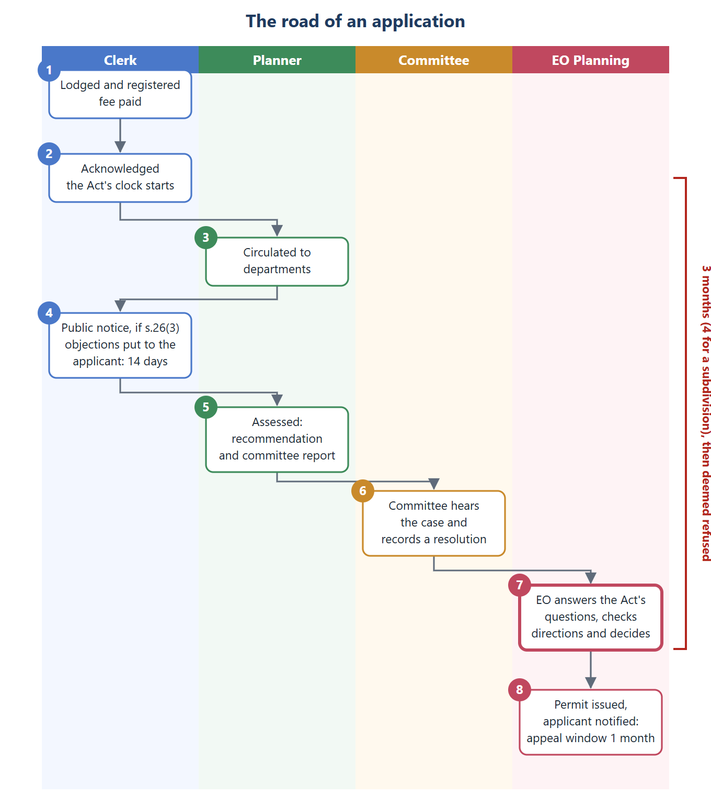

*Figure 1. The road of an application. Each column is a person or body; the numbers are the steps in the table above. The EO's own steps are in the right-hand column; the red bracket is the Act's clock.*

An application cannot skip step 2. A registered application can only be acknowledged or withdrawn; it cannot be moved straight to review.

### Statuses

`pending payment` → `registered` → `acknowledged` → `circulation` → `objection period` → `under review` → `awaiting EO decision` → `approved`, `approved with conditions` or `refused`. A case may also be `deferred`, `withdrawn` or `appealed`. A decided case can only move to `appealed`.

## 4. The clock

The clock is the most important number on the screen. Under section 26(7) of the Act an application not decided within **three months of acknowledgement** is **deemed refused**. For a subdivision or consolidation it is **four months** (section 40(6)).

- **The clock starts at acknowledgement**, not at receipt. The case bar says "Not acknowledged: no clock yet" until the council acknowledges.
- **Extending it** is the applicant's to do, **in writing**. On the Determination screen use *Record the applicant's written extension*. You give the new date and say where the applicant's letter is filed. An extension cannot revive an application that is already deemed refused.
- **After the date, an approval is refused by the system** (`deemed_refused`). A refusal can still be recorded.
- Dates are counted in calendar months, so an application acknowledged on 30 November has until 28 February.

The working workflow sets internal targets inside the Act's date: **ask for an extension one month before the deemed-refusal date**, and **have the committee resolve fifteen days before it** (for a three-month case, two months and two months fifteen days after acknowledgement). The software works them out. They appear under **Clock** in *Before you decide*, and the **next one** is on the road under the case bar. They are reminders; the Act's date is the one the system enforces.

## 5. Determination: deciding a case

Open the case, then choose **Determination**. The screen is a package: the planner's recommendation, the specialist findings, the objections, documents, the map evidence, the audit trail and the proposed conditions. Below them is **Before you decide**, then **EO determination**.

### Before you decide

This panel is the council's checklist. It shows:

| Line | What it tells you | What to do |
|---|---|---|
| **Lane** | Which route the case takes (see section 6) and whether it is open to you | Read the reasons if it says *Closed* |
| **Committee** | The committee's latest resolution, or that none is recorded | A decision must match the resolution |
| **Clock** | The date the case is deemed refused, and any written extension | Record an extension if the applicant agreed one |
| **Ministerial directions** | Whether a direction applies, or the check has not been made | Press *I have checked: none applies* once you have looked at the register |
| **The Act's questions** | Six yes-or-no questions (a State road, an aerodrome, a neighbouring authority, agricultural land if a subdivision, a conflict with a condition of title, a non-conforming or adverse use) | Answer each; press *Save answers*. A "yes" to the first four leads to a referral (below) |
| **Public notice** | Whether notice is required (a special consent, a title conflict, or an adverse or non-conforming use) and whether it is complete | If required and incomplete, *Open Public notice* |
| **Objections** | Whether each has been considered, put to the applicant, and the applicant's 14 days used or answered | *Open Public notice* and take the next step |
| **Copies due** | After a subdivision, a copy of the permit to the Surveyor-General and the Registrar of Deeds; after a title conflict, to the Registrar | Record when each is sent |
| **Referrals** | What has been sent to the Department and to the ministers for this case, and the reply-by date | *Record the referral* where a "yes" is waiting; *Refer to the Department* where section 8 says to |

### Deciding

1. Read the package and the panel.
2. Record the **ministerial-direction check** if the panel asks for it.
3. **Answer the Act's questions** and make the referrals they lead to. An approval waits for every answer. A refusal does not wait for the questions, the referrals, public notice or the objections: the council may refuse a case it cannot approve.
4. Where the plan asks for it, give the reason or acknowledgement shown under **Plan basis**. The Approve buttons stay greyed out until you do.
5. Write the **decision notes**. For a refusal the reasons are required (section 26(6)(b)).
6. Press **Approve**, **Approve with conditions** (add at least one condition first) or **Refuse**.

The system then writes the decision, produces the decision letter, and records **what the decision rested on**: a committee resolution, a delegation, or an administrator's override.

You can also **Return to role** (to the planner, GIS officer, surveyor, environmental officer or building inspector) for more work, or **Request information from applicant**.

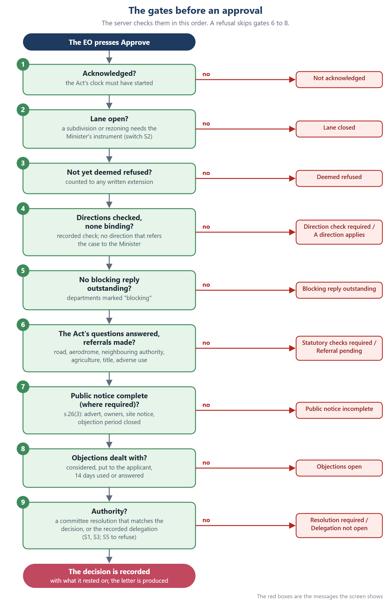

*Figure 2. The gates before an approval. The server checks them in this order and stops at the first one that fails. The red box is the message the screen shows. A refusal skips gates 6 to 8.*

### When the system refuses

The message appears on the screen. This table says what each means and what to do.

| The message says | Because | What to do |
|---|---|---|
| **Not acknowledged** (`not_acknowledged`) | The council has not acknowledged the application, so the Act's clock has not started | Have the clerk acknowledge it in Intake review |
| **Direction check required** | You have not recorded the check against ministerial directions (or one was added since) | Look at *Referrals & switches → Ministerial directions*, then press the check button |
| **A ministerial direction applies** | A direction refers this class of case to the Minister or restricts it | Follow the direction; record what was done; do not decide |
| **Committee resolution required** | No committee resolution is recorded, and the EO's own lane is closed | Table the case at the Committee and record the resolution |
| **Resolution mismatch** | The committee resolved something else (for example, refused) | Record a resolution that matches, or return the case to the committee |
| **Lane closed** | A subdivision, consolidation or rezoning, and the Minister's instrument is not recorded (switch S2) | Do not decide. Ask the CEO to obtain the instrument |
| **Delegation not open** | You tried to decide alone, and the council's delegation is not recorded (switches S1, S3; S5 for a refusal) | Take the case to the committee |
| **Deemed refused** | The date has passed and no written extension is recorded | An approval cannot be recorded. The applicant may appeal |
| **Refusal reasons required** | A refusal with no written reasons | Write the reasons |
| **Blocking reply outstanding** | A department whose reply was marked blocking has not answered | Chase it, or record that the reply was not needed |
| **Statutory checks required** | One or more of the Act's questions is unanswered | Answer them in *Before you decide* |
| **Statutory referral pending** | You answered "yes" (a State road, an aerodrome, a neighbouring authority, agricultural land) and the referral is not sent, or its month has not run | *Record the referral*; the body then has one month to reply, and the case waits for the reply or the month |
| **Public notice incomplete** | Notice is required and the advert, the abutting owners, the site notice or the closing of the objection period is not recorded | Complete it on *Public notice* |
| **Objections open** | An objection is not considered, not put to the applicant, or the applicant's 14 days have not run | Take the next step on *Public notice* |
| **Override reason required** | An administrator override without a written reason | Give the reason |
| **Case changed by another officer** | Someone saved while you were working | Reload and check |

## 6. Lanes: who may decide what

A **lane** is the route a case takes. The console works it out from the type of application and what the council has confirmed.

| Lane | Case | Who decides now |
|---|---|---|
| **L1** | A permit, a change of use, an extension (section 26) | The **Planning Committee** (or the council); the EO signs |
| **L2** | The same, **delegated to the EO** | The EO, **only when the council's delegation is recorded** (see section 7) |
| **L3** | A subdivision or consolidation (Part VI) | The committee, **only if** the Minister's instrument authorising the council is recorded |
| **L7** | Plan work such as a rezoning (Part IV) | The council adopts; the Minister approves master plans |

**Even where the EO's lane is open**, a case leaves it and goes to the committee if it needs special consent, conflicts with the plan, draws objections, or falls within a ministerial direction. The EO never decides against an operative plan.

## 7. Switches: what the council has confirmed in writing

The software starts **safe**. Until the council confirms a power in writing, the EO does not use it. Each confirmation is a **switch**, shown in **Referrals & switches → Switches**. A switch is **off** until the CEO or an administrator turns it on and states the written confirmation behind it: the resolution, instrument or letter, and its date. You can read the switches; you cannot change them.

| Switch | What the council has confirmed | What it opens |
|---|---|---|
| **S1** | A council resolution delegating determination to the EO, by name or designation | The EO deciding alone (L2) |
| **S2** | The Minister's instrument authorising the council for Part IV and/or Part VI (section 10(1)(b)) | Subdivisions and plan work (L3, L7) |
| **S3** | An operative plan or approved scheme covers the land (section 12(3)(b)) | The EO deciding alone on that land |
| **S4** | The committee's own delegation from the council, its membership and quorum | The committee deciding, not only recommending |
| **S5** | A written answer that the EO may refuse under delegation | The EO refusing alone |
| **S6** | The legal adviser's answer on review of a delegated decision | The review step after L2 |
| **S7** | The Department's returns and information requirements | A returns calendar |
| **S8** | The current text of the Act after 1998 | Confirmation of every date and section in this manual |

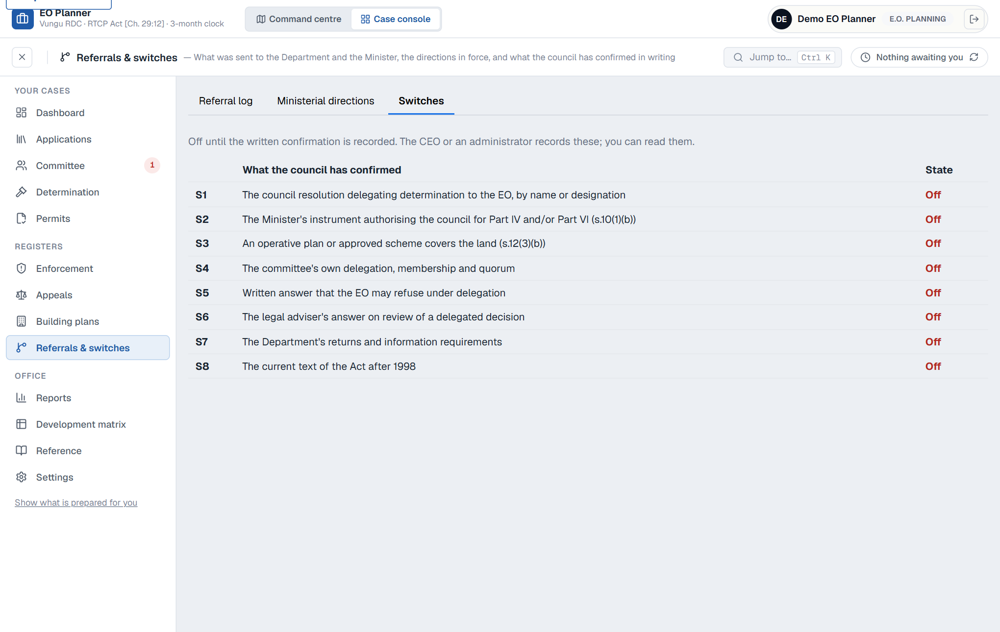

*Screen 2. Referrals & switches, the Switches tab. A switch is off until the CEO or an administrator records the written confirmation behind it.*

**At present all eight are off.** That means every decision goes through the committee. The Vungu plan in the system is not recorded as operative, so S3 stays off for the land it covers.

## 8. Referrals, directions and the Department

### The Department

The Department of Spatial Planning and Development (formerly the Department of Physical Planning) is the Ministry's planning department. Its advice **never stops the clock**. The council asks, sets a reply-by date, and decides on time. The Act makes the Department's involvement a precondition only for preparing a local plan where there is no operative master plan (section 17), for layouts on State land or Communal Land (section 43), and for cancelling a general plan (section 42(3)).

### The referral log

*Referrals & switches → Referral log* holds everything the council has sent to the Department, the Minister or another body, for a case or for a matter. For each one it keeps: when it was sent, who to, why (**mandatory**, **precautionary** or **routine**), the question, the **reply-by date** (21 days unless you set another), the advice that came back, and what the council did with it.

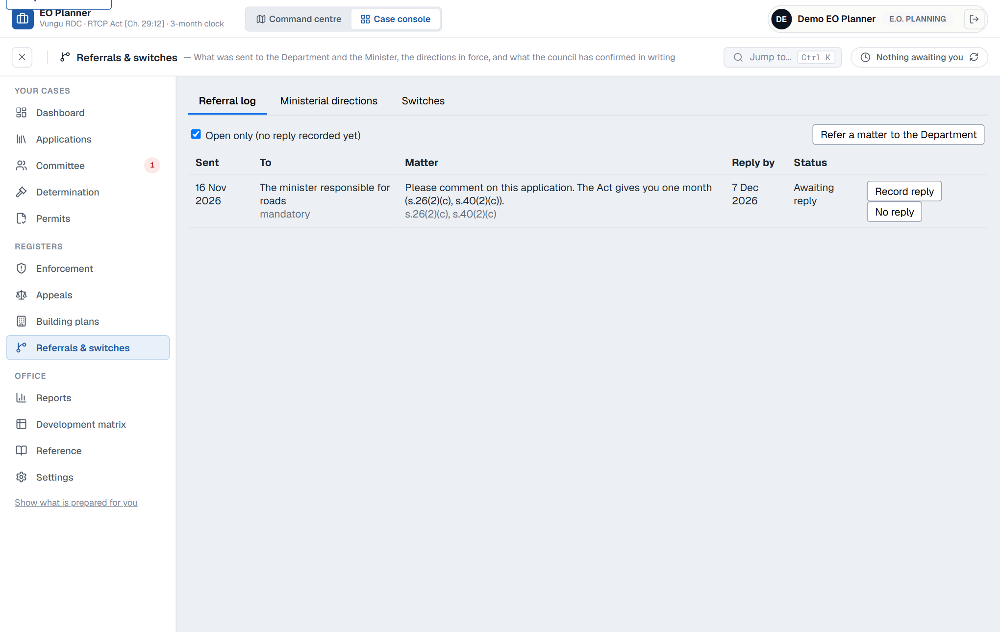

*Screen 3. The referral log. This is the referral made in the second worked example (section 13): to the minister responsible for roads, with its reply-by date.*

- To refer a **case**, use *Refer to the Department* in **Before you decide**.
- To refer a **matter** that is not a case (for example a layout), use *Refer a matter to the Department* in the register.
- If no reply comes by the date, press **No reply**. The log records "no reply"; it does not assume an answer.

When to refer is in section 3 of the working workflow. In short: **always** for a local plan without a master plan, a layout on State or Communal Land, and a general-plan cancellation; **before deciding** for an application with national or regional implications, a first-of-kind special consent, or a disputed reading of the zone.

### Other referrals the Act requires

On acknowledging an application near a State road, an aerodrome, or another authority's area, the Act requires the council to consult the minister or authority concerned (section 26(2)(c)); they may object within **one month**. A subdivision of agricultural land outside a town needs the agriculture minister's recommendation (section 40(5)(a)(i)). The software cannot know where a site is, so **you answer the Act's questions** in *Before you decide*; a "yes" then shows a **Record the referral** button, which puts the referral on the log under the right heading. **An approval waits** until each such referral has been answered, recorded as "no reply", or has had its month.

### Ministerial directions

*Referrals & switches → Ministerial directions* is the register of directions the Minister has given the council (sections 29, 69 and 70). Record each one the day it arrives, say whether it **refers cases to the Minister** or **restricts permits**, and tell the CEO. While such a direction is in force, decisions it covers are **stopped**. End the direction when it no longer applies.

## 9. The Committee

*Committee* is where meetings are set up, applications are tabled, attendance is recorded, and the committee's outcome is recorded.

1. Create the **meeting**, with its **quorum**.
2. **Table** the application on the agenda.
3. Record **attendance** for each member present.
4. Record the **outcome and the resolution** (approved, approved with conditions, refused, deferred or noted). **The system will not record a resolution unless the quorum is present.**
5. The outcome is recorded by the EO, the planning clerk or an administrator. A planner cannot.

The **latest** resolution on a case is the one that counts, and it must **match** your decision. A resolution of *deferred* or *noted* authorises nothing.

## 10. Permits

*Permits* is where the permit is drafted and the register of issued permits is kept.

### Reasons first

When something stands in the way of issuing, the page opens with **This permit cannot be issued yet** and lists each item with what to do. The drafting form is folded away under **Prepare the permit wording in advance**. You may prepare wording early; you cannot issue until the items are done.

The readiness list shows each requirement as **Complete**, **Outstanding**, **Not verified** or **Not applicable**. *What these words mean* under the list explains them on the screen:

| Word | Meaning |
|---|---|
| **Complete** | The council's record shows it is done |
| **Outstanding** | It is not done, and it stands in the way |
| **Not verified** | The record needed to tell could not be read, so nothing is known. It is not evidence that the step was done, and **it stands in the way too**. There is no way to issue past it by typing a justification |
| **Not applicable** | It does not apply to this case (for example, no objections, or public notice not required) |

Rows marked **enforced** are re-checked by the server when you issue. The others are shown to help you.

### The permit's fields

These are saved on the permit, **on the council's record**, and appear on any machine:

- **Permit number**: unique. Two permits cannot carry the same number.
- **Use class** (I to VI), **Permitted development** (in words), **Commencement period** in months, **Annexure 7 officer notes**.
- **Conditions of approval**: at least one, each worded and passing the five tests (necessity, relevance, enforceability, precision, reasonableness).
- **Decision authority** is **not typed**. The system sets it from what the decision rested on.

The statutory clauses of Annexure 7 are produced from the council's rule set and cannot be edited on one permit. Your own notes are printed separately and labelled.

### Issuing, and notifying

Tick the confirmation and press **Issue permit**. **Once issued, the permit's number, class, description, period and notes are locked.** An amendment under section 26(12) is a new application; the system does not yet handle amendments.

After issue, record the **copies due** (section 5, *Before you decide*) and the **notification**: the date the applicant was formally told. **The appeal window of one month (section 38) runs from that date**, so record it the day you do it.

## 11. Appeals, enforcement and the rest

- **Appeals.** An appeal to the Administrative Court must be lodged within one month of notification. The Appeals screen records appeals against decisions and whether each was within the window.
- **Enforcement.** Enforcement and prohibition orders, and compliance. **Demolition by the council on a council notice alone is not to be carried out** until the legal adviser has answered the question on the Constitution and the Rural District Councils Act, section 73.
- **Building plans, Reports, Development matrix, Reference, Settings.** Described on the screens themselves. This edition of the manual does not cover them in detail.

## 12. Who does what

| Person | Does | Cannot |
|---|---|---|
| **Planning clerk** | Registers, checks completeness and fees, acknowledges, gives notice, dispatches | Decide |
| **Planner** | Circulates, assesses, recommends, writes the committee report | Decide; record a committee outcome |
| **EO Planning** | Allocates, records the direction check and extensions, refers to the Department, approves the report, decides where the council's authority allows, issues the permit | Turn on a switch; decide a subdivision without S2; approve after the deemed-refusal date |
| **Committee** | Hears the case and resolves | |
| **CEO (accounting officer)** | Turns switches on, with their written evidence; is told of every ministerial direction | |
| **Administrator** | Turns switches on; may override the committee requirement **with a written reason** | Override the clock, a direction or the acknowledgement |

## 13. Two worked examples

These follow two real cases through the console, screen by screen. The people and the stands are made up for this manual; the screens, the dates and the messages are what the system shows. Today in both is **16 November 2026**.

### Example 1. An unopposed extension, decided by the Planning Committee

**The case.** Mr B. Phiri has applied to add a two-bedroom extension to his house on **Stand 1378**, in the Medium Density Residential zone. The reference is **TPD/VUN/2026/0911**. The clerk registered and acknowledged it today, and the planner has assessed it and written the committee report. It is now the EO's turn.

**What the EO has to achieve.** A lawful decision, on the committee's resolution, with the record complete: nothing for an appeal or an audit to find missing.

**Step 1. Open the case.** Choose it in *Applications* or on the *Dashboard*, then go to **Determination**. The case bar and the road under it (Screen 4) say where the case is: **Assessed**, next **Committee resolved**, owner: the committee. They also say **Lane L2, closed to the EO**, which means the council has not recorded a delegation to the EO, so the EO cannot decide this alone. That is expected, and it is why the committee comes next.

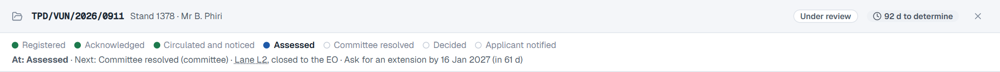

*Screen 4. The case bar and the road. Registered, Acknowledged, Circulated and Assessed are done; the case is at Assessed.*

**Step 2. Read "Before you decide".** The panel (Screen 5) is the checklist. For this case it says:

- **Lane:** L2, closed to the EO, for the two reasons shown (no delegation recorded, no operative plan recorded for the land).
- **Committee:** no resolution yet.
- **Clock:** the case is deemed refused after **16 February 2027**. The extension should be asked for by 16 January, and the committee should resolve by 1 February.
- **Ministerial directions:** *Not checked yet.*
- **The Act's questions:** *5 not answered.*
- **Public notice:** not required. **Objections:** none. **Referrals:** none.

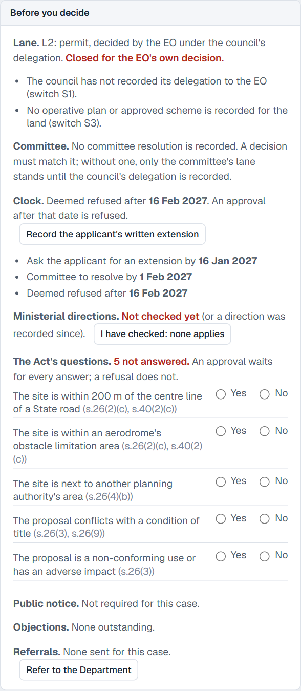

*Screen 5. Before you decide, at the start. Nothing is wrong; this is the list of what has to happen.*

**Step 3. Answer the Act's questions and record the direction check.** The EO knows the site: it is inside the village, away from the Gweru road, the aerodrome and the district boundary, and the extension does not conflict with the title deed or change the use. So the answer to each of the five questions is **No**. Press **Save answers**. Then look at the register of ministerial directions (*Referrals & switches*), find that none applies, and press **I have checked: none applies**. Screen 6 shows the result: *All answered*, and *Checked 16 Nov 2026; none applies*.

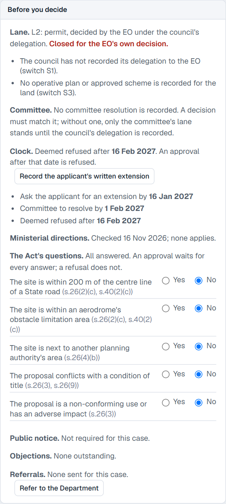

*Screen 6. Before you decide, after the EO has answered the five questions and recorded the direction check.*

**Step 4. The committee decides.** The clerk (or the EO) tables the case on the committee's November sitting in **Committee**. Attendance is recorded for each member present; the system will not record a resolution unless the quorum is there, and Screen 7 shows *Quorate: 2 of 2 required*. The committee approves, and the resolution is recorded against the item: *"Approved: the extension complies with the plan for the zone."* The road moves to **Committee resolved**.

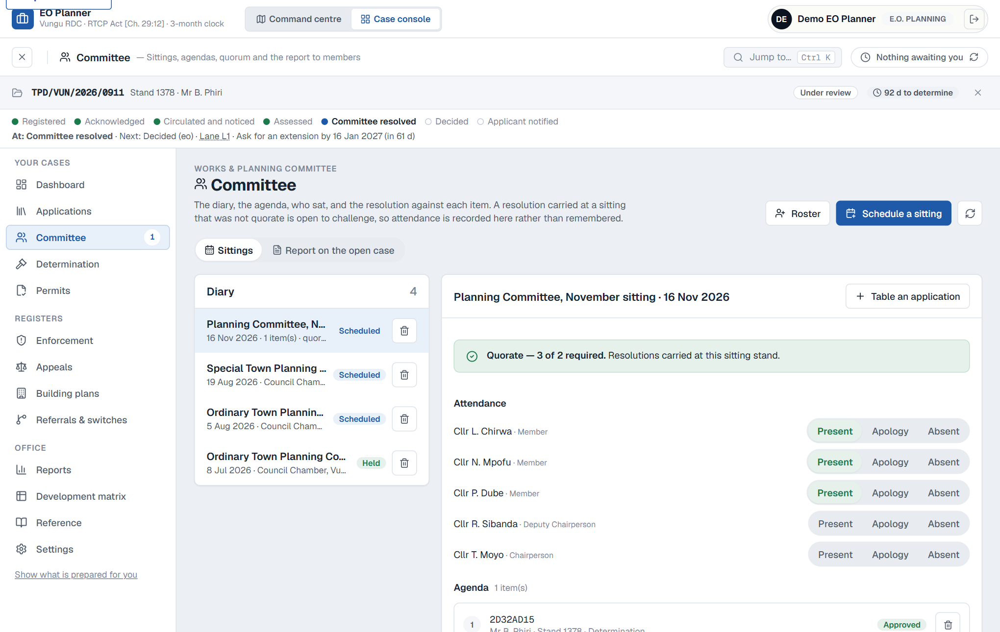

*Screen 7. The Committee screen. Attendance is recorded; the sitting is quorate; the case is tabled on the agenda.*

**Step 5. Decide.** Back on **Determination**, the panel now reads differently (Screen 8): **Lane L1, decided by the committee or council**, and *The committee's latest resolution: approved*. Everything is in place.

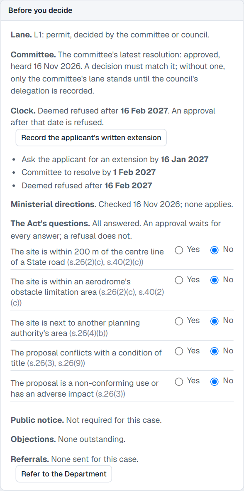

*Screen 8. Before you decide, after the committee has resolved. The lane is now L1: the case is the committee's and the EO signs.*

In **EO determination** (Screen 9) the **Plan basis** line says that a detached dwelling house is a permitted use in this zone, so the plan asks for nothing more. Write the **decision notes**, then press **Approve**. The system checks the nine gates of Figure 2, writes the decision, produces the decision letter, and records that the decision **rested on the committee's resolution**.

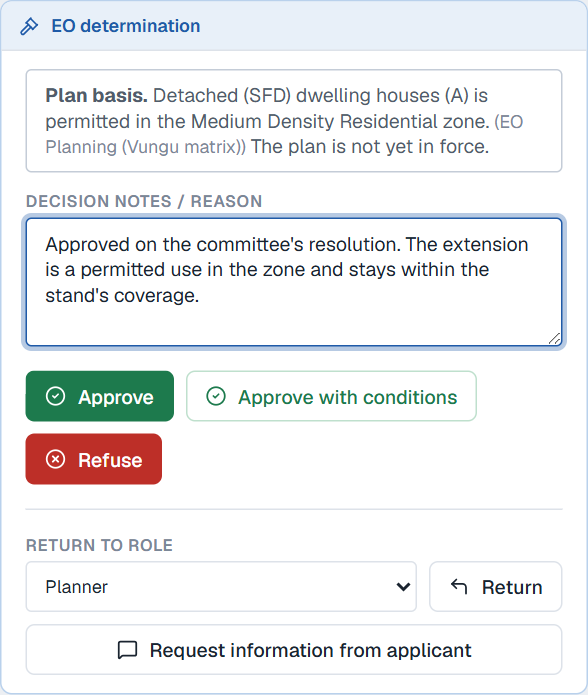

*Screen 9. EO determination. The plan basis is shown, the decision notes are written, and the three actions are below them.*

**Step 6. After the decision.** The case bar now says **Decided** and the road stands at **Decided** (Screen 10). The next step is the EO's own: **Applicant notified**. Open **Permits** (Screen 11). It reads **Issued: this permit is a fixed record**, and the readiness list is now a record of what stood at the time of the decision. Record the **notification** the day the applicant is told: the one-month appeal window (section 38) runs from that date.

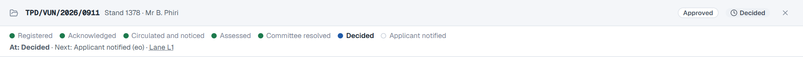

*Screen 10. After the decision. The case is Approved and the road is at Decided; the next step is to notify the applicant.*

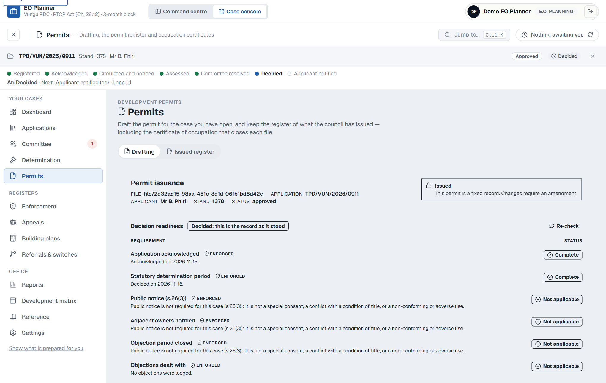

*Screen 11. Permits, after the decision. Public notice reads "Not applicable", because this case did not need it; the permit is locked.*

**What would have stopped the EO.**

| If | The system would have said |
|---|---|
| The clerk had not acknowledged the application | *Not acknowledged*: the Act's clock had not started |
| The committee had not resolved | *Committee resolution required* |
| The committee had refused, and the EO tried to approve | *Resolution mismatch* |
| The EO had not recorded the direction check | *Direction check required* |
| One of the five questions had been left unanswered | *Statutory checks required* |

### Example 2. An objected application beside a State road, ending in a refusal

**The case.** Mrs L. Hlongwane has applied to change part of her house on **Stand 1379** into a tuck shop, beside the Gweru road. The reference is **TPD/VUN/2026/0912**. It was acknowledged **65 days ago**, on 12 September, so the three months are running short.

**What the EO has to achieve.** To make sure the council does not lose the case by default, to do what the Act requires about the road, the objection and the applicant, and to record a refusal that will stand if it is appealed.

**Step 1. Read the dates.** The case bar (Screen 12) says **26 days to determine**, and that the next date to work to is **the committee to resolve by 27 November 2026, in 11 days**. The earlier date, *ask for an extension by 12 November*, has already gone by. The case bar shows only the next date; the **Clock** line in *Before you decide* lists all three (Screen 13). The deemed-refusal date is **12 December 2026**.

*Screen 12. The case bar. 26 days left; the next date to work to is the committee's, in 11 days.*

**Step 2. Answer the Act's questions.** The tuck shop is beside the Gweru road, which is a State road, so the answer to **"The site is within 200 m of the centre line of a State road"** is **Yes**. The other four are No. Press **Save answers**. The panel at once shows what that answer leads to, in red (Screen 13): *Referral to the minister responsible for roads: not sent*, with a button.

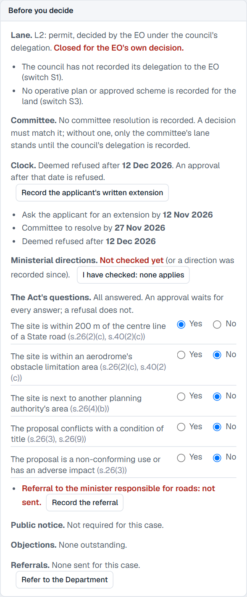

*Screen 13. A "yes" to the State road question. The approval now waits for a referral to the roads minister.*

**Step 3. Record the referral.** Send the referral to the minister responsible for roads in the way the council sends them, then press **Record the referral**. The panel now says *awaiting reply (they have one month, s.26(2)(c))* (Screen 14), and the referral appears in the referral log (Screen 3) with its reply-by date, 7 December. **An approval will wait** until the minister has replied, until "no reply" is recorded, or until the month has gone.

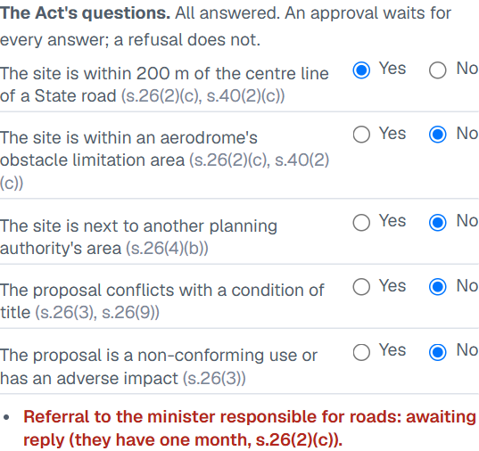

*Screen 14. The referral is recorded and the case is waiting for the reply.*

**Step 4. The objection.** Mr J. Khumalo, a neighbour, hands in an objection at the counter: noise and traffic, and no parking for customers. In **Public notice** the EO considers it and gives reasons: *Sustained: there is no parking, and the stand is on a bend.* The panel now says that **objections are not yet dealt with** (Screen 15): the objection must be **put to the applicant, who has 14 days to comment**.

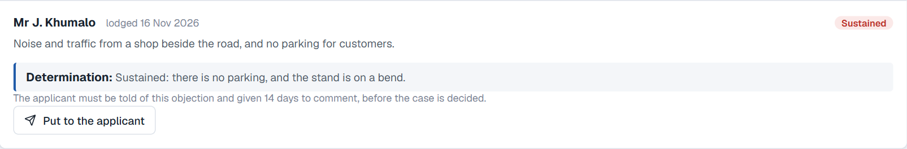

*Screen 15. The objection has been considered. The next step is to put it to the applicant.*

Press **Put to the applicant** and give Mrs Hlongwane the objection. The screen records the date and shows when her 14 days end: **30 November 2026** (Screen 16). When she comments, record what she said; if she does not, the 14 days running out is enough.

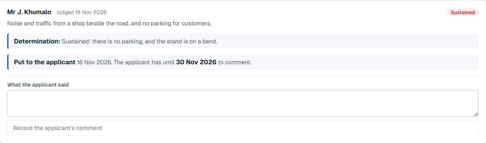

*Screen 16. The objection has been put to the applicant. She has until 30 November to comment.*

**Step 5. Protect the clock.** The minister has a month, the applicant has until 30 November, and the committee has to meet. The Act's date, 12 December, is close. So the council asks Mrs Hlongwane **in writing** for more time, and she agrees to **16 December**. In *Before you decide* press **Record the applicant's written extension**, give the new date and say **where her letter is filed** (Screen 17). Only the applicant can grant an extension, and it needs her letter: the system will not take a date without saying where the letter is. It also cannot revive a case already deemed refused.

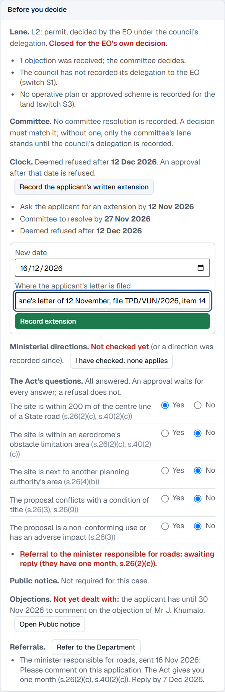

*Screen 17. The extension form. The new date and the place of the applicant's letter are both required.*

**Step 6. The committee refuses, and the EO refuses with reasons.** The committee holds a special sitting and **refuses**: *no parking is provided, the objection is sustained, and the access is on a bend.* Back on **Determination** (Screen 18) the panel shows **Lane L1**, the committee's latest resolution *refused*, and the new deemed-refusal date, **16 December 2026**, "the applicant extended it in writing". It still shows the referral awaiting a reply and the objection's 14 days.

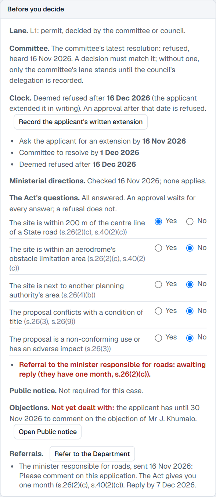

*Screen 18. Before refusing. The referral and the objection are still open on the screen.*

The council **may refuse** a case it cannot approve, so the system does not hold a refusal to the referral, public notice or the objection steps. It does require what a refusal must have: **written reasons** (section 26(6)(b)), and a committee resolution that **matches** (a refusal). The EO writes the reasons, including the right of appeal to the Administrative Court within one month, and presses **Refuse**. The case is **Refused**, and the road stands at **Decided** (Screen 19).

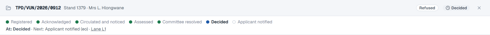

*Screen 19. After the refusal. The next step is to notify Mrs Hlongwane, which starts her one-month appeal window.*

**After the refusal.** Notify the applicant in writing and **record the notification date**: her appeal window starts from it. It is good practice also to tell the roads minister and Mr Khumalo of the outcome, though the workflow does not require it. The referral and the objection stay on the file as they were; nothing is deleted.

**What this example shows.**

- The dates work for you only if you read them: the case bar shows the next one; the panel shows all of them.
- A "yes" to a question about the site is an instruction to **refer**, and the approval then waits for the reply.
- An objection is not finished when it is considered: the applicant must be told, and given 14 days.
- Only the applicant can give more time, and only in writing.
- A refusal is quicker than an approval, but it must have reasons and a matching resolution.

## 14. What the system does not do yet

So that nobody relies on something that is not there:

- It does **not know where a site is**. It cannot tell whether a site is near a State road or an aerodrome, so you answer the Act's questions, and the system acts on the answers.
- It does **not send** the referrals, the copies or the letters. It records that you sent them, and waits for the record.
- A refusal is not held to the Act's questions, referrals, notice or objection steps (section 5). That is deliberate; the council may refuse what it cannot approve.
- The Vungu plan is **not** recorded as operative, so the plan gate shows a "provisional" banner. Treat it as true: nothing is decided "as of right" under that plan.
- The dates and section numbers come from the text of the Act as consolidated with amendments to 1998. Later amendments have not been checked (switch S8).
- Building plans, Reports, the Development matrix, Reference and Settings are described on the screens and not in this edition.

## 15. Glossary

| Term | Meaning |
|---|---|
| **Acknowledgement** | The council's written receipt of an application. It starts the clock |
| **Deemed refusal** | An application not decided in time is treated as refused (section 26(7); 40(6)) |
| **Direction** | An instruction from the Minister to the council (sections 29, 69, 70) |
| **Lane** | The route a case takes, and who may decide it |
| **Resolution** | The committee's recorded decision on a case |
| **Switch** | A written confirmation from the council that opens a power |
| **Statutory question** | One of the six yes-or-no questions the Act makes the council ask of every application |
| **Road of the case** | The seven steps of a case, with the one it has reached |
| **Plan gate** | The check against the plan's decision for the use on the land |
| **Blocking reply** | A department's reply that must arrive before a decision |
| **Annexure 6, 7** | The Handbook's permit core and the notes attached to the permit |
| **DSPD** | The Department of Spatial Planning and Development, formerly the Department of Physical Planning |

## 16. Where to get help

Report a problem to the council's IT administrator, with the application reference and what the screen said. For a question about the law, ask the council's legal adviser. This manual and the documents it links are kept in `docs/manuals` and `docs/workflows`.
