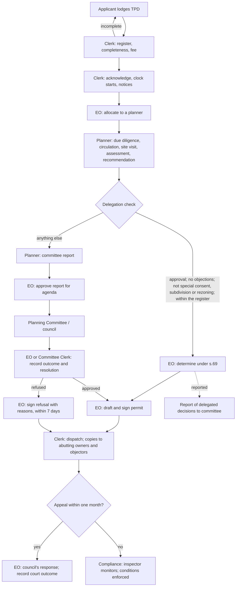

# The Executive Officer (Planning): workflow definition

**Status: DRAFT for the Executive Officer's and the council's review, 15 November 2026. No screen has been changed on the strength of it.**
Purpose: say, before any interface is touched, what the Executive Officer (Planning), "the EO", receives, decides, signs and passes on, to whom, under what authority and by when. Screens then follow this; today the screens follow how the software grew.

## 0. How to read this

Every rule carries its source. Confidence is marked, and an unknown stays a question; nothing is filled in from memory.

| Tag | Meaning |
|---|---|
| **[Act-checked]** | Read against the Act's text by an earlier step of this project (`backend/migrations/170_statutory_periods.sql`, `docs/architecture/03-rural-district-councils-act.md`). The RDC Act text used is consolidated to 2016 with amendments to 2017 (open issue OI-11). |
| **[UC-cited]** | A section number given by the use-case specification, which says it used the consolidated Act. Not independently checked in this review (s.69, s.149, s.153, ss.58, 61, 62 and 63 are in this group). |
| **[HB]** | The Ministry of Local Government and Public Works' *Development Management (Control) Handbook* (2021), kept at `frontend/Development Management_Control Manual 2021.md`. It is written for **urban** authorities (Town Clerk, Works and Planning Committee) and has to be translated for a rural council (OI-04). It is guidance, not law. |
| **[UC]** / **[BR]** | The project's own *Vungu RDC Use Case Specification* (use cases UC-xxx, business rules BR-nn, open issues OI-nn). It is a design document, not an authority. |
| **[code]** | What the software does today, read from the source. |
| **[unverified]** | Believed, not read in the text. Needs the council's legal adviser. |

**Not read at all:** the Ministry's circulars and directions to councils, the Regional, Town and Country Planning Act's own text beyond what migration 170 records, and the Public Finance Management Act. Section 7 lists what to obtain.

## 1. The EO's offices

The EO is not one role. Under the sources the post holds five distinct offices, and the workflow differs for each.

| # | Office | Source | What it means |
|---|---|---|---|
| A | **Delegated decision-maker** | RDC s.69 **[UC-cited]**; BR-10; UC-ASM-08 | May determine the routine cases the council has delegated by resolution, *without* a committee meeting. Only within the delegation register (UC-GOV-06). The register does not yet exist as data (section 6). |
| B | **Head of the Planning unit** | HB 6.2; UC-ASM-01, -07 | Allocates cases to planners; approves a planner's committee report for the agenda; returns work with comments. |
| C | **Officer of the council's process** | RDC s.149 **[UC-cited]**; HB 2.5; UC-ASM-09, -10 | Records the Planning Committee's and council's outcome; drafts, signs and issues permits, refusals and orders "in the manner the council has authorised"; sends the refusal within seven days. |
| D | **The council's respondent** | RTCP s.38; HB 3.6; UC-ASM-12 | Answers appeals to the Administrative Court; records filings and the court's decision. |
| E | **Planner of the district** | HB 6.2 (Forward Planning); UC-ASM-13; RDC s.74 | Local plans, layouts and plan revisions (adoption and the Minister's approval: section 5, step 14); contributes to the ward and district development plans. |

The EO is **also the head of the department whose officer decisions s.69 lets an aggrieved person take to review**. So the EO cannot be the reviewer of their own delegated decision; that review lies above them (question Q4).

## 2. What the EO receives, and from whom

| From | What | Why the EO needs it | Source |
|---|---|---|---|
| **Applicant** | The TPD application, plans, proof of funding and land rights; responses to objections; newspaper proof of notice | The file | HB 2.1, 2.3 |
| **Planning clerk** | A registered, complete, fee-paid case; the acknowledgement date (the statutory clock starts here); proof of publication and of abutting-owner notice; objections received; watched deadlines | The clerk is the gate: the EO sees only complete cases | HB 2.3 steps 1 to 4; UC-DEV-*; migration 170 |
| **Planner** | Due diligence (site history, title and township conditions, survey status, charges, operative plan and layout); the circulation replies; the site visit; the **assessment against the Handbook criteria**; a **recommendation** (approve, approve with conditions, refuse), reasons, and draft conditions tested for necessity, relevance, enforceability, precision and reasonableness | The EO decides, or reports to committee, on this | UC-ASM-02 to -05; HB 2.4, 2.6; BR-12 |
| **Building Inspector** | Building-plan appraisal; stage inspections; reports of illegal development; compliance certificates | Building plans, enforcement, occupation | HB 4.4, 5.8, 5.9; RTCP s.32 |
| **Environmental Health Officer** | Health appraisal of plans and premises | A condition or a bar to approval | HB 5.2, 5.3; Public Health Act |
| **GIS Officer / Surveyor** | The parcel, its zone and overlays, abutting owners, survey results | Evidence for the assessment and the notices | UC-ASM-05; HB 6.2 |
| **Referral bodies** | Comment from EMA, ZINWA, ZESA, District Development Fund, Ministry of Lands, Surveyor-General, Factories Inspectorate, Liquor Licensing Board | A factory or licensed premises cannot be approved without them (BR-17) | UC-ASM-03, -14; Factories and Works Act s.9(4) |
| **Committee Clerk (CEO's office)** | The agenda, the Planning Committee's and council's resolutions and minutes | The EO records or confirms the outcome | UC-GOV-01, -04; RDC s.51 |
| **Chief Executive Officer** | The delegation register; a request to review an officer's decision | The limits of office A | UC-GOV-06, -07; RDC s.69 |
| **Ministry** | Directions on non-delegation; approvals of plans, by-laws and estate development; circulars | Limits and approvals above the council | RDC s.86, s.90 **[Act-checked]** |

## 3. What the EO decides, signs and sends

| Output | To | Authority | Clock | Source |
|---|---|---|---|---|
| Allocation of a case (planner, target date) | Planner | Head of unit | at registration | UC-ASM-01 |
| A **delegated determination** | Applicant, via the clerk | RDC s.69, within the register | within the determination period | UC-ASM-08; BR-10 |
| Approval of a **committee report** for the agenda | Committee Clerk | Head of unit | before the meeting | UC-ASM-07 |
| The recorded **outcome and resolution number** | The register; the applicant | Planning Committee / council | after the meeting | UC-ASM-09; BR-39 |
| A **permit** (Annex 6 format, Annex 7 notes) or a **refusal with reasons** | Applicant; abutting owners and objectors copied | Council's authorisation to sign (OI-07) | refusal within **7 days** of the resolution | HB 2.3 step 7, 2.5; BR-11, BR-13 |
| **Conditions** attached to a permit | Applicant; enforcement | Necessity, relevance, enforceability, precision, reasonableness | with the permit | HB 2.6; BR-12 |
| Extension of the determination period (needs the applicant's written agreement) | Applicant | RTCP s.26(7) **[Act-checked]** | before the date passes | UC-ASM-06; BR-08 |
| Amendment or extension of a permit (minor only) | Permit holder | RTCP s.26(12) | in writing before expiry | UC-ASM-11; BR-15 |
| An **enforcement order**, and where urgent a **prohibition order** | Owner / occupier; then the Registrar of Deeds once operative | RTCP s.32, s.34 | operative **one month** after service unless appealed | BR-22, BR-23; HB 3.3, 3.4 |
| A **conditions-of-title notice** | Owner and occupier | RDC s.73 **[Act-checked]** | 28 days to appeal | BR-25 |
| The **council's response to an appeal** | Administrative Court | RTCP s.38 | appeal within **one month** of notification | UC-ASM-12; BR-13 |
| A **report of delegated decisions** | Planning Committee | Accountability for office A | each meeting | UC-ASM-08 |
| **Planning statistics** | CEO, who sends the Minister's returns | RDC s.153 | on request | UC-GOV-11 |

## 4. What the EO shares with the other Executive Officers and the CEO

| With | EO gives | EO gets | Source |
|---|---|---|---|
| **Chief Executive Officer** | Items for the agenda; delegated-decision reports; planning statistics; appeal outcomes; plan revisions for adoption | The delegation register; review requests; the Minister's directions; the Minister's returns calendar | UC-GOV-06, -07, -11; RDC s.51, s.69, s.153 |
| **Executive Officer (Finance)** | The application and fee facts for each case; permit and enforcement events that create charges | The fee set by council resolution (s.76) and whether it is paid; **outstanding council charges** for due diligence; the rates position behind a clearance certificate | HB 2.2; UC-ASM-02; RDC s.76, s.109 |
| **Engineer** | The application for comment (roads, water, sewerage, access, road reserves); building plans | Technical comment and conditions; approval of building plans signed by "the Director of Works or equivalent" (the Engineer in a rural council: **question Q6**) | HB 2.4.1, 5.7; RDC s.58 |
| **Human Resources, Social Services and Administration** | Health-related applications; premises for licensing | Environmental-health comment and fitness certificates | HB 5.2, 5.3; RDC 2nd Schedule Part IX |
| **Housing and Estates** (proposed post) | Estate layouts and zoning for council land | Allocation and transfer of stands | RDC s.86 |
| **Internal Audit** | The development register, open to inspection | Findings | HB 2.2.1 |

## 5. The workflow

| Step | Who acts | Entry condition | EO's act | Leaves with |
|---|---|---|---|---|
| 1 Receive | Clerk | Application and fee | none | A registered case |
| 2 Acknowledge | Clerk | Complete | none; EO watches the clock | Acknowledgement date, notices out |
| 3 Allocate | **EO** | Acknowledged | Assign planner and target date | A planner's file |
| 4 Assess | Planner | Allocated | none | Recommendation and draft conditions |
| 5 Delegation check | System, on the register | Recommendation recorded | none | Route: EO or committee |
| 6a Delegated decision | **EO** | In the register; approval only; no objections | Approve, or return with comments. **Never refuse under delegation** | Decision citing the delegation relied on |
| 6b Committee report | Planner, **EO approves** | Not delegable | Approve for the agenda or return | Item on the agenda |
| 7 Outcome | Committee, council | Item on the agenda | Record outcome and resolution number | Decision and minutes link |
| 8 Permit or refusal | **EO signs** | Decision final | Draft from the library, sign as authorised | Locked permit with a verification code |
| 9 Dispatch | Clerk | Signed | none | Refusal within 7 days; permit with Annex 7 notes |
| 10 Conditions in force | Inspector | Permit issued | Respond to breaches | Compliance certificate |
| 11 Appeal | **EO** | Appeal recorded | Respond, record the court's decision | Final outcome |
| 12 Enforcement | Inspector investigates, **EO signs** | Illegal development found | Issue enforcement order, and prohibition order where urgent | Order served; Registrar endorsement once operative |
| 13 Report | **EO** | Each meeting; each quarter | Delegated-decision report; statistics to the CEO | Return to the Minister (CEO) |
| 14 Plan revision | EO with GIS Officer | Plan needs change | Draft revision; notice; council adoption; signatures; Minister's approval | Gazetted plan (built: migration 232) |

## 6. Where the system departs from this today **[code]**

Only departures I verified in the source are listed.

1. **There is no delegation register.** The EO's decision route accepts a free-text "delegated authority" reason and then lets the decision through (`POST /permit-applications/:id/eo-decision`, `src/routes/development-management.js`). BR-10 and UC-GOV-06 are not enforced anywhere.
2. **The EO can refuse, and decide special consents and subdivisions, on the same route.** The source says a refusal, a special consent, a subdivision and any application with objections go to the Planning Committee. The code gates *approvals* on the plan (migration 231) but never a refusal.
3. **No record of which delegation a decision relied on**, so none can be traced to "the delegation in force on its date" (UC-GOV-06 postcondition).
4. **The EO's portal carries other roles' stages**: intake review, due diligence, technical circulation and public notification sit in the EO's own menu, though the sources give them to the clerk and the planner.
5. **The operating notes say "Planner recommends, EO decides"** for the committee step (`docs/COUNCIL_OPERATIONS_FLOW.md`), which conflates offices A and C: the committee or council decides, and the EO records and signs.
6. **Deemed outcome**: the system follows the Act (deemed refused after three months from acknowledgement; four for a subdivision), as migration 170 records. The Handbook says deemed approved after four months. See Q1.

Not yet checked, so not claimed: whether a report of delegated decisions is produced, whether allocation records reassignments, and whether permit signing locks the document.

## 7. Decisions needed before any screen changes

| # | Question | Who decides |
|---|---|---|
| **Q1** | **Deemed outcome and acknowledgement period.** Handbook: acknowledge within 5 working days; deemed approved after 4 months. Act as checked: acknowledge within two weeks; deemed *refused* after 3 months (4 for subdivision). The system follows the Act. Confirm against the current text. (OI-01, OI-02) | Council's legal adviser |
| **Q2** | **The delegation.** Which determinations has the council delegated to the EO by resolution under s.69, with what conditions? Is the source's rule (approval only, no objections, not special consent, subdivision or rezoning) the council's? (OI-03) | Council; EO |
| **Q3** | **May the EO ever refuse under delegation?** The source says no. Some councils delegate minor refusals. | Council |
| **Q4** | **Who reviews the EO's own decision** under s.69(4) and (5), since the EO heads the department? The CEO, then the council? Does a review pause the one-month appeal period? (OI-13) | Council's legal adviser |
| **Q5** | **How are permits and orders signed** electronically and by whom, consistently with s.149? (OI-07) | Council's legal adviser |
| **Q6** | **Who signs building plans**: the EO, the Engineer, or both? The Handbook says "the Director of Works or equivalent". | CEO |
| **Q7** | **Rural standards.** Which Handbook standards apply to business centres, growth points, homesteads and farms (minimum stand size, building lines)? (OI-04) | EO |
| **Q8** | **Demolition.** The Handbook says the Constitution requires a Court Order where demolition is not voluntary; the RDC Act's s.73 lets the council demolish after notice. How do the two combine in enforcement? | Council's legal adviser |
| **Q9** | **Ministry's expectations.** What returns, circulars and directions does the Ministry (or the Provincial Planning Officer / Department of Physical Planning) require of the EO beyond the Handbook? | EO; Ministry |
| **Q10** | **Late objections**, **notice distance on farms**, **committee name and membership** (the Handbook says "Works and Planning"). (OI-08, OI-09; RDC s.62) | Committee; EO |

**Documents to obtain:** the council's s.69 delegation resolution; the Ministry's circulars on development management and on returns; the current text of the RTCP Act Parts IV and V and of the RDC Act ss.62, 63 and 69; the council's by-laws.

## 8. What this means for the interface (not yet done)

Principles the screens should follow once the workflow is agreed:
1. **One desk per office.** The EO sees a queue for each of A to E, not one list of everything. Stages that belong to the clerk and the planner leave the EO's menu.
2. **Every screen is a decision or a hand-over** in section 5, and says whose it is, what authority it rests on, and the date it must be done by.
3. **The delegation check is a rule, not a text box.** The route a case takes (EO or committee) is computed from the register and shown with the reason.
4. **A refusal is never delegated** unless the council says so (Q3); the screen cannot offer it.
5. **The clock is always in view**, from acknowledgement, with the deemed outcome the Act gives.
6. **Inputs and outputs are visible**: what arrived from whom, what is waiting on whom.
