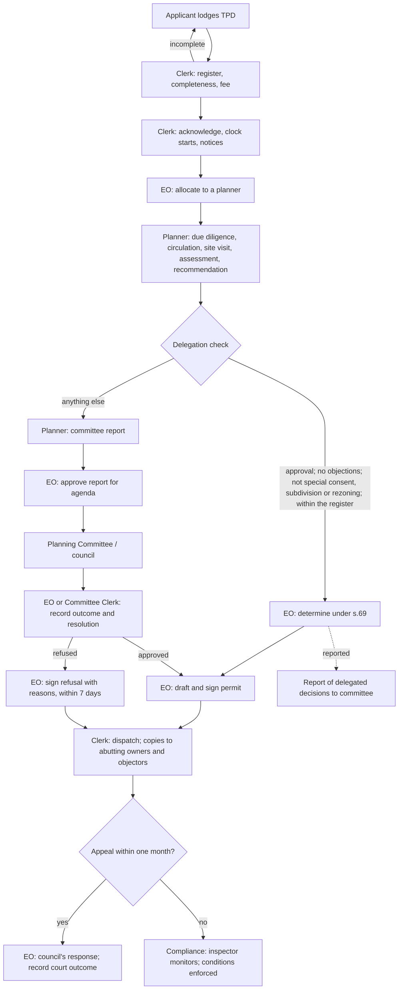

# The Executive Officer (Planning): workflow definition

**Status: DRAFT for the Executive Officer's and the council's review, 15 November 2026. No screen has been changed on the strength of it.**
Purpose: say, before any interface is touched, what the Executive Officer (Planning), "the EO", receives, decides, signs and passes on, to whom, under what authority and by when. Screens then follow this; today the screens follow how the software grew.

## 0. How to read this

Every rule carries its source. Confidence is marked, and an unknown stays a question; nothing is filled in from memory.

| Tag | Meaning |
|---|---|
| **[Act-checked]** | Read against the Act's text by an earlier step of this project (`backend/migrations/170_statutory_periods.sql`, `docs/architecture/03-rural-district-councils-act.md`). The RDC Act text used is consolidated to 2016 with amendments to 2017 (open issue OI-11). |
| **[Act-read]** | Read in this review from the text of the Regional, Town and Country Planning Act [Chapter 29:12] (the FAOLEX consolidation, whose amendments run to 1998). **It is an older consolidation than the 2016 one, and later amendments are not covered**: the ZimLII 2016 text could not be fetched. Section numbers below are from this text. |
| **[UC-cited]** | A section number given by the use-case specification, which says it used the consolidated Act. Not independently checked in this review (s.69, s.149, s.153, ss.58, 61, 62 and 63 are in this group). |
| **[HB]** | The Ministry of Local Government and Public Works' *Development Management (Control) Handbook* (2021), kept at `frontend/Development Management_Control Manual 2021.md`. It is written for **urban** authorities (Town Clerk, Works and Planning Committee) and has to be translated for a rural council (OI-04). It is guidance, not law. |
| **[UC]** / **[BR]** | The project's own *Vungu RDC Use Case Specification* (use cases UC-xxx, business rules BR-nn, open issues OI-nn). It is a design document, not an authority. |
| **[code]** | What the software does today, read from the source. |
| **[unverified]** | Believed, not read in the text. Needs the council's legal adviser. |

**Not read at all:** the Ministry's circulars and directions to councils, the 2016 consolidation of the RTCP Act and anything after 1998, the statutory instrument (if any) authorising Vungu as a local planning authority (section 4A), the RTCP Regulations, and the Public Finance Management Act. Section 7 lists what to obtain.

## 1. The EO's offices

The EO is not one role. Under the sources the post holds five distinct offices, and the workflow differs for each.

| # | Office | Source | What it means |
|---|---|---|---|
| A | **Delegated decision-maker** | **RTCP s.12(3) to (6) [Act-read]**; RDC s.69 [UC-cited]; BR-10; UC-ASM-08 | The council, as local planning authority, may delegate to an employee, **named or by official designation**, the power to determine an application under Part V or VI, **but only** where the land is covered by an **operative** master plan, local plan or approved scheme, the application needs no special consideration or special consent under it, and the decision does not conflict with it. The delegation may carry conditions and may be amended or withdrawn; decisions already taken stay valid. The register does not yet exist as data (section 6). |
| B | **Head of the Planning unit** | HB 6.2; UC-ASM-01, -07 | Allocates cases to planners; approves a planner's committee report for the agenda; returns work with comments. |
| C | **Officer of the council's process** | RDC s.149 **[UC-cited]**; HB 2.5; UC-ASM-09, -10 | Records the Planning Committee's and council's outcome; drafts, signs and issues permits, refusals and orders "in the manner the council has authorised"; sends the refusal within seven days. |
| D | **The council's respondent** | RTCP s.38; HB 3.6; UC-ASM-12 | Answers appeals to the Administrative Court; records filings and the court's decision. |
| E | **Planner of the district** | HB 6.2 (Forward Planning); UC-ASM-13; RDC s.74 | Local plans, layouts and plan revisions (adoption and the Minister's approval: section 5, step 14); contributes to the ward and district development plans. |

A person aggrieved by a delegated decision appeals **in writing to the local planning authority, within one month of being notified**; the authority may amend or rescind it and may suspend it meanwhile (RTCP s.12(6) [Act-read]). So the review of the EO's delegated decision lies with the council, not with the EO or the CEO acting alone. The RDC Act's own review of an officer's decision (s.69(4)(5) [UC-cited]) sits beside this and their relationship is Q4.

## 2. What the EO receives, and from whom

| From | What | Why the EO needs it | Source |
|---|---|---|---|
| **Applicant** | The TPD application, plans, proof of funding and land rights; responses to objections; newspaper proof of notice | The file | HB 2.1, 2.3 |
| **Planning clerk** | A registered, complete, fee-paid case; the acknowledgement date (the statutory clock starts here); proof of publication and of abutting-owner notice; objections received; watched deadlines | The clerk is the gate: the EO sees only complete cases | HB 2.3 steps 1 to 4; UC-DEV-*; migration 170 |
| **Planner** | Due diligence (site history, title and township conditions, survey status, charges, operative plan and layout); the circulation replies; the site visit; the **assessment against the Handbook criteria**; a **recommendation** (approve, approve with conditions, refuse), reasons, and draft conditions tested for necessity, relevance, enforceability, precision and reasonableness | The EO decides, or reports to committee, on this | UC-ASM-02 to -05; HB 2.4, 2.6; BR-12 |
| **Building Inspector** | Building-plan appraisal; stage inspections; reports of illegal development; compliance certificates | Building plans, enforcement, occupation | HB 4.4, 5.8, 5.9; RTCP s.32 |
| **Environmental Health Officer** | Health appraisal of plans and premises | A condition or a bar to approval | HB 5.2, 5.3; Public Health Act |
| **GIS Officer / Surveyor** | The parcel, its zone and overlays, abutting owners, survey results | Evidence for the assessment and the notices | UC-ASM-05; HB 6.2 |
| **Referral bodies** | Comment from EMA, ZINWA, ZESA, District Development Fund, Ministry of Lands, Surveyor-General, Factories Inspectorate, Liquor Licensing Board | A factory or licensed premises cannot be approved without them (BR-17) | UC-ASM-03, -14; Factories and Works Act s.9(4) |
| **Committee Clerk (CEO's office)** | The agenda, the Planning Committee's and council's resolutions and minutes | The EO records or confirms the outcome | UC-GOV-01, -04; RDC s.51 |
| **Chief Executive Officer** | The delegation register; a request to review an officer's decision | The limits of office A | UC-GOV-06, -07; RDC s.69 |
| **Ministry** | Directions on non-delegation; approvals of plans, by-laws and estate development; circulars | Limits and approvals above the council | RDC s.86, s.90 **[Act-checked]** |

## 3. What the EO decides, signs and sends

| Output | To | Authority | Clock | Source |
|---|---|---|---|---|
| Allocation of a case (planner, target date) | Planner | Head of unit | at registration | UC-ASM-01 |
| A **delegated determination** | Applicant, via the clerk | RDC s.69, within the register | within the determination period | UC-ASM-08; BR-10 |
| Approval of a **committee report** for the agenda | Committee Clerk | Head of unit | before the meeting | UC-ASM-07 |
| The recorded **outcome and resolution number** | The register; the applicant | Planning Committee / council | after the meeting | UC-ASM-09; BR-39 |
| A **permit** (Annex 6 format, Annex 7 notes) or a **refusal with reasons** | Applicant; abutting owners and objectors copied | Council's authorisation to sign (OI-07) | refusal within **7 days** of the resolution | HB 2.3 step 7, 2.5; BR-11, BR-13 |
| **Conditions** attached to a permit | Applicant; enforcement | Necessity, relevance, enforceability, precision, reasonableness | with the permit | HB 2.6; BR-12 |
| Extension of the determination period (needs the applicant's written agreement) | Applicant | RTCP s.26(7) **[Act-checked]** | before the date passes | UC-ASM-06; BR-08 |
| Amendment or extension of a permit (minor only) | Permit holder | RTCP s.26(12) | in writing before expiry | UC-ASM-11; BR-15 |
| An **enforcement order**, and where urgent a **prohibition order** | Owner / occupier; then the Registrar of Deeds once operative | RTCP s.32, s.34 | operative **one month** after service unless appealed | BR-22, BR-23; HB 3.3, 3.4 |
| A **conditions-of-title notice** | Owner and occupier | RDC s.73 **[Act-checked]** | 28 days to appeal | BR-25 |
| The **council's response to an appeal** | Administrative Court | RTCP s.38 | appeal within **one month** of notification | UC-ASM-12; BR-13 |
| A **report of delegated decisions** | Planning Committee | Accountability for office A | each meeting | UC-ASM-08 |
| **Planning statistics** | CEO, who sends the Minister's returns | RDC s.153 | on request | UC-GOV-11 |

## 4. What the EO shares with the other Executive Officers and the CEO

| With | EO gives | EO gets | Source |
|---|---|---|---|
| **Chief Executive Officer** | Items for the agenda; delegated-decision reports; planning statistics; appeal outcomes; plan revisions for adoption | The delegation register; review requests; the Minister's directions; the Minister's returns calendar | UC-GOV-06, -07, -11; RDC s.51, s.69, s.153 |
| **Executive Officer (Finance)** | The application and fee facts for each case; permit and enforcement events that create charges | The fee set by council resolution (s.76) and whether it is paid; **outstanding council charges** for due diligence; the rates position behind a clearance certificate | HB 2.2; UC-ASM-02; RDC s.76, s.109 |
| **Engineer** | The application for comment (roads, water, sewerage, access, road reserves); building plans | Technical comment and conditions; approval of building plans signed by "the Director of Works or equivalent" (the Engineer in a rural council: **question Q6**) | HB 2.4.1, 5.7; RDC s.58 |
| **Human Resources, Social Services and Administration** | Health-related applications; premises for licensing | Environmental-health comment and fitness certificates | HB 5.2, 5.3; RDC 2nd Schedule Part IX |
| **Housing and Estates** (proposed post) | Estate layouts and zoning for council land | Allocation and transfer of stands | RDC s.86 |
| **Internal Audit** | The development register, open to inspection | Findings | HB 2.2.1 |

## 4A. The Department of Spatial Planning and Development, and the Minister

**What the Act says of "the Director".** The Act speaks of the *Director of Physical Planning* (s.63, a public office in the Public Service), whose department is the Ministry's planning department; I take the Department of Spatial Planning and Development to be that department under its present name. **The name does not appear in the Act text read; the equivalence is my understanding, to be confirmed (Q11).** Everything below is **[Act-read]** from the 1998-amended consolidation.

| Interaction | What the Act provides | What it means for the EO |
|---|---|---|
| **Is the council a planning authority at all?** | A rural district council is a local planning authority for its area, **but not for Part IV (plans) or Part VI (subdivisions) unless the Minister has authorised it by statutory instrument**, and then only to the extent and on the conditions in that instrument (s.10(1)(b)). | Whether the EO may prepare or approve local plans, or decide subdivisions and consolidations, depends on a document I have not seen. **It decides which of offices B to E exist for Vungu.** Part V permits are not conditioned this way. |
| **Preparing a local plan** | Where there is no operative master plan, a local planning authority shall not prepare a local plan **without first consulting the Director** (s.17(2)(a)(ii)). The Minister may direct it to prepare one (s.17(2)(b)). | The Vungu "as mapped" plan: consultation with the Department is a precondition to record. |
| **Master plans** | The authority submits the draft master plan, the study report and the objections report **to the Minister**, who may return it with directions, hold inquiries, refer objections to the Administrative Court, and approve or reject it by Gazette notice naming the date it becomes operative (s.16). | Adoption chain above the council: the Minister, not the Department, approves. A council cannot delegate adoption or submission to a committee (s.12(1)(ii)). |
| **Local plans** | The authority itself approves a local plan, not sooner than six weeks after objections close (or the date of an inquiry notice), and **only if it conforms generally with the operative regional and master plan** (s.19(3)). It copies any inquiry report to the Minister (s.19(2)). | The EO prepares; council adopts. The Department's part is the consultation above and the Minister's reserve powers. |
| **A permit application (s.26)** | Made to the local planning authority. **On acknowledgement the authority must advise** the Minister responsible for roads, the Minister responsible for aviation, or the neighbouring local planning authority where the development is within 200 m of a State road's centre line, in an aerodrome's obstacle limitation area, or next to another authority's area (s.26(2)(c)); they may object within a month (s.26(4)(b)). The Act gives the **Director no part** in deciding a s.26 permit. | A mandatory referral step, owned by the EO's office, that the specification lists only as optional circulation. |
| **Minister's call-in** | The Minister may, in the public interest and having regard to national or regional implications, direct that an application or a class of applications be **referred to him for determination**, or restrict or regulate permits for a type of development; his decision is final; the authority is consulted if the grant would conflict with an operative plan (s.29). | The EO must check each case against any such direction in force, and a called-in case leaves the council's workflow. |
| **Directions, guides, default** | The Minister may give a local planning authority general or specific directions on procedure and on the information it must submit (s.69(1)); may issue **advisory notes and guides that authorities "shall take into account"** (s.69(2)); may direct it to serve enforcement, prohibition and similar orders and act for it if it does not (s.70(2)); and may take over plan-making it neglects (s.70(1)). | This is the channel through which the Department's guidelines and the Handbook bind the EO, and the source of any returns or information the Ministry requires. It is also a power over the EO's enforcement. |
| **Subdivision of State land or Communal Land** | A proposed layout **shall be referred to the Director, who may not approve it until** the local authority (State land) or the Communal Land minister (Communal Land) has been consulted (s.43). | **Directly relevant to Vungu, which holds Communal and resettlement land**: a layout step with the Department that is outside the council's own approvals. |
| **Cancelling a general plan** | The authority sends the objections and its comments to the Director, who reports to the Minister; the Minister decides (s.42(3)(4)). | Rare, but the route is to the Department. |
| **Entry** | The Director, and anyone acting under his authority, may enter land and buildings to implement the Act, on notice (s.65). | The Department can inspect in the council's area. |
| **Appeals** | To the **Administrative Court** within one month, for a permit decision (including a deemed refusal), an order or a notice (s.38); the Court may suspend the permit or order meanwhile (s.38(4)); for subdivisions s.44. The Minister is not the appeal body. | Confirms the appeal route in the specification. |

**What the Act does not say.** It gives the Department no role in deciding an ordinary s.26 permit, and no statutory right to receive permits, a register or returns; those come from the Minister's directions (s.69), the Handbook, and practice. Whether the Department expects copies of permits, a development register extract or quarterly returns is **not in the text** (Q9, Q12).

**Leads not yet verified.** A search summary of a Kwekwe master plan report says the plan was prepared under terms of reference issued by the Department of Spatial Planning and Development, and mentions a presidential call to establish departments of spatial planning and land management at local authorities. If true it bears on the EO's title, office and reporting line. I have not read the report.

## 5. The workflow

What the Act adds at the steps, beyond the table below **[Act-read]**: at acknowledgement, the **s.26(2)(c) referrals** to the roads and aviation ministries and the neighbouring authority (step 2); **public notice at the applicant's expense** is required when the use needs special consideration or special consent, does not conform to the existing or normally permitted development, could have an adverse or important impact, or conflicts with a registered title condition (s.26(3)); objections are received for **one month** and the applicant must be told and may comment before the decision (s.26(4)); the authority must examine whether the development generates a need for land or for roads, services or utilities and may **condition the permit on the applicant meeting that cost** (s.26(5)), which the Engineer and Finance share; the permit states its purpose and the period for implementing it (s.26(8)); a permit that conflicts with a registered title condition is **copied to the Registrar of Deeds** once the appeal period ends (s.26(9)); a **refusal must be given in writing with reasons** (s.26(6)(b)); and the Minister's directions under s.29 are checked at step 5.

| Step | Who acts | Entry condition | EO's act | Leaves with |
|---|---|---|---|---|
| 1 Receive | Clerk | Application and fee | none | A registered case |
| 2 Acknowledge | Clerk | Complete | none; EO watches the clock | Acknowledgement date, notices out |
| 3 Allocate | **EO** | Acknowledged | Assign planner and target date | A planner's file |
| 4 Assess | Planner | Allocated | none | Recommendation and draft conditions |
| 5 Delegation check | System, on the register | Recommendation recorded | none | Route: EO or committee. **The land must be covered by an operative plan or approved scheme (s.12(3)(b)), the case must need no special consent, and no s.29 direction may apply** |
| 6a Delegated decision | **EO** | In the register; the conditions of s.12(3); the specification adds approval only and no objections | Approve, or return with comments. The Act does not itself bar a delegated refusal; the specification does (Q3) | Decision citing the delegation relied on |
| 6b Committee report | Planner, **EO approves** | Not delegable | Approve for the agenda or return | Item on the agenda |
| 7 Outcome | Committee, council | Item on the agenda | Record outcome and resolution number | Decision and minutes link |
| 8 Permit or refusal | **EO signs** | Decision final | Draft from the library, sign as authorised | Locked permit with a verification code |
| 9 Dispatch | Clerk | Signed | none | Refusal within 7 days; permit with Annex 7 notes |
| 10 Conditions in force | Inspector | Permit issued | Respond to breaches | Compliance certificate |
| 11 Appeal | **EO** | Appeal recorded | Respond, record the court's decision | Final outcome |
| 12 Enforcement | Inspector investigates, **EO signs** | Illegal development found | Issue enforcement order, and prohibition order where urgent | Order served; Registrar endorsement once operative |
| 13 Report | **EO** | Each meeting; each quarter | Delegated-decision report; statistics to the CEO | Return to the Minister (CEO) |
| 14 Plan revision | EO with GIS Officer | Plan needs change | Draft revision; notice; council adoption; signatures; Minister's approval | Gazetted plan (built: migration 232) |

## 6. Where the system departs from this today **[code]**

Only departures I verified in the source are listed.

1. **There is no delegation register.** The EO's decision route accepts a free-text "delegated authority" reason and then lets the decision through (`POST /permit-applications/:id/eo-decision`, `src/routes/development-management.js`). BR-10 and UC-GOV-06 are not enforced anywhere.
2. **The EO can refuse, and decide special consents and subdivisions, on the same route.** The source says a refusal, a special consent, a subdivision and any application with objections go to the Planning Committee. The code gates *approvals* on the plan (migration 231) but never a refusal.
3. **No record of which delegation a decision relied on**, so none can be traced to "the delegation in force on its date" (UC-GOV-06 postcondition).
4. **The EO's portal carries other roles' stages**: intake review, due diligence, technical circulation and public notification sit in the EO's own menu, though the sources give them to the clerk and the planner.
5. **The operating notes say "Planner recommends, EO decides"** for the committee step (`docs/COUNCIL_OPERATIONS_FLOW.md`), which conflates offices A and C: the committee or council decides, and the EO records and signs.
6. **Deemed outcome**: the system follows the Act (deemed refused after three months from acknowledgement; four for a subdivision), as migration 170 records. The Handbook says deemed approved after four months. See Q1.

7. **The delegation conditions in the Act are not applied anywhere.** s.12(3) needs an *operative* plan or approved scheme, no special consent and no conflict with the plan. The Vungu plan in the system is **not in force** (status unknown, not gazetted), and the system's own `plan_governs()` already says so; so on the Act's terms **no delegated decision is lawful on Vungu land until a plan is operative**, yet the decision route accepts a delegated decision regardless.

Not yet checked, so not claimed: whether the s.26(2)(c) referrals (roads, aviation, neighbouring authority) are made or recorded; whether a report of delegated decisions is produced, whether allocation records reassignments, and whether permit signing locks the document.

## 7. Decisions needed before any screen changes

| # | Question | Who decides |
|---|---|---|
| **Q1** | **Deemed outcome and acknowledgement period.** Handbook: acknowledge within 5 working days; deemed approved after 4 months. **The Act text read says acknowledge within two weeks (s.26(2)(a)) and deemed *refused* after three months, extendable only by the applicant in writing (s.26(7)); four months for a subdivision (s.40(6)).** The system follows the Act, and the Handbook's "deemed approved" is at odds with it. Confirm that no amendment after 1998 changed this. (OI-01, OI-02) | Council's legal adviser |
| **Q2** | **The delegation.** Which determinations has the council delegated to the EO by resolution under s.69, with what conditions? Is the source's rule (approval only, no objections, not special consent, subdivision or rezoning) the council's? (OI-03) | Council; EO |
| **Q3** | **May the EO ever refuse under delegation?** The specification says no; **the Act does not bar it** (s.12(3) says "determine"), provided the s.12(3) conditions hold. A council choice, recorded in the delegation. | Council |
| **Q4** | **Review of the EO's delegated decision.** The RTCP Act gives it to the council, in writing within one month, with power to amend, rescind or suspend (s.12(6)). The RDC Act's s.69(4)(5) review by the head of department and then the council also exists. Which applies to a planning decision, and does either pause the one-month appeal to the Administrative Court? (OI-13) | Council's legal adviser |
| **Q5** | **How are permits and orders signed** electronically and by whom, consistently with s.149? (OI-07) | Council's legal adviser |
| **Q6** | **Who signs building plans**: the EO, the Engineer, or both? The Handbook says "the Director of Works or equivalent". | CEO |
| **Q7** | **Rural standards.** Which Handbook standards apply to business centres, growth points, homesteads and farms (minimum stand size, building lines)? (OI-04) | EO |
| **Q8** | **Demolition.** The Handbook says the Constitution requires a Court Order where demolition is not voluntary; the RDC Act's s.73 lets the council demolish after notice. How do the two combine in enforcement? | Council's legal adviser |
| **Q9** | **Ministry's expectations.** What returns, circulars and directions does the Ministry (or the Provincial Planning Officer / Department of Physical Planning) require of the EO beyond the Handbook? | EO; Ministry |
| **Q11** | **The Department.** Is the Department of Spatial Planning and Development the Director of Physical Planning's department of the Act? Who is its contact for Vungu (a provincial planning officer for the Midlands)? Does it hold any role in Vungu beyond sections 17, 42, 43 and 65? | EO; Ministry |
| **Q12** | **What directions and guides bind Vungu?** Has the Minister issued any s.69 directions or advisory notes, any s.29 call-in or restriction, or any requirement for returns, copies of permits or a development register extract? | EO; Ministry |
| **Q13** | **Is Vungu RDC authorised, by statutory instrument under s.10(1)(b), to be a local planning authority for Part IV (plans) and Part VI (subdivisions), and on what conditions?** Without it the council may not prepare or approve plans or decide subdivisions. | Council's legal adviser; Ministry |
| **Q14** | **Layouts on Communal Land and State land** go to the Director under s.43. What does the Department require, and is any such layout pending? | EO |
| **Q15** | **The presidential call for local departments of spatial planning and land management** (a lead, unverified): does it apply to Vungu, and does it change the EO's title, office or reporting line? | CEO; Ministry |
| **Q10** | **Late objections**, **notice distance on farms**, **committee name and membership** (the Handbook says "Works and Planning"). (OI-08, OI-09; RDC s.62) | Committee; EO |

**Documents to obtain:** the council's delegation resolution (RTCP s.12 and RDC s.69); the statutory instrument authorising Vungu as a local planning authority (s.10(1)(b)); any Minister's directions and advisory notes (ss.29, 69); the Ministry's circulars on development management and on returns; the 2016 consolidation of the RTCP Act and the RTCP Regulations; the current text of RDC ss.62, 63 and 69; the council's by-laws.

## 8. What this means for the interface (not yet done)

Principles the screens should follow once the workflow is agreed:
1. **One desk per office.** The EO sees a queue for each of A to E, not one list of everything. Stages that belong to the clerk and the planner leave the EO's menu.
2. **Every screen is a decision or a hand-over** in section 5, and says whose it is, what authority it rests on, and the date it must be done by.
3. **The delegation check is a rule, not a text box.** The route a case takes (EO or committee) is computed from the register and shown with the reason.
4. **A refusal is delegated only if the council says so** (Q3); and **no delegated decision is offered at all** unless the land is under an operative plan, the case needs no special consent, and no ministerial direction applies. The screen shows which of these failed.
5. **The clock is always in view**, from acknowledgement, with the deemed outcome the Act gives.
6. **Inputs and outputs are visible**: what arrived from whom, what is waiting on whom.
