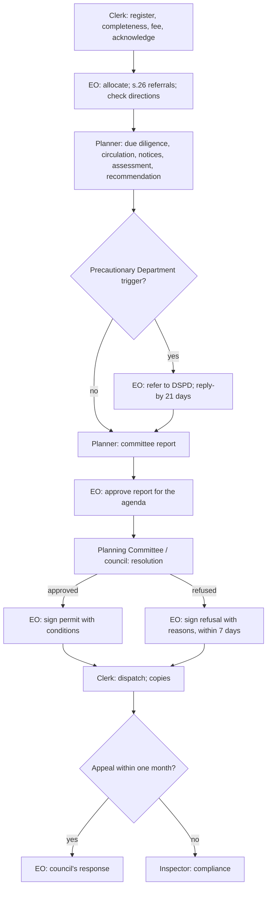

# The Executive Officer (Planning): working workflow (interim)

**Status: DRAFT working procedure, 15 November 2026, for the Executive Officer's and the council's review.**
Use: how the EO Planning works **now**, while the council's questions to the council's legal adviser, the Ministry and the Department of Spatial Planning and Development (DSPD, formerly the Department of Physical Planning, DPP) are unanswered. It rests on [the workflow definition](eo-planning-workflow.md), which holds the sources, the offices and the open questions; read that first for the reasons. This document says what to *do*.

Source tags are those of the definition: **[Act-read]** (RTCP Act text, amendments to 1998 only), **[Act-checked]**, **[HB]** (the Ministry's 2021 Handbook), **[UC]** (the project's use-case specification), **[code]** (the software today). Where a figure is a proposal for the council to set, it says **proposed**.

## 1. Five rules that keep this safe while answers are pending

1. **Safe by default.** Until a power is confirmed in writing, the EO does not use it. Decisions go to the bodies the Act certainly recognises (the Planning Committee and the council), and the EO prepares, records and signs. The EO's *delegated* lane is closed until its switch is on (section 7).
2. **The statutory clock never stops.** Three months from acknowledgement for a permit, four for a subdivision or consolidation, then the application is deemed refused **[Act-read: s.26(7), s.40(6)]**. Every wait in this procedure has a stop-date set inside that.
3. **Advice from the Department never pauses a clock.** The Department's comment is advisory unless the Act makes it a precondition; the Act does so only for local-plan preparation, layouts on Communal and State land, and general-plan cancellation (section 3). The council asks, sets a reply-by date, and decides on time.
4. **Every step leaves an entry** in the development register, which the public may inspect free of charge **[HB 2.2.1]**. If it is not in the register, it did not happen.
5. **Lanes open as confirmations arrive.** Section 7 lists each confirmation, what it opens, and who holds it.

## 2. Which lane a case takes

| Lane | Case | Who decides now | Open when |
|---|---|---|---|
| **L1** | Development permit or preliminary planning permission, a change of use, an extension (s.26) | **Planning Committee, then council where it only recommends**; the EO signs | Open now |
| **L2** | The same, **delegated to the EO** | the EO under the council's delegation | **Closed.** Switch S1 and S3 |
| **L3** | Subdivision or consolidation (Part VI) | the committee/council | Only if the Minister's instrument authorises the council for Part VI (switch S2). Until then the application is received, acknowledged and the applicant told who decides (section 5, step 1) |
| **L4** | Layout for subdividing **State land or Communal Land** (s.43) | the **Department**, after consulting the local authority or the minister responsible for Communal Land | Open now, as a referral |
| **L5** | Unauthorised development: enforcement and prohibition orders; regularisation (ss.27, 32, 34); conditions of title (RDC s.73) | the council acts; the EO signs the orders | Open now; demolition only as section 6 says |
| **L6** | Appeals to the Administrative Court (s.38; s.44) | the EO prepares the council's response | Open now |
| **L7** | Plan work: local plans, layouts, revisions (Part IV) | the council adopts; the Minister approves master plans | Only if switch S2 |
| **L8** | A ministerial direction, a call-in (s.29) or a request for information (s.69) | the Minister | Open now: the EO receives and complies |
| **L9** | A State development that conflicts with an operative plan (s.28) | the Minister concerned, who must consult the Minister and the council | Open now: the EO answers the council's consultation |

## 3. When the EO works with the Department

The Department is the Ministry's planning department; the Act names its head the Director of Physical Planning (s.63). I take DSPD to be the same department under its present name (confirmation is Q11).

| Tier | Trigger | Source | What the EO does |
|---|---|---|---|
| **Mandatory** | The council prepares a **local plan** where there is no operative master plan | RTCP s.17(2)(a)(ii) **[Act-read]** | Consult the Director **before** preparing it (lane L7; only if the council is authorised) |
| **Mandatory** | A proposed **layout on State land or Communal Land** | s.43 **[Act-read]** | Refer it to the Director; the Director may not approve until the local authority (State land) or the Communal Land minister (Communal Land) has been consulted. Track it outside the permit clock |
| **Mandatory** | **Cancelling a general plan** (rare) | s.42(3) **[Act-read]** | Send the objections and the council's comments to the Director, who reports to the Minister |
| **Mandatory** | A **ministerial direction** reaches the council, in any form | ss.29, 69, 70 **[Act-read]** | Record it, tell the CEO the same day, and apply it to every live case (section 5, step 5) |
| **Precautionary** | An application that may have **national or regional implications**: large mining, energy, a State road corridor, regional infrastructure | s.29 (the Minister may call it in) | Tell the Department **before** determination, so that a call-in can be considered. The council cannot call a case in; it can flag it |
| **Precautionary** | A **first-of-kind special consent**, or a case where rural standards are unclear (business centres, growth points, homesteads, farms) | OI-04 | Ask the Department for technical advice on the standard |
| **Precautionary** | A disputed reading of a **zone, or a conflict between a plan and an approved scheme** | s.21 | Ask for the Department's reading before the committee sits |
| **Precautionary** | A **draft plan revision** before council adoption | Part IV | Send the draft for technical review (lane L7) |
| **Routine** | Each quarter | Q9, until the Department says otherwise | **Offer** the development control return the system already compiles, through the provincial planning officer. Do not assume it is required |

**How a referral is made.** The EO signs a one-page referral; the CEO signs anything that is a question of policy or law. It carries: the council's reference, the case or topic, the parcel and zone, the plan status, what the council proposes, the question, the statutory clock position (the stop-date), and the reply-by date (**proposed**: 21 days). The Department's officer is the Midlands provincial planning officer **[to be confirmed, Q11]**.
**What comes back is recorded** in a referral log: date sent, date answered, the advice, and what the council did with it. If nothing comes back by the reply-by date, the EO proceeds and records "no reply".
**The reverse flow.** The Minister may require information from the council (s.69(1)(b)), and the Director may enter land to implement the Act (s.65): the EO is the council's point of contact for both.

## 4. Other referrals the Act requires (not to the Department)

| When | To whom | Source |
|---|---|---|
| **On acknowledging** an application for development within 200 m of a State road's centre line, in an aerodrome's obstacle limitation area, or next to another planning authority's area | The minister responsible for roads, the minister responsible for aviation, or the neighbouring authority, as the case may be; they may object within one month | s.26(2)(c), s.26(4)(b) **[Act-read]** |
| A subdivision **adjacent to a State road or in an obstacle limitation area** | The same ministers | s.40(2)(c) |
| A **subdivision of agricultural property** outside a municipal or town council area | The **minister responsible for agriculture**: the permit may not be granted without that minister's recommendation. **This applies to Vungu's farms.** | s.40(5)(a)(i) |
| A **permit that conflicts with a title condition** | A copy to the Registrar of Deeds once the appeal period ends (not if an appeal is lodged, unless the Court allows it) | s.26(9) |
| A **subdivision permit** | A copy of the permit, any survey-record extension and any amendment to the **Surveyor-General and the Registrar of Deeds**; notice to both **within 7 days** of an appeal and of its result | s.40(7), (8) |
| Internal comment | Building Inspector, Environmental Health, the Engineer (roads, water, sewerage, access), fire, housing, land survey; the Factories Inspectorate for a factory; the Liquor Licensing Board for licensed premises | HB 2.4.1; BR-17; Factories and Works Act s.9(4) |

## 5. The working procedure for lane L1 (a development permit)

Day 0 is receipt; **A** is the acknowledgement date, from which the statutory clock runs. The targets are **proposed** internal targets; the three-month stop is the Act's.

| # | Step | Owner | Target | Output | Department / Minister |
|---|---|---|---|---|---|
| 1 | **Receive and register.** Complete? Fee paid? If incomplete, return with what is missing. For a subdivision, a subdivision of agricultural land or a case needing a power the council may not hold (L3), say so to the applicant in writing | Planning clerk | same day | Register entry | none |
| 2 | **Acknowledge** and start the clock; tell the applicant of the deemed-refusal rule and the right of appeal **[s.26(2)(b)]** | Planning clerk | **5 working days** (the Handbook); the Act allows two weeks | Acknowledgement dated A | none |
| 3 | **Statutory referrals** (roads, aviation, neighbouring authority; section 4) | EO signs | same day as A | Letters out | none |
| 4 | **Allocate** to a planner, with a target date | EO | A + 2 working days | Allocated case | none |
| 5 | **Direction check.** Is any ministerial direction in force that refers this class of case to the Minister or restricts it (s.29)? If so, stop and follow the direction | EO | A + 2 working days | Recorded check | **Minister** |
| 6 | **Due diligence** (site history, title and township conditions, survey status, charges, plan and layout, zone and matrix) | Planner | A + 10 days | Due-diligence record | none |
| 7 | **Circulate** internally and externally, one-stop-shop where useful; reply-by 21 days | Planner | A + 5 working days | Replies on the case | none |
| 8 | **Public notice, at the applicant's expense,** where s.26(3) applies: special consideration or consent, non-conforming or adverse impact, or a title-condition conflict. Proof from the newspaper within 7 days | Clerk issues; applicant publishes | notice by A + 14 days | Notice, proof, objections window **one month** | none |
| 9 | **Objections.** Tell the applicant, who has **14 days** to comment | Clerk | within 3 days of receipt | Objections and responses on file | none |
| 10 | **Site visit and assessment** against the Handbook criteria, the plan's decision for the use and the **plan gate**; a recommendation with reasons and draft conditions tested for necessity, relevance, enforceability, precision and reasonableness; the infrastructure-cost test (s.26(5)) with the Engineer and Finance | Planner | A + 30 days, or **14 days after the objections window closes** | Recommendation | **Precautionary trigger?** (section 3) |
| 11 | **Refer to the Department** if a precautionary trigger applies | EO | before the report is approved | Referral and log entry | **DSPD** |
| 12 | **Committee report** (spatial and economic planning matters only) | Planner, EO approves | EO approves at least 10 days before the meeting | Item on the agenda | none |
| 13 | **Resolution.** The committee decides, or recommends to the council; the EO or the Committee Clerk records the outcome and number | Committee, council | **by A + 2 months 15 days** (about day 75) | Resolution number and minutes link | none |
| 14 | **Extension.** If the date cannot be met, ask the applicant for an extension **in writing**; an extension is the applicant's to grant (s.26(7)) | EO | **request out by A + 2 months** | Written extension, or none | none |
| 15 | **Permit or refusal.** The EO signs the permit (file reference, permit number, applicant, stand, development, conditions, rights and obligations, date, signature) **or a refusal with written reasons** (s.26(6)(b)), with the one-month appeal right | EO | **within 7 days of the resolution** | Signed, locked permit or refusal | none |
| 16 | **Dispatch.** Copies to abutting owners, objectors, and those consulted; the Registrar of Deeds copy where s.26(9) applies | Clerk | same day | Dispatch entry | **Registrar** |
| 17 | **Appeal watch.** One month from notification to the Administrative Court; the Court may suspend the permit or order | EO | until the month ends | Appeal recorded, or none | none |
| 18 | **Compliance.** Inspect against the conditions; certify | Building Inspector | by the permit's stages | Compliance entry | none |

**The EO's hard dates.** A + 2 months: extension asked. A + 2 months 15 days: resolution made. A + 3 months: deemed refusal (4 for L3).

## 6. Enforcement (lane L5)

1. **Regularise first where it can be.** Development carried out without a permit may be regularised by an application under s.26; the permit then takes effect from when the work was done (s.27) **[Act-read]**. The enforcement order may require this.
2. **An enforcement order** states the development, the provisions broken, the action required and the period (RTCP s.32). It is served by two methods where possible, is operative one month after service unless appealed, and once operative is sent to the Registrar of Deeds **[BR-22; HB 3.3]**.
3. **A prohibition order** only where the harm is serious, served with or before the enforcement order becomes operative; the council may owe compensation if the appeal succeeds **[BR-23]**.
4. **Demolition.** The Handbook says the Constitution requires a Court Order where demolition is not voluntary; the RDC Act s.73 lets the council act after notice. **Until the legal adviser answers (Q8), demolition by the council goes to the legal adviser first, and no demolition is carried out on a council notice alone.**
5. **The Minister may direct** the council to serve an order and, if it does not act within the period, act for it (s.70(2)); the EO records any such direction under step 5 of section 5.

## 7. The switches: what opens each lane

| Switch | Confirmation needed, in writing | Opens | Holder |
|---|---|---|---|
| **S1** | The council's resolution delegating determination to the EO **by name or official designation**, with its conditions (RTCP s.12(3), (5); RDC s.69) | Delegated decisions in L2 | CEO; Committee Clerk |
| **S2** | The Minister's **statutory instrument** authorising Vungu as a local planning authority for Part IV and/or Part VI, and what it says (s.10(1)(b)) | L3 and L7 | CEO; legal adviser |
| **S3** | **An operative plan or approved scheme covers the land** (s.12(3)(b)). The Vungu plan in the system is *not* operative (status unknown, no gazette reference), so S3 is **off for land covered only by that plan, which is all the land the system records**; land under another approved scheme (for example a township layout) must be shown to the register before S3 is on for it | Delegated decisions on that land | EO, from the plan register |
| **S4** | The **committee's** own delegation from the council (RTCP s.12(1); RDC ss.62, 63), its membership (at least three) and quorum | The committee deciding, not only recommending | CEO |
| **S5** | A written answer on **whether the EO may refuse under delegation** (Q3) | Delegated refusals | Council |
| **S6** | The legal adviser's answer on **review** of a delegated decision (s.12(6) against RDC s.69(4)(5)) and its effect on the appeal period (Q4) | The review step after L2 | Legal adviser |
| **S7** | The Department's **returns and information requirements** (Q9, Q12) | A returns calendar | EO; Department |
| **S8** | The **current text** of the RTCP Act after 1998 (Q1) | Confirmation of every clock and section above | Legal adviser |

**Even with S1 to S3 on, a case leaves L2 for L1** if it needs special consideration or special consent, conflicts with the plan, draws objections (the specification's rule, BR-10), or is within a ministerial direction. The EO never decides against an operative plan.

## 8. What the EO checks before signing

- [ ] The decision is the committee's or council's resolution (or, once S1 to S3 are on, a recorded delegation that applies), with its number and date.
- [ ] The acknowledgement date is recorded and the deemed-refusal date has not passed.
- [ ] Any direction under s.29 or s.69 has been checked.
- [ ] The s.26(2)(c) referrals were made and any objection from them was put to the applicant.
- [ ] Public notice was given where s.26(3) requires it, with proof, and every objection was put to the applicant.
- [ ] The plan gate is met: the use is permitted, or the departure reason and any acknowledgement are recorded.
- [ ] Every condition passes the five tests (necessity, relevance, enforceability, precision, reasonableness).
- [ ] A refusal gives written reasons and the one-month appeal right.
- [ ] A permit states its purpose and the period for implementation, with a subdivision's survey-record requirement where it applies.
- [ ] Copies are listed: abutting owners, objectors, consultees, and the Registrar or Surveyor-General where the Act requires.

## 9. What the software now enforces, and what is still by hand **[code]**

Migration 239 and the decision route enforce these; the switches are in the EO console under "Referrals & switches".

1. **The delegated lane is closed until switches S1 and S3 are on** (and S5 for a refusal). A typed "delegated authority" is refused. Even with them on, a case with objections, a special consent or an applicable direction goes to the committee.
2. **A decision must match the committee's resolution.** A refused resolution does not authorise an approval.
3. **A subdivision, consolidation or rezoning is not decided** until S2 records the Minister's instrument.
4. **An approval after the deemed-refusal date is refused.** The date counts to the applicant's written extension, recorded with where the letter is filed.
5. **Step 5 is recorded.** The EO records the check against the ministerial directions; a direction that refers cases to the Minister, or restricts them, stops the decision it covers.
6. **A refusal gives its reasons**, and an outstanding blocking reply from the circulation stops a decision.
7. **The referral log** holds each Department referral, with a 21-day reply-by, the advice, what the council did, or "no reply".

8. **The Act's questions** (a State road, an aerodrome, a neighbouring authority, agricultural land in a subdivision, a conflict with a condition of title, a non-conforming or adverse use) are answered before an approval; each "yes" that needs another body has a referral on the log, and the body has replied, been recorded as not replying, or had its **one month** (s.26(2)(c)).
9. **Public notice** is complete where s.26(3) requires it (a special consent, a title conflict, an adverse or non-conforming use). A `departure_reason` no longer stands in for it.
10. **Each objection** is considered, put to the applicant, and the applicant's **14 days** to comment are used or answered (step 9).
11. **The dates to work to** (ask for an extension one month before the deemed-refusal date; the committee to resolve fifteen days before it) are worked out and shown under the case bar and in *Before you decide*.
12. **The copies after a subdivision** (the Surveyor-General and the Registrar of Deeds), and the Registrar's copy after a title conflict, are listed and recorded in the log.

A refusal is held to the written reasons and the lane, not to items 8 to 10: the council may refuse a case it cannot approve.

Still by hand: whether a site is near a State road or an aerodrome (the EO answers); the sending itself of every referral and copy; the Registrar's notice within 7 days of an appeal; and treating the plan gate's "provisional" banner as true, because the Vungu plan is not in force.

## 10. Questions that change this procedure

These are unanswered; the procedure assumes the stated default until they are.

| Question | Default assumed |
|---|---|
| **Q2, Q3** The delegation | None exists; no delegated decisions |
| **Q13** The Minister's authorising instrument | Not seen; L3 and L7 closed |
| **Q4, Q8** Review; demolition | Review goes to the council; no demolition on notice alone |
| **Q1** Later amendments | The clocks are as in the 1998 text |
| **Q9, Q12** What the Department requires | Nothing assumed; returns offered, not promised |
| **Q10** The committee's meeting cycle | **Assumed monthly**; if it is less often, the stop-dates in section 5 move earlier, and a long gap between meetings is itself a reason to seek the council's agreement to a special sitting |
| **Q11** The Department's name and contact | The Midlands provincial planning officer |

## 11. What has been built, and what is next

Built (migration 239): (1) the **delegation register and the lane check**; (3) the **referral log** for the Department, the Minister's directions and the statutory referrals; and the decision gates of section 9. Also built since: (2) the **clock's stop-date reminders** of section 5, worked out by the server and shown with the case; the **Act's questions** that prompt the section 4 referrals; the public-notice and objection gates; and (4) the **EO's desk** regrouped around the steps the EO owns (the planner's and clerk's screens are folded away under "Prepared for you"). Not built: sending the referrals and letters from the software, and knowing where a site is. See [the gap report](eo-planning-code-gap-report.md).
